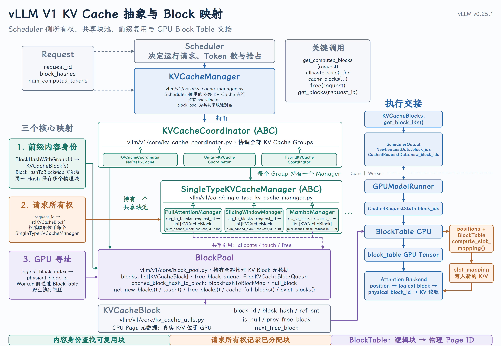
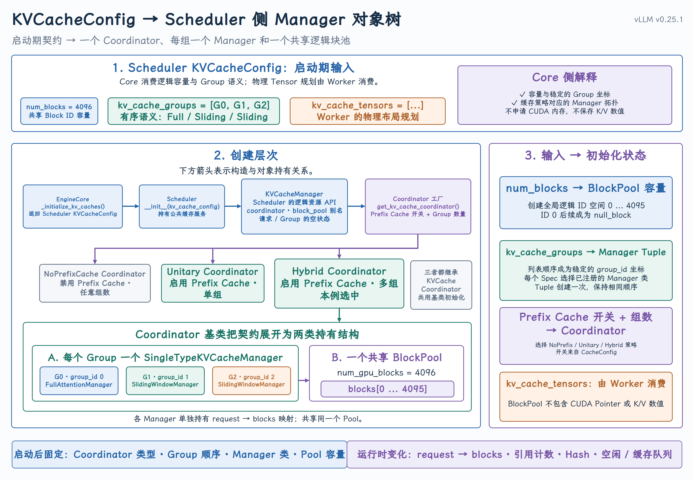

# KVCacheConfig 的 Core 侧消费：逻辑资源初始化

{ width="100%" }

{ width="100%" }

## 课程回顾

上次课程说明了 `KVCacheConfig` 怎样产生：模型层给出 `KVCacheSpec`，Worker 通过显存 Profiling 给出容量，vLLM 再完成 Group 划分、Worker 投影和 Block 数量计算。

```text
KVCacheSpec + available_memory
→ global KV cache groups
→ per-Worker projection
→ list[KVCacheConfig]
```

KVCacheConfig 仍然是一份启动期配置。它描述了“有多少块、分成几组、Worker 怎样规划 Tensor”，但它还不是 Scheduler 能够直接调用的逻辑资源系统。

## 一、先分清继承关系与组合关系

首图中最需要先看的不是函数，而是两种不同关系。

### 1. 继承：同一抽象的不同策略实现

```text
KVCacheCoordinator (ABC)
├── KVCacheCoordinatorNoPrefixCache
├── UnitaryKVCacheCoordinator
└── HybridKVCacheCoordinator
```

它们都是 Coordinator，但对 Prefix Cache 和多 Group 的协调策略不同。工厂函数[`get_kv_cache_coordinator()`](https://github.com/vllm-project/vllm/blob/v0.25.1/vllm/v1/core/kv_cache_coordinator.py#L782-L834) 根据配置选择其中一种：

```text
Prefix Cache disabled → KVCacheCoordinatorNoPrefixCache
Prefix Cache enabled + 1 group → UnitaryKVCacheCoordinator
Prefix Cache enabled + multiple groups → HybridKVCacheCoordinator
```

另一组继承关系是：

```text
SingleTypeKVCacheManager (ABC)
├── FullAttentionManager
├── SlidingWindowManager
├── MambaManager
└── other registered managers
```

每个 Manager 处理一种 `KVCacheSpec` 对应的缓存语义。具体类由[`get_manager_for_kv_cache_spec()`](https://github.com/vllm-project/vllm/blob/v0.25.1/vllm/v1/core/single_type_kv_cache_manager.py#L1455-L1496) 通过 `KVCacheSpecRegistry` 选出。

### 2. 组合：运行时真正存在的对象所有权

```text
Scheduler
└── owns KVCacheManager
    └── owns one KVCacheCoordinator
        ├── owns one shared BlockPool
        └── owns one SingleTypeKVCacheManager per KV cache group
```

这不是继承链。`KVCacheManager` 不是 Coordinator 的父类，Coordinator 也不是 [`BlockPool`](https://github.com/vllm-project/vllm/blob/v0.25.1/vllm/v1/core/block_pool.py#L144-L197) 的父类。它们是一层层的对象组合和所有权关系。

这套设计的目的是把四类问题分开：

| 对象 | 回答的问题 |
| --- | --- |
| `KVCacheManager` | Scheduler 应该通过什么统一接口管理 KV Cache？ |
| `KVCacheCoordinator` | 多个 Group 的结果怎样协调和对齐？ |
| `SingleTypeKVCacheManager` | 某一组缓存遵守什么分配与命中语义？ |
| `BlockPool` | 全局 Block 元数据、空闲队列与 Hash 索引放在哪里？ |
| [`KVCacheBlock`](https://github.com/vllm-project/vllm/blob/v0.25.1/vllm/v1/core/kv_cache_utils.py#L117-L176) | 一个 `block_id` 在 CPU 侧需要记录哪些状态？ |

## 二、KVCacheManager：Scheduler 看到的唯一入口

Scheduler 不直接调用 `BlockPool`，也不根据 Attention 类型自己选择 Group Manager。它只面向 `KVCacheManager` 的统一接口。

主要运行时接口包括：

- [`get_computed_blocks()`](https://github.com/vllm-project/vllm/blob/v0.25.1/vllm/v1/core/kv_cache_manager.py#L206-L246)：查询 Prefix Cache 命中；

- [`allocate_slots()`](https://github.com/vllm-project/vllm/blob/v0.25.1/vllm/v1/core/kv_cache_manager.py#L248-L464)：为本轮 Token 准备逻辑 Block；

- [`free()`](https://github.com/vllm-project/vllm/blob/v0.25.1/vllm/v1/core/kv_cache_manager.py#L466-L474)：释放请求所持有的 Block；

- [`get_blocks()`](https://github.com/vllm-project/vllm/blob/v0.25.1/vllm/v1/core/kv_cache_manager.py#L592-L594)：取得按 Group 组织的 Block；

- [`cache_blocks()`](https://github.com/vllm-project/vllm/blob/v0.25.1/vllm/v1/core/kv_cache_manager.py#L620-L629)：提交可复用的已计算 Block。

本课不展开这些算法，只要先建立一个边界：

Scheduler 做调度决定；`KVCacheManager` 把这些决定翻译成缓存查询、容量检查和块所有权操作。

[`KVCacheManager.__init__()`](https://github.com/vllm-project/vllm/blob/v0.25.1/vllm/v1/core/kv_cache_manager.py#L114-L184) 中影响整个对象体系的成员是：

| 成员 | 作用 |
| --- | --- |
| `coordinator` | 屏蔽单 Group、多 Group 与 Prefix Cache 策略差异 |
| `num_kv_cache_groups` | 固定输入输出中的 Group 维度 |
| `block_pool` | `coordinator.block_pool` 的别名，便于直接查询容量 |
| `kv_cache_config` | 保留启动期资源契约 |
| `watermark_blocks` | 为新请求准入保留的 Block 余量 |
| `empty_kv_cache_blocks` | 预构造的空结果，其 Group 维度与配置一致 |

## 三、Coordinator：多 Group 之间的协调层

Coordinator 的重点不是“再包一层”，而是把 Scheduler 的一次缓存操作展开到所有 Group，再把结果组合回去。

例如它的 `allocate_new_blocks()` 会遍历 `single_type_managers`：

```text
return tuple(
    manager.allocate_new_blocks(...)
    for manager in self.single_type_managers
)
```

因此返回值不是一条混合的 Block 列表，而是与 Group 顺序对齐的结果：

```text
group 0 → [KVCacheBlock, ...]
group 1 → [KVCacheBlock, ...]
group 2 → [KVCacheBlock, ...]
```

关键成员位于[`KVCacheCoordinator.__init__()`](https://github.com/vllm-project/vllm/blob/v0.25.1/vllm/v1/core/kv_cache_coordinator.py#L66-L120)：

| 成员 | 作用 |
| --- | --- |
| `kv_cache_config` | 保留 Group 顺序与 Spec |
| `scheduler_block_size` | Scheduler 对多 Group 统一使用的 Token 调度粒度 |
| `block_pool` | 所有 Group Manager 共享的唯一块池 |
| `single_type_managers` | 与 `kv_cache_groups` 等长、同序的 Manager Tuple |
| `eagle_group_ids` | 需要特殊处理 EAGLE/MTP Lookahead Block 的 Group |

## 四、SingleTypeKVCacheManager：一个 Group 的语义与所有权

`SingleTypeKVCacheManager` 只处理一个 KV Cache Group。它把该 Group 的 `KVCacheSpec` 解释成具体的块数量计算、跳过策略和 Prefix Cache 命中规则。

它的核心成员可以在[`SingleTypeKVCacheManager.__init__()`](https://github.com/vllm-project/vllm/blob/v0.25.1/vllm/v1/core/single_type_kv_cache_manager.py#L33-L96) 中看到：

| 成员 | 作用 |
| --- | --- |
| `kv_cache_spec` | 该 Group 的缓存语义 |
| `block_size` | 该 Manager 实际分配时一个 Block 对应的 Token 数 |
| `kv_cache_group_id` | 该 Manager 在全局 Group Tuple 中的稳定坐标 |
| `block_pool` | 指向 Coordinator 创建的共享 BlockPool |
| [`req_to_blocks`](https://github.com/vllm-project/vllm/blob/v0.25.1/vllm/v1/core/single_type_kv_cache_manager.py#L81) | `request_id → list[KVCacheBlock]` 的请求所有权映射 |
| `num_cached_block` | 运行中请求已命中的缓存 Block 数 |

注意：每个 Group Manager 都有自己的 `req_to_blocks`，但它们的 `block_pool` 成员指向同一个 `BlockPool` 对象。

```text
separate request mappings
+ one shared physical-ID metadata pool
```

## 五、BlockPool 与 KVCacheBlock：全局编号和 CPU 元数据

`BlockPool` 拥有所有 `KVCacheBlock` 元数据，并集中管理空闲、缓存与淘汰状态。核心成员是：

| 成员 | 作用 |
| --- | --- |
| `blocks` | 按 `block_id` 索引的固定元数据数组 |
| `free_block_queue` | 空闲 Block 与淘汰顺序 |
| [`cached_block_hash_to_block`](https://github.com/vllm-project/vllm/blob/v0.25.1/vllm/v1/core/block_pool.py#L185) | Prefix Hash 到可复用 Block 的索引 |
| `null_block` | `block_id=0` 的特殊占位 Block |

`KVCacheBlock` 只是 CPU 侧元数据：

```text
block_id
ref_cnt
block_hash
is_null
prev_free_block / next_free_block
```

它不包含 K Tensor、V Tensor 或 CUDA Pointer。因此不能说“`BlockPool` 分配 GPU 显存”。

`BlockPool` 建立逻辑 `block_id` 及其生命周期元数据；Worker 在对应 Page 中保存真实 K/V 数值。

## 六、三个核心映射如何连起整个系统

首图左侧给出了三个不能混在一起的映射。

### 1. 内容身份：`block_hash + group_id → KVCacheBlock`

cached_block_hash_to_block 它回答：“某个 Group 中，这段 Token 的 KV 是否已经在缓存里？”

Hash 需要带 Group ID，因为相同 Token 前缀在不同缓存 Group 中对应不同物理 Page。

### 2. 请求所有权：`request_id → list[KVCacheBlock]`

req_to_blocks 它回答：“这个请求在当前 Group 拥有哪些 Block？”

权威映射位于每个 `SingleTypeKVCacheManager.req_to_blocks`。多 Group 模型中，同一请求会在多个 Manager 中各有一份列表。

### 3. GPU 寻址：`logical_block_index → physical_block_id`

它回答：“请求的第 `i` 个逻辑 Block，实际对应哪个 GPU Page ID？”

这份映射会在 Worker 侧变成 `BlockTable`，Attention Backend 用它读取历史 K/V。它不是 `KVCacheManager` 中的第三个 Python Dict，而是从 Core 分配结果派生的 Worker 执行视图。

到这里，类层次、对象所有权和关键成员已经建立。下面才开始回答本课的第二个问题：

`KVCacheConfig` 究竟怎样把这些对象创建并连接起来？

## 七、KVCacheConfig 如何初始化 Manager 对象树

### 1. 多份 Worker 配置先收敛成 Scheduler 视图

入口是[`EngineCore._initialize_kv_caches()`](https://github.com/vllm-project/vllm/blob/v0.25.1/vllm/v1/engine/core.py#L240-L348)：

```text
kv_cache_configs = get_kv_cache_configs(...)

scheduler_kv_cache_config = generate_scheduler_kv_cache_config(
    kv_cache_configs
)

self.model_executor.initialize_from_config(kv_cache_configs)
return scheduler_kv_cache_config
```

这里分出两条消费路径：

| 配置形态 | 消费者 | 关心的视图 |
| --- | --- | --- |
| `list[KVCacheConfig]` | Model Executor / Workers | 每个 Rank 的层、Tensor 与物理存储 |
| `scheduler_kv_cache_config` | Scheduler | 全局 Group 坐标和统一 `block_id` 容量 |

[`generate_scheduler_kv_cache_config()`](https://github.com/vllm-project/vllm/blob/v0.25.1/vllm/v1/core/kv_cache_utils.py#L1766-L1785) 会确认所有 Worker 的 `num_blocks` 一致，再将 Worker 视图收敛成 Scheduler 需要的 Group 语义。

它不是把所有 Worker Tensor 合并成一个 Tensor，而是：

从多份物理规划中提取一份集中式 Scheduler 可以使用的逻辑资源契约。

### 2. EngineCore 用配置创建 Scheduler

[`EngineCore.__init__()`](https://github.com/vllm-project/vllm/blob/v0.25.1/vllm/v1/engine/core.py#L132-L158) 先解析 Scheduler 与 Hash 使用的块粒度，再传入配置：

```python
scheduler_block_size, hash_block_size = resolve_kv_cache_block_sizes(
    kv_cache_config,
    vllm_config,
)

self.scheduler = Scheduler(
    kv_cache_config=kv_cache_config,
    block_size=scheduler_block_size,
    hash_block_size=hash_block_size,
    ...
)
```

### 3. Scheduler 创建顶层 KVCacheManager

Scheduler 保存 `kv_cache_config`，然后在[`Scheduler.__init__()`](https://github.com/vllm-project/vllm/blob/v0.25.1/vllm/v1/core/sched/scheduler.py#L259-L280) 中创建 `KVCacheManager`：

```python
self.kv_cache_manager = KVCacheManager(
    kv_cache_config=kv_cache_config,
    enable_caching=self.cache_config.enable_prefix_caching,
    scheduler_block_size=self.block_size,
    hash_block_size=hash_block_size,
    ...
)
```

这里需要注意：Coordinator 的类型不只取决于 `KVCacheConfig`。`enable_prefix_caching` 来自 `CacheConfig`，它与 `kv_cache_groups` 的数量共同决定 Coordinator 子类。

### 4. KVCacheManager 创建 Coordinator

[`KVCacheManager.__init__()`](https://github.com/vllm-project/vllm/blob/v0.25.1/vllm/v1/core/kv_cache_manager.py#L147-L184) 将配置继续交给 Coordinator 工厂：

```python
self.coordinator = get_kv_cache_coordinator(
    kv_cache_config=kv_cache_config,
    enable_caching=self.enable_caching,
    ...
)

self.num_kv_cache_groups = len(kv_cache_config.kv_cache_groups)
self.block_pool = self.coordinator.block_pool
self.kv_cache_config = kv_cache_config
```

这一步后，`KVCacheManager` 已经拥有选定的 Coordinator，并通过别名暴露其共享 `BlockPool`。

### 5. Coordinator 把三个字段落到对象上

Core 侧的字段消费关系可以精确概括为：

```text
num_blocks
→ BlockPool(num_gpu_blocks)
→ blocks[0 ... num_blocks-1]

kv_cache_groups
→ enumerate(groups)
→ one registered manager per group
→ stable group_id order

kv_cache_tensors
→ not used to allocate storage on the Core side
→ consumed by Workers in Lesson 11
```

在[`KVCacheCoordinator.__init__()`](https://github.com/vllm-project/vllm/blob/v0.25.1/vllm/v1/core/kv_cache_coordinator.py#L91-L120) 中，`num_blocks` 首先创建唯一 `BlockPool`：

```python
self.block_pool = BlockPool(
    num_gpu_blocks=kv_cache_config.num_blocks,
    ...
)
```

然后 `kv_cache_groups` 被展开为与之等长的 Manager Tuple：

```python
self.single_type_managers = tuple(
    get_manager_for_kv_cache_spec(
        kv_cache_spec=group.kv_cache_spec,
        block_pool=self.block_pool,
        kv_cache_group_id=i,
        ...
    )
    for i, group in enumerate(kv_cache_config.kv_cache_groups)
)
```

注意 `block_pool=self.block_pool`：每次创建 Group Manager 时传入的都是同一个对象。

## 八、一个三 Group 的完整初始化例子

假设 Scheduler 得到：

```python
KVCacheConfig(
    num_blocks=4096,
    kv_cache_groups=[
        Group0(FullAttentionSpec),
        Group1(SlidingWindowSpec),
        Group2(SlidingWindowSpec),
    ],
    kv_cache_tensors=[...],
)
```

并且启用 Prefix Cache。初始化结果是：

```text
Scheduler
└── KVCacheManager
    └── HybridKVCacheCoordinator
        ├── single_type_managers[0]
        │   └── FullAttentionManager(group_id=0)
        ├── single_type_managers[1]
        │   └── SlidingWindowManager(group_id=1)
        ├── single_type_managers[2]
        │   └── SlidingWindowManager(group_id=2)
        └── shared BlockPool
            └── KVCacheBlock IDs [0, 4096)
```

初始化刚完成时：

```text
manager 0.req_to_blocks = {}
manager 1.req_to_blocks = {}
manager 2.req_to_blocks = {}

manager 0.block_pool is coordinator.block_pool
manager 1.block_pool is coordinator.block_pool
manager 2.block_pool is coordinator.block_pool
```

也就是：

```text
对象树已经建好
统一 block_id 空间已经建好
每个 Group 的策略 Manager 已经建好
但还没有任何请求拥有 Block
```

## 九、初始化完成后，什么固定，什么会变

启动完成后基本固定的是：

```text
KVCacheConfig
Coordinator subtype
Group count and order
per-group Manager classes
BlockPool capacity
block_id namespace
```

运行时不断变化的是：

```text
request_id → blocks
ref_cnt
block_hash
free queue membership
cached / evictable state
```

因此 `KVCacheConfig` 是启动期的资源契约，不是 Scheduler 每一步传递的运行时消息。

Core 侧也不会：

- 根据 `KVCacheTensor.size` 申请 CUDA 内存；

- 根据 `shared_by` 创建 Tensor Alias；

- 创建 Backend-specific K/V View；

- 在运行时每次分配 Block 时执行 `cudaMalloc`；

- 保存真实 K/V 数值。

## 结语：先有对象体系，才能理解配置的落点

本课的核心是理解一套分层的逻辑资源系统：

```text
KVCacheManager
→ Scheduler-facing facade

KVCacheCoordinator
→ cross-group coordination

SingleTypeKVCacheManager
→ one group's cache semantics and request ownership

BlockPool + KVCacheBlock
→ shared block-ID capacity and lifecycle metadata
```

在认识这些对象之后，`KVCacheConfig` 的作用才变得清楚：

```text
num_blocks
→ one shared BlockPool

kv_cache_groups
→ one ordered manager per group

CacheConfig.enable_prefix_caching + group count
→ coordinator subtype

kv_cache_tensors
→ not consumed as physical storage by the Core
```

Core 消费 `KVCacheConfig`，是为了初始化逻辑资源的对象拓扑、策略分层和统一 `block_id` 空间，而不是创建真实 K/V。
