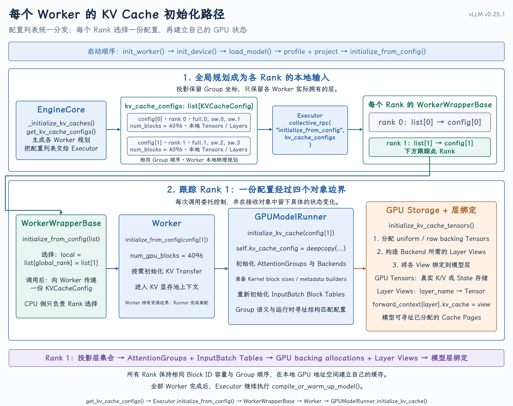
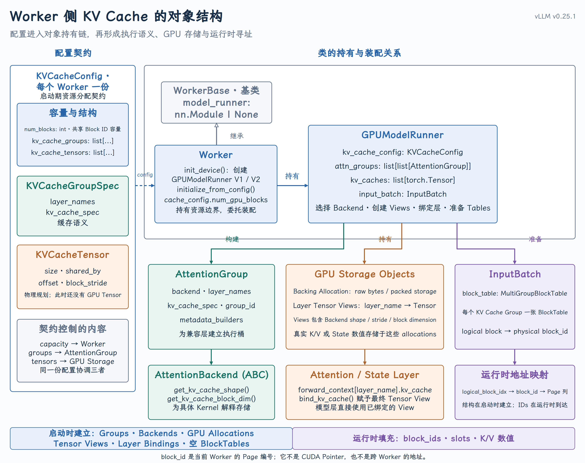
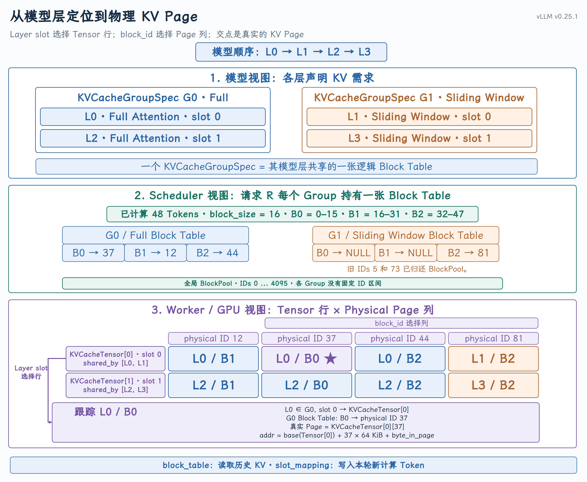

# KVCacheConfig 的 Worker 侧消费：GPU KV Cache 初始化

## 课程回顾

第 9 课介绍了 `KVCacheConfig` 的生成，第 10 课介绍了 Core 侧如何据此建立 BlockPool 和各 Group 的 Block Table。Core 管理的是逻辑 block，真正保存 K/V 的显存在 Worker 上。

Worker 如何根据 KVCacheConfig 建立 GPU KV Cache，并让运行时的 physical block_id 找到对应的存储位置？

本课看 Worker 如何使用 KVCacheConfig 完成显存分配、Tensor View 构造和模型层绑定，并解释 Scheduler 给出的 physical block_id 怎样找到对应的 GPU Page。

## 一、KVCacheConfig 如何到达 Worker

先看 KVCacheConfig 从 EngineCore 到 GPU 存储的传递过程：

`EngineCore → per-Worker config list → Executor → WorkerWrapperBase → Worker → GPUModelRunner → GPU Storage + Layer Bindings`

图的上半部分是 per-Worker 配置的生成和分发，下半部分以 rank 1 为例，展示配置进入 Worker 后的初始化过程。

{ width="100%" }

实际调用可以分成四段：

1. EngineCore：生成按 global rank 排列的 `list[KVCacheConfig]`。

2. WorkerWrapperBase：执行 `kv_cache_configs[self.global_rank]`，每个 rank 只取自己的配置。

3. Worker：更新本地 block 容量、初始化 KV Transfer connector，并进入 KV Cache 显存上下文。

4. GPUModelRunner：选择解释规则，分配 GPU storage，建立 Tensor View，再把 View 绑定到模型层。

Executor 向所有 Worker 发送同一份配置列表，各 Wrapper 再按 global_rank 取出本地配置。

源码：[WorkerWrapperBase.initialize_from_config()](https://github.com/vllm-project/vllm/blob/v0.25.1/vllm/v1/worker/worker_base.py#L321-L325) · [Worker.initialize_from_config()](https://github.com/vllm-project/vllm/blob/v0.25.1/vllm/v1/worker/gpu_worker.py#L695-L721)

## 二、Worker 侧的关键对象

配置到达 Worker 后，后续工作主要由下图中的对象完成。这里先关注 Worker/GPUModelRunner 和 GPU Storage/Layer Binding；AttentionGroup 与 InputBatch 后面再说明。

{ width="100%" }

各对象的职责如下：

- KVCacheConfig：当前 Worker 的启动分配合同，给出 `num_blocks`、`kv_cache_groups` 和 `kv_cache_tensors`。

- Worker：资源边界与初始化入口；它持有初始化后的 `GPUModelRunner`。

- GPUModelRunner：Worker 侧装配中心，负责 Backend、GPU storage、Tensor View 和 layer binding。

- GPU Storage Objects：真实 backing allocation 以及建立在其上的各层 View。

- Attention / State Layer：通过 `forward_context[layer_name].kv_cache` 直接拿到自己的 View。

`AttentionGroup` 负责把兼容的层组织成 Backend 执行桶，`InputBatch` 持有运行时 Block Table。它们都不拥有真实 K/V，也不负责给请求分配 physical block_id。

### 1. KVCacheGroupSpec 和 KVCacheTensor 分别描述什么

- `KVCacheTensor` 描述 Worker 要申请的物理存储槽位，包括 `size`、`shared_by`、`offset` 和 `block_stride`。

- `KVCacheGroupSpec` 描述哪些层共用同一张 Group Block Table。它表达的是逻辑寻址与缓存策略分组，不等价于“这些层共用同一块 backing allocation”。

普通 Hybrid 布局中，同一个 Group 的不同层通常落在不同 Tensor 槽位；不同 Group 中处于相同槽位的层，反而可能出现在同一个 `KVCacheTensor.shared_by` 中。因此 Group 和 Tensor 不是一一对应关系。

源码：[KVCacheTensor / KVCacheGroupSpec](https://github.com/vllm-project/vllm/blob/v0.25.1/vllm/v1/kv_cache_interface.py#L893-L920)

## 三、GPUModelRunner 如何初始化 KV Cache

[`GPUModelRunner.initialize_kv_cache()`](https://github.com/vllm-project/vllm/blob/v0.25.1/vllm/v1/worker/gpu_model_runner.py#L7405-L7462) 可以压缩成四步：

1. 确定解释规则：根据层、Spec 和 Attention Backend 确定内核看到的 block size、shape 与 stride。

2. 申请 raw storage：按照 `kv_cache_tensors` 申请足够的 GPU 字节。

3. 建立 Tensor View：把 raw bytes 解释成各层 Backend 所需的 dtype、shape、stride 和 offset。

4. 绑定到模型：让 ModelRunner 和每个 Attention 层拿到对应的 KV Cache View。

[GPUModelRunner.initialize_kv_cache()](https://github.com/vllm-project/vllm/blob/v0.25.1/vllm/v1/worker/gpu_model_runner.py#L7405-L7462)

### 1. 申请底层显存

```python
for kv_cache_tensor in kv_cache_config.kv_cache_tensors:
    tensor = torch.zeros(
        kv_cache_tensor.size,
        dtype=torch.int8,
        device=self.device,
    )
```

这里的 `int8` 只是把 `size` 直接解释成字节数。真正的 KV dtype 和多维 shape 在下一步通过 `view`、`reshape` 或 `as_strided` 建立。

[_allocate_kv_cache_tensors()](https://github.com/vllm-project/vllm/blob/v0.25.1/vllm/v1/worker/gpu_model_runner.py#L7081-L7122)

### 2. 建立 Backend 所需的 Tensor View

Attention Backend 根据当前层的 `KVCacheSpec` 给出 Kernel 需要的 Tensor geometry。reshape 通常不复制一份同样大的 K/V，它改变的是观察底层 storage 的方式：dtype、shape、维度顺序、stride、block dimension 和 storage offset。

[_reshape_kv_cache_tensors()](https://github.com/vllm-project/vllm/blob/v0.25.1/vllm/v1/worker/gpu_model_runner.py#L7133-L7260)

### 3. 将 KV Cache 绑定到模型层

```python
# ModelRunner 的有序列表
runner_kv_caches.append(kv_caches[layer_name])

# 模型前向上下文中的层
forward_context[layer_name].kv_cache = kv_cache
```

因此完成绑定后存在两条访问路径：

- `GPUModelRunner.kv_caches`：按模型层索引组织的 Tensor 列表；

- `static_forward_context[layer_name].kv_cache`：具体 Attention 层直接可见的 Tensor View。

[bind_kv_cache()](https://github.com/vllm-project/vllm/blob/v0.25.1/vllm/v1/worker/utils.py#L462-L519)

## 四、从 L0/B0 定位到 GPU Page

下面使用一个四层 Hybrid 模型，具体看 L0 的逻辑块 B0 如何落到 GPU Page。

这张图把同一份 KV Cache 放在三个视角中：模型视角给出 L0～L3 及各层的 Attention 类型；Core/Scheduler 视角给出 G0、G1 和各自的 Block Table；Worker 视角把 GPU 存储画成 KVCacheTensor 行与 physical block 列。

固定配置：

- 模型层顺序：`L0 Full, L1 Sliding Window, L2 Full, L3 Sliding Window`；

- `G0 Full = [L0(slot 0), L2(slot 1)]`；

- `G1 Sliding Window = [L1(slot 0), L3(slot 1)]`；

- `block_size = 16 tokens`，请求 R 已计算 48 个 Token，因此有逻辑块 B0、B1、B2。

{ width="100%" }

这张图的关键是“选行 + 选列”：layer_name 决定使用哪个 KVCacheTensor，logical block 再通过所属 Group 的 Block Table 得到 physical block_id。对 L0/B0 而言，两条路径最终在 `KVCacheTensor[0][37]` 汇合。下面分别看这两步。

### 1. L0 使用哪一个 KVCacheTensor

`L0 ∈ G0`，并且是 G0 的 `slot 0`。普通 Hybrid 布局把各 Group 的 slot 0 层放到同一个物理存储槽位：

```text
KVCacheTensor[0].shared_by = [L0, L1]
L0 → KVCacheTensor[0]
```

L0 与 L1 共享同一个底层 Tensor 规划，不代表它们共享相同 K/V；它们属于不同 Group，会用不同 Block Table 选择不同列。

### 2. B0 对应哪个 physical block_id

`B0` 表示逻辑 Token 区间 0–15，不是 physical ID 0–15。查询 G0 的 Block Table：

```text
G0 Block Table: B0 → physical block_id 37
```

于是 L0/B0 的物理 Page 是：

```text
row = KVCacheTensor[0]
column = physical block_id 37
page = KVCacheTensor[0][37]  # 教学上的二维简写
```

37、12、44、81 都来自同一个全局 BlockPool ID 空间。系统不会把 Group 切成 0–63、64–127 这样的固定区间，也不要求同一请求的 physical IDs 连续。

### 3. 计算 Page 内的 token slot

若当前 Token 的绝对位置是 7：

```text
logical_block_index = 7 // 16 = 0
token_offset = 7 % 16 = 7
physical_block_id = BlockTable[0] = 37
slot_id = 37 × 16 + 7 = 599
```

`token_offset` 才是 Page 内第几个 Token，范围为 0–15。`block_size = 16` 表示每页容纳 16 个 Token 位置，不是 16 字节。

[_compute_slot_mapping_kernel()](https://github.com/vllm-project/vllm/blob/v0.25.1/vllm/v1/worker/block_table.py#L326-L380)

### 4. 64 KiB 是怎么计算出来的

示例额外假设 `num_kv_heads = 8`、`head_size = 128`、`dtype = FP16`：

```text
每个 Token 的 K + V
= 2 × 8 heads × 128 dims × 2 bytes
= 4096 bytes = 4 KiB

每页
= 16 tokens × 4 KiB
= 64 KiB
```

在这个非 Packed、连续 Page 的教学例子中，L0/B0 的页首可写成：

```text
page_base = base(KVCacheTensor[0]) + 37 × 64 KiB
```

Page 内 K/V、head 和 dimension 的精确地址由 Backend Tensor View 的 strides 决定。本课主线停在 `slot_id`，不再引入容易混淆的 `byte_in_page`。

## 五、初始化阶段和运行时分别负责什么

Worker 启动阶段固定：

- GPU backing allocation 的容量和数量；

- 各层的 dtype、shape、stride、offset 与 Tensor View；

- `layer_name → kv_cache view` 的绑定；

- Worker 可使用的 physical block 数量。

请求运行时变化：

- 各 Group 的请求级 Block Table 内容；

- 本轮 Token 的 `slot_mapping`；

- Page 中实际写入的 K/V；

- Block 的分配、释放、引用计数、前缀复用与滑窗回收。

## 六、关键源码调用顺序

1. [WorkerWrapperBase.initialize_from_config()](https://github.com/vllm-project/vllm/blob/v0.25.1/vllm/v1/worker/worker_base.py#L321-L325)：按 global rank 选择配置。

2. [Worker.initialize_from_config()](https://github.com/vllm-project/vllm/blob/v0.25.1/vllm/v1/worker/gpu_worker.py#L695-L721)：Worker 物理初始化入口。

3. GPUModelRunner.initialize_kv_cache()：装配总入口。

4. [allocate / reshape](https://github.com/vllm-project/vllm/blob/v0.25.1/vllm/v1/worker/gpu_model_runner.py#L7081-L7260)：申请 bytes 并建立 Backend View。

5. [bind_kv_cache()](https://github.com/vllm-project/vllm/blob/v0.25.1/vllm/v1/worker/utils.py#L462-L519)：绑定到 ModelRunner 与模型层。

6. [_compute_slot_mapping_kernel()](https://github.com/vllm-project/vllm/blob/v0.25.1/vllm/v1/worker/block_table.py#L326-L380)：运行时把 Token 映射为 physical slot。

## 几个暂不展开的分支

- AttentionGroup / MetadataBuilder：执行规则分桶与 Backend-specific Kernel 参数构造。

- Packed Layout：一个 backing allocation 上建立多层 strided view。

- Mamba / State Cache：统一资源抽象下的另一种 state tensor view。

- TP / PP：全局规划投影到各 rank 的本地层与本地 GPU 地址空间。

## 小结

Worker 初始化完成后，模型层已经绑定了自己的 KV Cache View。运行时，Block Table 将 logical_block_index 映射为 physical block_id，slot mapping 再加上 Page 内的 token_offset，从而确定某个 Token 的 K/V 应写入哪个物理 slot。
