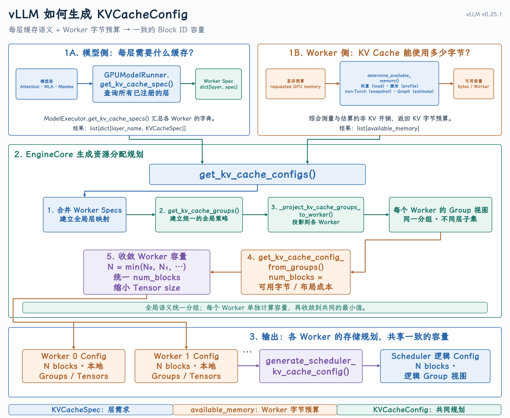
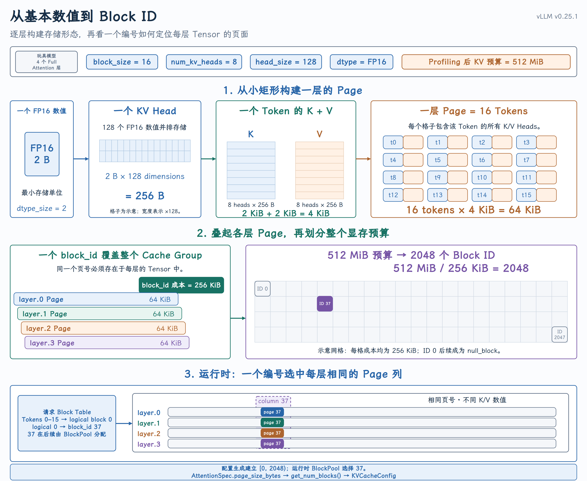

# KVCacheConfig 的产生

{ width="100%" }

## 引言：从两类输入到一份规划

`KVCacheConfig` 的产生不是单纯的显存除法。它需要先回答三个问题：

1. 每一个 cache-bearing layer 需要什么样的缓存？

2. 每个 Worker 能够拿出多少字节用于 KV Cache？

3. 如何让不同 Worker 对同一个 block_id 空间达成一致？

源码中的总入口仍然是 `EngineCore._initialize_kv_caches()`：

源码：[`EngineCore._initialize_kv_caches()`](https://github.com/vllm-project/vllm/blob/v0.25.1/vllm/v1/engine/core.py#L240-L348)

```python
kv_cache_specs = self.model_executor.get_kv_cache_specs()
available_gpu_memory = self.model_executor.determine_available_memory()

kv_cache_configs = get_kv_cache_configs(
    vllm_config, kv_cache_specs, available_gpu_memory
)
```

两个输入是并行获得的：

```text
Model semantics                       Device capacity
      ↓                                  ↓
list[dict[layer, KVCacheSpec]]        list[available_memory]
      └────────────────┬────────────────┘
                       ↓
              get_kv_cache_configs()
                       ↓
                list[KVCacheConfig]
```

本课将沿着这段代码，完整解释配置是如何形成的。

## 一、模型侧输入：每层的 KVCacheSpec

### 1. KVCacheSpec 描述的是“需求”

`KVCacheSpec` 是每个缓存层的需求描述。它的基类只规定了块内 token 数，并要求具体类型回答“一页占多少字节”。

源码：[`KVCacheSpec`](https://github.com/vllm-project/vllm/blob/v0.25.1/vllm/v1/kv_cache_interface.py#L100-L160)

```python
@dataclass(frozen=True)
class KVCacheSpec:
    block_size: int

    @property
    def page_size_bytes(self) -> int:
        raise NotImplementedError
```

其中两个单位必须分清：

```text
block_size       → 一个块保存多少 token
page_size_bytes  → 这一层的一个块占多少字节
```

`block_size` 是 token 粒度，`page_size_bytes` 是物理存储成本。Scheduler 后面分配的是 block_id，而容量规划必须知道每个 block_id 背后要消耗多少字节。

### 2. Attention 层的 page size

对于普通非量化 Attention KV Cache，一层一页的核心存储成本可以写成：

```text
page_size_bytes
= 2
× block_size
× num_kv_heads
× head_size
× dtype_size
```

开头的 `2` 分别对应 K 和 V。这个关系直接出现在 [`AttentionSpec.real_page_size_bytes`](https://github.com/vllm-project/vllm/blob/v0.25.1/vllm/v1/kv_cache_interface.py#L187-L202) 中。

源码：[`AttentionSpec.real_page_size_bytes`](https://github.com/vllm-project/vllm/blob/v0.25.1/vllm/v1/kv_cache_interface.py#L187-L202)

```python
return (
    2
    * self.block_size
    * self.num_kv_heads
    * head_dim
    * get_dtype_size(self.dtype)
)
```

量化 KV Cache、padding 和 MLA 会改变具体字节计算，Mamba 则管理 state 而不是普通 K/V。所以 vLLM 把 `page_size_bytes` 放进多态的 `KVCacheSpec` 中，而不是在规划函数里写死一个公式。

### 3. Model Runner 如何收集 spec

GPUModelRunner 遍历已注册的 Attention 与 Mamba 层，让每层返回自己的 spec，最终得到 `dict[layer_name, KVCacheSpec]`。

源码：[`GPUModelRunner.get_kv_cache_spec()`](https://github.com/vllm-project/vllm/blob/v0.25.1/vllm/v1/worker/gpu_model_runner.py#L7561-L7598)

在并行环境中，Model Executor 会收集所有 Worker 的返回值：

```text
Worker 0 → {layer.0: spec, layer.1: spec, ...}
Worker 1 → {layer.12: spec, layer.13: spec, ...}
...
```

Pipeline Parallelism 下，不同 Worker 可能只拥有模型的一部分层；Tensor Parallelism 下，同一层在对应 rank 上应当得到一致的 spec。

## 二、Worker 侧输入：可用 KV Cache 显存

### 1. 不是直接读取“GPU 空闲显存”

`GPUWorker.determine_available_memory()` 的目标是得到“在 vLLM 的显存预算内，KV Cache 可以使用多少字节”。

源码：[`GPUWorker.determine_available_memory()`](https://github.com/vllm-project/vllm/blob/v0.25.1/vllm/v1/worker/gpu_worker.py#L429-L441)

它并不是把当前空闲显存全部交给 KV Cache，而是先统计或估算其他必须保留的显存：

| 显存开销 | 简单理解 | 来源与源码 |
| --- | --- | --- |
| 模型权重 | 服务期间长期驻留的模型参数 | `load_model()` 用 `DeviceMemoryProfiler` 包住模型加载，再保存为 `model_memory_usage`。源码：[`load_model()`](https://github.com/vllm-project/vllm/blob/v0.25.1/vllm/v1/worker/gpu_model_runner.py#L5203-L5225)、[`model_memory_usage`](https://github.com/vllm-project/vllm/blob/v0.25.1/vllm/v1/worker/gpu_model_runner.py#L5293-L5309) |
| PyTorch 峰值激活 | forward 中出现的 hidden states、Q/K/V、MLP 中间结果等临时 Tensor 的最高占用 | `profile_run()` 后读取 `allocated_bytes.all.peak`，再减去 profiling 前的峰值基线。源码：[`profile_run()`](https://github.com/vllm-project/vllm/blob/v0.25.1/vllm/v1/worker/gpu_worker.py#L462-L472)、[`torch_peak_increase`](https://github.com/vllm-project/vllm/blob/v0.25.1/vllm/v1/worker/gpu_worker.py#L485-L493) |
| 非 PyTorch 内存 | Attention Backend、通信库或自定义算子绕过 PyTorch allocator 使用的显存 | 先用 GPU 总占用减去 PyTorch reserved memory，再比较 profiling 前后的增量。源码：[`non_torch_memory`](https://github.com/vllm-project/vllm/blob/v0.25.1/vllm/utils/mem_utils.py#L146-L164)、[`non_torch_increase`](https://github.com/vllm-project/vllm/blob/v0.25.1/vllm/utils/mem_utils.py#L301-L313) |
| CUDA Graph 显存 | Graph capture 后需要长期保留的内存池和固定 Buffer | CUDA 平台且启用 Graph 时调用独立估算，再根据开关决定是否扣除。源码：[调用与扣除位置](https://github.com/vllm-project/vllm/blob/v0.25.1/vllm/v1/worker/gpu_worker.py#L474-L500)、[`profile_cudagraph_memory()`](https://github.com/vllm-project/vllm/blob/v0.25.1/vllm/v1/worker/gpu_model_runner.py#L6497-L6519)、[Graph 显存差值估算](https://github.com/vllm-project/vllm/blob/v0.25.1/vllm/v1/worker/gpu_model_runner.py#L6581-L6604) |

这里要注意：四项都会影响 KV Cache 容量，但不全是由同一次 forward 直接测出。权重在模型加载时统计，激活峰值和非 PyTorch 增量由 profiling 得到，CUDA Graph 则单独估算。

完整汇总逻辑见：[`memory_profiling()`](https://github.com/vllm-project/vllm/blob/v0.25.1/vllm/utils/mem_utils.py#L228-L313) [的定义与计算](https://github.com/vllm-project/vllm/blob/v0.25.1/vllm/utils/mem_utils.py#L228-L313) 和 [`available_kv_cache_memory_bytes`](https://github.com/vllm-project/vllm/blob/v0.25.1/vllm/v1/worker/gpu_worker.py#L485-L523) [的最终计算](https://github.com/vllm-project/vllm/blob/v0.25.1/vllm/v1/worker/gpu_worker.py#L485-L523)。

然后才从 Worker 的请求显存预算中扣除这些开销：

```python
self.available_kv_cache_memory_bytes = (
    self.requested_memory
    - profile_result.non_kv_cache_memory
    - cudagraph_memory_estimate_applied
)
```

因此，概念上应当理解为：

```text
available KV cache memory
= vLLM Worker memory budget
- profiled non-KV peak memory
- applied CUDA Graph estimate
```

`gpu_memory_utilization` 影响 Worker 的请求显存预算，但它不等于“KV Cache 直接使用总显存的这个比例”。权重和峰值运行内存仍然需要从预算中扣除。

### 2. 为什么每个 Worker 都要独立 Profiling

每个 Worker 的设备状态、分片层和峰值开销可能不同，因此 `determine_available_memory()` 的最终结果是一个 Worker 列表：

```text
available_memory = [memory_worker_0, memory_worker_1, ...]
```

这一阶段仍然只有字节预算，还没有 block_id 空间。

### 3. 手动容量是另一条路径

如果显式设置 `kv_cache_memory_bytes`，Worker 仍然会做 profile run 以完成必要的模型准备，但会跳过自动容量推导，使用用户指定的 KV Cache 字节数。

这是部署调优路径，不改变后续“字节预算转换为块容量”的资源模型。

## 三、为什么要先形成全局分组

[`get_kv_cache_configs()`](https://github.com/vllm-project/vllm/blob/v0.25.1/vllm/v1/core/kv_cache_utils.py#L2121-L2134) 接收所有 Worker 的 spec 和 available memory。它的第一步不是立即计算 `num_blocks`，而是先建立全局的模型层视图。

源码：[`get_kv_cache_configs()`](https://github.com/vllm-project/vllm/blob/v0.25.1/vllm/v1/core/kv_cache_utils.py#L2005-L2153)

```python
merged_kv_cache_specs: dict[str, KVCacheSpec] = {}
for worker_specs in kv_cache_specs:
    for layer_name, layer_spec in worker_specs.items():
        if layer_name not in merged_kv_cache_specs:
            merged_kv_cache_specs[layer_name] = layer_spec
        else:
            assert merged_kv_cache_specs[layer_name] == layer_spec

global_kv_cache_groups = get_kv_cache_groups(
    vllm_config, merged_kv_cache_specs
)
```

先 merge 再 group 是为了解决 Pipeline Parallelism 带来的局部视图问题。

假设两个 PP stage 分别持有：

```text
PP stage 0: full.0, sw.0, sw.1
PP stage 1: full.1, sw.2, sw.3
```

如果每个 Worker 独立分组，它们可能得到不同的 group 结构。中心化 Scheduler 就无法用一套稳定的逻辑分组管理所有 Worker。

所以 vLLM 先从完整模型的层比例得到 global groups，再把这些 group 投影回每个 Worker：

源码：[`_project_kv_cache_groups_to_worker()`](https://github.com/vllm-project/vllm/blob/v0.25.1/vllm/v1/core/kv_cache_utils.py#L1963-L2002)

```python
projected_groups_per_worker = [
    _project_kv_cache_groups_to_worker(
        global_kv_cache_groups, worker_spec
    )
    for worker_spec in kv_cache_specs
]
```

投影不会重新设计分组策略，只保留该 Worker 实际拥有的层。因此两个概念需要区分：

```text
global groups          → 完整模型的统一分组策略
projected groups       → 某个 Worker 上的局部层集合
```

## 四、从层语义到 KV Cache Group

### 1. 普通单类型模型

对于大多数普通 Transformer，所有 Attention 层的 `KVCacheSpec` 相同。`get_kv_cache_groups()` 会把所有层放入同一个 group，它们共享同一种 Block Table 管理语义。

源码：[`get_kv_cache_groups()`](https://github.com/vllm-project/vllm/blob/v0.25.1/vllm/v1/core/kv_cache_utils.py#L1697-L1763)

```python
if is_kv_cache_spec_uniform(kv_cache_spec):
    return _get_kv_cache_groups_uniform_spec(kv_cache_spec)
```

这里的“同一个 group”不等于所有层共享同一份 K/V 数值。它表示这些层可以共享一套逻辑 block table，每层仍然有自己的物理缓存数据。

### 2. Hybrid 模型

当模型同时存在 Full Attention、Sliding Window、MLA 或 Mamba 等多种缓存语义时，vLLM 需要建立多个 `KVCacheGroupSpec`。

通用 hybrid 路径会先对物理 page size 做统一，再按层类型和重复比例分组。源码中对一个典型模型给出了直观例子：

```text
10 Full Attention layers
+ 20 Sliding Window layers

可以视为模式 (1 Full + 2 Sliding Window) 重复 10 次

→ 3 KV cache groups
→ 每个 group 包含 10 层
```

源码：[`_get_kv_cache_groups_uniform_page_size()`](https://github.com/vllm-project/vllm/blob/v0.25.1/vllm/v1/core/kv_cache_utils.py#L1108-L1227)

分组过程服务于两个目标：

- 让同一 group 内的层可以共享同一种 block table 语义；

- 让各 group 对一个逻辑块的物理页面成本可以被统一规划。

特殊模型还可能走 `UniformTypeKVCacheSpecs`、DeepSeek V4 packed layout 等分支。这些分支改变分组和布局方式，但不改变本课的主线：先建立逻辑 group，再换算物理块容量。

## 五、从字节预算到 num_blocks

### 1. 普通 uniform-page 路径

对于普通分支，每个 group 的物理 page size 已经统一。设：

```text
available_memory = 该 Worker 可用的 KV Cache 字节数
page_size        = 一层一个 block 的字节数
group_size       = 最大 group 中的层数
```

那么该布局下，一个 block_id 的池级成本是：

```text
bytes_per_block = page_size × group_size
```

所以：

```text
num_blocks = floor(
    available_memory / (page_size × group_size)
)
```

这段逻辑在 [`get_num_blocks()`](https://github.com/vllm-project/vllm/blob/v0.25.1/vllm/v1/core/kv_cache_utils.py#L972-L989) 中非常直接：

源码：[`get_num_blocks()`](https://github.com/vllm-project/vllm/blob/v0.25.1/vllm/v1/core/kv_cache_utils.py#L972-L989)

```python
num_blocks = int(available_memory // page_size // num_layers)
num_blocks = max(num_blocks, 0)
```

这里的 `num_layers` 在普通配置生成分支中传入的就是 `group_size`。

### 2. 为什么不能把这个公式套在所有模型上

[`get_kv_cache_config_from_groups()`](https://github.com/vllm-project/vllm/blob/v0.25.1/vllm/v1/core/kv_cache_utils.py#L1368-L1400) 根据 group 结构选择存储布局：

源码：[`get_kv_cache_config_from_groups()`](https://github.com/vllm-project/vllm/blob/v0.25.1/vllm/v1/core/kv_cache_utils.py#L1318-L1400)

```text
Uniform type but different hidden sizes
→ calculate per-layer tensor sizes

Packed multi-group layout
→ calculate packed bytes per block

General uniform-page layout
→ page_size × group_size
```

因此真正稳定的抽象不是某一个固定公式，而是：

```text
num_blocks
= floor(available_memory / layout-specific block cost)
```

不同分支的差异在于“layout-specific block cost”如何计算。

### 3. 同时生成 kv_cache_tensors

得到 `num_blocks` 后，配置生成函数还会构造 `KVCacheTensor`，告诉 Worker 每份底层存储需要多大，以及被哪些层使用。

普通 uniform-page 分支的核心代码是：

```python
for i in range(group_size):
    shared_by = []
    for group in kv_cache_groups:
        if i < len(group.layer_names):
            shared_by.append(group.layer_names[i])
    kv_cache_tensors.append(
        KVCacheTensor(
            size=page_size * num_blocks,
            shared_by=shared_by,
        )
    )
```

`shared_by` 列出的是会基于同一底层 Buffer 建立缓存视图的层。在普通多 group 布局中，这些层属于不同 group，使用各自的 Block Table 和 block ID 序列访问不同页面；它绝不表示这些层保存相同的 K/V 数值。

## 六、一个从模型到 block_id 空间的完整例子

前面的公式如果只停留在 `page_size` 和 `num_blocks`，很容易让人误以为 block 只是一个抽象计数。下面使用一个带完整数字的玩具模型，把模型结构、显存字节和最终的 `block_id` 空间连接起来。

{ width="100%" }

### 1. 先固定例子的边界

假设只有一个 Worker，并且模型满足：

```text
4 个 Full Attention 层
block_size    = 16 tokens
num_kv_heads  = 8
head_size     = 128
KV dtype      = FP16，即每个元素 2 bytes
available_memory = 512 MiB
```

为了只观察主线，这里不考虑 TP、PP、KV Cache 量化、page padding 和 hybrid cache。`512 MiB` 也不是 GPU 总显存，而是假设 `determine_available_memory()` 已经扣除权重、峰值激活等开销后，最终留给 KV Cache 的容量。

### 2. 模型首先变成每层 KVCacheSpec

四个 Attention 层产生四份内容相同的 `FullAttentionSpec`。对于其中任意一层，一页需要保存 16 个 token 的 K 和 V，因此：

```text
page_size_bytes
= 2                   # K 和 V
× 16                  # block_size
× 8                   # num_kv_heads
× 128                 # head_size
× 2 bytes             # FP16
= 65,536 bytes
= 64 KiB
```

这个计算对应 `AttentionSpec.real_page_size_bytes`。所以此时可以先得到一个具体认识：

对这个例子中的一层而言，一个 block 对应 16 个 token，并占用 64 KiB 显存。

### 3. 四层组成一个 KV Cache Group

四层都是相同的 Full Attention spec，因此会组成一个 group：

```text
Group 0
├── layer.0
├── layer.1
├── layer.2
└── layer.3

group_size = 4
```

“一个 group”表示四层可以使用同一种逻辑 Block Table 语义，并不表示四层共享同一份 K/V 数值。

当 Scheduler 后面说“分配一个 `block_id`”时，这个 ID 必须能够在四层各自的缓存 Tensor 中都找到对应页面。因此，一个 `block_id` 的池级成本不是 64 KiB，而是：

```text
bytes_per_block_id
= page_size_bytes × group_size
= 64 KiB × 4
= 256 KiB
```

### 4. 从 512 MiB 得到 2048 个 block

现在才执行容量除法：

```text
num_blocks
= floor(512 MiB / 64 KiB / 4)
= floor(512 MiB / 256 KiB)
= 2048
```

这正是普通 uniform-page 路径中 `get_num_blocks()` 的计算方式。

于是生成的 `KVCacheConfig` 可以简化理解为：

```text
KVCacheConfig
├── num_blocks = 2048
├── kv_cache_groups
│   └── Group 0: [layer.0, layer.1, layer.2, layer.3]
└── kv_cache_tensors
    ├── layer.0: 64 KiB × 2048 = 128 MiB
    ├── layer.1: 64 KiB × 2048 = 128 MiB
    ├── layer.2: 64 KiB × 2048 = 128 MiB
    └── layer.3: 64 KiB × 2048 = 128 MiB
```

四个 Tensor 总计 512 MiB，恰好等于可用 KV Cache 容量。这些 Tensor 规划由 `get_kv_cache_config_from_groups()` 生成。

### 5. `num_blocks = 2048` 到底产生了什么

它首先产生的是一个统一的编号空间：

```text
block_id ∈ [0, 2048)

也就是：0, 1, 2, ..., 2047
```

这里必须区分规划和运行两个阶段：

第 9 课的配置生成只决定“系统最多有 2048 个编号”。

- 它不会决定某个请求具体拿到哪一个编号。

- 后续 `BlockPool` 才会创建这些 `KVCacheBlock` 元数据，并在运行时选择空闲 ID。v0.25.1 中还会把 `block_id=0` 取出作为特殊的 `null_block`。源码：[`BlockPool.__init__()`](https://github.com/vllm-project/vllm/blob/v0.25.1/vllm/v1/core/block_pool.py#L163-L192)。

假设运行时某个请求的第一个逻辑块最终拿到：

```text
logical_block 0 → physical block_id 37
```

它表示的不是“一份被四层共享的 K/V 数据”，而是：

```text
layer.0 KV tensor → page 37 → layer.0 的 K/V
layer.1 KV tensor → page 37 → layer.1 的 K/V
layer.2 KV tensor → page 37 → layer.2 的 K/V
layer.3 KV tensor → page 37 → layer.3 的 K/V
```

四层使用相同的页号 37，但是每层 Tensor 中保存的是各自不同的 K/V。这样 Scheduler 只需要管理一套逻辑 `block_id`，Worker 就能把它解释成所有相关缓存 Tensor 中的对应页面。

这也是本课最重要的直觉：

`num_blocks` 不是“某一层有多少页”，而是 Scheduler 与所有缓存 Tensor 共同遵守的 block ID 容量；同一个 `block_id` 会投影到相关层 Tensor 的同一页号。

## 七、多 Worker 为什么要收敛到最小容量

单个 Worker 已经可以把自己的字节预算转换成 `num_blocks`。但不同 Worker 拥有的层和可用显存可能不同，因此初始容量也可能不同：

```text
Worker 0 → 768 blocks
Worker 1 → 682 blocks
```

如果中心化 Scheduler 按照 768 个块进行分配，它就可能产生 Worker 1 无法承载的 `block_id`。因此 `get_kv_cache_configs()` 最后会收敛到所有 Worker 的最小容量：

```python
min_num_blocks = min(
    config.num_blocks for config in kv_cache_configs
)

for config in kv_cache_configs:
    num_blocks_old = config.num_blocks
    config.num_blocks = min_num_blocks

    for tensor in config.kv_cache_tensors:
        tensor.size = (
            tensor.size // num_blocks_old * min_num_blocks
        )
```

这里不只修改 `num_blocks`，还要按比例缩小 `KVCacheTensor.size`，避免 Worker 为不会使用的页面保留显存。最终结果是：

```text
所有 Worker 使用相同的 num_blocks

各 Worker 仍可保留不同的：
- layer_names
- tensor sharing relationships
- local physical storage descriptions
```

这一步的本质是：

Scheduler 分配的任意 block_id，都必须能够在所有 Worker 上找到有效的物理页面。

## 八、从 Worker 配置得到 Scheduler 视图

`get_kv_cache_configs()` 返回的是每个 Worker 的配置列表。EngineCore 还需要生成 Scheduler 使用的逻辑视图：

源码：[`generate_scheduler_kv_cache_config()`](https://github.com/vllm-project/vllm/blob/v0.25.1/vllm/v1/core/kv_cache_utils.py#L1766-L1787)

```python
assert all(
    cfg.num_blocks == kv_cache_configs[0].num_blocks
    for cfg in kv_cache_configs
)

cfg = copy.deepcopy(kv_cache_configs[0])
```

这里可以选择任意一个 Worker 作为 Scheduler 视图的基础，前提是所有 Worker 已经对 `num_blocks` 达成一致。

`UniformTypeKVCacheSpecs` 等 Worker 侧的复合 spec 还会在这里归一化成 Scheduler 实际管理时需要的单一 spec 视图。

到此，资源规划阶段完成：

```text
per-layer KVCacheSpec
+ per-Worker available memory
→ global grouping
→ per-Worker projection
→ per-Worker capacity and tensor plans
→ common num_blocks
→ Scheduler logical config
```

## 结语：字节容量已经变成块空间

本课完成了从两类原始输入到 `KVCacheConfig` 的完整转换：

1. Model Runner 用 `KVCacheSpec` 描述每个缓存层的 block size、page size 和缓存语义。

2. GPUWorker 通过 Profiling 得到每个 Worker 能为 KV Cache 提供的字节预算。

3. `get_kv_cache_configs()` 先建立全局分组，再投影到各 Worker，根据存储布局的每块成本换算 `num_blocks`。

4. 所有 Worker 最后收敛到最小 `num_blocks`，保证中心化 Scheduler 分配的 block_id 在每个 Worker 上都有效。

用一句话概括：

`KVCacheConfig` 的生成过程，就是把模型的每层缓存语义和 Worker 的字节容量，编译成所有执行端都能遵守的统一块空间。
