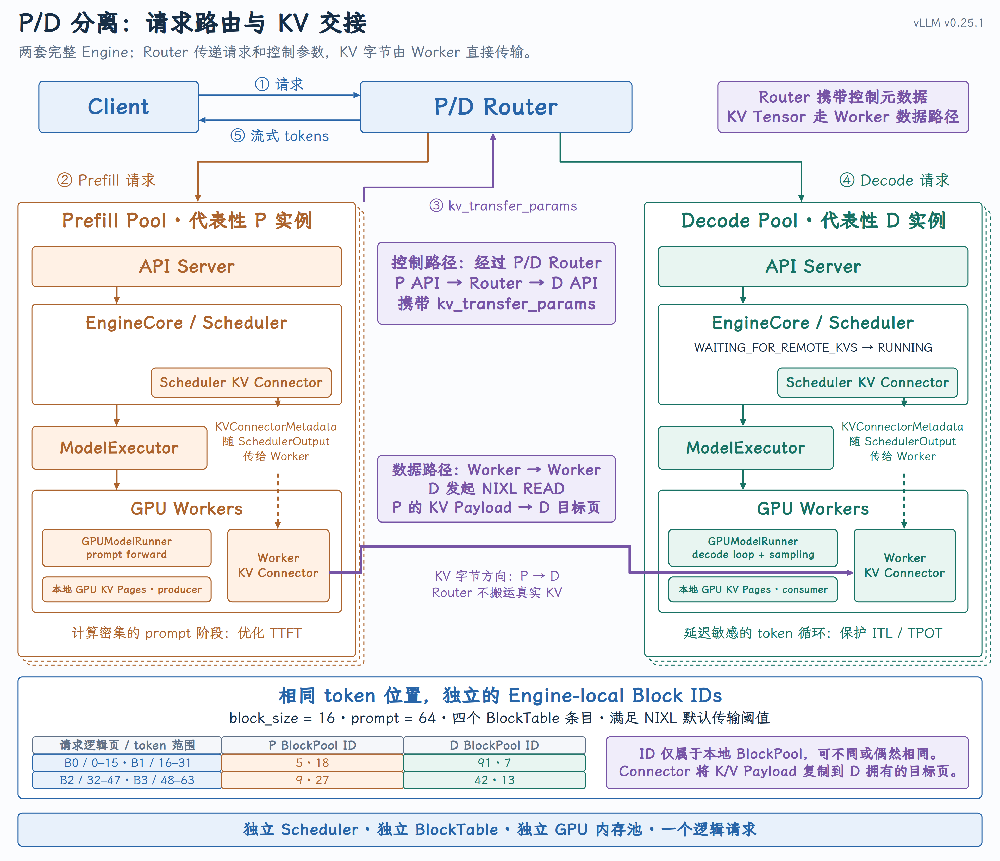
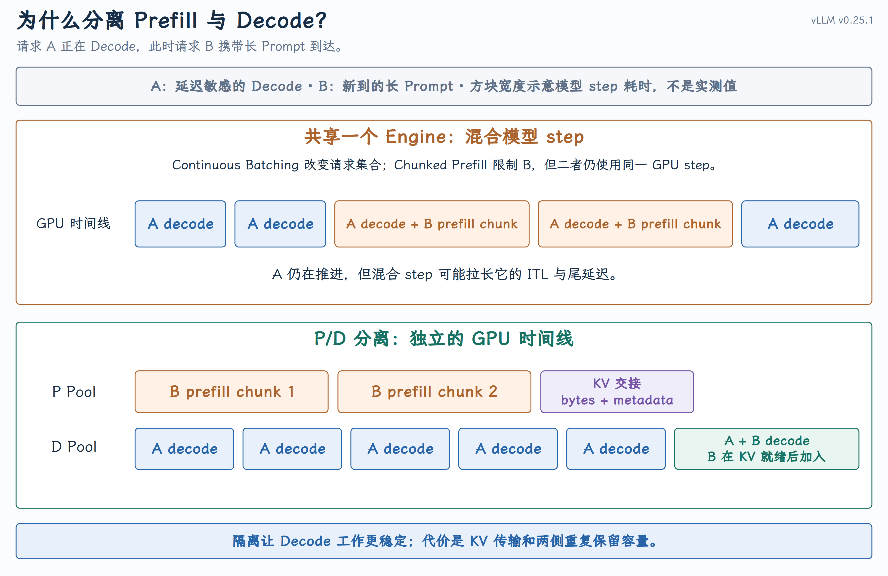
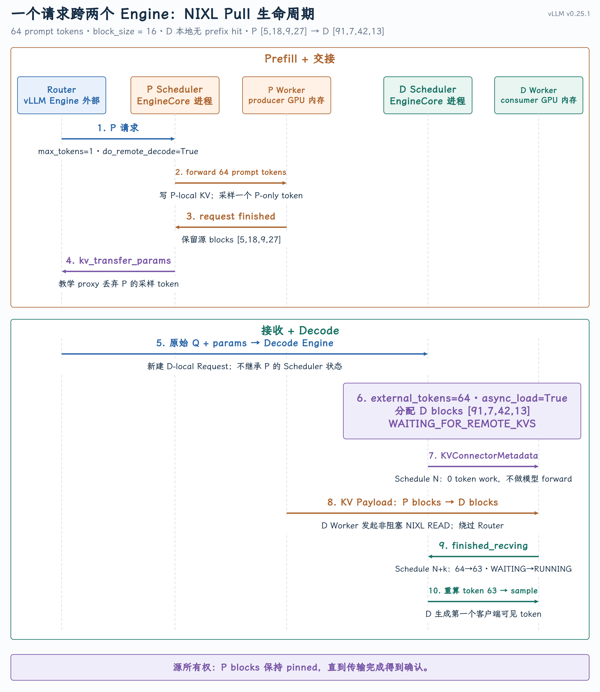
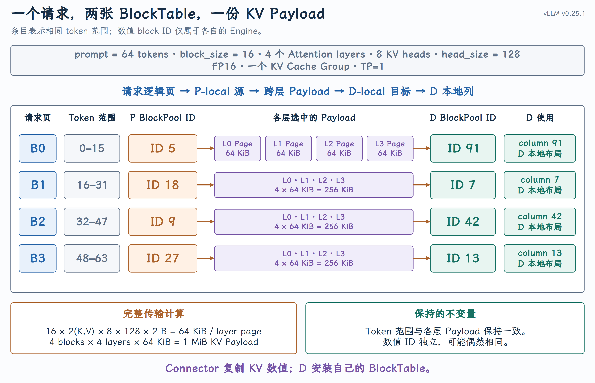

# PD 分离与 KV 传输

{ width="100%" }

Continuous Batching 回答的是“这一轮让哪些请求一起执行”，Chunked Prefill 回答的是“长 Prompt 这一轮执行多少 Token”。这两者都没有改变系统边界：一个请求的 Prefill 和 Decode 仍由同一个 Engine 完成，共用这个 Engine 的 Scheduler、BlockPool、Worker 和 GPU KV Cache。

P/D 分离把观察范围从“一个 Engine 内怎样安排工作”扩大到“多个 Engine 之间怎样分工”：

| 机制 | 作用范围 | 核心问题 |
| --- | --- | --- |
| Continuous Batching | 单 Engine、请求维度 | 本轮让哪些请求一起执行？ |
| Chunked Prefill | 单 Engine、Token 维度 | 每个请求本轮执行多少 Token？ |
| P/D Disaggregation | 多 Engine、实例维度 | Prefill 和 Decode 分别在哪里执行？ |

本课只沿一条可以闭环到源码的主线展开：vLLM v0.25.1、1P1D、NixlConnector Pull 模式、TP=1、单 KV Cache Group、P/D 使用相同 Block Size，D 侧没有本地 Prefix Cache 命中。异构 TP、异构 Block Size、Hybrid KV Cache、Mamba 和其他 Connector 会在最后说明边界，但不会干扰主线。

## 一、为什么还需要 P/D 分离

{ width="100%" }

Prefill 与 Decode 都是 Transformer forward，但它们对服务系统的压力不同：

| 工作 | 一次 Forward 的典型形态 | 最关心的服务指标 |
| --- | --- | --- |
| Prefill | 同时计算较多 Prompt Token，单步工作量大 | TTFT、Prompt 吞吐 |
| Decode | 每个请求每轮通常推进一个 Token，连续执行很多轮 | ITL、TPOT、尾延迟 |

- TTFT（Time To First Token）：请求到达至首个客户端可见 Token 的时间；

- ITL（Inter-Token Latency）：相邻两个客户端可见 Token 的时间间隔；

- TPOT（Time Per Output Token）：生成阶段平均每个输出 Token 的耗时。

在单 Engine 中，Continuous Batching 可以让新请求动态进入执行批次；Chunked Prefill 可以限制长 Prompt 每轮消耗的 Token Budget。但是 Prefill 和 Decode 仍然竞争同一组 GPU。一轮同时包含 Decode Token 和较大 Prefill Chunk 时，这一轮 Forward 可能变长，于是同批 Decode 请求的 ITL 也会被拉长。

P/D 分离把两类工作放进独立的 vLLM 实例和 GPU Pool：P Pool 专门处理 Prompt，D Pool 专门执行持续的生成循环。这样可以分别选择实例数量、TP/PP 配置、批处理上限和扩缩容策略，并降低其他请求的 Prefill 对 Decode 尾延迟的干扰。vLLM 的官方说明把目标概括为分别调节 TTFT 与 ITL、控制尾部 ITL：[`Disaggregated Prefilling`](https://github.com/vllm-project/vllm/blob/v0.25.1/docs/features/disagg_prefill.md#L8-L16)。

这不是免费优化。P/D 分离至少引入三项成本：

1. P、D 两侧都要加载模型权重并保留各自的 KV Cache Pool；

2. Prompt KV 必须跨实例传输，新增带宽占用和交接延迟；

3. Router 需要同时选择 P、D 实例，并处理超时、失败和资源释放。

因此，vLLM 文档明确提醒不要把“启用 P/D”直接等同于吞吐提升。研究系统 [DistServe](https://www.usenix.org/conference/osdi24/presentation/zhong-yinmin) 和 [Splitwise](https://arxiv.org/abs/2311.18677) 进一步联合优化了资源配置、并行策略、放置和调度，并报告了 Goodput 或成本收益；这些论文与 vLLM 的方向一致，但论文结果不能直接当成 `NixlConnector` 的默认性能结论。

## 二、左右两个 Engine 与中间两条交接路径

P/D 分离以后，P 和 D 各自拥有完整的执行闭环：

```text
API Server
  → EngineCore / Scheduler
  → Executor
  → Worker / GPUModelRunner
  → local GPU KV Cache
```

两边不会共享 Python Request、Scheduler 队列、BlockPool、BlockTable 或 GPU Tensor。P、D 是两个独立 vLLM 实例，通常部署在不同 GPU 集合上。外部 Router 负责选 P、选 D 和转发请求，但不搬运 GPU KV Tensor。vLLM 提供 Engine 内部的 KV Connector 协议与传输能力；生产级路由、重试和流量治理不在 vLLM Core 内。

### 1. 两种“Role”不要混在一起

vLLM 这里存在两套相互正交的角色：

| 名称 | 取值 | 回答的问题 |
| --- | --- | --- |
| `[KVTransferConfig](https://github.com/vllm-project/vllm/blob/v0.25.1/vllm/config/kv_transfer.py#L66-L72).kv_role` | `kv_producer` /`kv_consumer` / `kv_both` | 这个 vLLM 实例在 KV 交接中生产还是消费？ |
| `KVConnectorRole` | `SCHEDULER` / `WORKER` | 当前 Connector 对象运行在 Scheduler 侧还是 Worker 侧？ |

第一套属于实例配置，定义在[`KVTransferConfig`](https://github.com/vllm-project/vllm/blob/v0.25.1/vllm/config/kv_transfer.py#L23-L43)。第二套属于进程内职责划分：Scheduler 创建`KVConnectorRole.SCHEDULER` 对象，Worker 初始化`KVConnectorRole.WORKER` 对象。源码明确要求两者分开构造：[`Scheduler.__init__()`](https://github.com/vllm-project/vllm/blob/v0.25.1/vllm/v1/core/sched/scheduler.py#L124-L140)、[`ensure_kv_transfer_initialized()`](https://github.com/vllm-project/vllm/blob/v0.25.1/vllm/distributed/kv_transfer/kv_transfer_state.py#L72-L94)。因此，一个 P 实例不是“只有 Producer Connector”，而是：

```text
P instance: kv_role = kv_producer
  ├─ Scheduler-side Connector: plan, match, own lifecycle metadata
  └─ Worker-side Connector: register memory, move bytes, report completion

D instance: kv_role = kv_consumer
  ├─ Scheduler-side Connector: query remote KV, allocate destination blocks
  └─ Worker-side Connector: load KV into D-local GPU memory
```

对本课的 [NIXL](https://github.com/ai-dynamo/nixl) 主线，P、D 实例分别使用下面的配置

```bash
# Prefill instance
--kv-transfer-config \
  '{"kv_connector":"NixlConnector","kv_role":"kv_producer"}'

# Decode instance
--kv-transfer-config \
  '{"kv_connector":"NixlConnector","kv_role":"kv_consumer"}'
```

命令行 JSON 最终解析为前文的 `KVTransferConfig`；`kv_role` 决定实例的生产者/消费者 身份，`KVConnectorRole` 则决定同一实例内 Connector 对象所处的进程边界。

### 2. 控制路径与数据路径必须分开

```text
Control path
Client → Router → P API → Router → D API → Client
                         carries kv_transfer_params

Data path in NIXL pull mode
D Worker issues READ → P Worker-registered KV memory
P KV payload         → D-local destination pages
```

`kv_transfer_params` 是一组 Connector 控制参数，不包含每层真正的 K/V Tensor。以 NIXL Pull 路径为例，它包含 P 侧 Engine、Request、Block IDs、地址端点、TP Size 和可传输 Token 数等信息。真实 KV 字节绕过 Router，由 Worker Connector 在数据面传输。

## 三、P 侧计算 KV 并返回交接参数

后文始终使用请求 `Q` ，参数如下：

```text
prompt_tokens       = 64
block_size          = 16 tokens
num_layers          = 4
num_kv_heads        = 8        # TP=1 toy model
head_size           = 128
kv_dtype            = FP16     # 2 bytes
kv_cache_groups     = 1
local_prefix_hit(D) = 0
```

于是请求需要的不是“4 个物理 Page”，而是 4 个 BlockTable 条目：

```text
logical blocks = ceil(64 / 16) = 4
```

在普通逐层 KV 布局中，一个 `block_id` 会为这个 KV Group 内的每一层选择一页，所以这里概念上对应 `4 blocks × 4 layers = 16 layer pages`。Packed Layout 可能把这些页放进同一个 backing allocation，但不会改变 BlockTable 中仍有 4 个逻辑条目这一事实。

### 1. P 请求进入 vLLM

P/D Router 在 vLLM Engine 之外。它负责选择 P 实例并发送 P 请求；本课不展开 Router 的具体实现，只从请求进入 vLLM API 的边界开始追踪。

对本课的 NIXL Pull 主线，P 请求携带 Connector 可识别的控制参数：`do_remote_decode=true`表示这个请求在本地完成 Prefill 后，还需要把 KV 交给远端 Decode 实例。这是一份执行意图，不是已经可以执行传输的地址描述：P 尚未完成计算， 所以此时既没有这个请求最终占用的 P-local Block IDs，也没有写入返回响应的传输端点。

```json
{
  "kv_transfer_params": {
    "do_remote_decode": true,
    "do_remote_prefill": false
  }
}
```

请求进入 vLLM 后，这份参数的内部传递链是：

```text
CompletionRequest.kv_transfer_params
  → SamplingParams.extra_args["kv_transfer_params"]
  → Request.kv_transfer_params
  → Scheduler-side Connector
```

API 层把 `kv_transfer_params` 放进 `SamplingParams.extra_args`，EngineCore 中新建的 `Request`再保存这份参数：[`CompletionRequest.to_sampling_params()`](https://github.com/vllm-project/vllm/blob/v0.25.1/vllm/entrypoints/openai/completion/protocol.py#L342-L345)、[`Request.__init__()`](https://github.com/vllm-project/vllm/blob/v0.25.1/vllm/v1/request.py#L101-L117)。

### 2. P 计算 Prompt KV，并返回 `kv_transfer_params`

假设 P 从自己的 BlockPool 分配：

```text
P BlockTable(Q) = [5, 18, 9, 27]
```

P Worker 计算 64 个 Prompt Token，把各层 K/V 写入 P-local KV Cache。P 请求到达外部 编排所设定的完成边界后，Scheduler 才能取得它实际占用的 Blocks，并进入下面的调用链：

```text
Scheduler.update_from_output()
  → Scheduler._free_request(request)
  → Scheduler._connector_finished(request)
  → Connector.request_finished(request, block_ids)
      ├─ delay_free_blocks = True
      └─ completed_kv_transfer_params = {...}
```

调用关系和 Block IDs 的取得分别位于 [Scheduler._free_request()](https://github.com/vllm-project/vllm/blob/v0.25.1/vllm/v1/core/sched/scheduler.py#L2099-L2116) 和 [Scheduler._connector_finished()](https://github.com/vllm-project/vllm/blob/v0.25.1/vllm/v1/core/sched/scheduler.py#L2352-L2387)。 NIXL Pull Scheduler 在 [request_finished()](https://github.com/vllm-project/vllm/blob/v0.25.1/vllm/distributed/kv_transfer/kv_connector/v1/nixl/pull_scheduler.py#L181-L275) 中读取最初的 `do_remote_decode` 意图，并返回两个结果：

```python
delay_free_blocks, completed_kv_transfer_params = request_finished(
    request,
    ([5, 18, 9, 27],),
)
```

- `delay_free_blocks=True`：P Scheduler 暂时不能释放这些 Blocks，D 还需要把它们作为远端源读取；

- `completed_kv_transfer_params`：补齐 P Engine、Request、Block IDs、端点和可传输 Token 数，作为控制元数据返回给 Router。

第二个返回值类似:

```json
{
  "do_remote_prefill": true,
  "do_remote_decode": false,
  "remote_block_ids": [[5, 18, 9, 27]],
  "remote_engine_id": "engine-P",
  "remote_request_id": "Q-on-P",
  "remote_host": "p-host",
  "remote_port": 5559,
  "tp_size": 1,
  "remote_num_tokens": 64
}
```

进入 P 时和离开 P 时虽然都叫 `kv_transfer_params`，含义已经发生变化：前者回答“之后是否 需要远端 Decode”，后者回答“D 应该到哪里读取哪些 KV”。`remote_block_ids` 外层按 KV Cache Group 组织；本例只有一个 Group。字段名 `do_remote_prefill=True` 的含义是“接收方需要加载远端 Prefill KV”，不是让 P 再做一次 Prefill。

## 四、D 侧：分配目标页、接收 KV、恢复生成

{ width="100%" }

P 请求结束时，交接参数在 vLLM 内部沿下面的链路返回 API 层：

```text
Connector.request_finished()
  → Scheduler._free_request()
  → EngineCoreOutput.kv_transfer_params
  → CompletionResponse.kv_transfer_params
```

`Scheduler` 把 Connector 返回的参数放入 [`EngineCoreOutput`](https://github.com/vllm-project/vllm/blob/v0.25.1/vllm/v1/engine/__init__.py#L176-L194)，API 层再把它放入 P 的响应：[Scheduler.update_from_output()](https://github.com/vllm-project/vllm/blob/v0.25.1/vllm/v1/core/sched/scheduler.py#L1711-L1749)、 EngineCoreOutput、 [CompletionResponse](https://github.com/vllm-project/vllm/blob/v0.25.1/vllm/entrypoints/openai/completion/protocol.py#L548-L564)。

跨 Engine 边界只规定一个协议动作：外部 Router 取出 P 响应里的 `kv_transfer_params`， 把它放入 D 请求。Router 如何选择实例、重试和处理失败不属于本课的 vLLM Core 主线。D 请求进入 API 后，又通过第三节已经说明的 `CompletionRequest → SamplingParams → Request` 链路进入 D Scheduler。

D 收到的是一个新的本地 `Request`。它可以沿用相同的外部 Request ID，但不会继承 P 的 Python 对象、状态枚举、BlockTable 或 BlockPool 所有权。

### 1. Scheduler 先计算“已经有多少 Token 的 KV”

D 的核心调度逻辑可以抽象为：

```python
local_blocks, local_tokens = kv_cache_manager.get_computed_blocks(request)
external_tokens, async_load = connector.get_num_new_matched_tokens(
    request, local_tokens
)

computed_tokens = local_tokens + external_tokens

if async_load:
    new_tokens = 0
else:
    new_tokens = request.num_tokens - computed_tokens

destination_blocks = kv_cache_manager.allocate_slots(
    request,
    new_tokens,
    new_computed_blocks=local_blocks,
    num_external_computed_tokens=external_tokens,
)
```

真实调用集中在 [`Scheduler.schedule()`](https://github.com/vllm-project/vllm/blob/v0.25.1/vllm/v1/core/sched/scheduler.py#L686-L800) 的外部命中计算 和`[D-local Block](https://github.com/vllm-project/vllm/blob/v0.25.1/vllm/v1/core/sched/scheduler.py#L895-L935) `分配。

本例没有本地命中，NIXL 返回：

```text
local_tokens    = 0
external_tokens = 64
async_load      = True
```

NIXL 默认还存在 `kv_recompute_threshold = 64`：小于阈值的远端片段可能直接在 D 重算，以免传输成本高于计算成本。本例正好有 64 个远端 Token，因此不会触发“小于 64”这一跳过条件。阈值定义见 [`NixlBaseConnectorScheduler.__init__()`](https://github.com/vllm-project/vllm/blob/v0.25.1/vllm/distributed/kv_transfer/kv_connector/v1/nixl/base_scheduler.py#L138-L145)。

### 2. Schedule N 只启动传输，不做 Model Forward

D 从自己的 BlockPool 分配目标 Blocks：

```text
D BlockTable(Q) = [91, 7, 42, 13]
```

随后 Scheduler 把 Request 置为 `WAITING_FOR_REMOTE_KVS`。这一轮 `num_new_tokens = 0`，但 `SchedulerOutput` 仍携带 `kv_connector_metadata`：

```text
Schedule N
  allocate D-local destination blocks
  build KVConnectorMetadata
  Request: WAITING → WAITING_FOR_REMOTE_KVS
  total_num_scheduled_tokens = 0
```

状态变化和 Metadata 构建分别位于[`WAITING_FOR_REMOTE_KVS`](https://github.com/vllm-project/vllm/blob/v0.25.1/vllm/v1/core/sched/scheduler.py#L946-L967)和[`SchedulerOutput.kv_connector_metadata`](https://github.com/vllm-project/vllm/blob/v0.25.1/vllm/v1/core/sched/scheduler.py#L1092-L1117)。

GPUModelRunner 发现本轮没有 Token Work、但存在 KV Connector，于是进入`kv_connector_no_forward()`：绑定 Metadata、调用 `start_load_kv()`，然后直接返回 Connector 状态，不执行模型：[`kv_connector_no_forward()`](https://github.com/vllm-project/vllm/blob/v0.25.1/vllm/v1/worker/kv_connector_model_runner_mixin.py#L36-L48)、[`_get_kv_connector_output()`](https://github.com/vllm-project/vllm/blob/v0.25.1/vllm/v1/worker/kv_connector_model_runner_mixin.py#L78-L112)。

这份 Metadata 到达 D Worker 后，控制路径和数据路径才真正汇合。`NixlConnector` 在 v0.25.1中是 `NixlPullConnector` 的兼容别名，D Worker 取得：

```text
remote blocks = [[5, 18, 9, 27]]
local blocks  = [[91, 7, 42, 13]]
```

完成必要的 Worker 握手和 Block 映射后，D Worker 发起非阻塞 `READ`，把 P 注册的 KV 内存 写进 D-local 目标页。入口和真实 READ 分别见 [NixlPullConnectorWorker.start_load_kv()](https://github.com/vllm-project/vllm/blob/v0.25.1/vllm/distributed/kv_transfer/kv_connector/v1/nixl/pull_worker.py#L40-L75) 和[_read_blocks()](https://github.com/vllm-project/vllm/blob/v0.25.1/vllm/distributed/kv_transfer/kv_connector/v1/nixl/pull_worker.py#L189-L316)。因此，“P 把 KV 发给 D”描述的是字节方向；在 NIXL Pull 实现中，真正发起传输动作的是 D。

### 3. Schedule N+k 传输完成后才能恢复生成

Worker 后续通过 `KVConnectorOutput.finished_recving` 报告完成。Scheduler 在下一次看到该请求时，将它从阻塞状态恢复：

```text
finished_recving
  → cache successfully loaded D blocks
  → WAITING_FOR_REMOTE_KVS → WAITING
  → admit in the same schedule pass
  → RUNNING
```

对应逻辑位于[`_update_from_kv_xfer_finished()`](https://github.com/vllm-project/vllm/blob/v0.25.1/vllm/v1/core/sched/scheduler.py#L2474-L2501)和[`_try_promote_blocked_waiting_request()`](https://github.com/vllm-project/vllm/blob/v0.25.1/vllm/v1/core/sched/scheduler.py#L2407-L2456)。完整 Prompt KV 命中还有一个关键细节：D 会把 `num_computed_tokens` 从 64 回退到 63，然后重新计算最后一个 Prompt Token：

```text
remote KV ready       = tokens 0..63
num_computed_tokens   = 64 → 63
next D forward input  = prompt token 63
first visible sample  = produced by D
```

因为 KV Cache 保存历史 K/V，不保存最后位置可直接用于采样的 hidden state 或 logits。回退逻辑见[`full prompt hit recomputes the last token`](https://github.com/vllm-project/vllm/blob/v0.25.1/vllm/v1/core/sched/scheduler.py#L2429-L2437)。

## 五、交接的是什么，Blocks 何时释放

### 1、 相同 Token，不同 Engine-local Block IDs

{ width="100%" }

本例每一层、每一个 Token Block 的 KV Page 大小为：

```text
page_bytes_per_layer
= block_size × 2(K,V) × num_kv_heads × head_size × dtype_bytes
= 16 × 2 × 8 × 128 × 2
= 65,536 B
= 64 KiB
```

一个 `block_id` 在 4 层中选择 4 个 64 KiB Page，因此本例每个 BlockTable 条目对应`4 × 64 KiB = 256 KiB` 的跨层 KV Payload；四个条目合计传输 `1 MiB`。图中的 Page 是概念上的逐层 Payload 单元；Packed Layout 只会改变它们在 backing allocation 中的物理排列。

请求内的逻辑页序与两个 Engine 的本地 ID 映射如下：

| 请求内逻辑页 | Token 范围 | P-local BlockPool ID | D-local BlockPool ID |
| --- | --- | --- | --- |
| B0 | 0–15 | 5 | 91 |
| B1 | 16–31 | 18 | 7 |
| B2 | 32–47 | 9 | 42 |
| B3 | 48–63 | 27 | 13 |

这里有三个必须保持的边界：

1. `B0` 表示请求 `Q` 的第零个 Token Block，不是 `block_id = 0`；

2. P、D 的数字 ID 来自不同 BlockPool，可能不同，也可能偶然相同；即使相同也没有跨 Engine 的共享身份；

3. Connector 复制的是各层 K/V Payload，不是把 P 的 `[5, 18, 9, 27]` 写进 D 的 BlockTable。

NIXL Metadata 会同时保留 `ReqMeta.local_block_ids` 和 `RemoteMeta.block_ids`：[`NixlConnectorMetadata`](https://github.com/vllm-project/vllm/blob/v0.25.1/vllm/distributed/kv_transfer/kv_connector/v1/nixl/metadata.py#L152-L224)。传输完成以后，D Attention 只通过自己的 BlockTable `[91, 7, 42, 13]` 读取历史 KV。

还要注意，`remote_block_ids` 是 Connector 收到的 Engine-local 逻辑 Block IDs。若用户配置的逻辑 Block Size 与 Attention Backend 的 Kernel Block Size 不同，NIXL Worker 还会把一个逻辑 ID 展开成若干 Kernel Physical Block IDs：[`_logical_to_kernel_block_ids()`](https://github.com/vllm-project/vllm/blob/v0.25.1/vllm/distributed/kv_transfer/kv_connector/v1/nixl/base_worker.py#L2140-L2163)。因此不能脱离具体 KV Layout，直接把任意 `block_id` 等同于最终字节地址。

### 2、 `request_finished()` 改变了 P Blocks 的释放边界

KV 交接不仅是一次 Copy，还是一次跨 Engine 的所有权协议：

| 时刻 | P Blocks | D Blocks | 谁可以释放 |
| --- | --- | --- | --- |
| P 正在 Prefill | 已分配、正在写入 | 尚未分配 | P Scheduler |
| P 返回交接参数 | 已完成、被 Connector 暂时保留 | 尚未分配 | P 暂时不能释放 |
| D 正在异步读取 | 作为远端源保持有效 | 已分配、尚不可读 | 两边都不能提前释放或复用 |
| `finished_recving` | 可以在完成通知后释放 | 已成为 D-local 有效 KV | D 按正常请求生命周期管理 |
| D 请求结束 | 与该请求无关 | 可以释放或进入 Prefix Cache | D Scheduler |

在 NIXL Pull 路径中，D 完成 READ 后会通知 P；P Worker 将其报告为`finished_sending`，P Scheduler 才真正释放被暂存的 Blocks。Worker 完成集合和 Scheduler 释放逻辑分别见 [`NixlBaseConnectorWorker.get_finished()`](https://github.com/vllm-project/vllm/blob/v0.25.1/vllm/distributed/kv_transfer/kv_connector/v1/nixl/base_worker.py#L1883-L1981)和[`Scheduler._update_from_kv_xfer_finished()`](https://github.com/vllm-project/vllm/blob/v0.25.1/vllm/v1/core/sched/scheduler.py#L2474-L2501)。

失败路径也必须闭环：

- D 请求在进入 Engine 前被拒绝时，API 层会通知 Connector 清理已经暂存的远端 Prefill 资源：[`_with_kv_transfer_rejection_cleanup()`](https://github.com/vllm-project/vllm/blob/v0.25.1/vllm/entrypoints/generate/base/serving.py#L218-L244)；

- `KVTransferConfig.kv_load_failure_policy` 可以选择 `fail` 或 `recompute`：`KVTransferConfig`；

- NIXL 还用租约和心跳避免 P 侧 Blocks 因通知丢失而永久滞留。它们是资源回收保护，不改变主请求的数据流。

### 3、 常见误解

| 误解 | 正确理解 |
| --- | --- |
| P 和 D 是一个 Engine 内的两类 Worker | 它们是两个独立 vLLM 实例，各自拥有完整 Scheduler 和 Worker |
| Router 传输 KV Tensor | Router 传 HTTP 请求和控制参数；Worker Connector 传 KV Payload |
| D 直接使用 P 的 BlockTable | D 必须从自己的 BlockPool 分配目标 Blocks，并建立自己的 BlockTable |
| D 拿到完整 Prompt KV 就能直接采样 | KV Cache 不保存最后位置可直接采样的 hidden state/logits；D 需要重算最后一个 Prompt Token |
| P/D 一定提高吞吐 | 它主要提供工作负载隔离和独立调优；是否提高 Goodput 取决于负载、SLO、传输和资源配置 |
| 所有 Connector 都是 D 主动 Pull | 本课的 `NixlConnector` 是 Pull；Push、共享存储和外部 KV Store 的数据面协议不同 |

## 结论

P/D 分离不是 `Scheduler.schedule()` 里的第三种调度策略，而是一次服务架构边界的扩大。它在两个独立 Engine 之间建立了下面这条交接链：

```text
Router selects P
→ P computes and temporarily retains prompt KV
→ P returns kv_transfer_params
→ Router selects D
→ D allocates its own destination blocks
→ D Worker loads KV into D-local memory
→ finished_recving promotes the request
→ D recomputes the last prompt token and starts visible decoding
→ P releases source blocks after completion notification
```

整条链最重要的四个不变量是：

```text
P and D own independent Engine state.
Router carries control metadata, not KV tensors.
The D BlockTable contains D-local IDs, not P-local IDs.
Decode becomes runnable only after D-local KV is valid.
```
