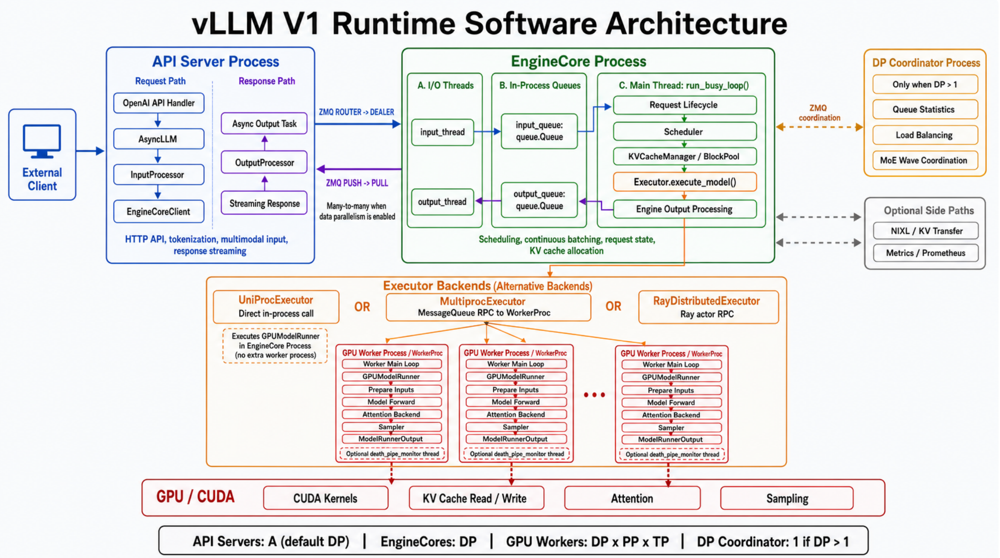

{ width="90%" }

一个请求会跨越四层边界:**模块是代码职责边界,线程是并发边界,进 程是内存隔离边界,GPU 是设备边界**

| 边界 | 通信双方 | 通信方式 |
| --- | --- | --- |
| 网络 | Client ↔ API Server | HTTP/gRPC |
| 进程 | API Server ↔ EngineCore | ZMQ |
| 线程 | EngineCore I/O Thread ↔ Main Thread | queue.Queue |
| 进程，可选 | EngineCore ↔ WorkerProc | MessageQueue RPC |
| 设备 | GPUModelRunner ↔ GPU | CUDA kernel launch |

> 这里要特别区分:
>
> - `InputProcessor` 、`Scheduler` 、`KVCacheManager` 是**模块**。
>
> - `input_thread`、EngineCore main thread、`output_thread` 是线程。
>
> - API Server、EngineCore、WorkerProc 是**进程**。
>
> - GPU 是独立的**硬件执行设备**。
>
> 模块之间不一定跨线程,线程之间不一定跨进程

## 1. Client 请求进入 API Server

客户端通过 OpenAI Compatible API 发起请求：`POST /v1/chat/completions`

API Server 负责:

- 解析 HTTP 和 OpenAI 请求格式

- 应用 chat template

- tokenize

- 处理图片等多模态输入

- 创建采样参数

- 把结果流式返回客户端

API Handler 最终调用 [AsyncLLM.generate()](https://github.com/vllm-project/vllm/blob/v0.25.1/vllm/v1/engine/async_llm.py#L524)

> 这里主要运行在**API Server的asyncio主线程**中：
>
> ```python
> HTTP handler coroutine
>   -> AsyncLLM.generate() coroutine
>   -> AsyncLLM.add_request() coroutine
> ```
>
> 它们是多个 asyncio Task,并不是每个请求创建一个操作系统线程

## 2. InputProcessor 创建 EngineCoreRequest

在 AsyncLLM.add_request() 中，请求会经过[InputProcessor.process_inputs()](https://github.com/vllm-project/vllm/blob/v0.25.1/vllm/v1/engine/async_llm.py#L349)

输入大致发生如下转换:

```python
Prompt / messages + SamplingParams + LoRA / multimodal metadata
  -> EngineCoreRequest
```

`EngineCoreRequest` 是 API Server 与 EngineCore 之间的协议对象,包含:

- `request_id`

- `prompt_token_ids`

- sampling parameters

- multimodal inputs

- priority

- arrival time

- LoRA/KV transfer 等元数据

这里仍然没有发生进程通信,只是 API Server 进程内部的普通函数调用。

## 3. API Server 同时建立输出状态

创建EngineCoreRequest后，执行[AsyncLLM.\_add_request()](https://github.com/vllm-project/vllm/blob/v0.25.1/vllm/v1/engine/async_llm.py#L400-L412)：

```python
self.output_processor.add_request(...)
await self.engine_core.add_request_async(request)
```

顺序非常重要：

1. 先在 `OutputProcessor` 中登记请求。
2. 再把请求发送给 EngineCore。

因此同一个逻辑请求,在 API Server 中会有一个输出侧状态:

```python
OutputProcessor.request_states[request_id]
```

它负责后续的:

- detokenization

- stop string 检查

- logprobs 处理

- 流式输出状态

- 请求完成后的清理

## 4. EngineCoreClient 跨进程发送请求

`EngineCoreClient` 是 API Server 内部组件,不是单独进程。

入口是 [AsyncMPClient.add_request_async()](https://github.com/vllm-project/vllm/blob/v0.25.1/vllm/v1/engine/core_client.py#L1121-L1124),内部调用 [\_send_input()](https://github.com/vllm-project/vllm/blob/v0.25.1/vllm/v1/engine/core_client.py#L1064-L1099)

它把请求编码成:

```python
RequestType.ADD
  + msgpack(EngineCoreRequest)
  + optional tensor buffers
```

然后通过 ZMQ 发送:

```python
API Server Process                    EngineCore Process
EngineCore Client                     input_thread
ZMQ ROUTER —————————————————————————> ZMQ DEALER
```

这是第一个真正的**进程边界**。

这里传递的是序列化数据。EngineCore 收到的对象不是 API Server 中原来的 Python 对象。

## 5. EngineCore input_thread 接收请求

EngineCore 的输入线程运行 [process_input_sockets()](https://github.com/vllm-project/vllm/blob/v0.25.1/vllm/v1/engine/core.py#L1484)

它负责:

```python
ZMQ recv_multipart()
  -> 判断 EngineCoreRequestType
  -> MsgpackDecoder.decode()
  -> preprocess_add_request()
  -> input_queue.put()
```

这里需要明确线程边界:

```python
input_thread
 │
 │ queue.Queue
 ▼
EngineCore main thread
```

`input_thread` 只负责 I/O、反序列化和轻量预处理，不负责执行调度算法。

## 6. EngineCore 主线程接管请求

EngineCore 主线程运行 [run_busy_loop()](https://github.com/vllm-project/vllm/blob/v0.25.1/vllm/v1/engine/core.py#L1259):

```python
while running:
    self._process_input_queue()
    self._process_engine_step()
```

第一步从 `input_queue` 取出请求,并处理 `ADD` 、 `ABORT` 、 `UTILITY` 等消息。

新请求最终进入 [Scheduler.add_request()](https://github.com/vllm-project/vllm/blob/v0.25.1/vllm/v1/core/sched/scheduler.py#L2012):

```python
EngineCoreRequest
   → Request
   → scheduler.requests[request_id]
   → scheduler.waiting
```

从这里开始,请求的生命周期主要由 EngineCore 主线程拥有。

> 因此以下模块虽然职责不同,但主要由同一个线程调用:`Scheduler` 、Request queues、`KVCacheManager`、`BlockPool` 、`Executor` 、Engine output processing
>
> 这就是为什么 Scheduler 和 KV cache 管理通常不需要围绕请求状态添加大量线程锁

## 7. Scheduler 生成本轮执行计划

每一次 EngineCore step 都调用 [Scheduler.schedule()](https://github.com/vllm-project/vllm/blob/v0.25.1/vllm/v1/core/sched/scheduler.py#L396)。

对于第一次执行的新请求:

```python
aiting request
   → prefix cache lookup
   → 计算需要执行多少 token
   → KVCacheManager.allocate_slots()
   → 分配物理 KV blocks
   → waiting → running
   → 写入 SchedulerOutput
```

`SchedulerOutput` 不是模型输出,而是这一轮 GPU 的执行计划:

```python
scheduled_new_reqs
scheduled_cached_reqs
num_scheduled_tokens
block_ids
scheduled_encoder_inputs
scheduled_spec_decode_tokens
preempted_req_ids
finished_req_ids
```

> 可以把它理解为: Scheduler 不直接执行模型,而是生成“这一轮谁执行、执行多少 token、使用哪些 KV block”的计划。

## 8. EngineCore 调用 Executor

EngineCore的[step()](https://github.com/vllm-project/vllm/blob/v0.25.1/vllm/v1/engine/core.py#L479)中完成主流程：

```python
scheduler_output = scheduler.schedule()
model_output = model_executor.execute_model(scheduler_output)
engine_core_outputs = scheduler.update_from_output(
  scheduler_output,
  model_output,
)
```

Executor是一个统一抽象，但下面有三种不同边界

> #### **UniProcExecutor**
>
> [UniProcExecutor.execute_model()](https://github.com/vllm-project/vllm/blob/v0.25.1/vllm/v1/executor/uniproc_executor.py#L108) 使用进程内调用:
>
> ```python
> EngineCore -> UniProcExecutor -> Worker -> GPUModelRunner
> ```
>
> 不经过 Worker 子进程,也没有 MessageQueue RPC。
>
> #### **MultiprocExecutor**
>
> [MultiprocExecutor.execute_model()](https://github.com/vllm-project/vllm/blob/v0.25.1/vllm/v1/executor/multiproc_executor.py#L307) 把执行命令发送给 [WorkerProc](https://github.com/vllm-project/vllm/blob/v0.25.1/vllm/v1/executor/multiproc_executor.py#L557):
>
> ```python
> EngineCore process -> MessageQueue RPC -> WorkerProc process
> ```
>
> 这是第二个进程边界,通常一个 GPU 对应一个 WorkerProc。
>
> #### **RayDistributedExecutor**
>
> [RayDistributedExecutor ](https://github.com/vllm-project/vllm/blob/v0.25.1/vllm/v1/executor/ray_executor.py#L64)使用 Ray Actor RPC,适合分布式、多节点场景。

所以不能简单说: EngineCore 一定通过进程通信调用 GPU Worker，准确说法是: 是否跨进程取决于 Executor 实现。

## 9. GPUWorker调用GPUModelRunner

Worker 收到 SchedulerOutput 后，调用 [GPUWorker.execute_model()](https://github.com/vllm-project/vllm/blob/v0.25.1/vllm/v1/worker/gpu_worker.py#L955)

然后进入 [GPUModelRunner.execute_model()](https://github.com/vllm-project/vllm/blob/v0.25.1/vllm/v1/worker/gpu_model_runner.py#L4070)

主要流程是：

```
SchedulerOutput
  → 更新 Worker 侧请求状态
  → 更新持久化 InputBatch
  → 准备 input_ids / positions
  → 准备 block_table / slot_mapping
  → model forward
  → attention backend
  → sampling
  → ModelRunnerOutput
```

这里还有一层设备边界:

```
GPUModelRunner (CPU Python/C++)
  -> CUDA kernel launch
  -> GPU
```

GPU 负责: GEMM、attention、RMSNorm、RoPE、KV cache 读写、sampling kernels

> GPU 不是一个 vLLM 进程,也不会直接接收 `SchedulerOutput`

## 10. 模型结果回到 EngineCore

GPUModelRunner 返回 `ModelRunnerOutput` 后,EngineCore 调用[Scheduler.update_from_output()](https://github.com/vllm-project/vllm/blob/v0.25.1/vllm/v1/core/sched/scheduler.py#L1499)

这里负责:

- 接收新 token

- 更新 `Request.output_token_ids`

- 更新 `num_computed_tokens`

- 处理 speculative decoding 结果

- 判断 EOS、⻓度限制和停止状态

- 释放已结束请求的 KV blocks

- 构造 `EngineCoreOutput`

数据变化为:

```
ModelRunnerOutput
  -> Scheduler request state update
  -> EngineCoreOutput
  -> EngineCoreOutputs
```

## 11. output_thread 跨进程返回结果

EngineCore 主线程把结果放入:

```
output_queue.put(...)
```

[process_output_sockets()](https://github.com/vllm-project/vllm/blob/v0.25.1/vllm/v1/engine/core.py#L1589) 运行在独立的 `output_thread` 中:

```
EngineCore main thread
 │
 │ output_queue: queue.Queue
 ▼
output_thread
 │
 │ ZMQ PUSH → PULL
 ▼
API Server EngineCoreClient
```

**独立输出线程可以让序列化和 ZMQ 发送与下一轮调度、GPU 执行发生重叠**

## 12. API Server 完成 Detokenization

API Server 中的 [AsyncLLM.output_handler](https://github.com/vllm-project/vllm/blob/v0.25.1/vllm/v1/engine/async_llm.py#L656-L707) 是后台 asyncio Task

它不断执行：

```python
engine_core.get_output_async()
  → OutputProcessor.process_outputs()
  → per-request RequestOutputCollector
```

[OutputProcessor.process_outputs()](https://github.com/vllm-project/vllm/blob/v0.25.1/vllm/v1/engine/output_processor.py#L576)负责：

- token IDs 转换成文本
- stop string 检查
- logprobs 处理
- 构造 RequestOutput
- 把结果放进请求专属队列

最初的 `AsyncLLM.generate()` 从该队列中读取结果并 `yield` ,API Handler 再通过 HTTP streaming 返回客户端。

!!! note "同一请求在不同层的状态"  
    同一个逻辑请求会在不同进程中存在不同表示：这些不是共享的同一个 Python 对象，而是不同层针对自己职责维护的状态
    ```
    API Server Process
      EngineCoreRequest
      OutputProcessor.RequestState
      RequestOutputCollector

    EngineCore Process
      Scheduler.Request
      waiting / running 状态
      KVCacheManager.req_to_blocks

    WorkerProc Process
      Cached request state
      persistent InputBatch
      block table

    GPU
      input tensors
      KV cache tensors
      attention output
    ```

    **API Server 负责输入输出，EngineCore 负责请求生命周期、调度和 KV cache，Executor 负责屏蔽不同部署方式，Worker 与 GPUModelRunner 负责构造执行批次，GPU 负责数值计算。API Server 与 EngineCore 通过 ZMQ 隔离，EngineCore 的 I/O 线程与主线程通过 Python 队列衔接，EngineCore 与 Worker 是否跨进程则由 Executor 类型决定。**
