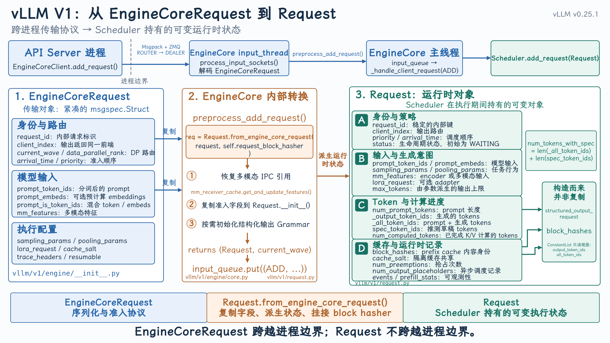
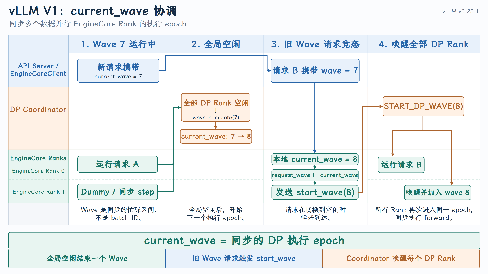

# 从 EngineCoreRequest 到 Request

{ width="100%" }

上一课我们介绍了 `EngineCore` 进程：它包含接收请求的 `input_thread`、执行调度循环的主线程，以及负责发送结果的 `output_thread`。

但这里还留下一个关键问题：

API Server 发送过来的究竟是什么？Scheduler 最终管理的又是什么？

答案是两个不同层次的对象：

- `EngineCoreRequest`：跨进程传输对象
- `Request`：EngineCore 内部的运行时请求对象

本课重点不是请求状态如何变化，而是理解这两个对象为什么同时存在，以及转换过程中增加了哪些运行时信息。

## 1. 为什么需要两种请求对象

`EngineCoreRequest` 和 `Request` 分别服务于两个不同阶段：前者是 API Server 向 EngineCore 发送请求时使用的轻量、可序列化的跨进程传输对象，保存输入、生成参数和路由信息；后者是 EngineCore 收到请求后创建的内部运行对象，由 Scheduler 持续维护其状态、计算进度、输出 token、KV Cache 占用和抢占信息。把两者分开，本质上是将稳定的进程间通信协议与复杂且不断变化的调度状态隔离，避免 API Server 与 Scheduler 的内部实现相互耦合。

## 2. [EngineCoreRequest](https://github.com/vllm-project/vllm/blob/v0.25.1/vllm/v1/engine/__init__.py#L88-L137)

### 1. 请求身份与时间

`request_id: str`

EngineCore 内部使用的唯一请求 ID。

用户最初提供的 ID 可能重复，因此 vLLM 会给它追加随机后缀：

```text
用户请求 ID：
 chatcmpl-123

内部请求 ID：
 chatcmpl-123-a83f20cd
```

转换发生在 [assign_request_id](https://github.com/vllm-project/vllm/blob/v0.25.1/vllm/v1/engine/input_processor.py#L223-L240)

`external_req_id: str | None`

保存用户原始请求 ID，用于：

- 最终输出中的 `request_id`；
- 用户通过原始 ID 取消请求；
- 一个外部请求展开成多个内部请求时建立映射。

因此：

```text
external_req_id = 用户看到的 ID
request_id      = vLLM 内部唯一 ID
```

`arrival_time: float`

请求到达引擎的时间，主要用于：

- 调度策略；
- 排队时间统计；
- TTFT 等性能指标；
- 同优先级请求的先后顺序。

### 2. 模型输入

`prompt_token_ids: list[int] | None`

经过 Chat Template 和 Tokenizer 后的整数序列：

```text
"Hello" → [9707]
```

这是最常见的纯文本输入。

`prompt_embeds: torch.Tensor | None`

调用方直接传入的预计算 embedding。

这种情况下，模型不需要再通过 embedding table 把 token ID 转成向量。

`prompt_is_token_ids: list[bool] | None`

混合输入的位置掩码。

当一个请求同时包含 token ID 和预计算 embedding 时：

```text
位置：                 0      1      2      3
输入：              token  token  embed  token
prompt_is_token_ids: True   True   False  True
```

- `True`：该位置使用 `prompt_token_ids`；
- `False`：该位置使用 `prompt_embeds`；
- `None`：纯 token 或纯 embedding 请求。

`mm_features: list[MultiModalFeatureSpec] | None`

已经预处理的多模态特征，例如：

- 图片特征；
- 视频特征；
- 音频特征；
- 特征在 prompt 中的位置；
- 多模态内容 hash。

它不是原始 HTTP 图片字段，而是给 EngineCore 使用的 `MultiModalFeatureSpec` 列表。

### 3. 执行语义

```text
sampling_params: SamplingParams | None
pooling_params: PoolingParams | None
```

这两个字段决定请求属于哪一种工作模式。

`sampling_params` 和 `pooling_params` 分别描述两类模型请求的执行方式：

- `sampling_params` 用于文本生成任务，规定如何从模型输出的 logits 中选择后续 token，包括 `temperature`、`top_p`、`top_k`、`max_tokens`、停止条件和重复惩罚等；
- `pooling_params` 用于 embedding、分类和打分等非生成任务，规定如何处理模型产生的隐藏状态，例如任务类型、embedding 维度以及是否应用归一化或激活函数。
- 一个请求通常只使用其中一个：生成请求设置 `sampling_params`，Pooling 请求设置 `pooling_params`。

### 4. 模型与缓存配置

`lora_request: LoRARequest | None`

指定本次请求使用哪个 LoRA Adapter，包括：

- LoRA ID；
- LoRA 路径；
- 内部数字 ID。

这使不同请求可以在同一基础模型上使用不同 LoRA。

`cache_salt: str | None`

参与 Prefix Cache 的内容哈希计算。

即使两条请求的 token 相同，只要 `cache_salt` 不同，也不会错误复用相同的 prefix cache：

```text
hash(token blocks, cache_salt)
```

它可以用于隔离不同用户、租户或安全域的缓存。

### 5. 路由与调度控制

`data_parallel_rank: int | None`

指定请求路由到哪个数据并行模型副本。

```text
API Server
   ├── EngineCore / DP rank 0
   ├── EngineCore / DP rank 1
   └── EngineCore / DP rank 2
```

- 有值：显式指定 DP rank；
- `None`：由 CoreClient 的负载均衡逻辑选择。

它主要是 CoreClient 路由字段，不会被复制进 Scheduler 的 `Request`。

`client_index: int = 0`

表示请求来自哪个前端客户端进程。

多个 API Server 可能连接相同的一组 EngineCore：

```text
API Server 0 ─┐
API Server 1 ─┼─→ EngineCore
API Server 2 ─┘
```

EngineCore 处理完成后，要依靠 `client_index` 把输出发回正确的 API Server。

CoreClient 设置该字段的位置见 [add_request_async](https://github.com/vllm-project/vllm/blob/v0.25.1/vllm/v1/engine/core_client.py#L1121)

`current_wave: int = 0`

在 MoE Data Parallel 场景下，多个 EngineCore 必须以相同节奏进入和退出模型执行。当系统从“运行”切换到“全局空闲”时，如果刚好又来了请求，如何保证所有 DP Rank 被一起唤醒？

`current_wave` 是 vLLM 为同步多个 MoE Data Parallel EngineCore 的运行与暂停而引入的执行 epoch；它尤其用于处理“所有 Rank 刚暂停，新请求恰好到达”的并发竞态。

{ width="100%" }

单 EngineCore、普通单卡运行时通常一直为 `0`，可以先忽略。

`priority: int = 0`

请求优先级，交给 Scheduler 决定调度顺序。

它只是表达调度意图，不代表请求一定立刻执行；实际还要受以下条件约束：

- token budget；
- KV Cache；
- 最大并发数；
- LoRA 限制；
- encoder budget。

### 6. 可观测性与高级功能

`trace_headers: Mapping[str, str] | None`

携带分布式链路追踪上下文，例如 OpenTelemetry 的 `traceparent`。

这样可以把：

```text
HTTP 请求
 → API Server
 → EngineCore
 → Scheduler
 → GPU 执行
```

关联到同一条 trace。

`resumable: bool = False`

表示请求是否支持流式暂停后恢复。

进入 `Request` 后会创建相应的 streaming queue，保存流式更新。

`reasoning_ended: bool | None = None`

记录 reasoning 阶段是否已经结束，主要服务于：

- reasoning model；
- structured output；
- reasoning parser 与 grammar 状态衔接。

`reasoning_parser_kwargs: dict[str, Any] | None = None`

传递给 reasoning parser 的附加参数。

这些参数最终会进入 `StructuredOutputRequest`，而不是直接参与模型矩阵计算。

`abort_immediately: bool = False`

请求进入 Scheduler 后立即取消。

它看起来有些奇怪，但主要是为了触发标准的请求结束清理流程，特别是 P/D 分离场景：

```text
P 节点已经为请求保存 KV
            │
D 节点拒绝接纳请求
            │
仍将请求短暂加入 Scheduler
            │
立即 abort
            │
触发 connector.request_finished()
            │
释放 P 节点相关资源
```

## 3. [Request](https://github.com/vllm-project/vllm/blob/v0.25.1/vllm/v1/request.py#L59)

下面只整理 `Request` 相比 `EngineCoreRequest` 新增或派生出的运行时字段，重复字段不再介绍。定义见Request

### 1. 生命周期与结束状态

| 字段 | 含义 |
| --- | --- |
| `status` | 请求当前状态，例如 `WAITING`、`RUNNING`、`PREEMPTED`、`FINISHED_STOPPED`。Scheduler 根据它决定请求应该位于哪个队列以及能否继续调度。 |
| `events` | 请求经历的调度事件列表，例如进入队列、被调度、被抢占，用于统计排队时间、TTFT 等指标。 |
| `stop_reason` | 触发请求停止的具体原因，可能是停止 token、停止字符串或其他内部原因。 |
| `max_tokens` | 本次请求允许的最大输出长度。生成请求来自 `sampling_params.max_tokens`；Pooling 请求内部设置为 `1`，作为调度语义上的占位值。 |
| `num_preemptions` | 请求被 Scheduler 抢占的次数，用于统计和调度分析。 |

### 2. Token 与计算进度

| 字段 | 含义 |
| --- | --- |
| `num_prompt_tokens` | Prompt 的总长度，可能由 `prompt_token_ids`、`prompt_embeds` 或二者共同计算得出。 |
| `_output_token_ids` | 已经确认生成的输出 token，可被内部方法追加。 |
| `_all_token_ids` | Prompt token 与已生成输出 token 的完整序列。 |
| `output_token_ids` | `_output_token_ids` 的只读视图，防止外部直接修改而破坏状态一致性。 |
| `all_token_ids` | `_all_token_ids` 的只读视图。 |
| `num_computed_tokens` | 已经完成模型计算的 token 数，是 Scheduler 判断后续工作量的核心字段。 |
| `spec_token_ids` | 推测解码器给出的候选 token，尚未被目标模型验证。 |

调度器计算待执行 token 数时，核心关系是：

```text
num_tokens_with_spec
= len(_all_token_ids) + len(spec_token_ids)

pending_tokens
= num_tokens_with_spec - num_computed_tokens
```

### 3. 异步调度与流水线状态

| 字段 | 含义 |
| --- | --- |
| `num_output_placeholders` | 异步调度提前为尚未返回的输出预留的占位 token 数。 |
| `async_tokens_to_discard` | 异步结果返回后需要丢弃的 token 数，主要处理提前调度与实际结束条件之间的偏差。 |
| `next_decode_eligible_step` | 请求下一次允许执行 decode 的调度 step，主要用于流水线并行和异步调度的节奏控制。 |
| `last_sched_seq` | 请求最近一次被调度时的序列号，用于确保异步执行完成前不提前释放 KV block。 |

这些字段主要用于普通同步调度之外的高级路径；单卡、同步调度时通常不会成为理解主线。

### 4. Prefill 与 Prefix Cache

| 字段 | 含义 |
| --- | --- |
| `is_prefill_chunk` | 本次是否只调度了 Prompt 的一个非最终分块，用于 Chunked Prefill。 |
| `block_hashes` | 按 token block 计算出的内容哈希，用于 Prefix Cache 查找相同前缀。 |
| `_block_hasher` | 负责计算 `block_hashes` 的函数引用。 |
| `_prompt_embeds_per_block_hashes` | 缓存每段 `prompt_embeds` 的哈希，避免重复计算相同 embedding block 的哈希。 |
| `skip_reading_prefix_cache` | 当前请求是否禁止从 Prefix Cache 读取已有 KV block。 |
| `prefill_stats` | 记录 Prompt 长度、本地缓存命中、外部缓存命中等 Prefill 统计信息。 |

这里要区分：

```text
block_hashes
 找到“内容相同”的缓存块

KVCacheManager.req_to_blocks
 记录请求实际持有哪些缓存块
```

`Request` 保存内容身份和计算进度，但 KV block 的所有权映射仍由 KV Cache Manager 维护。

### 5. 缓存传输与分离式执行

| 字段 | 含义 |
| --- | --- |
| `kv_transfer_params` | KV Connector 使用的请求级参数，服务于 P/D 分离、远程 KV 加载和保存等场景。 |

普通单机推理通常不使用这些字段；配置了 KV Connector 或 Encoder Cache Connector 后才会进入相关路径。

### 6. 结构化输出状态

| 字段 | 含义 |
| --- | --- |
| `structured_output_request` | 从生成参数中提取出的结构化输出运行状态，包括 grammar、允许 token 集合及 reasoning parser 状态等。 |

如果该字段存在，请求最初可能进入：

```text
WAITING_FOR_STRUCTURED_OUTPUT_GRAMMAR
```

只有 grammar 编译完成后，Scheduler 才能正常调度它。它不是用户输入参数的简单副本，而是 EngineCore 内部使用的结构化输出状态对象。

### 7. 流式与可恢复输出

| 字段 | 含义 |
| --- | --- |
| `streaming_queue` | 保存可恢复流式请求的增量更新；队列中的 `None` 表示流已经结束。 |

它用于支持请求执行期间的流式消费和恢复，不是普通非流式请求的主要状态。

### 8. 正确性与异常检测

| 字段 | 含义 |
| --- | --- |
| `num_nans_in_logits` | 模型 logits 中出现的 NaN 数量。大于零说明模型输出可能已损坏，可用于异常检测和日志统计。 |

### 整体关系

```text
Request
├── 生命周期
│   ├── status
│   ├── events
│   └── stop_reason
├── 计算进度
│   ├── num_computed_tokens
│   ├── output_token_ids
│   └── spec_token_ids
├── 异步执行
│   ├── num_output_placeholders
│   └── last_sched_seq
├── Prefix Cache
│   ├── block_hashes
│   ├── skip_reading_prefix_cache
├── 扩展执行
│   ├── kv_transfer_params
│   └── structured_output_request
└── 统计与输出
    ├── prefill_stats
    ├── num_preemptions
    ├── num_nans_in_logits
    └── streaming_queue
```

因此，`Request` 最核心的三组状态是：生命周期状态、Token 计算进度和 Prefix Cache 身份；其余字段主要服务于异步调度、推测解码、结构化输出、流式传输和 P/D 分离等扩展能力。

## 3. 请求如何进入 EngineCore

### 1. 发送请求

API Server 进程中的 `EngineCoreClient.add_request()` 会调用 `_send_input()`：

```python
def add_request(self, request: EngineCoreRequest) -> None:
    self._send_input(EngineCoreRequestType.ADD, request)
```

`_send_input()` 使用 Msgpack 编码请求，然后通过 ZMQ 发送：

```python
msg = (
    self.core_engine,
    request_type.value,
    *self.encoder.encode(request),
)

self.input_socket.send_multipart(msg, copy=False)
```

[查看 EngineCoreClient 发送请求](https://github.com/vllm-project/vllm/blob/v0.25.1/vllm/v1/engine/core_client.py#L861-L890)

因此，跨越进程边界的是：

```text
EngineCoreRequestType.ADD + EngineCoreRequest
```

而不是 `Request`。

### 2. input_thread 解码请求

EngineCore 的 `input_thread` 运行 `process_input_sockets()`。

它首先创建专门针对 `EngineCoreRequest` 的解码器：

```python
add_request_decoder = MsgpackDecoder(
    EngineCoreRequest,
    oob_tensor_provider=self.tensor_ipc_receiver,
)
```

接收到 `ADD` 消息后执行：

```python
req = add_request_decoder.decode(data_frames)
request = self.preprocess_add_request(req)
```

[查看 input_thread 接收与解码](https://github.com/vllm-project/vllm/blob/v0.25.1/vllm/v1/engine/core.py#L1490-L1587)

这里的 `req` 仍然是 `EngineCoreRequest`。真正的对象转换发生在 `preprocess_add_request()`。

### 3. 转换发生在哪里

核心代码非常短：

```python
def preprocess_add_request(
    self,
    request: EngineCoreRequest,
) -> tuple[Request, int]:
    if self.mm_receiver_cache is not None and request.mm_features:
        request.mm_features = (
            self.mm_receiver_cache.get_and_update_features(
                request.mm_features
            )
        )

    req = Request.from_engine_core_request(
        request,
        self.request_block_hasher,
    )

    if req.use_structured_output:
        self.structured_output_manager.grammar_init(req)

    return req, request.current_wave
```

[查看 preprocess_add_request()](https://github.com/vllm-project/vllm/blob/v0.25.1/vllm/v1/engine/core.py#L855-L877)

这个函数主要完成三件事：

1. 恢复或解析多模态特征引用。
2. 调用 `Request.from_engine_core_request()` 构造运行时对象。
3. 如果使用结构化输出，初始化对应的 Grammar。

转换完成后，得到：

```text
(Request, current_wave)
```

然后放入 EngineCore 的 `input_queue`，交给主线程处理。

### 4. from_engine_core_request 做了什么

`Request.from_engine_core_request()` 本身主要负责字段映射：

```python
@classmethod
def from_engine_core_request(
    cls,
    request: EngineCoreRequest,
    block_hasher,
) -> "Request":
    return cls(
        request_id=request.request_id,
        client_index=request.client_index,
        prompt_token_ids=request.prompt_token_ids,
        prompt_embeds=request.prompt_embeds,
        mm_features=request.mm_features,
        sampling_params=request.sampling_params,
        pooling_params=request.pooling_params,
        arrival_time=request.arrival_time,
        priority=request.priority,
        block_hasher=block_hasher,
        ...
    )
```

[查看转换方法](https://github.com/vllm-project/vllm/blob/v0.25.1/vllm/v1/request.py#L198-L222)

真正重要的工作发生在 `Request.__init__()` 中。

它不是简单复制字段，而是在复制之后建立一组运行时状态。

### 5. 转换完成后发生什么

input thread 将转换后的对象放入：

```python
self.input_queue.put_nowait(
    (EngineCoreRequestType.ADD, (request, current_wave))
)
```

EngineCore 主线程从 `input_queue` 取出消息，进入：

```python
_handle_client_request()
```

对 `ADD` 类型执行：

```python
req, request_wave = request
self.add_request(req, request_wave)
```

最终进入：

```python
self.scheduler.add_request(request)
```

Scheduler 随后保存请求，并将其放入 waiting queue。

[查看主线程请求分发](https://github.com/vllm-project/vllm/blob/v0.25.1/vllm/v1/engine/core.py#L1372-L1405)

[查看 Scheduler.add_request()](https://github.com/vllm-project/vllm/blob/v0.25.1/vllm/v1/core/sched/scheduler.py#L2012-L2035)

完整路径可以概括为：

```text
EngineCoreClient
    ↓ Msgpack + ZMQ
EngineCoreRequest
    ↓ input_thread 解码
preprocess_add_request()
    ↓
Request.from_engine_core_request()
    ↓
Request
    ↓ input_queue
EngineCore Main Thread
    ↓
Scheduler.add_request()
    ↓
waiting queue
```

## 总结

`EngineCoreRequest` 和 `Request` 不是重复设计：

| 对象 | 核心职责 |
| --- | --- |
| `EngineCoreRequest` | API Server 与 EngineCore 之间的序列化和准入协议 |
| `Request` | Scheduler 持有并持续修改的运行时请求状态 |
| 转换方法 | 复制输入和配置，派生状态、进度、缓存与统计字段 |
