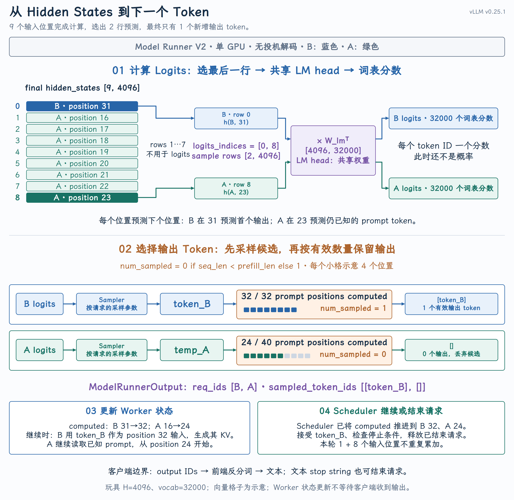

# 从 Hidden States 到 Output Token

{ width="100%" }

## 引言：从模型表示到输出，再到下一轮输入

上一课解释了当前 Q/K/V 如何经过 Attention 读取上下文，以及历史 K/V 怎样跨轮复用。Attention 的输出仍是中间表示，还要经过输出投影、残差连接、MLP、后续模型层和最终归一化，才能得到模型的 final hidden states。这些向量已经包含上下文，但还不是 token ID。本课继续回答：模型怎样从这些向量中选出下一个 token，并让请求从正确的位置继续执行？

源码仍以 vLLM v0.25.1、Model Runner V2 和 Llama 为准，聚焦单卡、普通自回归生成：不启用投机解码，不展开 pooling、prompt logprobs 和异步调度的专用路径。

### 整体执行流程

模型执行之后，主线只有四个阶段：计算 Logits → 选择输出 Token → 更新执行状态 → 继续或结束请求。

下面省略 Executor、Worker 的转发层；缩进表示函数内部的组织关系，箭头表示调用发起或结果流向。

```text
Scheduler.schedule() → 本轮执行计划
    ↓ EngineCore 通过 Executor 发起模型执行
GPUModelRunner.execute_model()
    Transformer forward → 暂存最终 hidden states，返回 None
    ↓ EngineCore 随后通过 Executor 发起采样
GPUModelRunner.sample_tokens()
    ├─ sample()
    │   ├─ ① 计算 Logits：选出预测行 → LM head 投影
    │   └─ ② 选择输出 Token：Sampler 采样 → 确定有效数量
    └─ ③ 更新执行状态：保存有效 token、推进 Worker 计算进度
         同时整理执行回执 ModelRunnerOutput
    ↓ 回执返回 Core
④ Scheduler.update_from_output()：继续或结束请求
    追加输出、检查停止条件 → 继续调度，或结束并释放资源
    新增输出交给前端转成文本
```

调度、执行、接收结果由[`EngineCore.step()`](https://github.com/vllm-project/vllm/blob/v0.25.1/vllm/v1/engine/core.py#L490-L506)组织。`execute_model()` [暂存最终表示](https://github.com/vllm-project/vllm/blob/v0.25.1/vllm/v1/worker/gpu/model_runner.py#L1341-L1354)，`sample_tokens()` 再 [取出这些数据](https://github.com/vllm-project/vllm/blob/v0.25.1/vllm/v1/worker/gpu/model_runner.py#L1358-L1371)并 [调用](https://github.com/vllm-project/vllm/blob/v0.25.1/vllm/v1/worker/gpu/model_runner.py#L1391-L1394) [`sample()`](https://github.com/vllm-project/vllm/blob/v0.25.1/vllm/v1/worker/gpu/model_runner.py#L1391-L1394)。采样使用本轮已经算好的表示，不会再执行一次 Transformer forward。下面先看第一处变化：模型为每个输入位置都产生一行表示，但预测下一 token 时，并不需要使用所有行。

## 一、计算 Logits：选出预测位置，再计算词表分数

### 先确定每一行在预测什么

这里沿用第17课的 A/B 输入例子，跟踪它经过完整模型后的结果。两个请求都在处理 prompt，只是 B 本轮刚好完成，A 还没有完成；B 的输入只有1个 token，也不能因此把它叫作 Decode。

| 请求 | Prompt 长度 | 本轮输入 positions | final hidden rows | 本轮后已计算长度 |
| --- | --- | --- | --- | --- |
| B | 32 | `31` | `0` | 32 |
| A | 40 | `16…23` | `1…8` | 24 |

Llama 的模型主体在所有层执行后 [应用 final norm 并返回 hidden states](https://github.com/vllm-project/vllm/blob/v0.25.1/vllm/model_executor/models/llama.py#L419-L439)。假设 hidden size 为4096，本轮结果就是 `[9, 4096]`：9行对应本轮9个输入位置，4096列是每个位置的特征维度。自回归模型用 position `p` 的最终表示预测 position `p+1`。因此 B 的最后一行预测第一个生成 token；A 的最后一行预测 prompt position 24，但那个 token 实际上已经由用户给定。这就是两行预测随后会被不同处理的原因。

### 选出每个请求用于预测的行

每个请求最后一个已执行位置的 hidden state，已经通过各层 causal Attention 汇总了可见前缀。下一 token 的预测直接使用这一行，不需要再把请求的所有 hidden rows 求平均。

本例请求边界是 `query_start_loc = [0, 1, 9]`，所以普通单 token 生成路径选择：

```text
logits_indices = query_start_loc[1:] - 1 = [0, 8]

[9, 4096] final hidden states
    ↓ 选择 rows 0、8
[2, 4096] sample hidden states
```

这是非投机路径下的等价写法；实际[`_combine_sampled_and_draft_tokens_kernel()`](https://github.com/vllm-project/vllm/blob/v0.25.1/vllm/v1/worker/gpu/input_batch.py#L318-L335)按每个请求需要的 logits 行数，从 query 末尾生成索引。行号0和8是当前 batch 的位置，不是请求 ID，也不是 token ID。两行按 B、A 排列，后面的 logits、候选 token 和有效数量沿用这个顺序。

### LM head 把特征投影成词表分数

选行之后，每个请求留下一个4096维向量。它的每一维是特征，不是某个 token 的概率。要从中选择 token，还需要把特征映射到词表中的每个候选，这就是 LM head 的作用。假设词表大小为32000，忽略量化、并行和额外缩放，计算可写成：

```text
sample_hidden_states [2, 4096]
× W_lmᵀ              [4096, 32000]
= logits             [2, 32000]
```

`W_lm` 是模型学习出的输出权重，按 `[词表大小, hidden size]` 存储，本例为`[32000,4096]`。第 `j` 行权重与当前 hidden state 做点积，得到 token ID `j` 的分数；图中的 B、A 使用同一组权重，分别计算各自的分数。例如，`logits[0,101]` 就是 B 对 token ID 101 的分数，而不是输入 position 101 的结果。结果的每一列对应一个词表 token ID，数值表示这个 token 作为下一 token 的相对倾向。Logits 不是概率：可以为负，也不要求加起来等于1；hidden size 与词表大小是两个不同的维度。模型构造时，Llama 已经 [创建](https://github.com/vllm-project/vllm/blob/v0.25.1/vllm/model_executor/models/llama.py#L484-L497) [`lm_head`](https://github.com/vllm-project/vllm/blob/v0.25.1/vllm/model_executor/models/llama.py#L484-L497) [与](https://github.com/vllm-project/vllm/blob/v0.25.1/vllm/model_executor/models/llama.py#L484-L497) [`logits_processor`](https://github.com/vllm-project/vllm/blob/v0.25.1/vllm/model_executor/models/llama.py#L484-L497)。运行时，[`GPUModelRunner.sample()`](https://github.com/vllm-project/vllm/blob/v0.25.1/vllm/v1/worker/gpu/model_runner.py#L1048-L1068)先按索引取行，再调用模型的 `compute_logits()`。Llama 的 [`compute_logits()`](https://github.com/vllm-project/vllm/blob/v0.25.1/vllm/model_executor/models/llama.py#L528-L533)把 hidden states 和 `lm_head` 交给 LogitsProcessor，由 [`_get_logits()`](https://github.com/vllm-project/vllm/blob/v0.25.1/vllm/model_executor/layers/logits_processor.py#L89-L104)执行输出投影。选行与投影在 `GPUModelRunner.sample()` 中对应的就是：

```python
sample_hidden_states = hidden_states[input_batch.logits_indices]  # 选行
logits = self.model.compute_logits(sample_hidden_states)           # 词表投影
```

与第18课的 `o_proj` 不同：`o_proj` 在 Attention 层内部混合各 head 的特征，这里的 LM head 则作用于模型最终表示，把特征维转换成词表维。现在 B、A 各有一行词表分数。接下来才需要决定：从这一整行分数里选谁？

## 二、选择输出 Token：先采样候选，再确定是否有效

### 处理词表分数，采样候选 token

上一步得到 `[2,32000]` 的 logits：两行属于两个请求，不能把两行混在一起采样。Runner 将它们交给 `self.sampler(logits, input_batch)`，各行按所属请求的采样参数选择候选。模型给出分数，采样参数决定如何使用这些分数。先用一个仅有4个候选的教学词表说明，数值不是实际模型输出：

| 候选 token ID | 101 | 102 | 103 | 104 |
| --- | --- | --- | --- | --- |
| Logit | 2 | 1 | 0 | -1 |
| temperature=1时的 softmax 概率 | 0.644 | 0.237 | 0.087 | 0.032 |

- Greedy：取分数最大的 token，本例选101。vLLM 用 `temperature=0` 表达这条路径，不是实际把 logits 除以0。

- 随机采样：按概率选择，101更容易被选中，但不是每次都选101。对正 temperature，数学上先用`logits / temperature` 调整分布；温度更低，概率更集中，温度更高则更平缓。

- Top-k / Top-p：先缩小允许参与抽样的集合。Top-k 保留最高的 k 个；Top-p 保留按概率从高到低累积达到阈值所需的高概率候选。本例单独设 top-k=2，便只在101、102中按约0.731、0.269的概率抽样。

Penalties 则利用已有 token history 调整分数，常见用途是抑制重复；它改变“选谁”，不会修改已经生成的 K/V。对应的 [`Sampler.apply_sampling_params()`](https://github.com/vllm-project/vllm/blob/v0.25.1/vllm/v1/worker/gpu/sample/sampler.py#L146-L196)处理 bias、penalties、禁词、temperature 等约束。

这些处理由 [`Sampler.sample()`](https://github.com/vllm-project/vllm/blob/v0.25.1/vllm/v1/worker/gpu/sample/sampler.py#L208-L244)组织：先应用采样参数，再根据条件使用 FlashInfer sampling，或 top-k/top-p 过滤后的 Gumbel sampling。这里的 softmax 概率用来解释选择含义，不代表所有实现都必须先物化完整概率张量。[Gumbel 路径](https://github.com/vllm-project/vllm/blob/v0.25.1/vllm/v1/worker/gpu/sample/gumbel.py#L135-L158)给 logits 加适当的随机噪声后取最大值，实现相应分布的抽样；greedy 则不加这份噪声。本课不展开采样 kernel 的实现细节。

### 确定候选能否成为本轮输出

回到主图，用 `token_B` 表示 B 的采样结果，用 `temp_A` 表示 A 的临时候选值。它们是教学占位符，不是实际 token ID。统一批处理路径可以为 A 的最后一行计算 logits、生成候选，但 A 的 prompt 还没计算完。`temp_A` 预测的是已知的 prompt position 24，而不是完整 prompt 之后的回答。如果把它追加为生成结果，就会把尚未读完 prompt 时的预测混进输出历史。因此，选出候选和接受为本轮输出是两件事。既然 A 不能输出，为什么还要为它采样？本课采用的 Runner V2 普通路径，为每个请求保留一行 logits 并统一采样，再用有效数量屏蔽尚未完成 Prefill 的请求。这是这条实现路径的批处理方式，不是自回归模型要求必须计算这个无效候选。[`Sampler.__call__()`](https://github.com/vllm-project/vllm/blob/v0.25.1/vllm/v1/worker/gpu/sample/sampler.py#L94-L144)在采样后计算 `num_sampled`，将候选张量和每个请求的有效数量一起放入 `SamplerOutput`。普通路径的 [有效数量判断](https://github.com/vllm-project/vllm/blob/v0.25.1/vllm/v1/worker/gpu/input_batch.py#L418-L435)等价于：

```python
num_sampled = 0 if seq_len < prefill_len else 1
```

这里 `seq_len` 是包含本轮输入后的已计算序列长度，不包括刚采样出的 token。本例 `prefill_len` 等于 prompt 长度，于是 B 得到1，A 得到0，正如图中的橙色区域。更一般地，`prefill_len` 来自[请求进入 Worker 时已有的 token 序列长度](https://github.com/vllm-project/vllm/blob/v0.25.1/vllm/v1/worker/gpu/states.py#L100-L111)，恢复请求时不一定只包含原始 prompt。`num_sampled=0` 不会撤销 A 的8个输入位置：它们已经完成计算、写入 K/V。它只表示这次候选不应追加到生成结果。注意这也不是概率置信度检查，不是说 `temp_A` 的分数不够高。到这里，GPU 上的 `SamplerOutput` 保存两份配套数据：

```text
sampled_token_ids = [[token_B], [temp_A]]   形状 [2,1]：每个请求一个候选
num_sampled      = [1, 0]                 形状 [2]：每行有几个有效 token
```

`num_sampled=0` 先标记 A 的候选无效，并不立即从 GPU 候选张量中删除那一行。接下来要把它们交给 CPU，同时为下一轮保留正确的 Worker 状态。

## 三、更新执行状态：返回结果，准备下一轮输入

采样结果一方面要返回 Core，另一方面要留在 Worker，供下一轮构造输入。返回时[，按](https://github.com/vllm-project/vllm/blob/v0.25.1/vllm/v1/worker/gpu/async_utils.py#L49-L70) [`num_sampled`](https://github.com/vllm-project/vllm/blob/v0.25.1/vllm/v1/worker/gpu/async_utils.py#L49-L70) [整理有效 token 列表](https://github.com/vllm-project/vllm/blob/v0.25.1/vllm/v1/worker/gpu/async_utils.py#L49-L70)，得到执行回执：

```text
ModelRunnerOutput
  req_ids           = [B, A]
  sampled_token_ids = [[token_B], []]
```

这份 `ModelRunnerOutput` 只包含 B 的有效 token，不把 A 的临时候选当成输出；它还不是客户端文本响应。

### 输入计算进度与输出长度分别更新

Worker 不能只把结果发走：如果下一轮还要执行 B，它自己也需要知道刚生成的 token ID。[`postprocess_sampled()`](https://github.com/vllm-project/vllm/blob/v0.25.1/vllm/v1/worker/gpu/model_runner.py#L1082-L1107)调用 [`post_update()`](https://github.com/vllm-project/vllm/blob/v0.25.1/vllm/v1/worker/gpu/input_batch.py#L480-L516) [对应的 kernel](https://github.com/vllm-project/vllm/blob/v0.25.1/vllm/v1/worker/gpu/input_batch.py#L480-L516)，用有效数量决定是否追加 token，同时按实际输入量推进 computed progress。

| 请求 | `num_computed_tokens` | `total_len`：已有 token ID 数量 | 为下一轮保留什么 |
| --- | --- | --- | --- |
| B | 31 → 32 | 32 → 33 | 新增 `token_B`，同时存入`last_sampled_tokens` |
| A | 16 → 24 | 40 → 40 | 不追加 `temp_A`，保留原有完整 prompt |

A 的 `total_len` 原本就是40，因为用户已经提供了全部 prompt token IDs；“已有40个 token ID”和“其中只有24个位置完成模型计算”并不矛盾。B 则相反：本轮后已有33个 token IDs，但只计算了32个位置。刚生成的 `token_B` 还没有自己的 K/V。 若请求继续，它在下一轮作为 position 32 的输入，才会经过各层投影、RoPE 和缓存写入。这与上一课的“先采样，下轮再产生该 token 的 K/V”一致。结果复制与本地更新由 [`sample_tokens()`](https://github.com/vllm-project/vllm/blob/v0.25.1/vllm/v1/worker/gpu/model_runner.py#L1415-L1454)安排，Worker 不需要等待 Core 收到回执才更新状态；异步复制的细节不在这里展开。

## 四、继续或结束请求：Scheduler 接受执行结果

Worker 已经准备好下一轮需要的本地状态，但它不负责决定请求是否还应继续调度。`ModelRunnerOutput` 返回后，EngineCore 调用 Scheduler 的[`update_from_output()`](https://github.com/vllm-project/vllm/blob/v0.25.1/vllm/v1/core/sched/scheduler.py#L1562-L1581)，按请求 ID 找回对应结果。不能假设 Scheduler 的遍历顺序总和 Worker batch 一致。这里要分清两项更新：输入位置的计算进度与新增的输出 token。Scheduler 在本轮构造 `SchedulerOutput` 后，已经通过[`_update_after_schedule()`](https://github.com/vllm-project/vllm/blob/v0.25.1/vllm/v1/core/sched/scheduler.py#L1164-L1177)把 B、A 的计划计算进度推进到32、24，因此收到回执后不能再把本轮的1和8重复加上去。Worker 的 GPU 状态与 Scheduler 的 CPU `Request` 是各自维护的状态，更新时刻不同；本课普通成功路径中，两侧最终都到达32、24。拒绝候选或重算时的进度校正不在这里展开。本轮需要追加的是输出：Scheduler [将有效 token 加入请求并检查停止条件](https://github.com/vllm-project/vllm/blob/v0.25.1/vllm/v1/core/sched/scheduler.py#L1897-L1913)。B 追加 `token_B`，A 的空列表不产生新输出。Worker 保存 B 的 token 是为了构造输入，Scheduler 保存它则是为了维护请求的输出历史与生命周期；不是给同一个请求生成了两次 token。这里检查的是 EOS、stop token ID、长度限制等[请求级条件](https://github.com/vllm-project/vllm/blob/v0.25.1/vllm/v1/core/sched/utils.py#L94-L117)；真正结束的请求随后进入 [资源释放路径](https://github.com/vllm-project/vllm/blob/v0.25.1/vllm/v1/core/sched/scheduler.py#L1704-L1716)。因此 `num_sampled=1` 只说明有一个有效生成结果，不保证还会有下一轮，也不保证它会显示成一个字符。对没有停止的请求，本例的下一轮输入就已经确定：

- B：用刚生成的 `token_B` 作为 position 32 的输入，开始 Decode。

- A：继续读取用户给定的 prompt，从 position 24 开始处理下一块。

前者的输入来自模型输出，后者的输入来自尚未计算的 prompt。它们都复用已有 KV Cache，由下一轮 Scheduler 决定实际计算多少个位置。对外输出还剩一层转换：Scheduler 将新增 token 封装成[`EngineCoreOutput`](https://github.com/vllm-project/vllm/blob/v0.25.1/vllm/v1/core/sched/scheduler.py#L1731-L1744)，前端再 [反分词并生成 RequestOutput](https://github.com/vllm-project/vllm/blob/v0.25.1/vllm/v1/engine/output_processor.py#L635-L666)。前端负责文本 stop string，与 Scheduler 的 stop token ID 不同；若文本条件使请求提前结束，前端会 [通知 Core 中止](https://github.com/vllm-project/vllm/blob/v0.25.1/vllm/v1/engine/async_llm.py#L685-L689)。这里不再展开文本拼接和 HTTP 流式封装。

## 结语

本轮计算9个输入位置，选择2行做预测，但最终只为 B 追加1个生成 token。A 虽然没有新输出，却完成了8个 prompt 位置的计算。这三种数量不能混为一谈：执行多少输入、计算多少行 logits、接受多少输出。有效 token 同时成为本轮的返回结果和下一轮可能使用的输入，执行主线由此闭合。
