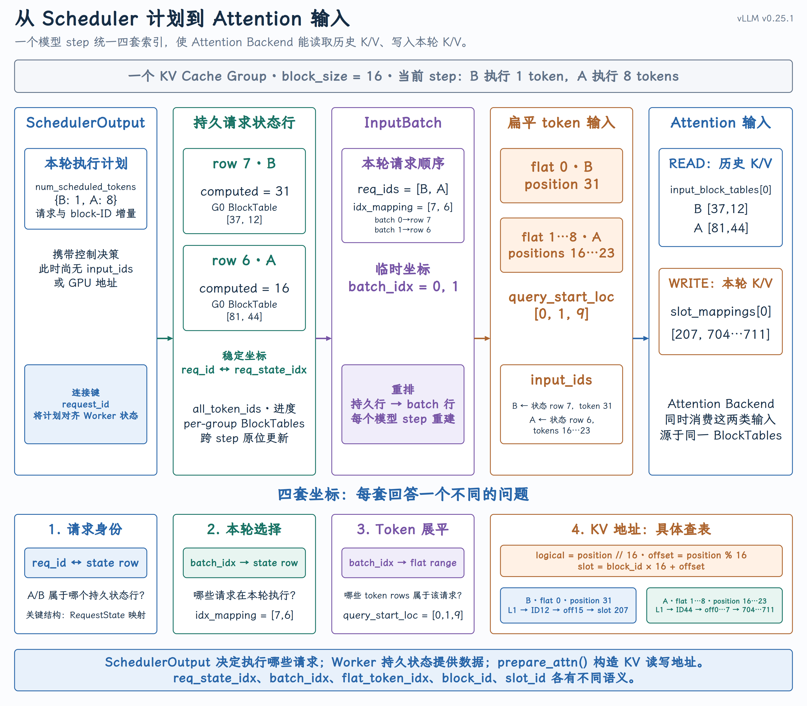

# 请求变成 GPU 输入

{ width="100%" }

## 课程回顾

上一课已经讲清楚：

```text
Scheduler.schedule()
→ 生成 SchedulerOutput
→ Executor 将等价的执行计划发送给每个 Worker
→ GPUModelRunner.execute_model(scheduler_output)
```

`SchedulerOutput` 中已经记录本轮执行哪些请求、每个请求计算多少 tokens，以及 KV block 映射发生了哪些变化。Block IDs 由 Scheduler 决定；Worker 只接收并物化这些决定。但 `SchedulerOutput` 仍然是按 `req_id` 组织的 CPU 控制信息，不是模型可以直接消费的 GPU 张量。

本课只回答一个问题：

Worker 如何把一份以请求和 token 数量表达的调度计划，转换成稠密的 GPU token 输入，并为每个 token 找到 KV Cache 写入位置？

整个过程可以记成四次坐标转换：

```text
1. req_id → req_state_idx
   找回请求在 Worker 中的跨 step 状态行

2. 驻留请求集合 → 当前 batch + idx_mapping
   选出本轮请求；idx_mapping 再把 batch_idx 映射回 req_state_idx

3. batch_idx → flat_token_idx + model position
   把不等长请求压成连续 token 输入

4. model position → logical block → block_id → slot_id
   找到每个 token 的 KV Cache 写入槽位
```

### 本课的简化例子

为了把 Worker 内部的坐标转换讲清楚，以下使用一个两请求、9-token 的封闭例子：

| 请求 | Prompt 长度 | `req_state_idx` | 本轮前 computed | 本轮 token 数 | 本轮 positions | Group 0 Block IDs |
| --- | --- | --- | --- | --- | --- | --- |
| B | 32 | 7 | 31 | 1 | `31` | `[37, 12]` |
| A | 40 | 6 | 16 | 8 | `16…23` | `[81, 44]` |

请求 A 上一个 step 已经执行 positions `0…15`，所以本轮从16继续。以下以普通 Model Runner V2路径为主，使用一个 KV Cache Group，`CP_SIZE = 1`，KV page size 与 backend kernel block size 都是16 tokens。Prefix Caching、Speculative Decoding、Pipeline Parallel、Context Parallel 和 CUDA Graph padding 不进入主线。

## 一、`req_id` 转换为 Worker 状态行

### 调度计划只存活一轮，请求状态需要跨轮保留

模型服务不是一次 forward 就结束。同一请求可能连续执行几十甚至几千个 step，因此 Worker 不能每轮都重新建立 Token IDs、已计算进度和 BlockTable。

| 数据结构 | 存活时间 | 回答的问题 |
| --- | --- | --- |
| `SchedulerOutput` | 当前 step | 本轮新增、更新、删除和执行哪些请求？ |
| `RequestState` + `BlockTables` | 请求驻留 Worker 期间 | 请求状态在哪一行，该行使用哪些 block IDs？ |
| `InputBatch` | 当前 step | 本轮执行哪些请求，它们如何排列？ |

这里的“跨轮保留”只表示状态会继续存在于多次 `execute_model()` 之间，不是写入磁盘，也不能在 Worker 进程重启后恢复。

### `req_state_idx` 是 Worker 本地的稠密行号

Scheduler 使用字符串 `req_id` 标识请求，但 Worker 的高频路径要访问预分配的数组和 GPU 张量。新请求首次进入 Worker 时，[`GPUModelRunner.add_requests()`](https://github.com/vllm-project/vllm/blob/v0.25.1/vllm/v1/worker/gpu/model_runner.py#L766-L811)会调用[`RequestState.add_request()`](https://github.com/vllm-project/vllm/blob/v0.25.1/vllm/v1/worker/gpu/states.py#L87-L113)为它分配一个可复用行号：

```python
req_idx = self.free_indices.pop()
self.req_id_to_index[req_id] = req_idx
self.index_to_req_id[req_idx] = req_id
```

在例子中：

```text
request A: req_id "A" → req_state_idx 6
request B: req_id "B" → req_state_idx 7
```

源码中局部变量常叫 `req_idx` 或 `req_index`；当它被解释为“Worker 请求状态行号”时，kernel 参数常叫 `req_state_idx`。它们是同一套索引语义，不是两种不同 ID。请求完成或被抢占时，[`RequestState.remove_request()`](https://github.com/vllm-project/vllm/blob/v0.25.1/vllm/v1/worker/gpu/states.py#L122-L129)才把该行放回 `free_indices`。因此 `req_state_idx` 是 Worker-local 且可复用的状态槽位，不是请求的永久 ID。

### `RequestState` 和 `BlockTables` 是两套独立、按行对齐的存储

`RequestState[6]` 只是一个便于讲解的概念，Python 中没有真实存在这样一个完整对象。`GPUModelRunner` 分别创建[`self.req_states`](https://github.com/vllm-project/vllm/blob/v0.25.1/vllm/v1/worker/gpu/model_runner.py#L208-L225)和[`self.block_tables`](https://github.com/vllm-project/vllm/blob/v0.25.1/vllm/v1/worker/gpu/model_runner.py#L436-L449)。这两套存储使用同一个 `req_state_idx` 对齐：

```text
                         req_state_idx = 6
                                  │
                ┌─────────────────┴─────────────────┐
                ▼                                   ▼
RequestState.all_token_ids[6, :]       BlockTables.block_tables[group][6, :]
RequestState.num_computed_tokens[6]    请求 A 的物理 block ID 映射
RequestState.last_sampled_tokens[6]
```

`RequestState` 保存 token 和进度状态；`BlockTables` 保存给 GPU 查表的 `int32` block IDs。它们不互相包含，共同点只是都使用 `req_state_idx` 作为请求维索引。定义位于[`RequestState.__init__()`](https://github.com/vllm-project/vllm/blob/v0.25.1/vllm/v1/worker/gpu/states.py#L9-L81)和[`BlockTables.__init__()`](https://github.com/vllm-project/vllm/blob/v0.25.1/vllm/v1/worker/gpu/block_table.py#L17-L80)。

对于 Group 0，A 的第6行可以表示为：

```text
num_computed_tokens[6] = 16
block_tables[0][6, :]  = [81, 44]

block_tables[0][6][logical block 0] = 81
block_tables[0][6][logical block 1] = 44
```

这里的81和44是 Scheduler 已经分配好的物理 block IDs。Worker 不保存 `ref_cnt`、prefix hash 和空闲队列，也不在这里重新分配 block。

### Forward 前：用 SchedulerOutput 更新 Worker 状态

Worker 中保存的是请求跨多个 step 延续的状态，而 `SchedulerOutput` 描述的是 Scheduler 对当前 step 作出的新决定。因此，在构造本轮 GPU 输入之前，`GPUModelRunner` 必须先把这些变化应用到本地状态。

对应实现是[`add_requests()`](https://github.com/vllm-project/vllm/blob/v0.25.1/vllm/v1/worker/gpu/model_runner.py#L766-L838)[ 和 ](https://github.com/vllm-project/vllm/blob/v0.25.1/vllm/v1/worker/gpu/model_runner.py#L766-L838)[`update_requests()`](https://github.com/vllm-project/vllm/blob/v0.25.1/vllm/v1/worker/gpu/model_runner.py#L766-L838)、[`BlockTables.apply_staged_writes()`](https://github.com/vllm-project/vllm/blob/v0.25.1/vllm/v1/worker/gpu/block_table.py#L122-L132)。因此，以下所有当前轮次示例的时间点都是：

```text
add_requests()
→ 为新请求安装完整 RequestState 和 BlockTable 行

update_requests()
→ 找回已驻留请求的原行，同步进度镜像并追加新 block IDs

block_tables.apply_staged_writes()
→ 将本轮更改提交给 GPU 查表存储
```

`finish_requests()`、Encoder Cache 回收、PP 同步和 zero-token 分支是 `execute_model()` 中的真实工程路径，但它们不改变本课的四次坐标转换，因此不逐项展开。

## 二、`req_state_idx` 投影为当前 `batch_idx`

Worker 中可能仍然驻留很多请求，但当前 step 只执行`SchedulerOutput.num_scheduled_tokens` 中出现的请求。[`GPUModelRunner.prepare_inputs()`](https://github.com/vllm-project/vllm/blob/v0.25.1/vllm/v1/worker/gpu/model_runner.py#L840-L1019)会按本轮`num_scheduled_tokens` 升序排列请求。在当前例子中：

```text
Worker 持久状态行：
row 6 → A → computed 16 → blocks [81, 44]
row 7 → B → computed 31 → blocks [37, 12]

当前 batch 的排列：
req_ids              = [B, A]
num_scheduled_tokens = [1, 8]
```

B 因为本轮只执行1个 token，排在执行8个 tokens 的 A 前面。源码注释将这种排序概括为`Decode first, then prefill`，但实际排序键是本轮 token 数；因此只执行1个 prompt-tail token 的 B 也会排在前面。构造位置见`prepare_inputs()` 中的请求排序。当前 batch 的行号叫`batch_idx`。A 在上一轮是 batch row 0，本轮因为 B 排在前面，A 变成 batch row 1；但 A 的 Worker 状态仍在第6行。`prepare_inputs()` 通过 `req_id_to_index` 构造`idx_mapping`：

```text
req_ids     = [B, A]
idx_mapping = [7, 6]

batch row 0 → req_state_idx 7 → request B
batch row 1 → req_state_idx 6 → request A
```

`InputBatch`对 `idx_mapping` 的定义就是 `batch_idx → req_state_idx`。因此：

- `req_state_idx` 回答“请求的跨 step 状态在 Worker 的第几行”。

- `batch_idx` 回答“请求在当前这次模型执行中排在第几行”。

- `idx_mapping` 让当前 batch 从临时行号找回持久状态行号。

`InputBatch` 每个 step 都会重新构造，但 `input_ids`、`positions` 等 GPU 缓冲区来自预分配的[`InputBuffers`](https://github.com/vllm-project/vllm/blob/v0.25.1/vllm/v1/worker/gpu/input_batch.py#L12-L33)，不是每轮都重新申请一套 GPU 内存。

## 三、变长请求压成连续 token 输入

GPU forward 不直接消费“B 有1个 token、A 有8个 tokens”这样的 Python 变长对象。`prepare_inputs()` 会把它们压成9行连续 token 输入，并使用 `query_start_loc` 保留请求边界。

### `query_start_loc` 记录每个请求在扁平 token 轴上的边界

对每个请求的本轮 token 数做前缀和：

```python
num_scheduled_tokens = [1, 8]
query_start_loc = cumsum([0] + num_scheduled_tokens)
# [0, 1, 9]
```

于是：

```text
B → flat token range [0, 1) → flat_token_idx 0 → model position 31
A → flat token range [1, 9) → flat_token_idx 1…8 → model positions 16…23
```

`query_start_loc` 的构造位于[`GPUModelRunner.prepare_inputs()`](https://github.com/vllm-project/vllm/blob/v0.25.1/vllm/v1/worker/gpu/model_runner.py#L901-L912)。

### `positions` 还原 token 在各自请求中的序列位置

flat token 行号只表示本轮 GPU 张量中的位置，不能代替 token 在自己请求中的 model position。[`_prepare_pos_seq_lens_kernel()`](https://github.com/vllm-project/vllm/blob/v0.25.1/vllm/v1/worker/gpu/input_batch.py#L245-L300)使用 `old_num_computed_tokens + local_offset` 构造 `positions` 和 `seq_lens`：

```text
positions = [31, 16, 17, 18, 19, 20, 21, 22, 23]

B: old computed 31 + query length 1 → seq_len 32
A: old computed 16 + query length 8 → seq_len 24
```

`seq_lens` 表示本轮 query 执行到末尾时的可见序列长度，不是 GPU 执行完成后返回的回执。

### `input_ids` 与 `positions` 使用同一条 flat token 轴

`query_start_loc` 确定了每个请求占用哪些 flat rows，然后 Worker 根据请求当前阶段填入 Token IDs。在当前例子中：

```text
B: num_computed_tokens 31 < prompt length 32
   input_ids[0] ← all_token_ids[7, 31]

A: num_computed_tokens 16 < prompt length 40
   input_ids[1:9] ← all_token_ids[6, 16:24]
```

B 虽然本轮只执行1个 token，但 position 31 是它的第32个、也是最后一个 prompt token。因此 B 本轮仍然走 Prefill 输入路径，这个 Token ID 不来自 `last_sampled_tokens`。Prefill Token IDs 由[`prepare_prefill_inputs()`](https://github.com/vllm-project/vllm/blob/v0.25.1/vllm/v1/worker/gpu/input_batch.py#L185-L242)从 `all_token_ids` 中取出。只有当本轮位置已经超过 prompt 区间时，[`combine_sampled_and_draft_tokens()`](https://github.com/vllm-project/vllm/blob/v0.25.1/vllm/v1/worker/gpu/input_batch.py#L303-L406)才会把 `last_sampled_tokens` 或 speculative draft tokens 补到对应的 `input_ids` 行。

常见误区：本轮只执行一个 token，不代表请求一定处于 Decode。

是否仍处于 Prefill，要比较已计算进度与 prompt 长度，不能只看本轮 query length。

### 四套坐标不能混淆

| 坐标 | 回答的问题 | 请求 A 的例子 |
| --- | --- | --- |
| `req_state_idx` | 跨 step 状态在 Worker 的第几行？ | 6 |
| `batch_idx` | 请求在当前 `InputBatch` 的第几行？ | 1 |
| `flat_token_idx` | token 在本轮 GPU 输入张量的第几行？ | `1…8` |
| `position` | token 在 A 自己序列中的位置？ | `16…23` |

flat token 行连续，只表示 `input_ids`、`positions` 等本轮输入张量的行连续；它不表示这些 token 对应的 KV pages 在 GPU 显存中连续。

## 四、从 Model Position 到 Attention 读写地址

[`InputBatch`](https://github.com/vllm-project/vllm/blob/v0.25.1/vllm/v1/worker/gpu/input_batch.py#L36-L100) 已经给出了当前 batch 的请求顺序、每个请求执行的 token 数和`positions`。接下来，[`GPUModelRunner.prepare_attn()`](https://github.com/vllm-project/vllm/blob/v0.25.1/vllm/v1/worker/gpu/model_runner.py#L1021-L1037)基于同一个 `idx_mapping` 生成两类结果：

```text
gather_block_tables()   → input_block_tables → 定位本轮 Attention 可见的 KV pages
compute_slot_mappings() → slot_mappings      → 定位本轮新 K/V 的写入 slots
```

对应实现是[`BlockTables.gather_block_tables()`](https://github.com/vllm-project/vllm/blob/v0.25.1/vllm/v1/worker/gpu/block_table.py#L134-L151) 和[`BlockTables.compute_slot_mappings()`](https://github.com/vllm-project/vllm/blob/v0.25.1/vllm/v1/worker/gpu/block_table.py#L160-L185)。

### 1. 从持久状态抽取当前 batch

持久 `BlockTables` 按 `req_state_idx` 保存所有驻留请求的 block IDs；当前 batch 却按 `batch_idx` 排列。`gather_block_tables()` 用 `idx_mapping` 完成这次重排：

```text
idx_mapping = [7, 6]          # batch 0 是 B，batch 1 是 A

input_block_tables[0]
├─ batch 0 / B ← BlockTable row 7 = [37, 12]
└─ batch 1 / A ← BlockTable row 6 = [81, 44]
```

因此，`input_block_tables[group][batch_idx, logical_block]` 是当前 batch 的读取视图；`slot_mappings[group][flat_token_idx]` 则逐 token 给出写入位置。

### 2. 一条完整的坐标转换

在本课的简化配置 `CP_SIZE = 1`、`block_size = 16` 下，一个 token 的写入地址经过：

```text
batch_idx → req_state_idx
flat_token_idx → model position
model position → logical block + offset
(req_state_idx, logical block) → physical block_id
physical block_id + offset → slot_id
```

对应[`_compute_slot_mappings_kernel()`](https://github.com/vllm-project/vllm/blob/v0.25.1/vllm/v1/worker/gpu/block_table.py#L239-L301)可化简为：

```python
req_state_idx = idx_mapping[batch_idx]
position = positions[flat_token_idx]
logical_block = position // block_size
offset = position % block_size
block_id = block_tables[group][req_state_idx, logical_block]
slot_id = block_id * block_size + offset
```

代入本轮数据：

| 请求 | flat token | position | logical block | `block_id` | offset | `slot_id` |
| --- | --- | --- | --- | --- | --- | --- |
| B | 0 | 31 | 1 | 12 | 15 | `12 × 16 + 15 = 207` |
| A | 1…8 | 16…23 | 1 | 44 | 0…7 | `704…711` |

所以：

```text
slot_mappings[0] = [207, 704, 705, 706, 707, 708, 709, 710, 711]
```

A 的 position 15 使用 `block_id=81`，对应 `slot_id=1311`；position 16 换到`block_id=44`后变成 `slot_id=704`。这个跳变是正常的，因为请求中相邻的 logical blocks 不要求对应连续的 physical block IDs

### 3. `slot_id` 的边界

`slot_id` 是一个 KV Cache Group 内的 token-slot 坐标，不是 GPU 字节地址。vLLM 通过[`build_slot_mappings_by_layer()`](https://github.com/vllm-project/vllm/blob/v0.25.1/vllm/v1/worker/gpu/attn_utils.py#L547-L555)把 group 的映射交给组内各层；各层使用相同坐标访问自己的 KV tensor view，共享的是地址规则，不是 K/V 内容。KV head、head size、dtype 和 tensor strides 等维度，仍由 Attention Backend 在下一阶段解释。

多个 KV Cache Groups 会分别生成 block table 和 slot mapping。Context Parallel 或 page size 与 kernel block size 不一致时，具体公式会扩展，但主线仍然是：先定位请求行，再把 model position 映射为 physical block 和 page 内 offset。

## 五、交给 Attention 的公共输入合同

经过 [`prepare_inputs()`](https://github.com/vllm-project/vllm/blob/v0.25.1/vllm/v1/worker/gpu/model_runner.py#L853-L864) 和 `prepare_attn()` 后，Worker 已经准备好：

```text
InputBatch
├─ req_ids / idx_mapping
├─ input_ids / positions
├─ query_start_loc / seq_lens
└─ logits_indices

per-group attention inputs
├─ input_block_tables
└─ slot_mappings
```

这些仍然是 Attention Backend 无关的公共输入。`prepare_attn()` 只完成按当前 batch 收集 BlockTable 行并计算 slot mappings；它还没有生成 FlashAttention、FlashInfer 等 Backend 最终使用的逐层 metadata，也没有发起 Attention forward。

这就是本次课的内容

```text
SchedulerOutput
→ Worker persistent request rows
→ current InputBatch rows
→ flat token inputs
→ per-group block tables and slot mappings
```

## 关键结论

1. `req_state_idx` 定位请求的跨 step Worker 状态；`batch_idx` 和 `flat_token_idx` 每轮重建。

2. `idx_mapping` 将当前 batch 行映射回持久状态行；`query_start_loc` 将变长请求切分在同一条 flat token 轴上。

3. `input_block_tables` 用于读取历史 K/V；`slot_mappings` 用于定位本轮新 K/V 的写入位置。

4. `slot_id` 是 token-slot 坐标，不是 CUDA 字节地址，也不表示组内各层共享 K/V 内容。

到这里，Worker 已经准备好了 `input_ids`、`positions`、`query_start_loc`、`input_block_tables` 和 `slot_mappings`。下一课将继续追踪这些公共输入：它们如何变成逐层 Attention Metadata，Attention Backend 又如何使用 block table 读取历史 K/V、使用 slot mapping 写入本轮新 K/V。
