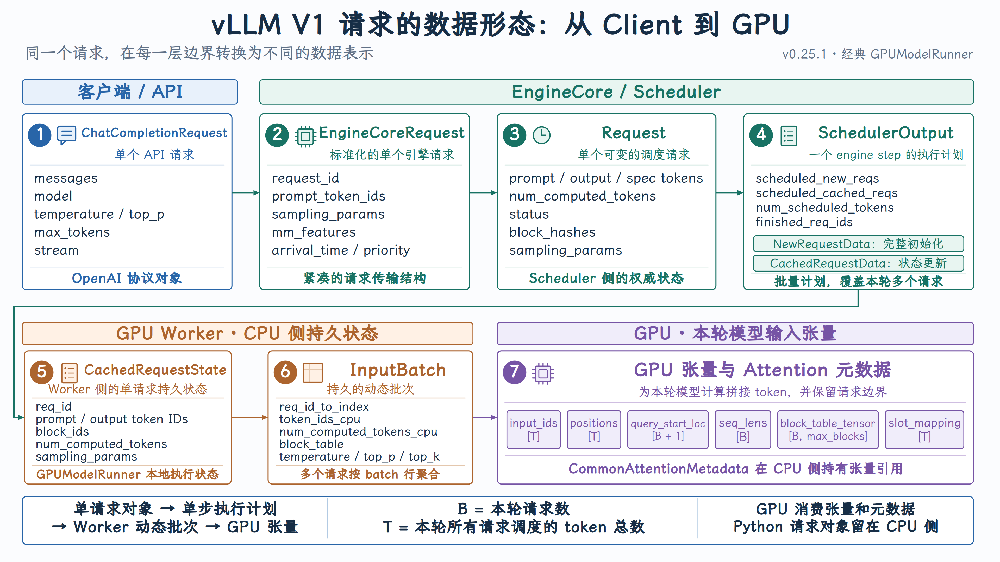

# 请求的数据形态：从 Client 到 GPU

{ width="100%" }

## 1. Client：HTTP JSON

Client 发送的是协议数据，不是 vLLM 内部对象：

```json
{
  "model": "Qwen/Qwen2.5-1.5B-Instruct",
  "messages": [
    {"role": "user", "content": "Hello"}
  ],
  "temperature": 0.8,
  "max_tokens": 128
}
```

它包含：业务输入、模型名称、生成参数、流式选项

此时还没有 token，也没有调度状态。

## 2. API Server：[ChatCompletionRequest](https://github.com/vllm-project/vllm/blob/v0.25.1/vllm/entrypoints/openai/chat_completion/protocol.py#L196)

```python
class ChatCompletionRequest:
    model
    messages
    temperature
    top_p
    max_tokens
    stream
```

这是 OpenAI API 层的请求实体：

- 单位：单个用户请求
- 形态：Pydantic 业务对象
- 核心内容：messages + API 参数
- 作用：协议表达和参数校验

对于 offline inference，入口可能直接是：

- [TextPrompt](https://github.com/vllm-project/vllm/blob/main/vllm/inputs/llm.py#L99)
- [TokensPrompt](https://github.com/vllm-project/vllm/blob/main/vllm/inputs/llm.py#L106)
- [EmbedsPrompt](https://github.com/vllm-project/vllm/blob/main/vllm/inputs/llm.py#L125)

## 3. Engine 输入：[EngineCoreRequest](https://github.com/vllm-project/vllm/blob/v0.25.1/vllm/v1/engine/__init__.py#L88)

```python
class EngineCoreRequest:
    request_id
    prompt_token_ids
    sampling_params
    pooling_params
    mm_features
    arrival_time
    priority
```

> 此时请求已经从业务语义变成推理语义：
>
> - messages        → prompt_token_ids
> - API 采样字段      → SamplingParams
> - 图片 / 音频       → mm_features

结构特点：

- 单位：单个请求
- 形态：msgspec.Struct
- 核心内容：token、参数、多模态特征
- 位置：API Server 与 EngineCore 的边界

## 4. Scheduler：[Request](https://github.com/vllm-project/vllm/blob/v0.25.1/vllm/v1/request.py#L59)

这是最重要的请求实体：

```python
class Request:
    request_id
    prompt_token_ids
    output_token_ids
    spec_token_ids
    num_computed_tokens
    status
    block_hashes
    sampling_params
    pooling_params
```

结构特点：

- 单位：单个请求
- 形态：可变 Python 对象
- 所有者：Scheduler
- 作用：维护完整生命周期和计算进度

> 它是 Scheduler 侧的权威状态：
>
> - 请求有哪些 token？
> - 已经计算了多少？
> - 当前是 WAITING 还是 RUNNING？
> - 是否被抢占？
> - 有哪些 block hash？

> 前面几种形态是“请求想做什么”，从这里开始变成“请求运行到哪里”。

## 5. Scheduler 输出：[SchedulerOutput](https://github.com/vllm-project/vllm/blob/v0.25.1/vllm/v1/core/sched/output.py#L181)

它不是单个请求，而是：

Scheduler 为当前 engine step 生成的批量执行计划。

```python
class SchedulerOutput:
    scheduled_new_reqs
    scheduled_cached_reqs
    num_scheduled_tokens
    total_num_scheduled_tokens
    scheduled_spec_decode_tokens
    finished_req_ids
```

结构特点：

- 单位：一整个调度 step
- 形态：批量计划
- 生产者：Scheduler
- 消费者：GPUModelRunner

内部有两种请求表示。

### [NewRequestData](https://github.com/vllm-project/vllm/blob/v0.25.1/vllm/v1/core/sched/output.py#L31)

```python
class NewRequestData:
    req_id
    prompt_token_ids
    sampling_params
    block_ids
    num_computed_tokens
```

表示 Worker 第一次见到的请求，因此携带完整初始化信息。

### [CachedRequestData](https://github.com/vllm-project/vllm/blob/v0.25.1/vllm/v1/core/sched/output.py#L112)

```python
class CachedRequestData:
    req_ids
    new_token_ids
    new_block_ids
    num_computed_tokens
    num_output_tokens
```

表示 Worker 已经知道的请求，只携带本轮增量。

> 注意：CachedRequestData 表示 Worker 缓存了请求状态，不表示 Prefix Cache 命中。

## 6. Worker：[CachedRequestState](https://github.com/vllm-project/vllm/blob/v0.25.1/vllm/v1/worker/gpu_input_batch.py#L35)

```python
class CachedRequestState:
    req_id
    prompt_token_ids
    output_token_ids
    block_ids
    num_computed_tokens
    sampling_params
```

它是 Request 在 Worker 侧的表示：

- 单位：单个请求
- 形态：Worker 本地持久状态
- 所有者：GPUModelRunner

对比两个 Request：

```text
Scheduler.Request
    调度侧权威状态，决定谁运行

CachedRequestState
    Worker 侧执行状态，准备模型输入
```

二者属于不同进程，不能共享同一个 Python 对象。

## 7. Worker 批次：[InputBatch](https://github.com/vllm-project/vllm/blob/v0.25.1/vllm/v1/worker/gpu_input_batch.py#L92)

InputBatch 不再表示单个请求，而是多个请求的持久动态批次：

```python
class InputBatch:
    req_id_to_index
    token_ids_cpu
    num_prompt_tokens
    num_computed_tokens_cpu
    block_table
    temperature
    top_p
    top_k
    frequency_penalties
```

可以把它理解成一张按 request index 组织的表：

```text
row 0 → request A
row 1 → request B
row 2 → request C
```

结构特点：

- 单位：Worker 当前维护的动态批次
- 形态：CPU tensor、NumPy array、GPU tensor 的组合
- 作用：把多个 CachedRequestState 聚合为批量数据

Continuous Batching 最终就体现在这个结构中：

- 请求完成 → 删除一行
- 新请求加入 → 增加一行
- 被抢占 → 暂时移除
- 每个 step 都可以改变批次成员

## 8. GPU：模型输入 Tensor

进入 GPU 后，不再存在一个完整的 Request 对象。

请求被打平成多个 tensor：

```text
input_ids:          [T]
positions:          [T]
query_start_loc:    [B + 1]
seq_lens:           [B]
block_table_tensor: [B, max_num_blocks]
slot_mapping:       [T]
```

其中：

```text
B = 本轮请求数
T = 本轮所有请求调度的 token 总数
```

注意请求边界由元数据保存。例如：

```text
input_ids = [A0, A1, B0, B1, B2, C0]
query_start_loc = [0, 2, 5, 6]
```

表示：

```text
Request A → input_ids[0:2]
Request B → input_ids[2:5]
Request C → input_ids[5:6]
```

Attention 的公共元数据放在：[CommonAttentionMetadata](https://github.com/vllm-project/vllm/blob/v0.25.1/vllm/v1/attention/backend.py#L395)

```python
class CommonAttentionMetadata:
    query_start_loc
    seq_lens
    num_reqs
    num_actual_tokens
    block_table_tensor
    slot_mapping
```

它解决两个问题：

- query_start_loc / seq_lens
  → 扁平 token 分别属于哪个请求？
- block_table_tensor / slot_mapping
  → KV Cache 应该从哪里读取、写到哪里？

## 总结

| 转换                                  | 核心目的                 |
| ------------------------------------- | ------------------------ |
| JSON → ChatCompletionRequest         | 协议校验                 |
| ChatCompletionRequest → 模型输入     | Chat模板、分词、采样参数 |
| 模型输入 → EngineCoreRequest         | 统一不同请求入口         |
| EngineCoreRequest → Request          | 建立运行时状态           |
| Request → SchedulerOutput            | 生成单步执行计划         |
| SchedulerOutput → CachedRequestState | 同步Worker侧请求状态     |
| CachedRequestState → InputBatch      | 聚合动态批次             |
| InputBatch → GPU Tensor              | 构造本轮模型输入和KV地址 |

这条链路的核心规律是：**越靠上越接近用户语义，越靠下越接近批处理、内存地址和GPU计算**。
