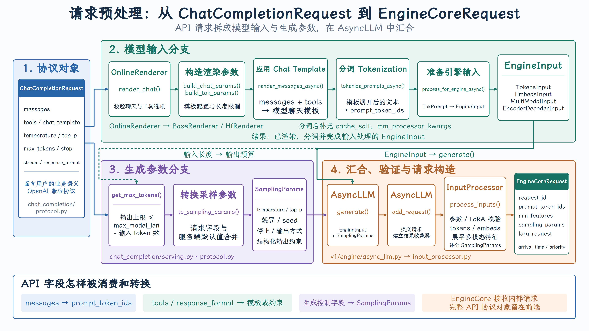

# 第 5 课 请求预处理：Chat Template 与 Tokenization

{ width="100%" }

## 1. Protocol Object

HTTP 入口是：

[POST /v1/chat/completions](https://github.com/vllm-project/vllm/blob/v0.25.1/vllm/entrypoints/openai/chat_completion/api_router.py#L40-L74)

```python
async def create_chat_completion(
    request: ChatCompletionRequest,
    raw_request: Request,
):
    handler = chat(raw_request)
    generator = await handler.create_chat_completion(request, raw_request)
```

FastAPI/Pydantic 将 JSON 请求体转换成：

[ChatCompletionRequest](https://github.com/vllm-project/vllm/blob/v0.25.1/vllm/entrypoints/openai/chat_completion/protocol.py#L196-L245)

它同时包含两类信息：

```text
模型输入：
messages、tools、chat_template、多模态内容

生成控制：
temperature、top_p、max_tokens、stop、response_format
```

这也是后面需要拆成两条分支的原因。

## 2. Input Branch

### 2.1 进入 OpenAIServingChat

主要入口是：

[OpenAIServingChat._create_chat_completion()](https://github.com/vllm-project/vllm/blob/v0.25.1/vllm/entrypoints/openai/chat_completion/serving.py#L249-L371)

这里首先调用：

```python
result = await self.render_chat_request(request)
```

它经过模型检查和 Engine 健康检查后，委托给：

```python
return await self.online_renderer.render_chat(request)
```

对应代码：

[render_chat_request()](https://github.com/vllm-project/vllm/blob/v0.25.1/vllm/entrypoints/openai/chat_completion/serving.py#L206-L231)

### 2.2 OnlineRenderer 做 API 语义验证

[OnlineRenderer.render_chat()](https://github.com/vllm-project/vllm/blob/v0.25.1/vllm/renderers/online_renderer.py#L94-L176) 负责：

- 验证 `tool_choice`
- 检查工具解析器是否可用
- 决定是否把 `tools` 传给 Chat Template
- 验证客户端是否允许覆盖 `chat_template`
- 处理 Mistral 和 GPT-OSS 等特殊路径

普通 Hugging Face 模型最后进入：

```python
conversation, engine_inputs = await self.preprocess_chat(...)
```

### 2.3 构造 ChatParams 和 TokenizeParams

实现位于：

[OnlineRenderer.preprocess_chat()](https://github.com/vllm-project/vllm/blob/v0.25.1/vllm/renderers/online_renderer.py#L330-L376)

```python
tok_params = request.build_tok_params(self.model_config)

chat_params = request.build_chat_params(
    default_template,
    default_template_content_format,
).with_defaults(...)
```

这两个对象职责不同：

```text
ChatParams
  控制消息解析和 Chat Template
  chat_template、tools、documents、add_generation_prompt

TokenizeParams
  控制分词和长度限制
  max_model_len、max_output_tokens、truncate_prompt_tokens
```

构造代码：

- [build_chat_params()](https://github.com/vllm-project/vllm/blob/v0.25.1/vllm/entrypoints/openai/chat_completion/protocol.py#L510-L539)
- [build_tok_params()](https://github.com/vllm-project/vllm/blob/v0.25.1/vllm/entrypoints/openai/chat_completion/protocol.py#L541-L559)

### 2.4 BaseRenderer 执行四阶段转换

接下来调用：

```python
await renderer.render_chat_async(
    [messages],
    chat_params,
    tok_params,
)
```

核心编排位于：

[BaseRenderer.render_chat_async()](https://github.com/vllm-project/vllm/blob/v0.25.1/vllm/renderers/base.py#L1070-L1108)

它包含四步：

```python
# 1. messages → DictPrompt
render_messages_async()

# 2. DictPrompt → TokPrompt
tokenize_prompts_async()

# 3. 添加 cache_salt、mm_processor_kwargs
# cache_salt 影响 prefix cache 的匹配范围
# mm_processor_kwargs 传给多模态 processor 的额外参数
_apply_prompt_extras()

# 4. TokPrompt → EngineInput
process_for_engine_async()
```

### 2.5 应用模型 Chat Template

普通 HF 模型使用：

[HfRenderer.render_messages_async()](https://github.com/vllm-project/vllm/blob/v0.25.1/vllm/renderers/hf.py#L1057-L1173)

它先把 OpenAI 消息规范化：

```python
conversation, mm_data, mm_uuids = (
    await parse_chat_messages_async(...)
)
```

然后套用模型 Chat Template：

```python
prompt_raw = await self._apply_chat_template_async(
    model_config,
    tokenizer,
    conversation,
    **chat_template_kwargs,
)
```

真正调用 Hugging Face 的位置是：

[safe_apply_chat_template()](https://github.com/vllm-project/vllm/blob/v0.25.1/vllm/renderers/hf.py#L707-L802)

```python
plain = tokenizer.apply_chat_template(
    conversation=conversation,
    tools=tools,
    chat_template=chat_template,
    tokenize=tokenize,
)
```

普通 HF 路径通常先返回渲染文本，下一步再统一 tokenize；Mistral、Prompt Embeds 等路径可能在模板阶段直接产生 token IDs。

**示例**

```text
conversation = [
  {
    "role": "system",
    "content": "你是一个简洁的助手。",
  },
  {
    "role": "user",
    "content": "介绍一下北京。",
  }
]

<|im_start|>system
你是一个简洁的助手。<|im_end|>
<|im_start|>user
介绍一下北京。<|im_end|>
<|im_start|>assistant
```

### 2.6 分词并转换成 EngineInput

统一分词入口：

[tokenize_prompts_async()](https://github.com/vllm-project/vllm/blob/v0.25.1/vllm/renderers/base.py#L630-L647)

**示例**

```python
dict_prompt = {
    "prompt": (
        "<|im_start|>system\n"
        "你是一个简洁的助手。<|im_end|>\n"
        "<|im_start|>user\n"
        "介绍一下北京。<|im_end|>\n"
        "<|im_start|>assistant\n"
    )
}

tok_prompt = {
    "prompt": (
        "<|im_start|>system\n"
        "你是一个简洁的助手。<|im_end|>\n"
        "<|im_start|>user\n"
        "介绍一下北京。<|im_end|>\n"
        "<|im_start|>assistant\n"
    ),
    "prompt_token_ids": [
        151644,
        8948,
        198,
        108386,
        104455,
        100165,
        1773,
        151645,
        198,
        151644,
        872,
        198,
        104198,
        102104,
        105195,
        1773,
        151645,
        198,
        151644,
        77091,
        198,
    ],
}
```

然后：

[process_for_engine_async()](https://github.com/vllm-project/vllm/blob/v0.25.1/vllm/renderers/base.py#L961-L981) 把前端使用的 TokPrompt 转成推理引擎可以直接接收的标准 EngineInput

根据输入类型产生：

- TokensInput
- EmbedsInput
- MultiModalInput
- EncoderDecoderInput

这些类型定义在：

[vllm/inputs/engine.py](https://github.com/vllm-project/vllm/blob/v0.25.1/vllm/inputs/engine.py#L29-L162)

最终统一为：

[EngineInput 类型别名](https://github.com/vllm-project/vllm/blob/v0.25.1/vllm/inputs/engine.py#L232-L282)

注意：EngineInput 不是一个具体 class，而是一组 TypedDict 的联合类型。

## 3. Generation-Parameter Branch

输入分支产生 EngineInput 后，服务层已经能够得到真实的 prompt 长度：

```python
prompt_token_ids = self._extract_prompt_components(engine_input).token_ids
```

然后计算允许生成的 token 数：

[get_max_tokens()](https://github.com/vllm-project/vllm/blob/v0.25.1/vllm/entrypoints/serve/utils/api_utils.py#L170-L206)

核心约束是：

```python
effective_max_tokens = min(
    model_max_tokens,
    request_or_default_max_tokens,
    override_max_tokens,
    platform_max_tokens,
)
```

接着调用：

[ChatCompletionRequest.to_sampling_params()](https://github.com/vllm-project/vllm/blob/v0.25.1/vllm/entrypoints/openai/chat_completion/protocol.py#L588-L630)

把 OpenAI API 字段转换为内部 SamplingParams：

```text
temperature
top_p / top_k / min_p
frequency_penalty
presence_penalty
repetition_penalty
stop / stop_token_ids
seed
logprobs
structured_outputs
max_tokens
```

因此：

```text
ChatCompletionRequest
        ├─ messages       → EngineInput
        └─ generation字段  → SamplingParams
```

## 4. Merge, Validate and Construct

### 4.1 两条分支在 generate() 汇合

服务层调用：

```python
generator = self.engine_client.generate(
    engine_input,
    sampling_params,
    sub_request_id,
    ...
)
```

代码位置：

[serving.py:357](https://github.com/vllm-project/vllm/blob/v0.25.1/vllm/entrypoints/openai/chat_completion/serving.py#L357-L371)

这里的 engine_client 对在线服务而言就是 AsyncLLM。

### 4.2 AsyncLLM.generate()

[AsyncLLM.generate()](https://github.com/vllm-project/vllm/blob/v0.25.1/vllm/v1/engine/async_llm.py#L524-L586) 做两件核心事情：

```python
q = await self.add_request(
    request_id,
    prompt,
    sampling_params,
    ...
)
```

然后不断从请求的 RequestOutputCollector 读取输出并 yield：

```python
while not finished:
    out = q.get_nowait() or await q.get()
    yield out
```

generate() 本身是一个异步生成器，它同时承担请求提交与结果流式返回。

### 4.3 InputProcessor 构造 EngineCoreRequest

在：

[AsyncLLM.add_request()](https://github.com/vllm-project/vllm/blob/v0.25.1/vllm/v1/engine/async_llm.py#L280-L398)

调用：

```python
request = self.input_processor.process_inputs(
    request_id,
    prompt,
    params,
    ...
)
```

核心实现：

[InputProcessor.process_inputs()](https://github.com/vllm-project/vllm/blob/v0.25.1/vllm/v1/engine/input_processor.py#L242-L385)

它负责：

1. 校验 SamplingParams 与模型能力。
2. 校验 LoRA。
3. 校验 Data Parallel rank。
4. 从 EngineInput 提取 token IDs 或 embeddings。
5. 拆分 encoder/decoder 输入。
6. 克隆并补全 SamplingParams。
7. 将多模态字典展平并排序成 mm_features。
8. 构造 EngineCoreRequest。

最终代码：

```python
return EngineCoreRequest(
    request_id=request_id,
    prompt_token_ids=prompt_token_ids,
    prompt_embeds=prompt_embeds,
    mm_features=mm_features,
    sampling_params=sampling_params,
    arrival_time=arrival_time,
    lora_request=lora_request,
    priority=priority,
    ...
)
```

### 4.4 EngineCoreRequest 是进程间传输对象

定义位于：

[EngineCoreRequest](https://github.com/vllm-project/vllm/blob/v0.25.1/vllm/v1/engine/__init__.py#L88-L137)

它使用：

```text
class EngineCoreRequest(
    msgspec.Struct,
    array_like=True,
    omit_defaults=True,
    gc=False,
):
```

这是一个紧凑的序列化结构，主要字段包括：

```text
request_id
prompt_token_ids / prompt_embeds
mm_features
sampling_params / pooling_params
arrival_time
lora_request
priority
data_parallel_rank
trace_headers
```

它已经不再包含完整的 ChatCompletionRequest，例如 HTTP 语义、响应格式等前端字段已经被消费或转换。

### 4.5 前端登记输出状态，并发送给 EngineCore

最终在：

[AsyncLLM._add_request()](https://github.com/vllm-project/vllm/blob/v0.25.1/vllm/v1/engine/async_llm.py#L400-L415)

```python
# 当前 API Server 进程保存输出处理状态
self.output_processor.add_request(...)

# 发送到独立 EngineCore 进程
await self.engine_core.add_request_async(request)
```

所以同一个请求在这里分成两个方向：

```text
EngineCoreRequest
    ├─ OutputProcessor
    │    保存前端输出、detokenization 和流状态
    │
    └─ EngineCoreClient
         跨进程发送给 EngineCore
         → Request
         → Scheduler waiting queue
```
