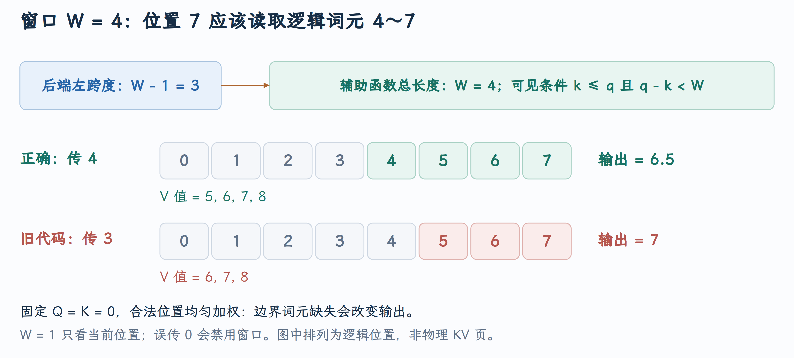

# ROCm Attention 滑动窗口的参数与边界

窗口长度 4 应该保留哪四个 token？PR #59550 修复了 ROCM_ATTN 将左侧跨度误当作完整窗口长度的问题：在位置 7，本该可见的 4～7 被缩成了 5～7。只改一个参数就能改变 Attention 的概率分布，因此需要沿模型配置、backend 和 GPU mask 逐层追踪它。

本文对应 [PR #59550](https://github.com/vllm-project/vllm/pull/59550)，源码核对到提交 [`eb815579d5`](https://github.com/vllm-project/vllm/commit/eb815579d5fab709aa0e2f9fc6be35ef2af59fd1)。截至 2026 年 10 月 5 日，PR 状态为**已合并** 。

## 1. Attention 的窗口定义

对 causal self-attention，位置 `q` 不能看到未来 `k>q`。窗口长度为 `W`，并且包括当前 token 时，可见条件为：

$$
k\le q,\qquad q-k<W.
$$

当 `q=7,W=4`，满足条件的是 `k=4,5,6,7`。最早位置的距离是 `3`；`k=3` 的距离是 `4`，严格小于条件使它被排除。对 `W=1`，只有当前位置可见。

模型中的 Sliding Window Attention 仍计算 Q/K/V，但只允许局部历史参与归一化与 Value 混合。它与 KV Cache 的滑动窗口资源管理相关，却不是同一个操作：mask 决定语义上能读哪些位置，cache manager 负责历史页是否仍有需要以及能否回收。

## 2. 同一个窗口有两种参数表示

FlashAttention 风格的 causal window tuple 使用 `(left_span,right_span)`。包含当前 token 的长度 `W` 对应 `(W-1,0)`，而 ROCm 被调用的 helper 接收总长度 `W`。

[backend 窗口表示](https://github.com/vllm-project/vllm/blob/eb815579d5fab709aa0e2f9fc6be35ef2af59fd1/vllm/v1/attention/backends/rocm_attn.py#L305-L313) 在没有窗口时保存 `(-1,-1)`，decoder causal 路径保存 `(W-1,0)`。但旧 `forward` 把 `self.sliding_window[0]` 直接传入 `chunked_prefill_paged_decode`。

| 模型窗口 | backend 的左跨度 | helper 应接收 | 旧代码接收 |
|---|---:|---:|---:|
| 无窗口 | -1 | 0，禁用窗口 | -1，helper 也视为禁用 |
| `W=1` | 0 | 1 | 0，错误地禁用窗口 |
| `W=4` | 3 | 4 | 3，漏掉边界 token |

问题发生在**表示转换** ，不是窗口公式或模型配置本身出错。

## 3. 从模型层到 GPU mask

一轮 forward 内，模型产生当前 Q/K/V；Attention 的 backend 使用 runner 准备的 metadata：`query_start_loc` 标识各请求的 Query 行边界，`seq_lens` 给出有效上下文长度，`block_table` 查找历史 KV 页。写入当前 K/V 的槽位由 `slot_mapping` 定位，这和历史读取地址不是同一个表。

本文涉及的执行链是：

```text
模型 Attention
  → RocmAttentionImpl.forward
  → chunked_prefill_paged_decode(sliding_window=...)
  → 多 Query 的 context_attention_fwd
     或单 Query 的 paged decode kernel
  → causal AND window mask
  → softmax 与 Value 加权
  → output tensor 返回模型层
```

[混合批次的 kernel 入口](https://github.com/vllm-project/vllm/blob/eb815579d5fab709aa0e2f9fc6be35ef2af59fd1/vllm/v1/attention/ops/chunked_prefill_paged_decode.py#L285-L333) 根据 Query 形状处理不同路径；函数先把缺省或非正窗口转成 0。[Decode 窗口 mask](https://github.com/vllm-project/vllm/blob/eb815579d5fab709aa0e2f9fc6be35ef2af59fd1/vllm/v1/attention/ops/chunked_prefill_paged_decode.py#L236-L242) 使用总长度的严格小于条件；[Prefix Prefill 的窗口 mask](https://github.com/vllm-project/vllm/blob/eb815579d5fab709aa0e2f9fc6be35ef2af59fd1/vllm/v1/attention/ops/prefix_prefill.py#L292-L309) 也有相同的语义要求。

Chunked Prefill 中 `q` 是序列绝对位置，包含先前已计算的 context，不是本 chunk 内从零开始的行号。否则窗口会在每个 chunk 的开头错误重置。

## 4. 用可手算的输出显示边界差异

固定一个 Query 在位置 7，令所有 Q、K 为零，让可见位置的分数相同。设每个位置的 Value 标量为 `V[k]=k+1`。softmax 于是对所有可见位置均匀分配概率：

| 情况 | 可见位置 | Value | 输出 |
|---|---|---|---:|
| 正确 `W=4` | 4、5、6、7 | 5、6、7、8 | 6.5 |
| 错传 3 | 5、6、7 | 6、7、8 | 7 |
| 正确 `W=1` | 7 | 8 | 8 |
| 错传 0，窗口关闭 | 0～7 | 1～8 | 4.5 |

{ width="100%" }

图中的 token 条表示逻辑序列，未表示物理 KV 页顺序；选中集合分别对应表中的平均值。这样可以在没有随机 Q/K 的情况下，直接观察一个 token 的缺失怎样改变 Attention 输出。

## 5. 修复放在 backend 转换边界

窗口长度在 [rocm_attn.py](https://github.com/vllm-project/vllm/blob/eb815579d5fab709aa0e2f9fc6be35ef2af59fd1/vllm/v1/attention/backends/rocm_attn.py) 的 `RocmAttentionImpl.forward()` 离开 backend，进入 ROCm helper。PR 在这次调用处补上 1；下面节选相关参数：

```python
chunked_prefill_paged_decode(
    ...,  # 省略沿用的 Q/K/V、缓存和尺度参数。
    # backend 存的是 W-1；这里转成 ROCm helper 使用的 W。
    # 无窗口的左跨度 -1 同时变成 0。
    sliding_window=1 + self.sliding_window[0],
)
```

这段改动位于 `RocmAttentionImpl.forward → chunked_prefill_paged_decode` 调用中。GPU mask 的 `q-k<W` 公式本来就按总长度定义，修改其严格小于比较会改变所有调用者的契约；模型配置和 cache manager 也无需为这次单位转换重写。

见 [修复后的窗口参数](https://github.com/vllm-project/vllm/blob/eb815579d5fab709aa0e2f9fc6be35ef2af59fd1/vllm/v1/attention/backends/rocm_attn.py#L486-L491)。这里同时满足有窗口的 `W-1→W` 与无窗口的 `-1→0`。backend 其他需要 tuple 的路径继续保留其表示，不应该把字段统一改成 `W` 后破坏别的消费者。

KV Cache manager 的 [滑动窗口的逻辑缓存示例](https://github.com/vllm-project/vllm/blob/eb815579d5fab709aa0e2f9fc6be35ef2af59fd1/vllm/v1/core/single_type_kv_cache_manager.py#L1163-L1178) 同样用位置 7 看 4～7 的语义。实际页回收还受 block size、对齐和共享引用限制：四个逻辑位置可见，不等于 GPU 必然只保存四个 KV 槽。

## 6. 绝对位置怎样映射到物理 KV 页

`query_start_loc` 描述当前 batch 中每请求的 Query 行区间，`seq_lens` 描述该请求本轮可见的总序列长度。kernel 用 `context_len=seq_len-query_len` 得到已经缓存的前缀，当前 Query 局部行 j 的绝对位置是 `context_len+j`。见 [请求 Query 与历史长度](https://github.com/vllm-project/vllm/blob/eb815579d5fab709aa0e2f9fc6be35ef2af59fd1/vllm/v1/attention/ops/prefix_prefill.py#L173-L181)。

例如总序列长度 8、本轮 Query 长度 3，则 context 长度为 5，本轮 j=0、1、2 对应 q=5、6、7。`W=4` 下各自可见位置为 `2…5、3…6、4…7`。不能直接用 j 计算窗口，否则第一 Query 会被误当作序列位置 0。

设 KV page 每页 B=4 token，block table 为 `[9,2]`。逻辑位置 k=5 的逻辑页为 `5//4=1`、页内槽为 `5%4=1`，查表得到物理页 2，于是槽位是 `(physical_page=2,offset=1)`。k=4…7 都位于物理页 2；k=0…3 则位于物理页 9。逻辑相邻页无需在 GPU 上相邻。这里为简化寻址示例使用 B=4，实际 page size 由配置决定。

当前 token 的写入地址由 slot_mapping 定位，历史读取由 block_table 加逻辑位置定位。mask 的条件始终使用逻辑位置 q/k，不能拿物理页 ID 或 flattened slot ID 代入 `q-k<W`。分页寻址见 [历史 KV tile 与 block table 寻址](https://github.com/vllm-project/vllm/blob/eb815579d5fab709aa0e2f9fc6be35ef2af59fd1/vllm/v1/attention/ops/prefix_prefill.py#L231-L266)。

## 7. 在线 softmax 为什么必须先应用窗口 mask

一个 Query 的 Attention 输出是 `sum(exp(score_k)*V_k)/sum(exp(score_k))`。窗口外分数应被排除在分子、分母之外，而不是算完全部 Attention 后再把窗口外 Value 清零。后者虽然去掉了它们的 Value 贡献，分母中却仍保留相应概率质量，结果依然错误。

为了不在 global 写出完整 score matrix，kernel 按 KV tile 使用在线 softmax。每个 Query 保存三项 FP32 状态：已处理 score 的最大值 m、以 m 为基准的指数和 l，以及 Value 加权和 a。新 tile 分数为 s 时（至少包含一个有限的可见分数）：

$$
m'=\max(m,\max s),\qquad \alpha=\exp(m-m'),\qquad p=\exp(s-m'),
$$

$$
l'=\alpha l+\sum p,\qquad a'=\alpha a+\sum pV,\qquad O=a/l.
$$

窗口 mask 在新 tile 的 s 上先将不可见位置设为负无穷，让它们的指数贡献为 0。旧状态在最大值变化时必须同乘 α，才能在同一指数基准下合并。初始全屏蔽行还要避免直接计算 `exp(-inf-(-inf))`；具体 kernel 需要按分支处理这一数值边界。实现见 [窗口分数与在线归一化](https://github.com/vllm-project/vllm/blob/eb815579d5fab709aa0e2f9fc6be35ef2af59fd1/vllm/v1/attention/ops/prefix_prefill.py#L289-L343)。

沿 q=7 的均匀分数例子，用两个概念分块看正确窗口：tile A 包含位置 4、5，Value 为 5、6，得到 `m=0,l=2,a=11`；tile B 含位置 6、7，Value 为 7、8，合并后 `m=0,l=4,a=26`，最终 6.5。旧窗口错漏位置 4 时，tile A 只贡献位置 5，状态为 `l=1,a=6`，再合并 B 得 `l=3,a=21`，输出 7。窗口边界改变的就是归一化集合。

## 8. Mask 边界与缓存回收边界的区别

对当前 q=7、W=4，需要历史位置 4…6 和当前位置 7。但 manager 的任务还包含后续执行、整页管理与共享引用。它可以保留不可见 token 所在的整个边界页；“仍保存在 GPU”不等于“本轮参加 Attention”。

[滑动窗口的 skip 与额外保留](https://github.com/vllm-project/vllm/blob/eb815579d5fab709aa0e2f9fc6be35ef2af59fd1/vllm/v1/core/single_type_kv_cache_manager.py#L1158-L1199) 的 skip 计算还减去 `extra_retained_tokens`，用于部分投机路径重放近期输入。比如理论上可跳过 0…3，若需要额外保留两枚历史 token，资源边界会保守地后移；当前 Attention 的窗口 mask 仍按 W 计算，不因此扩大。

这条 PR 修复的是 backend 到 helper 的窗口单位转换。沿它可以看见三个相邻但独立的责任：模型配置给出窗口语义，Attention kernel 在逻辑位置上筛选并归一化，KV manager 按生命周期保留或回收物理页。只改其中一处并把另外两处的计数也一并替换，反而可能破坏原有接口。
