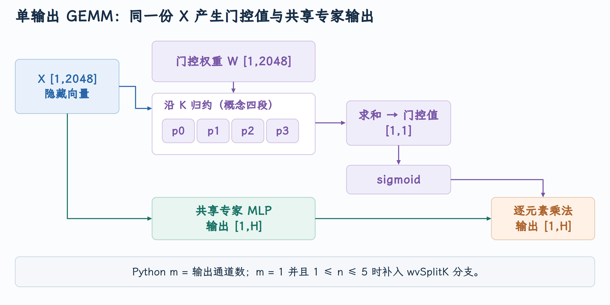

# 单输出 GEMM 与 Shared Expert 门控的 ROCm 优化

一个只输出一个数的 Linear 为什么会影响整条 Decode 的速度？PR #53283 处理的正是 MoE shared expert 的门控投影：输入是一条 hidden vector，输出是缩放共享专家结果的标量，但原有分发条件让它错过了支持该形状的 `wvSplitK`。从这条路径可以理解模型中的小算子、Linear 抽象和 ROCm 专用内核怎样连接。

本文对应 [PR #53283](https://github.com/vllm-project/vllm/pull/53283)，源码核对到提交 [`922b4da601`](https://github.com/vllm-project/vllm/commit/922b4da6010bb2d82bb0efe669f45bf48b26ce3a)。截至 2026 年 10 月 5 日，PR 状态为**已合并** 。

## 1. Shared expert 的门控与路由 gate

MoE 层通常由路由器选择部分专家。这里还存在一个 shared expert 分支，它不依靠相同的 Top-K 选择规则，而是参与当前 token 的共享计算。在已核对的 Qwen 实现中，这个分支的输出再乘一个 sigmoid 门控：

$$
Y_{\rm shared}(X)=\sigma(Xw_g^T)\odot\operatorname{MLP}_{\rm shared}(X).
$$

`X [T,H]` 是本轮 token 的 hidden states，`w_g [1,H]` 产生 `gate [T,1]`，沿 hidden 维度广播。这里的标量 gate 与产生多个专家分数的路由器 Linear 是两个对象。

[shared expert gate 的构造](https://github.com/vllm-project/vllm/blob/922b4da6010bb2d82bb0efe669f45bf48b26ce3a/vllm/model_executor/models/qwen3_moe.py#L179-L198) 明确设置输出维度为 `1`、`quant_config=None`。所以即使其余模型使用 GPTQ INT4，这个 gate 仍可经过未量化的 BF16/FP16 Linear。[门控结果的消费位置](https://github.com/vllm-project/vllm/blob/922b4da6010bb2d82bb0efe669f45bf48b26ce3a/vllm/model_executor/models/qwen3_moe.py#L125-L129) 在共享 MLP 的输出上应用 sigmoid 缩放。

## 2. 从模型 forward 到 ROCm 分发

单设备视角下，可跟踪以下实际接口：

```text
共享 MLP 的 forward
  → ReplicatedLinear.forward
  → UnquantizedLinearMethod.apply
  → 已选定的 ROCm GEMM wrapper
  → rocm_unquantized_gemm_impl
  → wvSplitK 或其他 fallback
  → gate [T,1]
  → sigmoid 与共享专家输出相乘
```

[未量化 Linear 的创建与实现绑定](https://github.com/vllm-project/vllm/blob/922b4da6010bb2d82bb0efe669f45bf48b26ce3a/vllm/model_executor/layers/linear.py#L165-L182) 在初始化时调用 `dispatch_unquantized_gemm`；[平台分发](https://github.com/vllm-project/vllm/blob/922b4da6010bb2d82bb0efe669f45bf48b26ce3a/vllm/model_executor/layers/utils.py#L584-L599) 在 ROCm 选择对应 wrapper。模型接口保持相同，平台差异落在执行实现中。

通用记号写成 `X [T,K] × Wᵀ [K,N] → Y [T,N]`。但被修改的 Python 函数使用了另一套命名：

```python
n = x.numel() // x.size(-1)  # token 行数 T
m = weight.shape[0]         # 输出通道数 N
k = weight.shape[1]         # 收缩维度 K
```

定义见 [ROCm 形状与候选路径](https://github.com/vllm-project/vllm/blob/922b4da6010bb2d82bb0efe669f45bf48b26ce3a/vllm/model_executor/layers/utils.py#L291-L315)。阅读这个 PR 时，`m==1` 指的是**单输出通道** ，不是 batch size 为一；`0<n<=5` 才是在约束激活行数。

## 3. 小输出形状为何需要专门处理

普通 GEMM 的高吞吐配置通常按多个输出通道分块，让大量线程承担不同输出。如果输出只有一个通道，适用于宽矩阵的配置可能留下大量空闲工作或带来较大的调用成本。Decode 又会反复执行这类小算子，单次延迟会逐层累计。

`wvSplitK` 的实现为少量激活向量组织 K 方向的计算与归约，并依据形状选择模板。[C++ 算子及输出形状](https://github.com/vllm-project/vllm/blob/922b4da6010bb2d82bb0efe669f45bf48b26ce3a/csrc/rocm/skinny_gemms.cu#L1189-L1226) 读取 `in_a` 为权重、`in_b` 为激活，返回 `[N_in,M_in]`，这里又对应 `[token 行数,输出通道数]`。

对 `T=1,K=2048,N=1`，这就是一个点积。下面手算仅展示归约机制，划成四段不代表生产内核的实际线程调度：

$$
y=\sum_{k=0}^{2047}x_kw_k
 = p_0+p_1+p_2+p_3,\qquad
p_i=\sum_{k=512i}^{512(i+1)-1}x_kw_k.
$$

{ width="100%" }

共享专家向量和 gate 都从同一份 `X` 产生，再在乘法节点汇合；图中没有将 gate 误画成共享专家 MLP 的输入。C++ 的 [模板选择与批次分支](https://github.com/vllm-project/vllm/blob/922b4da6010bb2d82bb0efe669f45bf48b26ce3a/csrc/rocm/skinny_gemms.cu#L1306-L1340) 使用形状选择输出 tile；单输出在此处选择 `YTILE=1`，一个 wave 承担一个输出通道。

## 4. PR 补齐单输出分发

这次修改落在 [utils.py](https://github.com/vllm-project/vllm/blob/922b4da6010bb2d82bb0efe669f45bf48b26ce3a/vllm/model_executor/layers/utils.py) 的 `rocm_unquantized_gemm_impl()`。原条件 `m>8 and 0<n<=5` 把输出为一的 gate 排除在外；HIP 已有单输出模板，因此需要补齐的是 Python 的形状判定：

```python
x_view = x.reshape(-1, x.size(-1)).contiguous()
# m 为输出通道数，n 为激活行数；单输出与原有宽输出共用此分支。
if (m == 1 or m > 8) and 0 < n <= 5:
    cu_count = num_compute_units()
    # 复用已有 wvSplitK，再恢复模型期望的 leading dims。
    out = ops.wvSplitK(weight, x_view, cu_count, bias)
    return out.reshape(*x.shape[:-1], weight.shape[0])
```

这段代码的 m/n 就是第 2 节定义的输出通道数与激活行数。命中后调用 `ops.wvSplitK(weight,x_view,cu_count,bias)` 并恢复输出 shape。把条件补在 wrapper 中，让 shared expert gate 和其他同形状 Linear 共用修复；若只在某个模型的 gate forward 中特判，会把平台分发散落到模型实现里。

实际改动见 [单输出分支](https://github.com/vllm-project/vllm/blob/922b4da6010bb2d82bb0efe669f45bf48b26ce3a/vllm/model_executor/layers/utils.py#L350-L356)，Python wrapper 通过 [自定义算子绑定](https://github.com/vllm-project/vllm/blob/922b4da6010bb2d82bb0efe669f45bf48b26ce3a/vllm/_custom_ops.py#L2091-L2096) 调用扩展中的 ROCm 算子。

它不是把所有 small GEMM 都送入这个 kernel。进入 `use_skinny` 前仍检查环境开关、设备架构、FP16/BF16、`K%8==0`、权重与 bias 的连续性；激活展平后显式 `.contiguous()`，保证 K 方向的读取契约。函数中 AITER 等分支具有自己的优先级，实际命中还取决于它们是否先接受当前形状。

| 输出通道数 `m` | token 行数 `n` | 本次新增分支 |
|---:|---:|---|
| 1 | 1～5 | 可使用 `wvSplitK` |
| 1 | 6 | 不进入该分支 |
| 2～8 | 1～5 | 仍不满足该分支，继续其他路径 |
| 大于 8 | 1～5 | 延续原有路径 |

## 5. 单输出的真实线程分工

继续固定 `T=1,K=2048,N=1`，并看 gfx1151 的实现。Host 的 `sYT=ceil(N/(CuCount*4))` 为 1，选出 `THRDS=32,WVPRGRP=16,YTILE=1,UNRL=4`；`A_CHUNK` 固定为 8。这里输入激活是未量化的 16 bit，权重也直接作为 FP16/BF16 使用，不需要 RDNA W4A16 中的 nibble 解码。模板选择见 [单输出的 gfx1151 模板选择](https://github.com/vllm-project/vllm/blob/922b4da6010bb2d82bb0efe669f45bf48b26ce3a/csrc/rocm/skinny_gemms.cu#L1257-L1270)。

一个 wave 的 lane l 在每个展开步读取连续 8 个 K 特征，首步从 `8*l` 开始，32 个 lane 覆盖 256 个特征。`UNRL=4` 让一轮主循环覆盖 1024 个特征；2048 特征对应两轮。每 lane 将四对 16 bit 输入交给 `DOT2C`，局部结果保存在 FP32 中，最后经 DPP/shuffle 汇总，由 lane 31 加 bias 写回 `[T,1]`。见 [寄存器操作数与成对点积](https://github.com/vllm-project/vllm/blob/922b4da6010bb2d82bb0efe669f45bf48b26ce3a/csrc/rocm/skinny_gemms.cu#L439-L478) 和 [归约及唯一 writer](https://github.com/vllm-project/vllm/blob/922b4da6010bb2d82bb0efe669f45bf48b26ce3a/csrc/rocm/skinny_gemms.cu#L486-L527)。

每组启动 16 个 wave 不意味着 16 个 wave 一起算同一个 gate。映射按输出通道分配 wave：对于全层仅一个输出的形状，只有获得通道 0 的 wave 进入有效输出循环；其他 wave 可能参与激活搬运，但没有自己的有效输出。这条 `wvSplitK` 路径不靠跨组 atomic 汇总一个标量。源码中同文件还存在其他采用 atomic 的算子，不能把它们的执行方式套到当前调用。

这里的优化也不是“尽可能让更多 CU 算一个点积”。单个标量能提供的并行工作有限；若跨很多组切分 K，还需临时 buffer、归约或 atomic，组织成本可能比算术本身更大。当前实现把归约限定在 wave 内，用较少的有效计算工作完成目标。

## 6. 小算子为何会出现在量化 MoE 的关键路径

Shared expert gate 是一张只有 `N*K` 个数的小权重：`N=1,K=2048`、BF16 时为 4096 字节。它与 MoE expert 大矩阵的瓶颈不同。大专家矩阵常需要关注权重带宽与 token 分组，小 gate 则更容易受到 launch、通用 GEMM 分块和调用链固定成本的影响。

未量化 Linear 的平台 wrapper 先保持输入最后一维的 K 语义，再将其展平并确保连续，执行后恢复 `[*leading_dims,1]`。例如 `[2,3,2048]` 展平后有 6 行，即使外层 batch 是 2，也超出这里的五行条件。条件应根据本轮算子的真实行数理解；投机验证或多 token Prefill 同样可能让它越过门槛。

门控输出经 sigmoid 得到每个 token 的标量，乘到 shared expert 的 hidden vector。假设一条 token 的共享 MLP 输出为 `[2,-1,4]`、门控 logit 为 0，则 sigmoid 为 0.5，缩放输出为 `[1,-0.5,2]`。路由专家则各自有 Top-K 概率，沿另一条分支产生加权结果；单输出 gate 没有替代路由器选择专家。

把一个 gate kernel 的延迟减少量记为 Δt，一次模型 forward 经过 L 个包含该 gate 的层，理论上相关串行部分少用约 `L*Δt`。实际端到端还包含 Attention、其他投影、专家执行和框架开销。这里应先明确重复次数和所占时间，再判断模型级价值，不能从“只有一个数”推断它不重要，也不能从专用算子的优势推断全部模型算子都应改为 skinny。
