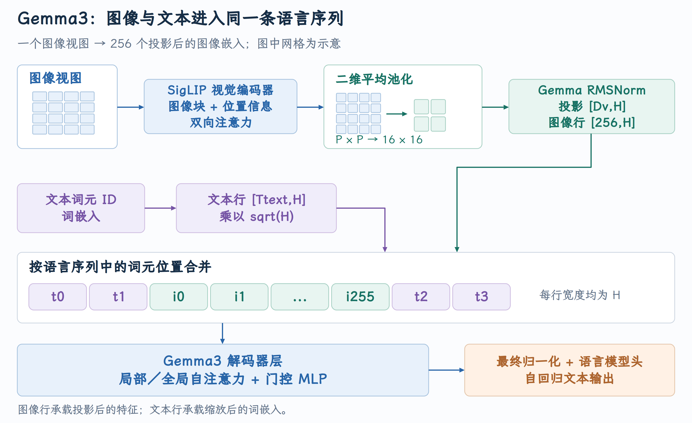
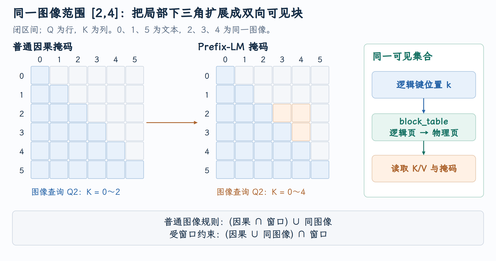

# 多模态 Prefix-LM 在 ROCm Attention 中的实现

Gemma3 把一张图像变成一串 embedding，放进与文本相同的解码器序列。但这串图像 embedding 不能全部套用文本的因果规则：同一图像内部需要双向交互，后续回答仍按自回归方式生成。理解 PR #60040，要先看 Gemma3 如何连接视觉编码器与语言模型，再追踪这种可见性怎样进入 vLLM 的 Attention metadata、分页 KV 和 ROCm kernel。

本文对应 [PR #60040](https://github.com/vllm-project/vllm/pull/60040)，vLLM 实现核对到提交 [`309e622d88`](https://github.com/vllm-project/vllm/commit/309e622d88ff6606e5d71519c8a2326c1f102044)。模型背景参照 [Gemma 3 技术报告](https://arxiv.org/html/2503.19786v1)。截至 2026 年 10 月 5 日，PR 状态为**开放，尚未合并** 。

## 1. Gemma3 怎样把图像接入文本解码器

以 PR 涉及的多模态 Gemma3-4B IT 为例，模型包含三个主要部分：SigLIP 视觉编码器、将视觉特征转换成语言模型输入的 projector，以及 Gemma3 文本解码器。vLLM 的 [Gemma3 多模态模型构造](https://github.com/vllm-project/vllm/blob/309e622d88ff6606e5d71519c8a2326c1f102044/vllm/model_executor/models/gemma3_mm.py#L534-L568) 分别创建 `vision_tower`、`multi_modal_projector` 和 `Gemma3ForCausalLM`。

这里的 IT 表示 instruction-tuned 版本。对本篇要解释的机制，更重要的是它采用的视觉连接与 Attention 结构。Gemma3 的 1B 版本是纯文本模型；不能因为它与 4B 共享 Gemma3 名称，就给它套上同一条视觉输入路径。

{ width="100%" }

图中上下两条分支产生不同来源的 embedding，在指定 token 位置合并；随后进入同一组语言模型层。视觉编码器只消费图像，文本信息通过语言模型的 self-attention 与视觉表示交互。

### 1.1 SigLIP 先产生二维图像的 patch 表示

视觉编码器将图像切成 patch。[patch embedding 的卷积与位置表](https://github.com/vllm-project/vllm/blob/309e622d88ff6606e5d71519c8a2326c1f102044/vllm/model_executor/models/siglip.py#L259-L277) 使用 kernel size 与 stride 都等于 patch size 的二维卷积，把每个 patch 映射成视觉宽度 $D_v$ 的向量，再加视觉位置 embedding。[patch 网格展平](https://github.com/vllm-project/vllm/blob/309e622d88ff6606e5d71519c8a2326c1f102044/vllm/model_executor/models/siglip.py#L315-L330) 将 `[batch,D_v,P,P]` 展平成 `[batch,P²,D_v]`，其中 $P$ 是每边 patch 数。

这些 patch token 进入视觉 Transformer encoder。每层通过双向 self-attention 混合图像不同位置的信息，再经逐位置 MLP。视觉 encoder 中的“双向”发生在图像 patch 序列；语言解码器中的图像 Prefix-LM 则发生在后面已投影的图像 token 序列，是两次不同层次的交互。

Gemma3 技术报告采用 896×896 的视觉输入，将视觉表示压缩成每个视图 256 个向量。Pan & Scan 可以额外产生图像 crop；每个 crop 也要编码，因此一张原图的实际 embedding 数可能大于 256。代码中的 `num_patches` 在这条多模态输入接口里统计原图与 crop 视图数，不能与视觉 Transformer 内部的 patch token 数混淆。

### 1.2 Projector 同时压缩 token 数与转换特征宽度

视觉表示不能仅靠 reshape 变成语言 embedding：视觉宽度 $D_v$ 与文本 hidden size $H$ 是两个不同维度。Gemma3 的 projector 先将视觉序列恢复成二维网格，执行二维 average pooling，再做 Gemma RMSNorm 和线性投影。

设一张视图有 $P×P$ 个 patch，目标图像 token 网格为 $S×S$，pooling kernel 和 stride 为 `P/S`。数据变化为：

$$
\begin{aligned}
[1,P^2,D_v]&\longrightarrow[1,D_v,P,P]\\
&\longrightarrow[1,D_v,S,S]\\
&\longrightarrow[1,S^2,D_v]\\
&\longrightarrow[1,S^2,H].
\end{aligned}
$$

最后一步的投影权重是 `[D_v,H]`；pooling 减少 token 行数，投影改变每行的特征宽度。二者解决不同问题。源码见 [Gemma3 pooling、norm 与视觉投影](https://github.com/vllm-project/vllm/blob/309e622d88ff6606e5d71519c8a2326c1f102044/vllm/model_executor/models/gemma3_mm.py#L451-L492)。

用一组尺寸展开这个过程：若 $P=64$、目标 token 数为 256，则 $S=16$，pooling 使用 4×4 kernel 和 stride 4，每个输出向量来自视觉网格的一块 4×4 区域。4096 个视觉位置压成 256 个语言输入位置。这里固定网格尺寸解释 projector 的计算；实际尺寸由 checkpoint 的 `vision_config` 与 `mm_tokens_per_image` 共同决定。

平均池化改变了每个图像 token 的含义：它代表一块视觉区域的编码信息，不是一个可读的文本词。视觉 Transformer 已经为 patch 提供图像内上下文，projector 再把这种信息送入适合语言模型使用的特征空间。

### 1.3 图像 embedding 替换占位位置的输入数值

Processor 将 `<start_of_image>` 这样的图像标记扩展成包含多个图像占位位置的 token 序列。[图像占位序列的构造](https://github.com/vllm-project/vllm/blob/309e622d88ff6606e5d71519c8a2326c1f102044/vllm/model_executor/models/gemma3_mm.py#L162-L195) 选出其中的 image token 位置；视觉输出随后按视图与图像重新组织，见 [图像 embedding 生成与输入合并接口](https://github.com/vllm-project/vllm/blob/309e622d88ff6606e5d71519c8a2326c1f102044/vllm/model_executor/models/gemma3_mm.py#L604-L642)。

对于文本位置，输入来自词表 embedding；对于图像位置，输入数值来自 projector。Gemma3 文本 embedding 还乘 $\sqrt{H}$，但同一缩放不会再应用到视觉 embedding，见 [文本 embedding 的单独缩放](https://github.com/vllm-project/vllm/blob/309e622d88ff6606e5d71519c8a2326c1f102044/vllm/model_executor/models/gemma3.py#L328-L341)。

因此模型需要同时保留两份信息：**实际 embedding 数值** 供 Linear/QKV 使用，**图像所占的语言序列位置** 供 Attention mask 使用。一个 image token ID 不能表示整张图的 embedding，也不能独自告诉 GPU 哪一段位置应双向可见。

## 2. Gemma3 的解码器层为何需要不同 Attention 范围

输入合并后，图像 token 与文本 token 都成为 `[T,H]` hidden states，逐层通过 Gemma3 decoder。用 $N_{ai},N_{ao}$ 表示 Attention 前后两处 norm，$N_{fi},N_{fo}$ 表示 FFN 前后两处 norm。省略 batch/TP 细节，一次 decoder layer 为：

$$
\begin{aligned}
a&=\operatorname{Attention}(N_{ai}(h)),\\
h'&=h+N_{ao}(a).
\end{aligned}
$$

$$
\begin{aligned}
f&=\operatorname{MLP}(N_{fi}(h')),\\
h_{\rm next}&=h'+N_{fo}(f).
\end{aligned}
$$

vLLM 把 residual 与归一化部分融合传递，代码没有在每处都写独立加法，但数据依赖与上述结构相同，见 [decoder 的四处归一化与 residual](https://github.com/vllm-project/vllm/blob/309e622d88ff6606e5d71519c8a2326c1f102044/vllm/model_executor/models/gemma3.py#L254-L289)。MLP 使用合并 gate/up projection，计算 `activation(gate)*up`，再经 down projection 回到 H，见 [Gemma3 gated MLP](https://github.com/vllm-project/vllm/blob/309e622d88ff6606e5d71519c8a2326c1f102044/vllm/model_executor/models/gemma3.py#L73-L93)。

Attention 则是跨 token 的混合步骤：QKV projection 后，Q/K 分别做 head 内 RMSNorm 和 RoPE，再把 Q/K/V 交给 vLLM 的 Attention 层，输出经 O projection 回到 H。见 [QK norm、RoPE 与 Attention 前向](https://github.com/vllm-project/vllm/blob/309e622d88ff6606e5d71519c8a2326c1f102044/vllm/model_executor/models/gemma3.py#L202-L220)。GQA 让多个 Query head 共享 KV head，从而减少缓存的 K/V 头数；它决定 head 之间的对应关系，Prefix-LM 决定 token 之间的可见关系。

一个容易误读的维度细节是：Gemma3 使用配置中的独立 `head_dim`。Q 宽度为 `num_attention_heads*head_dim`，K/V 宽度为 `num_key_value_heads*head_dim`，不能总用 `H/num_attention_heads` 代替 head_dim。输入 projection 与输出 projection 承担 H 和这些 head 宽度之间的转换。

### 局部层与全局层交错

Gemma3 技术报告使用五个 local sliding-window 层与一个 global 层交错。local 限制文字历史的读取范围，global 定期让信息跨越更长距离。这主要降低长上下文中的 KV 与 Attention 成本，同时保留远距离交互机会。

在所选 vLLM 版本中，实际层类型来自 `config.layer_types[layer_idx]`，local 层传入 `config.sliding_window`，global 层传 `None`。两类层还选择各自的 RoPE 参数，见 [每层 window 与 RoPE 配置](https://github.com/vllm-project/vllm/blob/309e622d88ff6606e5d71519c8a2326c1f102044/vllm/model_executor/models/gemma3.py#L152-L175)。技术报告中的常用 local window 为 1024，部署时应以所加载配置为准；不能把其他版本配置类的默认值直接当作该 checkpoint 的窗口。

“Global”说明不受局部窗口限制，普通文本仍按 causal 生成；它并不表示整条语言序列变成双向 encoder。图像项是否能超出局部窗口，则还取决于多模态 mask 的组合规则。

## 3. Prefix-LM 的条件信息与自回归输出

普通 causal language model 对序列 `x0、x1、…` 使用 $k\le q$ 的 mask。位置 q 的 hidden state 只能读取此前及当前位置，用来预测后续 token。训练或 prefill 可以把多行一起计算，mask 仍保证后续文本不会泄漏到前面的预测位置。

Prefix language model 把已经给定的条件区间与待生成区间区分开：条件区间内部可以双向读取，生成区间则读取给定条件与已经生成的前缀，逐 token 输出。以最简单的“前 P 个位置都是条件”为例：

$$
M_{\rm prefix}(q,k)=
\begin{cases}
k<P,&q<P,\\
k\le q,&q\ge P.
\end{cases}
$$

前缀能双向，是因为它已经作为条件完整给定；生成的答案仍服从自回归依赖。这里是在解释可见性结构，不意味着 vLLM 在推理时重新训练一个 Prefix-LM 目标。

Gemma3 的图像可见性还要更精确：文本与图像可交错，不是把整段 prompt 都视为一个全双向前缀。它在语言序列的 causal mask 上，为同一图像 embedding 连续范围加入双向块。可以把它理解为**多个局部双向条件区间嵌入因果序列** 。

### 同一图像内的未来位置，仍属于已给定输入

固定六个位置：0、1 是前置文本，2、3、4 是同一图像的三个 embedding，5 是后续文本。这里将图像压成三个 token，仅用于展示规则。图像范围 `[2,4]` 为**闭区间** 。

| Query | causal 可见 Key | 加入同图像规则后 | 理由 |
|---:|---|---|---|
| 1，前置文本 | 0、1 | 0、1 | 不能读取后面的图像或文本 |
| 2，第一个图像 token | 0、1、2 | 0、1、2、3、4 | 同图像内部双向 |
| 3，第二个图像 token | 0、1、2、3 | 0、1、2、3、4 | 同图像内部双向 |
| 4，最后一个图像 token | 0～4 | 0～4 | causal 已包含完整图像 |
| 5，后续文本 | 0～5 | 0～5 | 自回归读取已有条件 |

{ width="100%" }

图中 Q 为行、K 为列。橙色区域是普通 causal 额外开放的图像内部未来位置。Query 2 的“未来图像 Key 3、4”是已经输入的图像的一部分；未来回答 token 仍不可见。若出现第二张图，两个图像范围不会仅因都属于 image modality 而彼此双向连接。

用 $C(q,k)=(k\le q)$、$I(q,k)$ 表示 q/k 落在同一有效图像范围，无窗口时：

$$
M(q,k)=C(q,k)\lor I(q,k).
$$

这个规则作用于语言模型每层的 QK 分数。即使视觉 encoder 已经是双向的，也不能省掉这里的图像项：projector 后的向量进入文本解码器后，会在不同的层、不同的 Q/K 投影中继续交互。

Prefix-LM 与 **prefix caching** 还要分开。前者决定哪些 token 能互相读取，后者决定已计算的前缀 KV 是否能复用。启用缓存不会自动把 causal 改为双向，拥有 Prefix-LM mask 也不等于已经支持任意前缀的缓存复用。

## 4. Local window 与图像双向块如何组合

local 层既需要限制文字历史，也需要表达同图像交互。令 $S(q,k)=(q-k<W)$。共享 helper 的普通多模态规则是：

$$
M(q,k)=(C(q,k)\land S(q,k))\lor I(q,k).
$$

文字的 base causal 路径受窗口限制，图像项额外 OR 进去。若层开启 `mm_prefix_clamp_sliding_window`，图像项也经过窗口条件：

$$
M(q,k)=(C\land S)\lor(I\land S)=(C\lor I)\land S.
$$

两者的差别在于较旧的同图像 Key 是否能超出 window。固定 q=4、图像范围 `[2,4]`、W=2：base causal/window 只有 Key 3、4；普通图像规则补回 Key 2；clamp 后 Key 2 的距离为 2，不满足严格小于，所以仍排除。

条件 $q-k<W$ 是单侧距离。对 q=2、未来同图像 k=4，距离为 -2，仍满足它；clamp 不等于 `abs(q-k)<W`。上述小窗口算例说明 helper 规则，实际 runner 还有范围长度筛选，不能据此声称所有部署都会把一个长于模型窗口的图像范围送入 kernel。

[共享多模态 mask 的组合](https://github.com/vllm-project/vllm/blob/309e622d88ff6606e5d71519c8a2326c1f102044/vllm/v1/attention/ops/triton_attention_helpers.py#L316-L419) 先建立 base mask，再按 `start<end` 的闭区间执行 OR/clamp。`start=end` 的 singleton 不会带来新的双向边，`(0,0)` 也用于无范围 padding。PR 复用这份已存在的 helper，让 ROCm 路径与同一语义对齐。

## 5. 图像位置如何到达 ROCm backend

模型数值路径与 mask 元数据路径在这里重新会合：encoder cache 保存图像 feature 描述，runner 从 `MultiModalFeatureSpec.mm_position` 提取图像 embedding 的语言位置范围，写入 `CommonAttentionMetadata.mm_req_doc_ranges`。见 [MRV2 的 Attention metadata 准备](https://github.com/vllm-project/vllm/blob/309e622d88ff6606e5d71519c8a2326c1f102044/vllm/v1/worker/gpu/model_states/default.py#L169-L233)。

[图像 embedding 的连续范围提取](https://github.com/vllm-project/vllm/blob/309e622d88ff6606e5d71519c8a2326c1f102044/vllm/v1/worker/gpu/attn_utils.py#L555-L576) 读取 image/video 特征的 `extract_embeds_range()`。它关注的是实际 embedding 位置，因此开始/结束标记、文本分隔符与多个 crop 不应被想当然地并成一个连续图像块。当前实现还跳过长度超过模型滑动窗口的范围，以保持已有上游约束。

范围已经在 runner 中产生，接下来需要让 ROCm backend 接收它。修改落在 [rocm_attn.py](https://github.com/vllm-project/vllm/blob/309e622d88ff6606e5d71519c8a2326c1f102044/vllm/v1/attention/backends/rocm_attn.py)：原来的 [RocmAttentionMetadata](https://github.com/vllm-project/vllm/blob/309e622d88ff6606e5d71519c8a2326c1f102044/vllm/v1/attention/backends/rocm_attn.py#L74-L77) 只有普通 Attention 所需字段，PR 增加一份范围 tensor 引用：

```python
# 形状 [num_reqs,max_ranges,2]：每个请求的图像闭区间；None 为普通路径。
mm_prefix_range_tensor: torch.Tensor | None = None
```

这份 tensor 描述位置关系，K/V 数值仍来自当前层的投影和缓存。几类 metadata 分别承担下面的职责：

| Metadata | 描述的对象 | 主要消费者 |
|---|---|---|
| `query_start_loc` | 本轮各请求 Query 行的起止位置 | 计算请求内行号与 Query 长度 |
| `seq_lens` | 本轮有效序列长度 | context 长度与逻辑位置边界 |
| `block_table` | 逻辑历史页到物理 KV 页的映射 | 历史 K/V 读取 |
| `slot_mapping` | 当前 K/V 的写入槽位 | 缓存写入 |
| `mm_prefix_range_tensor` | 同图像的语言位置闭区间 | 多模态 mask 与 tile bounds |

### 本轮还需要图像双向范围吗

生成的回答 token 位于图像之后，通常只需普通 causal/window 路径。图像末尾的最后一个 Query 也可能已能通过 causal 规则读取全部同图像 Key；但在未 clamp 的局部层中，较旧图像 Key 仍可能被 window 截掉。

因此 Builder 不能只按“图像结束”删除范围。它先在 `__init__()` 汇总当前 attention group 中未 clamp 的局部窗口，取最小值作为过滤边界，见 [group 窗口汇总](https://github.com/vllm-project/vllm/blob/309e622d88ff6606e5d71519c8a2326c1f102044/vllm/v1/attention/backends/rocm_attn.py#L136-L145)：

```python
# 从静态 forward context 找到当前 group 对应的实际 Attention 层。
layers = vllm_config.compilation_config.static_forward_context
# 只考虑未 clamp 的局部层；没有这类层时返回 None。
self.mm_prefix_unclamped_window = min(
    (
        layers[name].sliding_window
        for name in layer_names
        if getattr(layers[name], "sliding_window", None) is not None
        and not getattr(layers[name], "mm_prefix_clamp_sliding_window", False)
    ),
    default=None,
)
```

随后 [RocmAttentionMetadataBuilder.build()](https://github.com/vllm-project/vllm/blob/309e622d88ff6606e5d71519c8a2326c1f102044/vllm/v1/attention/backends/rocm_attn.py#L194-L238) 利用 CPU 上的 Prefill 标记、Query 边界和序列上界筛选范围。生成阶段的 CPU 长度可能滞后，所以第一步先排除生成请求；对 Prefill，则从本轮上界减 Query 长度推导起点：

```python
# 范围来自通用 metadata，Prefill 标记决定能否排除生成请求。
mm_ranges = common_attn_metadata.mm_req_doc_ranges
is_prefilling = common_attn_metadata.is_prefilling
if (
    mm_ranges is not None
    and is_prefilling is not None
    and is_prefilling.device.type == "cpu"
):
    mm_ranges = {
        req_idx: ranges
        for req_idx, ranges in mm_ranges.items()
        if is_prefilling[req_idx]
    }

# CPU Query 边界与序列上界用于推导本轮起点。
query_start_loc_cpu = common_attn_metadata.query_start_loc_cpu
seq_lens_cpu_upper_bound = common_attn_metadata.seq_lens_cpu_upper_bound
if (
    mm_ranges
    and is_prefilling is not None
    and is_prefilling.device.type == "cpu"
    and query_start_loc_cpu.device.type == "cpu"
    and seq_lens_cpu_upper_bound is not None
    and seq_lens_cpu_upper_bound.device.type == "cpu"
):
    # 该 attention group 内未 clamp 的最小局部窗口。
    window = self.mm_prefix_unclamped_window
    active_ranges: dict[int, list[tuple[int, int]]] = {}
    for req_idx, ranges in mm_ranges.items():
        query_len = int(
            query_start_loc_cpu[req_idx + 1] - query_start_loc_cpu[req_idx]
        )
        # Prefill 上界包含 draft placeholder；不能用滞后的生成长度估计。
        query_start_pos = int(seq_lens_cpu_upper_bound[req_idx]) - query_len
        active_ranges[req_idx] = [
            (start, end)
            for start, end in ranges
            # 起点在图像末尾之前，可能需要读未来同图像 Key。
            if query_start_pos < end
            or (
                # 恰在末尾时，仅长于局部窗口的未 clamp 图像仍需扩展。
                query_start_pos == end
                and window is not None
                and end - start + 1 > window
            )
        ]
    mm_ranges = active_ranges
```

仍沿 `[2,4]` 的图像例子：起点为 2 时保留范围，以开放 Key 3、4；起点为 5 时不再需要图像项；起点恰为 4 时，只有未 clamp 窗口短于图像长度才需要补回较旧图像 Key。CPU 条件不齐全时，这段过滤跳过，不能把缺失信息当成“范围无效”。

### 把筛选后的范围交给当前层

PR 在 [metadata 构造处](https://github.com/vllm-project/vllm/blob/309e622d88ff6606e5d71519c8a2326c1f102044/vllm/v1/attention/backends/rocm_attn.py#L254-L258) 调用已有的 [compute_mm_prefix_range_tensor()](https://github.com/vllm-project/vllm/blob/309e622d88ff6606e5d71519c8a2326c1f102044/vllm/v1/attention/backends/utils.py#L75-L101)，将 Python 字典转成设备上的 `int32 [num_reqs,max_ranges,2]`。空项以 `(0,0)` 补齐，没有有效范围时返回 None。下面节选构造调用：

```python
attn_metadata = RocmAttentionMetadata(
    ...,  # 省略沿用的 Query、缓存和序列字段。
    # 将本轮已筛选范围转换成设备 tensor，供 GPU 读取。
    mm_prefix_range_tensor=compute_mm_prefix_range_tensor(
        mm_ranges,
        common_attn_metadata.num_reqs,
        seq_lens.device,
    ),
)
```

`rocm_attn.py` 因而新增范围转换 helper 的导入。metadata 保存的是本轮范围；`mm_prefix_clamp_sliding_window` 则属于当前模型层。[RocmAttentionImpl.forward()](https://github.com/vllm-project/vllm/blob/309e622d88ff6606e5d71519c8a2326c1f102044/vllm/v1/attention/backends/rocm_attn.py#L577-L594) 将二者同时送入执行 wrapper，调用节选为：

```python
chunked_prefill_paged_decode(
    ...,  # 其余 Q/K/V、缓存和窗口参数沿用原调用。
    # 本轮范围来自 metadata；clamp 来自当前模型层。
    mm_prefix_range=attn_metadata.mm_prefix_range_tensor,
    mm_prefix_clamp_sliding_window=getattr(
        layer, "mm_prefix_clamp_sliding_window", False
    ),
)
```

至此，模型生成的图像 embedding 与位置元数据在 Attention 中会合。实际的可见性计算还要由 wrapper 和 GPU kernel 承接。

## 6. ROCm 的执行分支如何落实 Prefix-LM

[chunked_prefill_paged_decode.py](https://github.com/vllm-project/vllm/blob/309e622d88ff6606e5d71519c8a2326c1f102044/vllm/v1/attention/ops/chunked_prefill_paged_decode.py) 原来只按 Query 数选择执行路径。单 Query 默认交给 causal paged Decode，但图像内部的单 Query 也可能需要双向可见性，因此 PR 将条件扩展为“多 Query 或有图像范围”。下面节选控制流：

```python
# 多 Query 或存在图像范围时，交给支持该可见性的 context 路径。
if max_query_len > 1 or mm_prefix_range is not None:
    context_attention_fwd(
        ...,  # 其余张量、尺度与缓存参数沿用原调用。
        # 有图像范围时，context 路径也要计算单 Query。
        skip_decode=mm_prefix_range is None,
        mm_prefix_range=mm_prefix_range,
        mm_prefix_clamp_sliding_window=mm_prefix_clamp_sliding_window,
    )

# 已产生多模态结果，避免后面的普通 paged Decode 再次写输出。
if mm_prefix_range is not None:
    return
```

有范围时，context kernel 连单 Query 都处理；本 PR 在其返回后增加 `if mm_prefix_range is not None: return`。否则后面的普通 paged Decode 还可能重新计算并覆盖相同输出。普通 paged kernel 的 [入口守卫](https://github.com/vllm-project/vllm/blob/309e622d88ff6606e5d71519c8a2326c1f102044/vllm/v1/attention/ops/chunked_prefill_paged_decode.py#L93-L98) 也同步收紧：

```python
# paged Decode 只承担真实单 Query；多 Query 与零 Query padding 均退出。
if cur_batch_query_len != 1:
    return
```

这让零 Query 的填充请求直接退出，该分支只承担真实的单 Query Decode。

wrapper 的 [函数签名](https://github.com/vllm-project/vllm/blob/309e622d88ff6606e5d71519c8a2326c1f102044/vllm/v1/attention/ops/chunked_prefill_paged_decode.py#L305-L312) 同步新增 `mm_prefix_range=None` 与 `mm_prefix_clamp_sliding_window=False`，普通调用继续使用原路径。分支与提前返回见 [context 与 paged Decode 分支](https://github.com/vllm-project/vllm/blob/309e622d88ff6606e5d71519c8a2326c1f102044/vllm/v1/attention/ops/chunked_prefill_paged_decode.py#L319-L357)。

```text
Gemma3 QKV projection
  → RocmAttentionImpl.forward
  → chunked_prefill_paged_decode(mm_prefix_range=...)
  → context_attention_fwd
  → 计算 KV tile 遍历范围
  → 从 cache / 当前 chunk 读取 K/V
  → 应用 causal、window、image mask
  → 在线 softmax 与 Value 混合
  → O projection、MLP 与后续层
```

这里的 `context_attention_fwd` 可以处理带历史 cache 的 Prefill，也可以处理需要图像语义的单 Query。Prefill/Decode 的名称描述常见负载，真正的选择依据是本轮 Query 形状与可见性需求。

### 6.1 Loop 范围、地址有效性、元素 mask 各自解决一层问题

执行进入 [prefix_prefill.py](https://github.com/vllm-project/vllm/blob/309e622d88ff6606e5d71519c8a2326c1f102044/vllm/v1/attention/ops/prefix_prefill.py) 的 `_fwd_kernel`。PR 给它增加 range 指针与三个编译参数，并导入已有的 `compute_tile_loop_bounds` 和 `compute_kv_seq_mask`。前者先给出绝对 KV tile 上下界，再分别映射成 cached context 与当前 chunk 的循环边界。[新增 tile bounds](https://github.com/vllm-project/vllm/blob/309e622d88ff6606e5d71519c8a2326c1f102044/vllm/v1/attention/ops/prefix_prefill.py#L198-L228) 和 [当前 chunk 的上下界转换](https://github.com/vllm-project/vllm/blob/309e622d88ff6606e5d71519c8a2326c1f102044/vllm/v1/attention/ops/prefix_prefill.py#L416-L440) 是两个实际修改点。普通 causal 的当前 chunk 上界随 Query tile 截止；图像路径必须扩展到同图像所需 Key。

如果只改二维 mask，而 loop 仍在普通 causal 上界结束，需要的未来图像 Key 就不会被读取。PR 因而先改候选 tile 的计算：

```python
# 普通路径默认覆盖全部 cached context。
context_start = 0
context_end = cur_batch_ctx_len
# 图像路径按整个 Query tile 的可见 Key 并集决定遍历范围。
if USE_MM_PREFIX:
    loop_lo, loop_hi, _ = compute_tile_loop_bounds(
        cur_batch_ctx_len,
        cur_batch_seq_len,
        cur_batch_query_len,
        start_m,
        segm_idx_or_0=0,
        tiles_per_segment_or_0=0,
        TILE_SIZE=BLOCK_SIZE,
        BLOCK_M=BLOCK_M,
        BLOCK_Q=BLOCK_M,
        num_queries_per_kv=1,
        SLIDING_WINDOW=SLIDING_WINDOW,
        USE_MM_PREFIX=USE_MM_PREFIX,
        IS_3D=False,
        USE_CAUSAL=CAUSAL,
        MM_PREFIX_CLAMP_SW=MM_PREFIX_CLAMP_SW,
        MAX_MM_RANGES=MAX_MM_RANGES,
        mm_prefix_range_ptr=mm_prefix_range_ptr,
        seq_idx=cur_batch,
    )
    # 把逻辑 tile 边界映射到 cached context；当前 chunk 另行换算。
    context_start = tl.minimum(loop_lo * BLOCK_SIZE, cur_batch_ctx_len)
    context_end = tl.minimum(loop_hi * BLOCK_SIZE, cur_batch_ctx_len)

offs_bs_n = tl.arange(0, BLOCK_SIZE)
offs_n = tl.arange(0, BLOCK_N)
```

一个 Query tile 可能包含 q=2、3、5。helper 给出 tile 内真实 Query 所需 Key 的并集，后面的二维 mask 再为每个 Query 分别筛选。[context 循环](https://github.com/vllm-project/vllm/blob/309e622d88ff6606e5d71519c8a2326c1f102044/vllm/v1/attention/ops/prefix_prefill.py#L263-L269) 的起止参数同步由 `0、context_len` 改成 `context_start、context_end`。

当前 chunk 使用同一组绝对边界，转换回局部行号后按块对齐：

```python
# 普通路径从 chunk 起点开始；多模态路径使用 helper 返回的下界。
key_range_lower = 0
if USE_MM_PREFIX:
    # 先减 context_len 得 chunk 行号，下界向下、上界向上对齐。
    key_range_lower = tl.maximum(0, loop_lo * BLOCK_SIZE - cur_batch_ctx_len)
    key_range_lower = key_range_lower // BLOCK_N * BLOCK_N
    key_range_upper = tl.minimum(
        cur_batch_query_len, loop_hi * BLOCK_SIZE - cur_batch_ctx_len
    )
    key_range_upper = block_mask * tl.cdiv(key_range_upper, BLOCK_N) * BLOCK_N
# 没有图像范围时保留普通 causal 上界。
elif CAUSAL:
    key_range_upper = block_mask * (start_m + 1) * BLOCK_M
else:
    q_len_pad = (cur_batch_query_len + BLOCK_N - 1) // BLOCK_N * BLOCK_N
    key_range_upper = block_mask * q_len_pad
```

### 6.2 从候选 Key 位置读取分页数据

历史位置 k 先通过 `k//page_size` 得到逻辑页，查 block table 得物理页，再用 `k%page_size` 得页内位置。range 扩大了候选 tile 访问，因此 PR 给 context 的 block-table load 加有效 token 条件，见 [扩展遍历的分页地址保护](https://github.com/vllm-project/vllm/blob/309e622d88ff6606e5d71519c8a2326c1f102044/vllm/v1/attention/ops/prefix_prefill.py#L275-L302)。只屏蔽后续 K/V load，不能撤销已经发生的非法 block-table 索引。

mask 则始终使用绝对逻辑位置：当前 Query 的位置为 `context_len+local_query_row`。物理页编号只用于存储寻址，不能代入 q/k 的 causal 或 window 比较。

[分页寻址与 K load](https://github.com/vllm-project/vllm/blob/309e622d88ff6606e5d71519c8a2326c1f102044/vllm/v1/attention/ops/prefix_prefill.py#L275-L310) 的代码也要配套保护。`MASK_BLOCK_TABLE` 让 helper 在查页表时就排除越界 token：

```python
token_indices = start_n + offs_bs_n
# 先建立 cached context 的真实 token 边界。
context_token_valid = token_indices < cur_batch_ctx_len
off_k, off_v = _paged_kv_cache_offsets(
    B_Loc,
    cur_batch,
    token_indices,
    context_token_valid,
    offs_d,
    cur_kv_head,
    x,
    stride_b_loc_b,
    stride_b_loc_s,
    stride_k_cache_bs,
    stride_k_cache_h,
    stride_k_cache_d,
    stride_k_cache_bl,
    stride_k_cache_x,
    stride_v_cache_bs,
    stride_v_cache_h,
    stride_v_cache_d,
    stride_v_cache_bl,
    PHYSICAL_BLOCK_SIZE,
    # 多模态候选 tile 可跨过边界，页表读取必须使用上述 mask。
    MASK_BLOCK_TABLE=USE_MM_PREFIX,
)

if (
    start_n + BLOCK_SIZE > cur_batch_ctx_len
    or BLOCK_DMODEL != BLOCK_DMODEL_PADDED
):
    # K 数值读取同时限制 head 维与有效 context token，越界补零。
    k_load = tl.load(
        K_cache + off_k,
        mask=dim_mask[:, None] & context_token_valid[None, :],
        other=0.0,
    )
else:
    k_load = tl.load(K_cache + off_k)
```

### 6.3 逐 Query 掩码与不可见列的数值清理

遍历范围解决“读哪些 tile”，地址保护解决“能否安全读取”，二维 mask 才决定“每个 Query 能看到哪些 Key”。context 与当前 chunk 都应使用绝对位置：

[当前 chunk 的逐 Query mask](https://github.com/vllm-project/vllm/blob/309e622d88ff6606e5d71519c8a2326c1f102044/vllm/v1/attention/ops/prefix_prefill.py#L489-L516) 如下；这里先把局部 Key 位置加上 context 长度，再调用同一共享规则：

```python
# 当前 chunk 的尾部 padding 不属于有效 Key。
valid_kv = (start_n + offs_n[None, :]) < cur_batch_query_len
# Q/K 都转成请求内绝对位置，才能匹配图像闭区间。
if USE_MM_PREFIX:
    attn_mask = valid_kv & compute_kv_seq_mask(
        cur_batch_ctx_len + offs_m[:, None],
        cur_batch_ctx_len + start_n + offs_n,
        cur_batch,
        cur_batch_seq_len,
        mm_prefix_range_ptr,
        SLIDING_WINDOW=SLIDING_WINDOW,
        USE_MM_PREFIX=USE_MM_PREFIX,
        MAX_MM_RANGES=MAX_MM_RANGES,
        USE_CAUSAL=CAUSAL,
        MM_PREFIX_CLAMP_SW=MM_PREFIX_CLAMP_SW,
    )
elif CAUSAL:
    attn_mask = valid_kv & (offs_m[:, None] >= (start_n + offs_n[None, :]))
else:
    attn_mask = valid_kv
# 图像路径已在 helper 中组合 window，不能再次裁掉允许的同图像 Key。
if SLIDING_WINDOW > 0 and not USE_MM_PREFIX:
    attn_mask = attn_mask & (
        offs_m[:, None] - (start_n + offs_n[None, :]) < SLIDING_WINDOW
    )
qk = tl.where(attn_mask, qk, float("-inf"))
```

还有一层数值问题：回收或复用的页可能残留 NaN，`0*NaN` 仍是 NaN。只把 softmax 概率置零不足以清理 Value 点积。因此 context 先计算逐 Query mask，再找出没有任何真实 Query 可见的整列 Key：

```python
# 使用绝对逻辑位置组合 causal、window 与同图像可见性。
if USE_MM_PREFIX:
    attn_mask = compute_kv_seq_mask(
        cur_batch_ctx_len + offs_m[:, None],
        token_indices,
        cur_batch,
        cur_batch_seq_len,
        mm_prefix_range_ptr,
        SLIDING_WINDOW=SLIDING_WINDOW,
        USE_MM_PREFIX=USE_MM_PREFIX,
        MAX_MM_RANGES=MAX_MM_RANGES,
        USE_CAUSAL=CAUSAL,
        MM_PREFIX_CLAMP_SW=MM_PREFIX_CLAMP_SW,
    )
    # padding Query 不参与“是否有真实 Query 可见”的列归约。
    valid_rows = offs_m[:, None] < cur_batch_query_len
    visible_kv = tl.sum((attn_mask & valid_rows).to(tl.int32), axis=0) > 0
    # 整列不可见的 K 清为有限值，避免残留 NaN 进入 QK。
    k_load = tl.where(visible_kv[None, :], k_load, 0.0)
```

V load 同步使用 `dim_mask & context_token_valid` 保护有效地址，见 [V 的读取与清理](https://github.com/vllm-project/vllm/blob/309e622d88ff6606e5d71519c8a2326c1f102044/vllm/v1/attention/ops/prefix_prefill.py#L375-L389)；随后沿用同一 `visible_kv` 清理整列不可见值：

```python
# 不可见 V 清为 0；仅令 softmax 概率为 0 仍可能出现 0*NaN。
if USE_MM_PREFIX:
    v_load = tl.where(visible_kv[:, None], v_load, 0.0)
```

`visible_kv` 是列级条件：只要 tile 内有一行真实 Query 需要这个 Key，就保留原值；只有整列不可见时才清零。计算 QK 后仍要用 `attn_mask` 将各行不可见的分数设为负无穷，见 [context 分数屏蔽](https://github.com/vllm-project/vllm/blob/309e622d88ff6606e5d71519c8a2326c1f102044/vllm/v1/attention/ops/prefix_prefill.py#L335-L343)。

[逐 Query mask 与列级清理](https://github.com/vllm-project/vllm/blob/309e622d88ff6606e5d71519c8a2326c1f102044/vllm/v1/attention/ops/prefix_prefill.py#L312-L337) 的列归约不替代逐 Query 可见性：只要一行需要这个 Key，它的原始数值就必须保留。PR 还让 paged Decode 跳过 `query_len=0` 的 padding 行，避免无真实 Query 的行写输出。

### 6.4 让 Python 参数进入 Triton 编译分支

`context_attention_fwd()` 在 [Python 签名](https://github.com/vllm-project/vllm/blob/309e622d88ff6606e5d71519c8a2326c1f102044/vllm/v1/attention/ops/prefix_prefill.py#L871-L876)中接收范围与 clamp，Triton `_fwd_kernel` 的 [参数声明](https://github.com/vllm-project/vllm/blob/309e622d88ff6606e5d71519c8a2326c1f102044/vllm/v1/attention/ops/prefix_prefill.py#L171-L179)则接收指针与编译常量。只有把两端一起接通，前面准备的元数据才会影响 GPU 分支。

[GPU launch](https://github.com/vllm-project/vllm/blob/309e622d88ff6606e5d71519c8a2326c1f102044/vllm/v1/attention/ops/prefix_prefill.py#L1091-L1098) 的新增参数如下，其他张量、stride 与 tile 配置省略。范围指针是运行时数据，其余三项决定 Triton 编译分支：

```python
_fwd_kernel[grid_fn](
    ...,  # 省略已有 Q/K/V、缓存地址和执行配置。
    mm_prefix_range_ptr=mm_prefix_range,
    # 是否编译图像分支，以及每请求最多检查多少个闭区间。
    USE_MM_PREFIX=mm_prefix_range is not None,
    MAX_MM_RANGES=mm_prefix_range.shape[1] if mm_prefix_range is not None else 0,
    # 当前层是否让图像范围也受左侧 window 约束。
    MM_PREFIX_CLAMP_SW=mm_prefix_clamp_sliding_window,
)
```

同一个 wrapper 还有独立的 ALiBi kernel 分支。此次修改没有为它接入图像掩码，因此 PR 在 [ALiBi 入口](https://github.com/vllm-project/vllm/blob/309e622d88ff6606e5d71519c8a2326c1f102044/vllm/v1/attention/ops/prefix_prefill.py#L960-L966) 拒绝这个组合，避免静默运行普通可见性规则：

```python
if alibi_slopes is not None:
    # 本 PR 没有把多模态 mask 接到 ALiBi kernel，入口应拒绝该组合。
    assert mm_prefix_range is None, (
        "Prefix-LM attention is not supported with ALiBi"
    )
```

## 7. 缓存前缀与当前图像 chunk 如何共同归一化

图像 Query 的可见 Key 可以来自两种 storage：已经存在的 paged context，以及本轮 dense K/V。两部分必须竞争同一个 softmax 分母，不能各自归一化再相加。

沿六位置例子，假设本轮 chunk 包含位置 2～5，q=2 的 context 是位置 0、1，图像 Key 2、3、4 都在本轮实际产生。令所有可见 QK 分数为 0、Value 为 `k+1`，则：

| 阶段 | 新参加的 Key | 指数和 `l` | Value 加权和 `acc` |
|---|---|---:|---:|
| context 循环 | 0、1 | 2 | 1+2=3 |
| 当前 chunk 循环 | 2、3、4 | 5 | 3+3+4+5=15 |
| 最终归一化 | 同一个可见集合 | — | 15/5=3 |

若只用 causal，q=2 看不到 3、4，结果会是 `(1+2+3)/3=2`。若对 context 与图像部分分别求均值，得到 1.5 和 4，简单相加或平均也无法得到正确的 3。

[在线 softmax 状态初始化](https://github.com/vllm-project/vllm/blob/309e622d88ff6606e5d71519c8a2326c1f102044/vllm/v1/attention/ops/prefix_prefill.py#L250-L262) 建立每行最大值 `m_i`、指数和 `l_i` 与 FP32 `acc`；[跨 context 与 chunk 的状态连续更新](https://github.com/vllm-project/vllm/blob/309e622d88ff6606e5d71519c8a2326c1f102044/vllm/v1/attention/ops/prefix_prefill.py#L362-L415) 在两段循环之间保留它们。一般分数下最大值改变时，旧 l/acc 同时缩放到新的指数基准，完整推导可见 [滑动窗口与在线 softmax](ROCm-Attention滑动窗口的参数与边界.md)。

这个算例要求图像 Key 3、4 已产生。Chunked Prefill 切分图像区间时，mask 声明“需要未来 Key”不能凭空生成未调度的 KV，也不能保证任意切分与整段图像 Prefill 等价；还必须由上游调度与实际数据边界保证所需视图可用。当前 kernel 的 loop 始终受本轮有效 `seq_len` 与 storage 范围约束。

## 8. Graph replay 为什么还要证明 mask 路径稳定

执行链接通以后，backend 才能向选择器报告能力。本 PR 在 [supports_mm_prefix 支持声明](https://github.com/vllm-project/vllm/blob/309e622d88ff6606e5d71519c8a2326c1f102044/vllm/v1/attention/backends/rocm_attn.py#L293-L297) 中把返回值由 False 改为 True，但同时新增 Builder 的 `get_cudagraph_support()` 与 `get_varlen_cudagraph_max_query_len()`。前者按 runner 与各层 window/clamp 判断支持级别，后者在允许 uniform batch 时返回 `max_decode_query_len(vllm_config)`。新增能力与新增限制相互配合，保证选择 backend 和选择 graph 时依据同一执行语义。

选择器查询的能力声明也同步修改，只有执行链落实后才能向上声明支持：

```python
@classmethod
# ROCM_ATTN 现在可以被需要图像 Prefix-LM 的模型选中。
def supports_mm_prefix(cls) -> bool:
    return True
```

graph 判定比普通能力声明更严格：捕获后的 GPU 操作序列必须在 replay 时仍适用。Builder 为此新增以下方法，并导入 `KVCacheSpec` 等接口类型与 `max_decode_query_len` 工具：

```python
@classmethod
def get_cudagraph_support(
    cls, vllm_config: VllmConfig, kv_cache_spec: KVCacheSpec
) -> AttentionCGSupport:
    # 纯文本延续已有 graph 支持级别。
    if not vllm_config.model_config.is_mm_prefix_lm:
        return cls._cudagraph_support
    # 这条多模态 graph 保障依赖 MRV2 的范围约束。
    if not vllm_config.use_v2_model_runner:
        return AttentionCGSupport.NEVER

    model_window = vllm_config.model_config.get_sliding_window()
    layers = vllm_config.compilation_config.static_forward_context.values()
    for layer in layers:
        if not getattr(layer, "use_mm_prefix", False):
            continue
        window = getattr(layer, "sliding_window", None)
        # 未 clamp 局部层只有在 runner 的 model window 足够严格时才安全。
        if (
            window is not None
            and not getattr(layer, "mm_prefix_clamp_sliding_window", False)
            and (model_window is None or model_window > window)
        ):
            return AttentionCGSupport.NEVER
    # 只有满足 uniform batch 的执行条件才能使用完整图。
    return AttentionCGSupport.UNIFORM_BATCH

@classmethod
def get_varlen_cudagraph_max_query_len(
    cls, vllm_config: VllmConfig, kv_cache_spec: KVCacheSpec
) -> int | None:
    if (
        cls.get_cudagraph_support(vllm_config, kv_cache_spec)
        != AttentionCGSupport.UNIFORM_BATCH
    ):
        return None
    # 给 varlen graph 提供当前配置允许的最大 Decode Query 数。
    return max_decode_query_len(vllm_config)
```

相同 Query shape 可以属于文本，也可以位于图像内部。FULL graph 捕获固定 GPU 操作序列；若捕获的是普通 paged causal Decode，就不能在 replay 时仅替换 range tensor，期望它自动转向另一条 context kernel 路径。PIECEWISE 则允许在编译片段之间准备 metadata 与执行相应 Attention 调用。

[Prefix-LM graph 能力判定](https://github.com/vllm-project/vllm/blob/309e622d88ff6606e5d71519c8a2326c1f102044/vllm/v1/attention/backends/rocm_attn.py#L84-L117) 对 MRV2 联合检查 model window、层 window 与 clamp 保障，满足约束时返回 `UNIFORM_BATCH`；MRV1 返回完整 Attention graph 的 `NEVER` 支持级别，eager/PIECEWISE 仍可使用。`UNIFORM_BATCH` 还受 runner 的 uniform Query、最大 Decode Query 长度等条件约束。

因此支持边界来自执行不变量，而非“张量 shape 相同就行”：生成 Query 是否位于图像范围之外、图像扩展是否与 causal/window 等价，以及捕获与 replay 是否运行同一条算子路径，都影响复用。自适应投机验证的 dummy 预算问题可结合 [PIECEWISE 填充与启动 Profiling](MRV2的PIECEWISE填充与投机解码启动Profiling.md) 理解。

Gemma3 的模型结构解释了这条 PR 为什么横跨多处模块：视觉分支产生条件 embedding，文本解码器继续在这些条件上进行 token 交互，runner 保留图像位置，backend 将它们转成可见性，GPU 在有效 K/V 上完成同一个 softmax。Prefix-LM 的核心就落在这条从条件输入到实际 Attention 的链路上。
