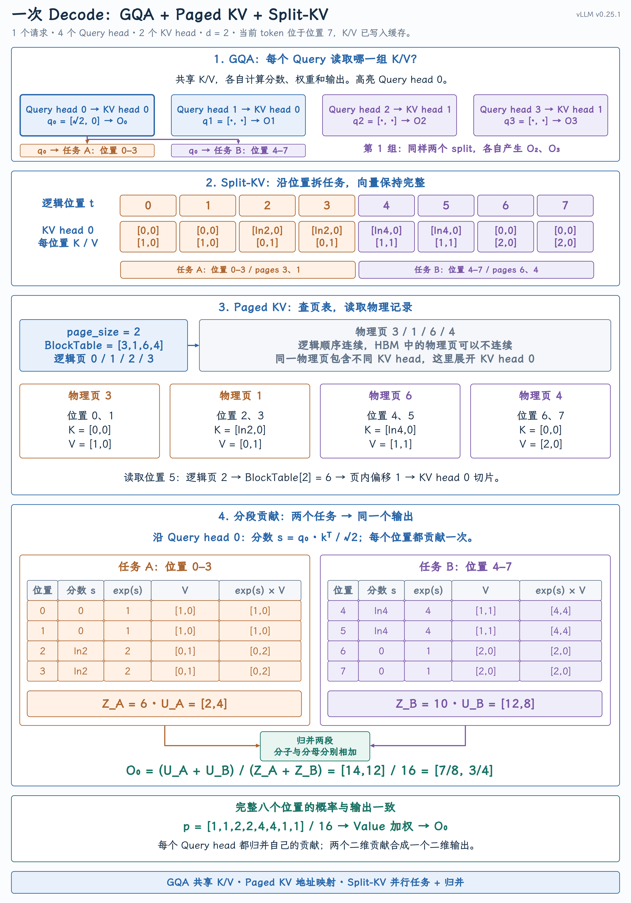

# Decode Attention：Paged KV、GQA 与 Split-KV

Decode Attention 每轮只有一个新的 Query 位置，却要读取整段历史 K/V。GQA 减少需要保存的 KV head，Paged KV 让缓存按页存放，Split-KV 则把长历史交给多个任务并行处理。本课用一次 Decode 串起共享、寻址、分段计算和结果归并，解释它们各自解决什么问题，以及怎样在 vLLM 中协同工作。

## 一、Decode 的瓶颈：读取很多，任务很少

Prefill 有许多 Query 位置，可以把不同 Query 行块分配给不同线程块。标准逐 token Decode 中，每个请求只有一个新的 Query 位置，沿 Query 序列切分的空间消失了；当请求数和 head 数也不多时，可供 GPU 调度的任务就可能不足。

固定一个请求、一个 Query head，当前 K/V 已写入缓存。设可见 KV 位置总数（包含当前位置）为 $N$、每个向量的维度为 $d$，这个 Query head 的输入、输出形状是：

$$
\begin{aligned}
Q&\in\mathbb R^{1\times d},\\
K,V&\in\mathbb R^{N\times d},\\
O&\in\mathbb R^{1\times d}.
\end{aligned}
$$

分数只有 1 × N，不再是长序列 Prefill 的 N × N。FlashAttention 仍能避免分数和概率等中间矩阵落入 HBM，但当前 Query 依然要与全部可见 Key 匹配，并汇总对应 Value。这里要解决的是长历史的 KV 读取，以及足够的并行任务。

例如，一个请求有 8 个 Query head、2 个 KV head，N = 16384、d = 128，K/V 使用 BF16，则单层缓存的有效数据量为：

$$
2\times16384\times2\times128\times2\ \mathrm{bytes}=16\ \mathrm{MiB}.
$$

五个因子依次表示 K/V 两份数据、位置数、KV head 数、向量维度和每个元素的字节数。实际 HBM 流量还受缓存命中和内核复用方式影响，不能直接把 16 MiB 当作实测读取量。

如果只有少数线程块沿着历史循环，增加历史长度只会让这些任务执行得更久，其他 SM 未必能参与。任务不足时，增加并行度可能提高实际带宽利用；带宽已经饱和时，继续拆任务不会减少必要的数据读取。 本课讨论单层Attention 的这条路径；整轮 Decode 还包括模型权重读取、线性层等工作。

## 二、GQA 与 Paged KV：共享什么，存在哪里

这三种机制处在不同层面，不是必须依次开启的三个优化步骤：

| 机制 | 解决的问题 | 改变什么 |
| --- | --- | --- |
| GQA | 普通多头注意力为每个 Query head 配置一组 K/V，缓存太大 | 模型中的 KV head 数及共享关系 |
| Paged KV | 历史不断增长，连续缓存难以灵活分配 | KV Cache 的存储和地址映射 |
| Split-KV | 少数任务各自处理长历史，并行度不足 | Attention 的任务划分与结果归并 |

用一套小例子把它们连起来：一个请求、4 个 Query head、2 个 KV head、每个向量 2 维。 当前 token 位于位置 7，它的 K/V 已写入缓存，可见位置为 0–7。第二至四节的计算和图使用这些参数；它们用于讲清机制，不是实际内核启动配置。

### GQA：多个 Query head 共享 K/V

GQA（Grouped-Query Attention，分组查询注意力）让多个 Query head 使用同一个 KV head。 本例分为两组：

| Query head | 读取的 KV head | 各自产生的输出 |
| --- | --- | --- |
| 0、1 | 0 | $O_0$、$O_1$ |
| 2、3 | 1 | $O_2$、$O_3$ |

两个 Query 即使读取相同的 K/V，也会算出各自的分数、概率和输出。相同序列长度、向量维度和精度下，这个例子只需保存 2 个 KV head，而不是普通多头注意力中与 4 个 Query head 对应的 4 个 KV head，KV 数据量减半。只有一个 KV head、所有 Query head 都共享它的情形称为 MQA（Multi-Query Attention，多查询注意力） 。[GQA 论文](https://arxiv.org/abs/2305.13245)

KV head 数是模型结构的一部分。vLLM 按模型已有的分组关系读取和复用 K/V，并不会在运行时随意把普通多头注意力改成 GQA。共享 K/V 也不等于 Query head 的计算量按相同比例减少。

### Paged KV：逻辑上连续，物理上按页存放

Paged KV 把 KV Cache 分成固定大小的页，用页表记录逻辑页到物理页的映射。 请求增长时可以逐页分配空间，不必为每个请求预留一整段最大长度的连续缓存。分页本身不减少这个请求有效的 K/V 数值，也不减少 Attention需要访问的逻辑位置。

本例每页放 2 个位置，页表为 `[3,1,6,4]` ：

| 逻辑页 | 位置 | 物理页 |
| --- | --- | --- |
| 0 | 0、1 | 3 |
| 1 | 2、3 | 1 |
| 2 | 4、5 | 6 |
| 3 | 6、7 | 4 |

例如读取位置 5：5 ÷ 2 向下取整得到逻辑页 2，查页表得到物理页 6，页内偏移为 5 mod 2 = 1。再选择 KV head和特征维度，就能取到所需 K/V。页表保存的是地址映射，K/V 数值仍保存在物理页中。

对于逻辑位置 $t$、页大小 $P$：

$$
\begin{aligned}
\mathrm{page\_id}&=\mathrm{BlockTable}[\lfloor t/P\rfloor],\\
\mathrm{offset}&=t\bmod P.
\end{aligned}
$$

vLLM 内核[先查物理页号](https://github.com/vllm-project/vllm/blob/v0.25.1/vllm/v1/attention/ops/triton_unified_attention.py#L419-L426)，再结合[页、页内位置、head 和特征维的 stride](https://github.com/vllm-project/vllm/blob/v0.25.1/vllm/v1/attention/ops/triton_unified_attention.py#L467-L491)装载数据，不需要先把整个历史整理成连续的大矩阵。

## 三、Split-KV：把长历史交给多个任务

共享和分页解决了“保存哪些数据、数据在哪里”，但还没有决定由多少任务来处理这些数据。

一种便于复用 K/V 的组织方式是：同组 Query head 由一个任务一起计算。对小例子而言，不分段时只有 2 个任务，每个任务沿全部 8 个位置计算；同组两个 Query head 是两行独立计算，并不共享 Softmax 结果。所选 vLLM Triton 内核的 [Query 行与 head 映射](https://github.com/vllm-project/vllm/blob/v0.25.1/vllm/v1/attention/ops/triton_unified_attention.py#L305-L350)采用这种分组方式。这是内核的任务安排，不是 GQA 规定的唯一实现。

Split-KV 沿 Key/Value 的序列位置拆分任务。 将位置 0–7 分成 A、B 两段：

| 任务 | 使用的 Query head | 使用的 KV head | 负责的位置 | 读取的物理页 |
| --- | --- | --- | --- | --- |
| 第 0 组 A 段 | 0、1 | 0 | 0–3 | 3、1 |
| 第 0 组 B 段 | 0、1 | 0 | 4–7 | 6、4 |
| 第 1 组 A 段 | 2、3 | 1 | 0–3 | 3、1 |
| 第 1 组 B 段 | 2、3 | 1 | 4–7 | 6、4 |

现在有 2 个 KV head × 2 段 = 4 个分段任务。同一物理页包含不同 KV head 的数据，两组任务选择各自的 head 切片。每个任务读取完整 Query，K/V 向量也保留全部特征；切开的是位置范围，不是向量宽度。

这些任务可以独立调度到不同 SM，但不保证同时运行，也不保证任务越多越快。8 个位置的小例子只展示分工；长历史时，每段有足够工作，拆分才更可能带来收益。

{ width="100%" }

[查看图1原图](../../../assets/vllm/decode-attention-gqa-paged-split-kv.png)。图中高亮 Query head 0，展开它使用的 KV head 0 数据；其他 Query head 各自产生结果。图里的指数和用于手算，实际内核用减去最大值后的稳定状态保存同样的信息。

这里要区分三个粒度：page 是存储单位，tile 是任务内一次循环处理的数据块，segment 是独立任务负责的位置范围。 本例每个 segment 跨两页；一般情况下，segment 与 page 的边界也未必重合。段内逐 tile 更新 Online Softmax 状态，段间才需要写出状态并归并，不是为每个 tile 都保存一份中间结果。

与沿 Query 切分相比，Split-KV 多了一项工作：不同 Query 的任务写不同输出；同一 Query 的不同 KV 分段，只得到同一输出的部分贡献。 所以 4 个分段任务结束后，还要分别为 4 个 Query head 归并结果。[Flash-Decoding](https://crfm.stanford.edu/2023/10/12/flashdecoding.html)也采用段内计算、段间归并的思路；这里对应的是 vLLM Triton 路径，具体状态格式以源码为准。

## 四、从分段贡献得到完整输出

### 分子和分母必须一起合并

沿图中的 Query head 0 计算，向量维度 d = 2：

$$
\begin{aligned}
q_0&=[\sqrt2,0],\\
s_j&=\frac{q_0k_j^\top}{\sqrt2}.
\end{aligned}
$$

因此，本例中 Key 的第一维恰好等于分数。下表中同一行的两个位置，分别保存相同的 K 和 V：

| 分段 | 位置 | K | V | 分数 | 指数权重 |
| --- | --- | --- | --- | --- | --- |
| A | 0、1 | [0, 0] | [1, 0] | 0 | 1 |
| A | 2、3 | [ln 2, 0] | [0, 1] | ln 2 | 2 |
| B | 4、5 | [ln 4, 0] | [1, 1] | ln 4 | 4 |
| B | 6、7 | [0, 0] | [2, 0] | 0 | 1 |

每行对应两个位置，各自贡献一次。用 $Z$ 表示指数权重和，$U$ 表示未归一化的 Value 加权和：

$$
\begin{aligned}
Z_A&=1+1+2+2=6,\\
U_A&=2[1,0]+4[0,1]=[2,4],\\
Z_B&=4+4+1+1=10,\\
U_B&=8[1,1]+2[2,0]=[12,8].
\end{aligned}
$$

两段覆盖全部可见位置，分子、分母分别相加即可恢复完整 Attention：

$$
\begin{aligned}
O_0&=\frac{U_A+U_B}{Z_A+Z_B}\\
&=\frac{[14,12]}{16}=[7/8,3/4].
\end{aligned}
$$

### 不分段时，所有位置使用同一个分母

不分段时，八个位置的指数权重之和为 16，因此它们的 Attention 概率是：

$$
p=\frac{[1,1,2,2,4,4,1,1]}{16}.
$$

按图1中的 Value 加权，把相同 Value 的项合在一起：

$$
\begin{aligned}
O_0&=\frac{2[1,0]+4[0,1]+8[1,1]+2[2,0]}{16}\\
&=\frac{[14,12]}{16}=[7/8,3/4].
\end{aligned}
$$

这与前面的分段归并完全一致：分段只是把八项求和拆给两个任务，最后仍然除以全部位置的指数权重和。每个Value 都是二维向量，加权求和后仍是二维；两个分段都为同一个二维输出提供部分贡献。 归并时逐分量相加，不能把它们拼成四维。

### 局部输出为什么不能直接相加或平均

如果每段先用自己的分母归一化，得到的局部输出分别为：

$$
\begin{aligned}
O_A&=\frac{U_A}{Z_A}=\frac{[2,4]}6=\left[\frac13,\frac23\right],\\
O_B&=\frac{U_B}{Z_B}=\frac{[12,8]}{10}=\left[\frac65,\frac45\right].
\end{aligned}
$$

此时，A 段内的概率之和是 1，B 段内的概率之和也是 1。但在完整 Attention 中，A 段四个位置合计只占 6/16 的概率，B 段占 10/16。局部归一化保留了段内的相对权重，却没有保留这一段在全局中占多少权重。

所以，合并局部输出时，要先把每段的总权重从 1 调整为它在全局中的占比：

$$
\begin{aligned}
O_0&=\frac{Z_AO_A+Z_BO_B}{Z_A+Z_B}\\
&=\frac6{16}\left[\frac13,\frac23\right]+\frac{10}{16}\left[\frac65,\frac45\right]\\
&=[2/16,4/16]+[12/16,8/16]\\
&=[7/8,3/4].
\end{aligned}
$$

例如，A 段第一个位置的局部概率是 1/6，乘以这一段的全局占比 6/16 后，才恢复为正确的全局概率 1/16。

| 合并方式 | 本例的结果 | 问题 |
| --- | --- | --- |
| 直接相加 $O_A+O_B$ | $[23/15,22/15]$ | 两段各自占权重 1，所有位置的权重之和变成 2 |
| 简单平均 $(O_A+O_B)/2$ | $[23/30,11/15]$ | 强行让两段各占 1/2，与实际的 6/16、10/16 不符 |
| 按全局占比加权 | $[7/8,3/4]$ | 恢复全部八个位置的正确概率 |

两段虽然各有四个位置，指数权重之和却不同。归并权重由指数权重和决定，不由位置数量决定。 因此，分段任务可以交出分子和分母，也可以交出局部输出及恢复其全局权重所需的信息；只交出局部输出通常不足以正确归并。

## 五、vLLM 如何执行分段与归并

源码沿 vLLM v0.25.1 的普通 Triton Attention 后端 展开，使用 BF16、标准因果 Attention，不启用滑动窗口或attention sink。后端 `forward()` 把 Query、分页 KV、页表及分段工作区传给 [`unified_attention()`](https://github.com/vllm-project/vllm/blob/v0.25.1/vllm/v1/attention/backends/triton_attn.py#L654-L691) 。以下按单 GPU、一个请求计算有效任务数。

### 决定是否拆分

所选版本的普通 Triton 后端[把分段数设为 16](https://github.com/vllm-project/vllm/blob/v0.25.1/vllm/v1/attention/backends/triton_attn.py#L54-L56)，[并预分配分段状态缓冲区](https://github.com/vllm-project/vllm/blob/v0.25.1/vllm/v1/attention/backends/triton_attn.py#L154-L175)。这不是根据每个请求在线搜索最优 split数。

`unified_attention()` 的 [`use_3d` 判断](https://github.com/vllm-project/vllm/blob/v0.25.1/vllm/v1/attention/ops/triton_unified_attention.py#L1036-L1050)要求分段缓冲区可用、最大 Query 长度不超过 1、请求数不超过配置阈值，并且没有启用 batch invariance。条件不满足时走二维任务网格，在任务内部完成整个有效 KV 范围。

后端的初始请求数阈值为 128 除以 KV head 数的整数商：有 2 个 KV head 时，阈值为 64；启用 Decode CUDA Graph 时，还会调整到邻近的捕获尺寸。它用请求数和 KV head 数估计现有任务是否足够，没有在运行时测量HBM 是否饱和。[阈值计算与调整](https://github.com/vllm-project/vllm/blob/v0.25.1/vllm/v1/attention/backends/triton_attn.py#L132-L152)

### 从两段示意到实际任务网格

源码中[的任务网格（launch grid）](https://github.com/vllm-project/vllm/blob/v0.25.1/vllm/v1/attention/ops/triton_unified_attention.py#L1074-L1082)按是否分段组织：

| 执行方式 | 任务坐标 |
| --- | --- |
| 不分段：二维网格 | `(query_block, kv_head)` |
| 分段：三维网格 | `(query_block, kv_head, segment)` |

“三维”指增加了分段调度轴，不是改变 Q/K/V 的数学维度。

把规模恢复为第一节的 8 个 Query head、2 个 KV head、16384 个位置、每个向量 128 维 ：每组 4 个 Query head 一起处理。不拆分时只有 2 个有效任务；拆为 16 段后，有 32 个有效分段任务，随后有 8 个归并任务，每个Query head 对应一个。

启用分段后，内核读取 `segm_idx` ，[按 tile 对齐计算每段范围](https://github.com/vllm-project/vllm/blob/v0.25.1/vllm/v1/attention/ops/triton_unified_attention.py#L305-L325)。在本例启用分段的 BF16 Decode 路径中，默认 KV tile 为 16 个位置；16384 个位置分成 16 段，每段正好包含 64 个 tile、1024 个位置。[tile 大小选择](https://github.com/vllm-project/vllm/blob/v0.25.1/vllm/v1/attention/ops/triton_unified_attention.py#L784-L799)

### 分段写状态，归并写输出

每个任务完成自己的 tile 循环，随后在 [`IS_3D` 分支](https://github.com/vllm-project/vllm/blob/v0.25.1/vllm/v1/attention/ops/triton_unified_attention.py#L586-L642)为各个 Query head 分别写出分段状态：

| 缓冲区 | 数学含义 | 状态内容 |
| --- | --- | --- |
| `softmax_segm_output` | $u_r$ | 一个未归一化的 $d$ 维分子 |
| `softmax_segm_max` | $m_r$ | 一个局部最大值 |
| `softmax_segm_expsum` | $l_r$ | 一个局部指数和 |

虽然第一个缓冲区名字包含 `output` ，这里写入的仍是分子，不是已经除以 $l_r$ 的局部输出。

分段内核之后，调用者[启动 `reduce_segments`](https://github.com/vllm-project/vllm/blob/v0.25.1/vllm/v1/attention/ops/triton_unified_attention.py#L1169-L1189) ，每个 Query token、每个 Query head 对应一个归并任务。两个内核在同一 CUDA stream 中依次提交，归并读取前，分段内核的写入已经完成。

[`reduce_segments()`](https://github.com/vllm-project/vllm/blob/v0.25.1/vllm/v1/attention/ops/triton_unified_attention.py#L729-L771) 依次求共同最大值、缩放各段指数和与分子、求和，再执行最终除法。

实际历史长度未必足以填满 16 段。[无有效位置的分段直接退出](https://github.com/vllm-project/vllm/blob/v0.25.1/vllm/v1/attention/ops/triton_unified_attention.py#L322-L325)，归并时也[会屏蔽无效分段](https://github.com/vllm-project/vllm/blob/v0.25.1/vllm/v1/attention/ops/triton_unified_attention.py#L718-L735)。因此 launch grid 中有多少个槽位，不等于真正执行有效计算的任务数。

## 六、Split-KV 的收益与代价

- 收益： 把少数长任务拆成更多可并行的任务，让更多 SM 参与计算，提高任务不足时的带宽利用率。它不减少 Attention 必须读取的 KV 数据量。

- 代价： 需要额外保存、写入和读取分段状态，并启动归并内核；各段还会重复读取 Query。

- 适用条件： 长历史、小并发、原有任务少时更容易获益；历史短、并行任务已经足够或 HBM 带宽已饱和时，继续拆分可能无益，甚至变慢。

判断是否加速，要比较 分段计算与归并的总耗时 ，不能只看分段计算变快了多少。
