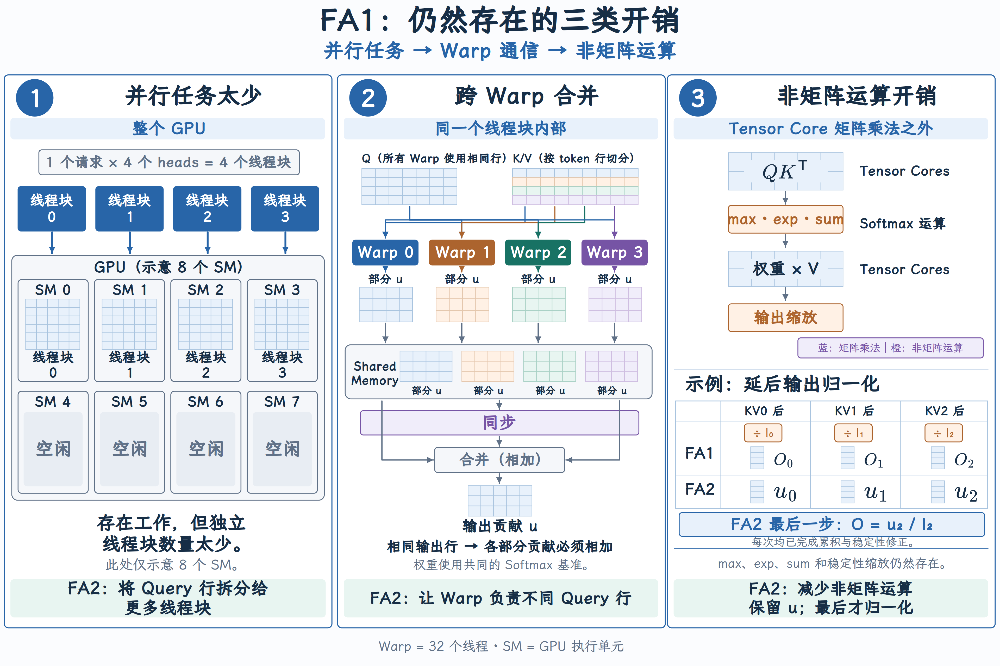
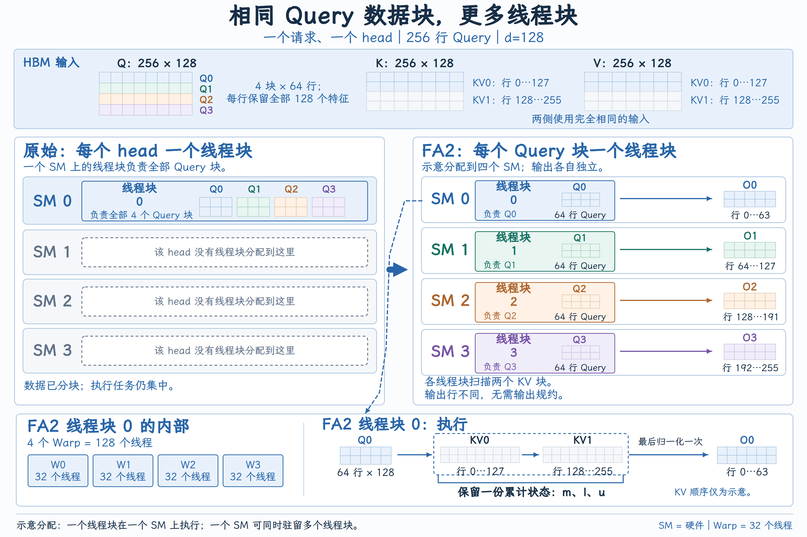
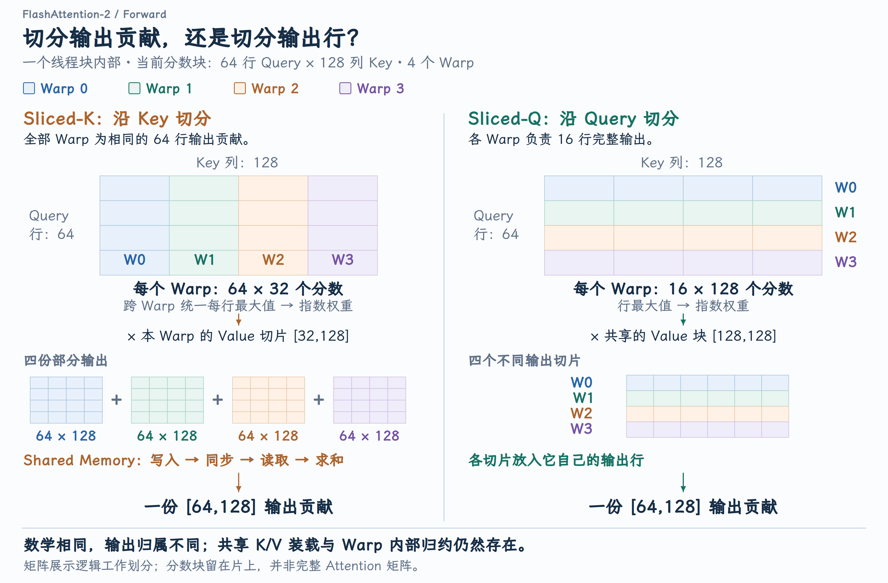

# FlashAttention-2：并行划分与非矩阵运算优化

FlashAttention v1 省去了大中间矩阵的显存往返，GPU 却仍可能因为任务太少、Warp 之间交换结果、输出反复缩放而无法充分发挥算力。FA2 保留同一个 Attention 计算目标，重新安排线程块和 Warp 的工作，并简化在线更新。本课沿这三项改动，解释它为什么更快、结果为什么不变，以及它们在 vLLM 所调用的内核中如何实现。

## 一、减少 IO 之后，还要让计算单元忙起来

FA1 已经把分数计算、Softmax 和 Value 加权融合在一起，不再把完整的分数与概率矩阵写回 HBM。接下来要解决的，是剩余工作如何在 GPU 上高效执行：

1. 任务数量： GPU 有很多执行单元，但当前内核是否提供了足够多的独立任务？

2. 任务内部分工： 多个 Warp 算出的结果能直接写回，还是必须先交换、合并？

3. 额外计算： 矩阵乘法之外，哪些缩放与归约可以减少？

这些问题来自 [FA2 论文对原始 FA1 的分析](https://arxiv.org/html/2307.08691v1#S3)。FA1 本来就使用 GPU 并行计算；FA2 改进的是并行维度与分工方式。

图右下角比较的是每轮 KV 更新后保存的状态：FA1 保存部分归一化输出 O，FA2 保存未归一化分子 u。下标表示更新轮次。

{ width="100%" }

## 二、线程块之间：把 Query 块交给独立任务

### 分了数据块，为什么还会缺少并行任务

先区分三个执行层级：

| 对象 | 在本课中的作用 |
| --- | --- |
| SM（Streaming Multiprocessor） | GPU 中执行线程块的硬件单元 |
| 线程块（Thread Block） | 一组协作线程，在一个 SM 上执行 |
| Warp | 线程块内部的执行组，由 32 个线程组成 |

一个 SM 在资源允许时可以同时驻留多个线程块，但一个线程块不会拆开到多个 SM 上执行。[CUDA 编程模型](https://docs.nvidia.com/cuda/cuda-programming-guide/01-introduction/programming-model.html)

FA2 论文所对比的原始 FA1 实现，主要沿 batch 和 head 分配线程块。一个请求、4 个 head，只能提供 4 个这样的任务；即使每个 head 的序列很长，也可能只是让这几个任务运行更久，其他 SM 仍分不到工作。[论文 §3.2](https://arxiv.org/html/2307.08691v1#S3.SS2)

第一课已经把 Q 按行分块，但那解决的是片上空间不足。数据切成四块，与启动四个线程块，是两件事。 前者决定一次处理多少数据，后者决定 GPU 能否把这些工作分给不同 SM。

### Query 行之间没有 Softmax 依赖

每条 Query 都有自己的最大值、分母和输出。Softmax 沿 Key 方向归一化，不会把不同 Query 行放进同一个分母。因此，可以让一个线程块完整负责一组 Query 行：

$$
O_i=\operatorname{softmax}\!\left(\frac{Q_iK^\top}{\sqrt d}\right)V.
$$

$Q_i$ 是第 i 个 Query 块，形状为 $B_q$ × d；K、V 均为 $N_k$ × d；$O_i$ 为 $B_q$ × d。$B_q$ 是每块 Query 行数，$N_k$ 是Key/Value 位置数，d 是 head 维度；Softmax 对分数块的每一行独立执行。

只要负责 $Q_i$ 的线程块遍历它所需的全部 K/V，就能独立完成 $O_i$。不同线程块写入不同输出行，最后不需要把它们的输出相加，也不需要再次做 Softmax 。读取相同 K/V 没有写入冲突。

### 用同一组矩阵看任务怎样变化

固定一个请求、一个 head：Q、K、V 均为 256 × 128。Q 每 64 行分一块，K/V 每 128 行配对分一块。

| 对象 | 每块形状 | 块数或对应关系 |
| --- | --- | --- |
| $Q_i$ | 64 × 128 | 四块，各含 64 条 Query |
| $K_j$、$V_j$ | 各 128 × 128 | 两组，每组对应相同的 128 个位置 |
| 当前分数 $S_{ij}$ | 64 × 128 | 行是 Query，列是 Key |
| 输出 $O_i$ | 64 × 128 | 对应 $Q_i$ 的 64 行输出 |

表中 i、j 分别是 Query 块、KV 块编号。分块沿 token 行进行，每个向量的 128 个特征都保留 ；一个分数仍来自完整的 128 维点积。

{ width="100%" }

图左比较原先按 head 集中分配工作的方式；图右每个线程块负责一个 Query 块，并各自扫描两组 K/V。它们分别写回输出的 0–63、64–127、128–191、192–255 行。图中把四个线程块放到四个 SM 上，只是展示一种可能的调度，不是固定绑定。

这里也改变了累计状态的存放方式。原始 FA1 Algorithm 1 外层遍历 K/V，内层遍历 Q，每轮读写各 Query 块的状态；FA2 固定一个 Query 块，在同一线程块内遍历 K/V，让该块的累计状态留在片上直到结束。这是为了让独立输出拥有独立的执行任务，不是把 K/V 的遍历也取消了。

## 三、线程块内部：让 Warp 负责不同输出行

现在进入图 2 的一个线程块：它处理 64 行 Query，每轮处理 128 行 K/V，由 4 个 Warp 协作。线程块之间已经独立，块内仍有两种不同的分工方式。

### 按 Key 分工，得到同一输出的不同贡献

如果每个 Warp 处理 32 个 Key/Value，它们都要使用相同的 64 行 Query：

| 每个 Warp 的工作 | 形状 |
| --- | --- |
| 当前分数片段 | 64 行 Query × 32 列 Key |
| 对应的 Value 片段 | 32 × 128 |
| 两者加权相乘后的部分贡献 | 64 × 128 |

四份结果都指向同一个 64 × 128 输出块。虽然每个 Warp 处理不同 Key，它们只算完了同一求和的不同项，必须合并才能得到完整贡献 。

设 $E_0\ldots E_3$ 是按 Key 列切开的指数权重片段，$V_0\ldots V_3$ 是相应的 Value 行片段；每行权重先使用共同的最大值作为指数基准，则当前 KV 块的贡献为：

$$
U=E_0V_0+E_1V_1+E_2V_2+E_3V_3.
$$

每个 $E_r$ 为 64 × 32、$V_r$ 为 32 × 128，U 为 64 × 128，r 是 Warp 编号。这里不是相加四份局部 Softmax 输出；只有指数基准一致，未归一化贡献才能直接相加。

这种划分在论文中称为 sliced-K ：此处切的是 Key 的位置列表，不是把一个 Key 的 d 个特征截短。原始实现需要把部分结果写入共享内存、同步，再读取并相加。HBM 往返减少之后，这些片上交换和等待仍有成本。[论文 §3.3](https://arxiv.org/html/2307.08691v1#S3.SS3)

### 按 Query 分工，结果落在不同位置

FA2 改为让四个 Warp 分别负责 16 行 Query，共同使用当前的全部 128 行 K/V。每个 Warp 的分数片段为 16 ×128，对输出的贡献也是 16 × 128。

{ width="100%" }

这种 sliced-Q 划分利用的，仍是 Query 行之间的独立性。四份结果对应不同输出行，各自放回自己的位置即可，省掉了合并同一输出所需的跨 Warp 交换。没有少算 Query-Key 配对，也没有减少对 Value 的加权项。

每个 Warp 的 16 行仍由其中的 32 个线程协作，不能理解成一个线程独自计算一整行。这里也没有消除所有同步：K/V 装载仍需协作，同一行的最大值、分母仍可能需要 Warp 内归约。FA2 的 `TiledMma` 配置 正是沿矩阵行方向组织 Warp。

两个层级现在可以对应起来：线程块之间分配不同 Query 块，线程块内部再把这些 Query 行分给不同 Warp。每层都在明确“谁负责哪些输出行”，K/V 则作为这些输出共同需要的输入。

## 四、在线更新：把输出归一化移出 KV 循环

### 矩阵乘法快，为什么还要减少标量运算

QKᵀ 和指数权重乘 V 可以使用 Tensor Core；最大值、指数、求和、缩放等操作使用其他指令和执行资源。它们的吞吐能力不同，所以 FLOPs 少不代表耗时占比一定低 。FA2 因此还要减少夹在矩阵乘法之间的非矩阵工作。[论文 §3.1](https://arxiv.org/html/2307.08691v1#S3.SS1)

其中一个可以省下的动作，是在处理完每个 KV 块后，都把当前分子转换为归一化输出。

### 原始 FA1 保存 O，FA2 保存 u

第一课推导 Online Softmax 时使用分子 u，随后才换成原始 FA1 Algorithm 1 保存的部分输出 O。两者满足 u =lO，区别在于循环中保存哪一个，而不是两种不同的 Attention 定义。

固定一条 Query。已经处理的历史状态为最大值 m、指数和 l、输出向量 O；新块中第 j 个位置的分数为 $s_j$、Value为 $v_j$。O、$v_j$ 均为 1 × d，其余为标量。先更新共同基准：

$$
\begin{aligned}
m'&=\max\left(m,\max_{j\in\text{新块}}s_j\right),\\
\alpha&=e^{m-m'},\qquad e_j=e^{s_j-m'},\\
l'&=\alpha l+\sum_{j\in\text{新块}}e_j.
\end{aligned}
$$

撇号表示更新后的状态，α 把旧累计量换到新最大值对应的基准，$e_j$ 是当前块的未归一化指数权重。两种实现使用同样的最大值和分母递推。

原始 FA1 把旧输出恢复成分子，加入新贡献，再保存归一化输出：[Algorithm 1，第 12 行](https://arxiv.org/pdf/2205.14135#page=5)。

$$
O'=\frac{\alpha lO+\sum_{j\in\text{新块}}e_jv_j}{l'}.
$$

但下一个块需要的仍然是未归一化贡献。既然最终结果才必须除以 l，就直接保存 1 × d 的分子 u = lO。将 u′ = l′O′代入上式：

$$
u'=\alpha u+\sum_{j\in\text{新块}}e_jv_j,\qquad O=\frac ul\quad\text{（全部可见 KV 完成后）}.
$$

因此，对遍历 T 个 KV 块的一条 Query，按分母缩放整个输出向量从循环内的每轮动作变成结束时的一次动作。省掉的是中间轮次的分母归一化；最大值变化时按 α 重缩放 u 和 l，仍然必须做。 T 表示块数，不能直接当作加速倍数。

### 同一算例下的 FA1 与 FA2

沿用第一课第一条 Query：四个分数为 `[0, ln2, ln4, 0]` ，Value 依次是 `[1,0]` 、`[0,1]` 、`[1,1]` 、`[2,0]` 。前两个位置为 A，后两个为 B。下表列出两块各自的结果，以及合并后的结果：

| 位置集合 | 最大值 m、指数和 l | 归一化输出 O = u/l | 未归一化分子 u |
| --- | --- | --- | --- |
| A | m = ln2，l = 3/2 | `[1/3, 2/3]` | `[1/2, 1]` |
| B | m = ln4，l = 5/4 | `[6/5, 4/5]` | `[3/2, 1]` |
| A 与 B | m = ln4，l = 2 | `[7/8, 3/4]` | `[7/4, 3/2]` |

加入 B 时，最大值从 ln2 升到 ln4，A 的旧分子和分母都要乘 α = 1/2。FA1 从 O 恢复分子，FA2 直接使用 u，修正后的贡献相同：

$$
\begin{aligned}
\mathrm{FA1}:\quad \alpha lO&=\frac12\times\frac32[1/3,2/3]=[1/4,1/2],\\
\mathrm{FA2}:\quad \alpha u&=\frac12[1/2,1]=[1/4,1/2].
\end{aligned}
$$

B 以 ln4 为基准，未归一化指数权重为：

$$
\left[e^{\ln4-\ln4},\ e^{0-\ln4}\right]=\left[1,\frac14\right].
$$

对两个 Value 加权，得到分子贡献 `1×[1,1] + (1/4)×[2,0] = [3/2,1]` ；权重相加，得到分母贡献 `5/4` 。因此合并后：

$$
\begin{aligned}
u'&=[1/4,1/2]+[3/2,1]=[7/4,3/2],\\
l'&=\frac12\times\frac32+\frac54=2.
\end{aligned}
$$

FA1 每轮保存 O′ = u′/l′，FA2 保留 u′，全部块结束后才归一化。 本例只有 A、B 两块，最终输出均为`[7/8,3/4]` ；如果后面还有块，FA2 就省去本轮的分母归一化。两者数学上等价，浮点实现可能有舍入差异。

## 五、收益取决于原来卡在哪里

FA2 的改动没有减少 dense Attention 所需的 Query-Key 配对数。它让已有工作更容易分散到 GPU 上执行，并减少协作和非矩阵操作的成本；因此，收益应结合输入形状判断。

| 场景 | 能从三项改动中获得什么 |
| --- | --- |
| Query 很多、batch/head 较少的长 Prefill | Query 分块能增加独立任务，改善 SM 利用 |
| 原本已有大量 batch/head 任务 | 新增 Query 并行的边际收益可能降低，块内分工和缩放仍有优化空间 |
| 普通单 token Decode | 每请求、每 head 只有一行 Query，无法沿这一维再拆；表现更多取决于KV 读取与其他并行维度 |

[论文 §4.1、图 4](https://arxiv.org/html/2307.08691v1#S4.SS1) 在 A100 80GB SXM4 上测试了序列长度 512–16K、head 维度 64/128 和不同因果设置，前向加反向的合计性能相对原始 FA 约提升到两倍。这个数字包含反向，不能当作 vLLM 推理的固定加速比。

在推理服务中，应分别看 Attention 内核耗时、整次模型前向耗时和请求吞吐。FA2 直接改善的是前者；最终收益还受模型其他算子、KV 访问和服务负载限制。

### vLLM 中的核心实现位置

vLLM v0.25.1 的 [FlashAttention 后端](https://github.com/vllm-project/vllm/blob/v0.25.1/vllm/v1/attention/backends/flash_attn.py#L952-L977) 通过 `flash_attn_varlen_func` 调用 FA2 CUDA 扩展，核心算法与正文一致。CUDA 源码位于构建配置指定的 [FlashAttention 依赖](https://github.com/vllm-project/vllm/blob/v0.25.1/cmake/external_projects/vllm_flash_attn.cmake#L38-L43) 中：[`flash_fwd_kernel.h`](https://github.com/vllm-project/flash-attention/blob/2c839c33742309ec41e620bf837495ec9926c56e/csrc/flash_attn/src/flash_fwd_kernel.h#L849-L1012) 组织分块计算，`softmax.h`中的 [`softmax_rescale_o`](https://github.com/vllm-project/flash-attention/blob/2c839c33742309ec41e620bf837495ec9926c56e/csrc/flash_attn/src/softmax.h#L136-L166) 更新在线状态，[`normalize_softmax_lse`](https://github.com/vllm-project/flash-attention/blob/2c839c33742309ec41e620bf837495ec9926c56e/csrc/flash_attn/src/softmax.h#L169-L185) 在遍历结束后归一化输出。
