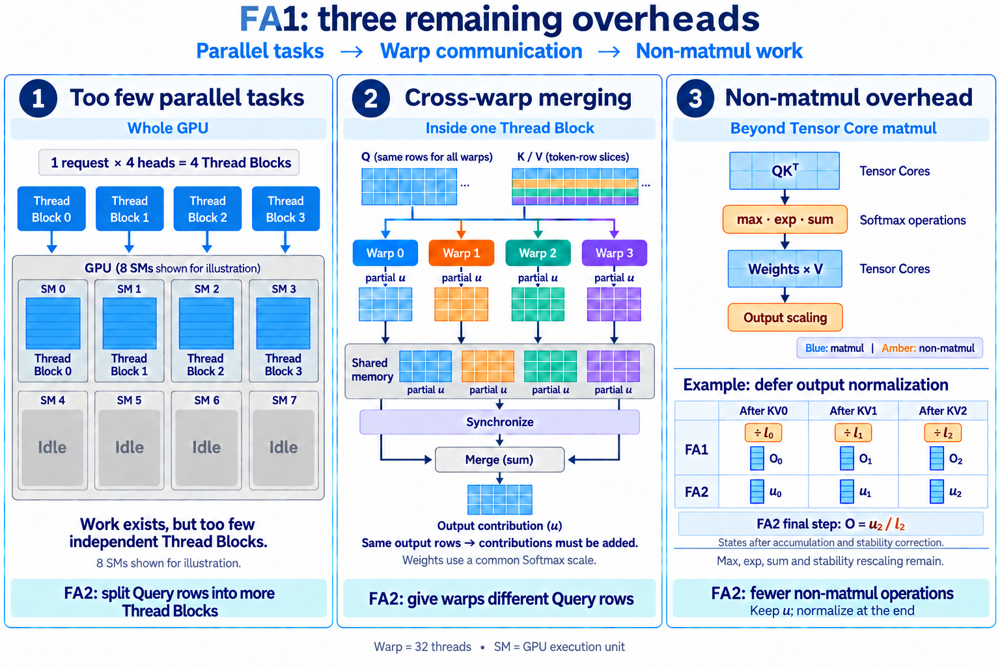
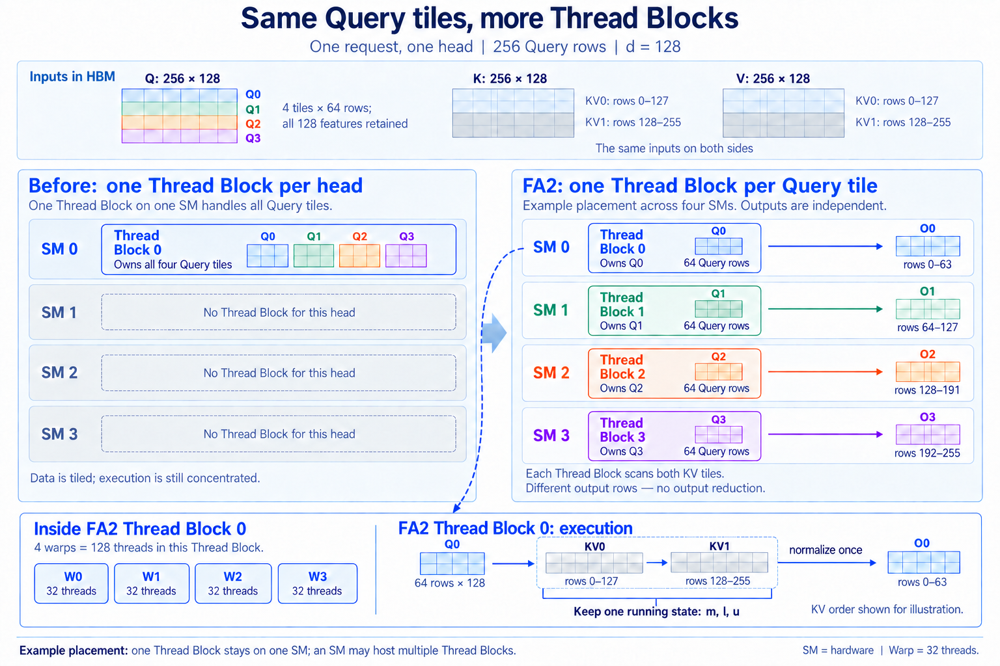
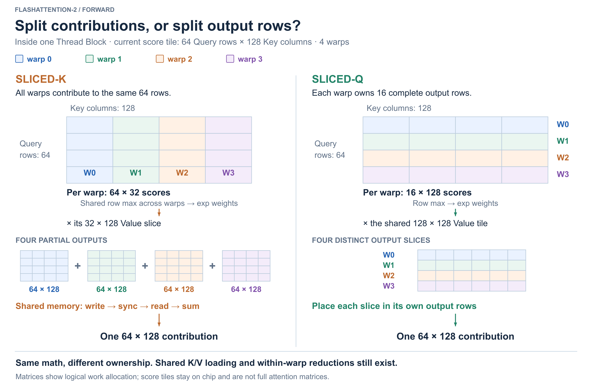

# FlashAttention-2：线程块与 Warp 的工作划分

本章围绕原始 FlashAttention 的三个性能问题展开：线程块并行度不足、Warp 之间的通信与合并、非矩阵运算开销。分别说明 FA2 如何沿 Query 方向增加独立任务、让 Warp 负责不同输出行，以及通过延后归一化减少输出缩放。结合数值例子和 vLLM 调用的 FA2 源码，解释每项改动的原因、执行过程与正确性。

## 一、FA1 之后，还剩哪些开销

第一章中的原始 FA1 已经避免把完整的分数、指数权重和概率矩阵写入 HBM，但 Attention 的两次矩阵乘法仍然要做。中间矩阵不再反复搬运，并不意味着 GPU 的计算单元就能持续高效工作。

FA2 论文对原始 FA1 实现的分析指出了三类开销；它们是下面优化的起点，并不表示当前 vLLM 使用的 FA2 内核仍保留这些设计：

| 问题                  | 开销从哪里来                                     | FA2 的改动                                |
| --------------------- | ------------------------------------------------ | ----------------------------------------- |
| 线程块太少            | 只按请求和 head 并行，部分 SM 分不到任务         | 将不同 Query 数据块交给独立线程块         |
| Warp 之间需要合并输出 | 按 K/V 分工，各 Warp 只得到同一输出的一部分贡献  | 按 Query 行分工，让各 Warp 负责不同输出行 |
| 非矩阵运算开销        | 矩阵乘法吞吐很高，Softmax 与输出缩放仍会占用时间 | 改写在线更新，减少不必要的归一化缩放      |

{ width="90%" }

右下角按 KV 更新轮次对比保存的状态：原始 FA1 保存部分输出 O，FA2 保存分子 u。这里的下标表示更新轮次，不是 Query 块编号。

三条主线分别关注任务是否足够、任务内部怎样协作，以及计算过程中哪些额外操作可以减少。[FA2 论文 §3](https://arxiv.org/html/2307.08691v1#S3)

本章先固定标准多头 Attention 的一次 forward，无 dropout。分块示例使用无 mask 的完整 Attention；因果 mask 的影响在相应位置说明。

## 二、线程块太少：让 Query 块成为独立任务

### 为什么分了块，SM 仍然可能空闲

FA2 论文描述的原始 FA1 实现按请求和 head 提供并行任务：一个请求、4 个 head，只有 4 个线程块（Thread Block，也称 CTA）。即使每个 head 中有大量 Query，这些数据也可能仍由少量线程块处理。一个线程块不能拆到多个 SM 上，所以当 GPU 有更多 SM 时，一部分 SM 就分不到这次 Attention 的工作。[FA2 论文 §3.2](https://arxiv.org/html/2307.08691v1#S3.SS2)

第一章已经把 Q 按行分成数据块，以限制片上工作集。**数据块变多，不代表并行执行的线程块也变多。** 需要进一步改变的是数据块与执行线程之间的对应关系。

### 从数据块到独立任务

图 2 对比同一个 head 的两种任务划分。Q 的 256 行始终分成四个数据块，每块 64 行；改变的是这些数据块交给多少个线程块执行。图中的 **SM 是硬件执行单元，Thread Block 是线程块，Warp 是线程块内部由 32 个线程组成的执行组** 。

{ width="90%" }

左图中，一个线程块负责全部四个 Query 块；右图中，四个线程块各负责一个 Query 块，分别产生自己的输出行。图中比较的是任务分配；第一章 Algorithm 1 描述的是数据块的访问顺序。[FA2 论文 §3.2](https://arxiv.org/html/2307.08691v1#S3.SS2)

图下方展开右侧 FA2 的线程块 0：其中有 4 个 Warp，共 128 个线程。这些线程共同完成该线程块负责的数据块计算，一行向量的数据也会分布在多个线程中。**一个线程块在一个 SM 上执行，一个 SM 在资源允许时可以同时驻留多个线程块。** 图中每个 SM 放一个线程块，只用于展示任务可以分散执行，不是固定的调度规则。[CUDA 编程模型](https://docs.nvidia.com/cuda/cuda-programming-guide/01-introduction/programming-model.html)

第一章末尾的 vLLM Triton 示例已经采用固定 Query 块、遍历 KV 的组织方式，用来展示 Online Softmax 在实际内核中的应用。它不是原始 FA1 执行组织的复刻；这里讨论的是从原始实现到 FA2 的改进。

### 为什么不同 Query 可以独立计算

对一行 Query，Softmax 的最大值和分母只沿 Key 方向计算，不涉及其他 Query 行。只要一个执行者能访问这行 Query 需要的全部 K/V，就能独立得到该行的最终输出。

因此，对于已经按行划分的 $Q_0,Q_1,\ldots$，可以让不同线程块分别计算对应的输出：

$$
O_i=\mathrm{softmax}\!\left(\frac{Q_iK^\mathsf{T}}{\sqrt d}\right)V.
$$

**不同 $O_i$ 对应不同的输出行，最后按原位置写回即可，不需要相加或再次做 Softmax。** K/V 被多个任务读取并不产生写入冲突。

这也是 Query 分块和 KV 分块的重要区别：前者拆开不同的输出，后者拆开同一输出的贡献。

### 一个线程块完成一个 Query 块

固定一个请求、一个 head，取 $N_q=N_k=256$、$d=128$。Q 每 64 行分成一块，K/V 每 128 行配对分成一块：

| 数据     | 完整形状                                                                  | 一次参与计算的块                              |
| -------- | ------------------------------------------------------------------------- | --------------------------------------------- |
| Q        | $256\times128$                                                        | $Q_i$：$64\times128$，共 4 块         |
| K、V     | 各$256\times128$                                                      | $K_j,V_j$：各 $128\times128$，共 2 组 |
| 当前分数 | 逻辑上为$256\times256$ | 只生成$64\times128$ 的 $S_{ij}$      |                                               |
| 输出     | $256\times128$         | 一个线程块产生$64\times128$ 的 $O_i$ |                                               |

这里沿 token 行分块，**没有截断每个 Q/K/V 向量的 128 个特征分量** 。计算一个分数仍要完成一次 128 维点积。分数矩阵有自己的两个轴：行对应 Query，列对应 Key。

图 2 右侧的四个线程块可以独立推进。沿着图下方展开的线程块 0 看：

1. 固定 `Q[0:64, :]`，为这 64 行各自建立 $m,l,u$。
2. 处理一块 K/V，将它的贡献立即合并到累计状态。
3. 复用局部分数的存储，处理另一块 K/V，继续更新同一份状态。
4. 全部可见 K/V 处理完毕，计算 $O=u/l$，写入 `O[0:64, :]`。

一个线程块的 $m,l$ 各有 64 个数，$u$ 是 $64\times128$ 的矩阵。跨 KV 迭代保留的是这一份累计状态，**不是给每个 KV 块保存一份统计量，再在末尾统一合并** 。线程块 1、2、3 采用相同过程，分别写入其他输出行。

### 多划分线程块的收益与代价

回到一个请求、4 个 head 的情况。每个 head 的 256 行 Query 分成 4 个独立任务后，线程块总数从 4 增加到：

$$
1\times4\times\left\lceil\frac{256}{64}\right\rceil=16.
$$

序列长度若为 4096，同样的划分就能提供 $1\times4\times64=256$ 个线程块。增加 Query 行数不再只是延长少数任务的执行时间，也能增加供 SM 调度的独立任务。[FA2 论文 §3.2](https://arxiv.org/html/2307.08691v1#S3.SS2)

这不保证加速 4 倍或 64 倍。更多线程块分别访问所需的 K/V，Query 块过小也可能降低矩阵乘法效率。可以沿同一个示例看这种取舍：

沿用 128 行 KV、$d=128$，若 K/V 每个元素占 2 字节，一组 K/V 块的数据量为：

$$
2\times128\times128\times2=65{,}536\ \mathrm{bytes}=64\ \mathrm{KiB}.
$$

这组 K/V 服务 64 行 Query 时，两次矩阵乘法的工作量是 $4\times64\times128\times128$ FLOPs；只服务 16 行时，计算量变为四分之一，而这组 K/V 的数据量没有减少。**缩小 Query 块能增加任务数，却会降低一次 K/V 装载对应的计算复用。** 这里按逻辑装载计数，实际 HBM 流量还受缓存影响。

反过来，增大块会扩大活跃的分数片段和输出累加器，占用更多寄存器、共享内存，可能减少同时驻留的线程块。并行任务数、数据复用与片上资源需求需要一起权衡，不能只追求更大的块或更多的任务。

加入 causal mask 后，各 Query 行依然独立，但可见 K/V 的范围不同：完全不可见的块可以跳过，边界块内部应用 mask。因此不同线程块的工作量可能不相等。

## 三、Warp 需要合并输出：改为各自负责 Query 行

第一个改动让不同线程块有了独立任务。现在进入一个线程块内部：如果多个 Warp 沿 K/V 分工，它们仍然会为同一输出计算不同的贡献。

### 切分 K/V：同一输出需要合并贡献

一条 Query 的输出需要汇总所有对应 Value 的贡献。把不同 Key/Value 分给不同 Warp，只是拆开了这个求和的不同项，并没有拆开输出行。**各 Warp 没有重复计算相同的项，但各自的结果都不完整，必须相加。**

用第一章的第一行说明这种依赖。四个分数为 $[0,\ln2,\ln4,0]$，在共同最大值 $\ln4$ 下，指数权重为 $[1/4,1/2,1,1/4]$。用两个 Warp 示意这种分工：Warp 0 处理前两个 Key/Value，Warp 1 处理后两个，它们分别产生：

$$
\begin{aligned}
u_{\mathrm{left}}&=\tfrac14[1,0]+\tfrac12[0,1]=[\tfrac14,\tfrac12],\\
u_{\mathrm{right}}&=1[1,1]+\tfrac14[2,0]=[\tfrac32,1].
\end{aligned}
$$

两份贡献相加后，才得到这一行的 $u=[7/4,3/2]$。这里先固定共同最大值，是为了单独看清输出求和的依赖；实际计算也要处理最大值与分母的协作，不能把两个局部 Softmax 输出直接相加。

回到线程块 0 的矩阵块：当前有 64 行 Query、128 行 K/V，4 个 Warp 参与计算。

如果将当前块的 128 个 Key/Value 分给 4 个 warp，每个 warp 处理 32 个 Key/Value，那么它们都要处理相同的 64 行 Query。每个 warp 得到一个 $64\times32$ 的分数片段，再与自己负责的 Value 相乘，产生对同一个 $64\times128$ 输出块的部分贡献。

**这些部分贡献形状相同、输出位置相同，所以必须合并。** 合并前，权重还必须处在每行一致的 Softmax 基准下。

论文描述的 FA1 warp 划分需要将部分结果写入共享内存、同步，再读取并求和。减少 HBM 读写之后，**片上的共享内存访问和同步仍然可能成为开销** 。[FA2 论文 §3.3](https://arxiv.org/html/2307.08691v1#S3.SS3)

### 切分 Query：每个 Warp 完成自己的输出行

**不同 Query 对应独立的输出行，因此既可以在线程块之间划分，也可以在线程块内部继续分给不同 Warp。** 两层并行利用的是同一种独立性；K/V 仍然分块读取，由负责这些 Query 行的线程块依次处理。

在当前示例中，4 个 warp 分别负责 64 行中的 16 行，共同使用当前 K/V 块。每个 warp 计算的分数片段为 $16\times128$，对输出的贡献也为 $16\times128$。

{ width="90%" }

左侧各 warp 的结果指向相同输出，需要求和；右侧各 warp 的结果对应不同输出行，可以直接放到各自位置。**消除的是为了合并同一输出而进行的跨 warp 交换，不是所有通信与同步。** 装载 K/V 仍需协作，一行数据分散在 warp 的线程中，行最大值、分母等也仍有 warp 内归约。

这里的 16 行是每个 Warp 负责的输出行数；这些行的数据仍由 Warp 内的多个线程协作处理。FA2 的 [`TiledMma` 配置](https://github.com/vllm-project/flash-attention/blob/2c839c33742309ec41e620bf837495ec9926c56e/csrc/flash_attn/src/kernel_traits.h#L62-L77)把 warp 沿矩阵的行方向组织；矩阵指令内部如何分配到 32 个线程，不改变不同 warp 负责不同输出行的关系。

## 四、非矩阵运算开销：减少输出更新中的缩放

### 为什么运算量少，也可能拖慢执行

前两个改动改善了任务分配，但每个线程块内部仍要交替执行矩阵乘法、Softmax 和输出更新。QK 与加权 Value 的矩阵乘法可以使用 Tensor Core；求最大值、取指数、求和和输出缩放，则依赖其他指令及执行资源。

**不同类型运算的吞吐能力不同，FLOPs 占比不等于时间占比。** 矩阵乘法执行得越快，夹在其中的非矩阵操作就越值得检查。FA2 论文因此把减少非矩阵运算作为一项优化目标。[FA2 论文 §3.1](https://arxiv.org/html/2307.08691v1#S3.SS1)

先检查输出更新中的缩放：最终结果需要除以分母，但处理每个中间 KV 块时，是否也必须先得到归一化输出？

### 原始 FA1 在每次输出更新时归一化

第一章推导 Online Softmax 时先累计分子，之后才介绍原始 FA1 保存部分输出的形式。这里比较的正是这两种状态表示：**原始 FA1 Algorithm 1 保存部分归一化输出 O，FA2 的更新过程保留未归一化分子 u。** 如果本来就一直保存 u，便已经采用了后一种形式，不能再把延后归一化算作额外收益。[FA2 论文 §3.1.1](https://arxiv.org/html/2307.08691v1#S3.SS1.SSS1)

固定一行 Query。旧状态为 $m,l,O$，当前新块分数为 $s_j$，对应的 Value 为 $v_j$。先统一指数基准：

$$
m'=\max\left(m,\max_{j\in\text{新块}}s_j\right),
\qquad \alpha=e^{m-m'},
\qquad e_j=e^{s_j-m'}.
$$

将原始 FA1 Algorithm 1 第 12 行的矩阵更新写成单行形式：

$$
l'=\alpha l+\sum_{j\in\text{新块}}e_j,
\qquad
O'=\frac{\alpha lO+\sum_{j\in\text{新块}}e_jv_j}{l'}.
$$

这里的 $lO$ 表示旧状态对应的分子，更新式整体再除以 $l'$，使保存的 $O'$ 成为已处理 Key 集合上的归一化输出。**分母的倒数作用于整行输出的各个分量，而且出现在 KV 循环内部。** [FA1 Algorithm 1，第 12 行](https://arxiv.org/pdf/2205.14135#page=5)

这不是重新计算历史 Key 的完整 Softmax，而是每次更新都包含按当前分母进行的输出缩放。实际内核可以合并缩放系数，不一定先执行一次独立乘法，再执行一次独立除法；优化对象是更新式中的归一化因子。

### 直接累计分子，结束后再相除

后续块可以直接与未归一化的累计贡献合并，因此改为保存 $u=lO$。代入上式，循环内的分子更新变为：

$$
u'=\alpha u+\sum_{j\in\text{新块}}e_jv_j.
$$

所有可见 K/V 处理完成后，再计算：

$$
O=\frac{u}{l}.
$$

$m$ 和 $l$ 的数学递推没有改变；最大值改变时，$u$ 和 $l$ 仍须按 $\alpha$ 重缩放。**移到循环外的是按分母缩放输出，数值稳定性所需的重缩放仍在循环内。** 对一个有 $T$ 个 KV 块的 Query，算法层面从每块归一化改为结束时归一化一次。

### 同一组数据，比较两种保存方式

沿用第一章的两块数据：$A=[0,\ln2]$，$B=[\ln4,0]$，Value 依次为 $[1,0]$、$[0,1]$、$[1,1]$、$[2,0]$。

| 时刻 | 原始 FA1：保存部分输出 $O$ | FA2：保存分子 $u$ |
| --- | --- | --- |
| A 完成 | $m=\ln2$，$l=3/2$，$O=[1/3,2/3]$ | $m=\ln2$，$l=3/2$，$u=[1/2,1]$ |
| 加入 B，最大值升到 $\ln4$ | 恢复并缩放：$\frac12\times\frac32[\frac13,\frac23]=[\frac14,\frac12]$ | 直接缩放：$\frac12[\frac12,1]=[\frac14,\frac12]$ |
| 加入 B 的贡献 | 分子增加 $[3/2,1]$，新分母为 2，再保存 $O=[7/8,3/4]$ | 分子增加 $[3/2,1]$，保存 $u=[7/4,3/2]$，新分母为 2 |
| 全部 K/V 完成 | 当前 $O$ 就是最终结果 | 最后计算 $u/l=[7/8,3/4]$ |

如果 B 后面还有其他块，FA2 就继续更新 $m,l,u$，不会在 B 处先归一化。两种保存方式在数学上等价；浮点实现可能因运算顺序和精度产生舍入差异。

## 五、完整执行过程与 vLLM 实现

### Query 块的完整生命周期

把三项优化放到同一个过程里：

```text
不同请求、head、Query 行块形成独立线程块
每个线程块：
    载入自己的 Q 块；初始化各行 m、l、u
    依次处理所有可见 KV 块：
        协作载入当前 K/V 块
        各 warp 为自己负责的 Query 行计算分数
        更新各行 m、l，重缩放 u，累加当前块的 Value 贡献
        释放或复用当前分数与指数权重的存储
    对各行计算 O = u / l
    将结果写入自己负责的输出行
```

原始 FA1 论文 Algorithm 1 的外层循环固定 K/V、内层遍历 Q，会将各 Query 块的状态写回 HBM，供下一轮 K/V 更新。FA2 固定一个 Query 块，让它在同一个线程块内扫描 K/V，累计状态可以在片上保留到结束。分块计算的数学关系没有变化，变化的是**输出由谁负责，以及状态保留在哪里** 。

这也带来取舍：负责不同 Query 块的线程块都要读取所需的 K/V，实际 HBM 流量取决于缓存复用等因素。不能仅凭“输出只写一次”，就断言所有形状下的总显存流量都更少。

### vLLM 如何进入 FA2 内核

以 **vLLM v0.25.1、FA2、分页 KV Cache 的普通 Prefill 路径** 为例，不展开 GQA 的特殊重排或跨线程块的 KV 拆分。

Python backend 将 Q、K/V cache、序列长度和 `block_table` 交给 [`flash_attn_varlen_func`](https://github.com/vllm-project/vllm/blob/752a3a504485790a2e8491cacbb35c137339ad34/vllm/v1/attention/backends/flash_attn.py#L952-L977)。当 `fa_version=2` 时，[接口分支](https://github.com/vllm-project/vllm/blob/752a3a504485790a2e8491cacbb35c137339ad34/vllm/vllm_flash_attn/flash_attn_interface.py#L296-L340)调用 `_vllm_fa2_C.varlen_fwd`。CUDA 源码来自[构建配置固定的 flash-attention 提交](https://github.com/vllm-project/vllm/blob/752a3a504485790a2e8491cacbb35c137339ad34/cmake/external_projects/vllm_flash_attn.cmake#L38-L43)。

这里有一个容易被函数名误导的分支：**分页 K/V 会选择名为 `splitkv` 的内核，但不一定真的把同一个 Query 的 KV 分给多个线程块。**

普通变长 Prefill 的分页分支[要求 `num_splits <= 1`](https://github.com/vllm-project/flash-attention/blob/2c839c33742309ec41e620bf837495ec9926c56e/csrc/flash_attn/flash_api.cpp#L705-L714)，因此本例进入 `compute_attn_1rowblock_splitkv` 的 `Split=false` 分支，仍由一个线程块扫描全部可见 K/V。[该分支的索引](https://github.com/vllm-project/flash-attention/blob/2c839c33742309ec41e620bf837495ec9926c56e/csrc/flash_attn/src/flash_fwd_kernel.h#L1111-L1120)将三个 block 轴分别用于 Query 块、请求和 head。完整入口链可在[后端查阅材料](Attention后端查阅.md#分页-fa2-的入口)中核对。

本文使用的 $d=128$、64 行 Q、128 行 KV、4 个 warp，也对应这个版本[分页内核分发中的配置](https://github.com/vllm-project/flash-attention/blob/2c839c33742309ec41e620bf837495ec9926c56e/csrc/flash_attn/src/flash_fwd_launch_template.h#L163-L169)。分页表负责寻找 K/V 的物理位置；内核按 Query 行划分输出的关系保持不变。

### 在源码中核对三个改动

沿上面的调用路径，三个改动分别落在以下位置：

| 主线                 | 源码中的对应关系                                                                             |
| -------------------- | -------------------------------------------------------------------------------------------- |
| 增加独立线程块       | 上述`Split=false` 分支的 block 索引区分 Query 块、请求和 head，不同 Query 块属于不同线程块 |
| 减少跨 Warp 输出合并 | 第三节的`TiledMma` 配置沿行方向组织 Warp，让不同 Warp 负责不同输出行                       |
| 减少非矩阵运算       | `acc_o` 在循环内保留分子，按分母缩放输出的操作移到循环结束后                               |

沿 KV 循环，可以把第四节的更新式对应到以下三个源码位置：

| 数学动作                         | 源码位置                                                                                                                                                                                  | 处理后的状态                                                    |
| -------------------------------- | ----------------------------------------------------------------------------------------------------------------------------------------------------------------------------------------- | --------------------------------------------------------------- |
| 更新最大值、指数和，并缩放旧分子 | [`softmax_rescale_o(acc_s, acc_o, ...)`](https://github.com/vllm-project/flash-attention/blob/2c839c33742309ec41e620bf837495ec9926c56e/csrc/flash_attn/src/flash_fwd_kernel.h#L935-L938) | `acc_s` 被转换为未归一化指数权重，旧 `acc_o` 已按新基准缩放 |
| 加入当前 Value 贡献              | [`gemm_rs(acc_o, ...)`](https://github.com/vllm-project/flash-attention/blob/2c839c33742309ec41e620bf837495ec9926c56e/csrc/flash_attn/src/flash_fwd_kernel.h#L941-L947)                  | `acc_o` 包含截至当前块的累计分子 $u$                      |
| 遍历结束后归一化                 | [`normalize_softmax_lse`](https://github.com/vllm-project/flash-attention/blob/2c839c33742309ec41e620bf837495ec9926c56e/csrc/flash_attn/src/flash_fwd_kernel.h#L1000-L1012)              | `acc_o` 变为最终输出 $O$                                  |

[`softmax_rescale_o` 的实现](https://github.com/vllm-project/flash-attention/blob/2c839c33742309ec41e620bf837495ec9926c56e/csrc/flash_attn/src/softmax.h#L136-L166)同时缩放旧的 `row_sum` 和 `acc_o`，随后累加当前块的指数和。它使用 `exp2` 并把缩放系数合入计算，数学上仍对应前面的稳定指数更新。

`row_sum` 在循环内还可以按线程保存局部和，到 [`normalize_softmax_lse`](https://github.com/vllm-project/flash-attention/blob/2c839c33742309ec41e620bf837495ec9926c56e/csrc/flash_attn/src/softmax.h#L169-L185) 才做同一行所需的线程间求和、取倒数并缩放输出。这是 **warp 内线程片段的归约** ，用于补齐同一行的分母。

示例按 KV₀、KV₁ 的顺序讲解；该内核实际上[从后向前遍历 KV 块](https://github.com/vllm-project/flash-attention/blob/2c839c33742309ec41e620bf837495ec9926c56e/csrc/flash_attn/src/flash_fwd_kernel.h#L849-L860)，先处理需要 mask 的边界。只要各块恰好处理一次，并正确更新共同基准，数学结果不依赖采用哪个遍历方向。

## 六、收益与适用边界

三条主线分别增加可并行的任务、减少任务内部的结果交换、减少非矩阵运算；延后输出归一化是第三条主线中的具体改进。它们都保留了每条 Query 对所需 K/V 的完整计算，结果在数学上不变；性能收益取决于原来受哪项开销限制。

### 论文中的性能收益

FA2 论文在 A100 80GB SXM4 上测试了序列长度 512～16K、head dimension 为 64 或 128，以及有、无因果 mask 的配置。其 Attention 前向与反向合计的速度，相比原始 FlashAttention 约提升到 2 倍；这组测试包含反向计算，不能直接作为推理 Prefill 的加速比例。[测试设置与结果见论文 §4.1、图 4](https://arxiv.org/html/2307.08691v1#S4.SS1)

这些结果验证了执行组织优化的价值；在 vLLM 中能获得多少收益，还要看前向内核、请求形状，以及 Attention 在整次推理中的耗时占比。

### Prefill 与 Decode

长 Prefill 有较多 Query 行，尤其在 batch/head 数较少时，容易从 Query 块并行中受益。普通单 token Decode 中，每个请求、每个 head 只有一行 Query，这一维无法继续拆分；仍可依靠 batch/head 并行，但不能期待同样的 Query 并行收益。

延迟归一化等优化仍可能减少 Decode 的一部分开销，但速度还取决于 KV Cache 读取、任务数量和具体内核。FA2 改善的是 Attention 的执行效率，没有减少 dense Attention 必须计算的 Query-Key 配对数，也不能把内核加速比例直接当成整个 vLLM 服务的吞吐提升比例。
