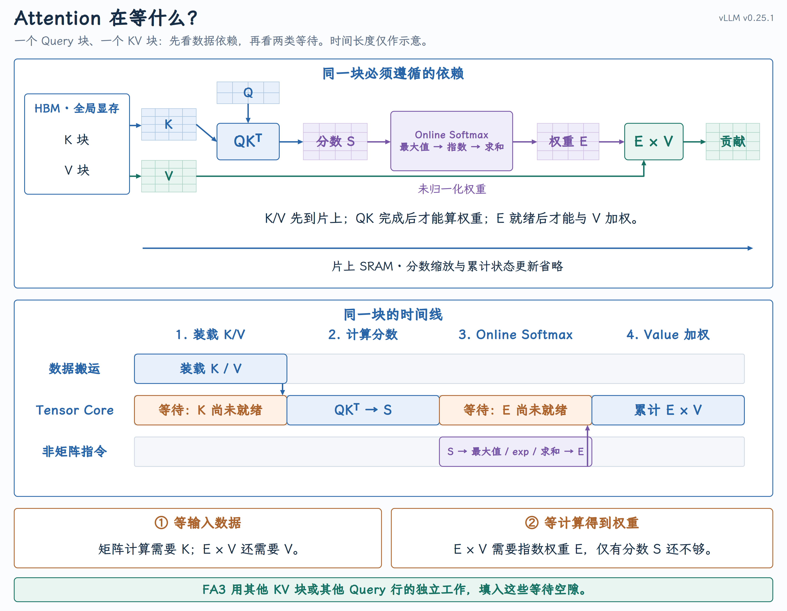
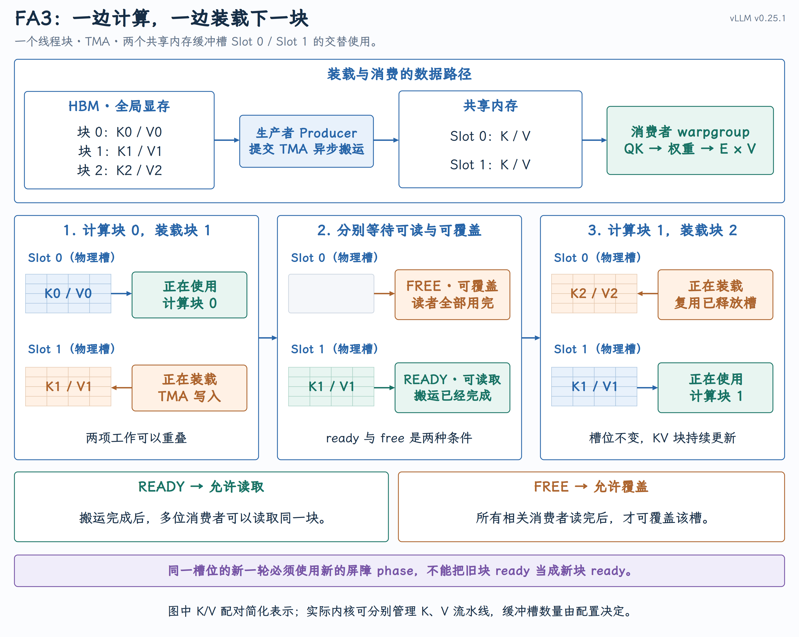
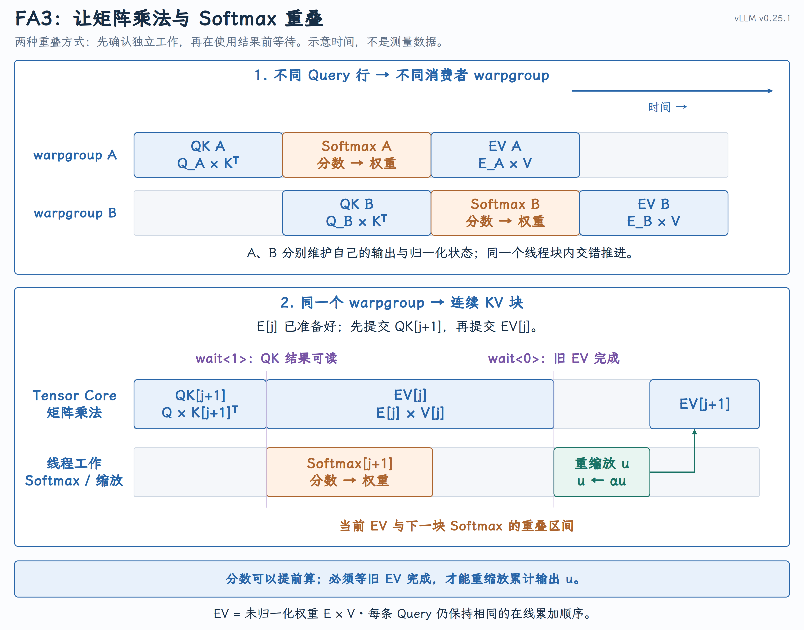

# FlashAttention-3：异步搬运与计算流水线

FA1 减少了中间矩阵的 HBM 读写，FA2 改善了线程块、Warp 的分工，并减少非矩阵运算。FA3 进一步减少执行中的等待：利用 GPU 的异步执行能力，让数据搬运、矩阵乘法和 Softmax 在满足数据依赖的前提下重叠执行，提高硬件利用率。

## 一、从 FA2 剩下的两类等待出发

{ width="100%" }

图中只展开单个块的依赖链，不代表整个 GPU 停止工作；时间长度仅作示意，省略分数缩放与累计状态更新。

当前块必须等，独立的工作却可以先做。 下一块 K/V 的装载不需要当前输出；另一组 Query 的矩阵计算也不依赖当前组的 Softmax。问题因此变成：怎样让这些工作在硬件上重叠？

### 两类等待对应两种异步能力

FA3 重点利用 Hopper 架构 的两种异步能力，代表 GPU 是 H100、H200：

- TMA（Tensor Memory Accelerator，张量内存加速器） 是异步搬运张量数据的硬件，负责把张量从全局显存搬到共享内存。

- WGMMA（Warpgroup Matrix Multiply-Accumulate，Warpgroup 矩阵乘加） 是让Tensor Core做矩阵乘加的异步指令，由一个 [warpgroup（四个 Warp，共 128 个线程）](https://docs.nvidia.com/cuda/parallel-thread-execution/#asynchronous-warpgroup-level-matrix-instructions-warpgroup)协作提交矩阵乘加。

二者都允许 提交后先推进独立工作，到真正使用结果时再等待完成 。这正是后面组织流水线的基础。[Hopper 调优指南](https://docs.nvidia.com/cuda/hopper-tuning-guide/)

| 要缩短的空档 | 硬件能力 | 可以安排的重叠 |
| --- | --- | --- |
| 矩阵计算等 K/V | TMA：异步张量搬运 | 装载下一块，同时计算当前块 |
| Tensor Core 等指数权重 E | WGMMA：异步矩阵乘加 | Tensor Core 执行独立矩阵操作，同时线程执行Softmax |

## 二、用下一块的搬运覆盖当前块的计算

[Warp specialization（Warp 专门化分工）](https://docs.nvidia.com/cuda/cuda-programming-guide/04-special-topics/async-barriers.html#producer-consumer-pattern-using-barriers) 是在同一个线程块内，按 Warp 分配不同的执行路径：例如一组Warp 专门装载数据，另一组专门计算，双方通过共享内存交换数据，通过屏障协调进度。在 FA3 中，生产者（producer）负责发起数据搬运，消费者（consumer warpgroup）负责计算，从而让下一块的装载与当前块的计算重叠。但下一块不能覆盖仍在使用的当前块，因此共享内存需要多个缓冲槽。下图用两个槽展示交替装载和计算：

{ width="100%" }

图中的 Slot 0、Slot 1 是片上共享内存的两个缓冲槽 ，K/V 块从 HBM 搬入这些槽后才参与计算。按图中三个阶段看：

1. 计算块 0，同时装载块 1。 块 0 已在 Slot 0 中就绪，消费者读取它进行计算；生产者提交 TMA 请求，将块1 从 HBM 搬入 Slot 1。

2. 分别确认可读与可覆盖。 块 1 搬完后，Slot 1 发出 ready，消费者才能读取；所有相关消费者用完块 0 后，Slot 0 才能标记 free，允许覆盖。这两个条件不要求同时满足，也不是整个线程块统一停下来等待。

3. 计算块 1，同时装载块 2。 消费者转向 Slot 1；生产者复用已释放的 Slot 0，装入块 2。之后两个槽继续交替使用，槽位不变，保存的 KV 块不断更新。

屏障还要区分复用轮次：Slot 0 改存块 2 后，块 0 的 ready 不能被当成块 2 的 ready。图中将 K/V 配对表示，实际内核可以分别管理它们的流水线；缓冲槽数量也由配置决定。

源码中，[`load_K / load_V`](https://github.com/vllm-project/flash-attention/blob/2c839c33742309ec41e620bf837495ec9926c56e/hopper/mainloop_fwd_sm90_tma_gmma_ws.hpp#L787-L812) 通过 `producer_acquire` 等待槽位可复用；消费者等待 K 就绪、执行 QK 并确认完成后 才调用 [`consumer_release`](https://github.com/vllm-project/flash-attention/blob/2c839c33742309ec41e620bf837495ec9926c56e/hopper/mainloop_fwd_sm90_tma_gmma_ws.hpp#L1212-L1217) 释放 K 的槽位。

## 三、让矩阵乘法与 Softmax 重叠

输入准备及时后，还剩一个空隙：QK 与 Value 加权之间的 Softmax。它使用的指数、归约和缩放指令，与Tensor Core 上的矩阵乘法使用不同的执行资源。FA3 可以通过两种安排，让这两类工作同时推进。

### 不同 warpgroup 交错执行

假设同一线程块有两个消费者 warpgroup：A 负责一组 Query 行，B 负责另一组 Query 行。A 已经拿到自己的分数、开始计算 Softmax 时，B 可以使用 Tensor Core 计算自己的 QK；B 开始 Softmax 时，A 又可以执行自己的Value 加权。这称为 ping-pong 调度 。

A 和 B 的输出行不同，归一化状态也不同，因此没有“B 必须等 A 的 Softmax”的数学依赖。内核用调度屏障协调它们发出矩阵指令的顺序，使矩阵阶段和 Softmax 阶段交错；它们仍在同一个线程块内协作，不需要放到两个 SM上。

### 同一个 warpgroup 跨块执行

同一个 warpgroup 也能组织重叠：提交 WGMMA 后，Tensor Core 异步执行矩阵乘法，线程可以继续计算不依赖其结果的 Softmax。 下面看图的下半部分：Query 块不变，`j` 、`j+1` 表示先后处理的两个 KV 块。

{ width="100%" }

上半部分的两行代表两个 warpgroup；下半部分的两行则代表同一个 warpgroup 发起的两类工作 ：蓝色`Tensor Core` 轨道执行矩阵乘法，`Thread work` 轨道执行 Softmax 和缩放。横向是时间，同一竖直位置的操作可以重叠。EV 表示未归一化权重 E 乘 V，图中时长仅作示意。

从下半部分左侧开始，假设第 `j` 块的权重 `E[j]` 已准备好，所需 K/V 也已就绪：

1. 先看蓝色的 `QK[j+1] `→` EV[j]` 。 先提交下一块的分数计算，再提交当前块的 Value 加权。下一块的 QK 只依赖 Q 和下一块的 K，不必等当前块的输出，所以可以提前计算。

2. 到第一条紫线 `wait<1>` ，下一块分数已经可读。 线程开始黄色的 `Softmax[j+1]` ，与此同时，蓝色的`EV[j]` 可以继续执行。图中上下对齐的这段，就是矩阵乘法与 Softmax 的重叠区间。

3. 到第二条紫线 `wait<0>` ，确认旧的 `EV[j]` 已完成。 即使下一块 Softmax 已经算完，也不能在旧 EV 仍写入累计输出 u 时缩放 u。因此，绿色的 `Rescale u` 必须放在这条线之后。

4. 沿绿色框后的箭头，进入 `EV[j+1]` 。 累计输出调整到新的 Softmax 基准后，才能加入下一块的贡献；后续KV 块继续按相同的依赖关系推进。

这里提前的是下一块的分数计算，重叠的是 当前块的 EV 与下一块的 Softmax 。它可以与图上半部分的不同warpgroup 交错调度组合使用。[FA3 论文 §3.1–3.2](https://arxiv.org/html/2407.08608v1#S3.SS2)

源码的 [`IntraWGOverlap` 分支](https://github.com/vllm-project/flash-attention/blob/2c839c33742309ec41e620bf837495ec9926c56e/hopper/mainloop_fwd_sm90_tma_gmma_ws.hpp#L1244-L1280) 对普通 Q/K/V 路径（`HasQv=false` ）采用了上述顺序。省略搬运、掩码和状态维护后，关键时序如下；为便于命名，A 对应图中的 `j` ，B 对应 `j+1` ，`submit_*` 和 `softmax_B` 是示意名称：

```cpp
submit_QK_B();          // 提交并 commit B 的矩阵操作组
submit_EV_A();          // 随后提交并 commit A 的矩阵操作组
warpgroup_wait<1>();    // 确保较早的 QK_B 完成，允许 EV_A 尚未完成
softmax_B();           // 与可能仍在执行的 EV_A 重叠
warpgroup_wait<0>();    // 确保 EV_A 也完成，再复用存储、修改累计输出
```

`wait<1>` 表示允许至多一个已提交的操作组未完成，不是“等一条指令”；这里依靠 QK_B 先于 EV_A 提交，才能先取得 B 的分数。`wait<0>` 要求这些组全部完成。如果 EV_A 很快就结束，实际重叠区间也会很短，异步只提供重叠的机会，并不保证固定的加速幅度。

## 四、重叠不能破坏输出累加的顺序

跨块流水允许提前计算下一块 Softmax，但 u 仍是共享的累计状态：当前块 EV 还在写 u 时，不能同时按下一块的最大值缩放 u。 因而要区分两类工作：

- 下一块分数就绪后，可以更新逐行最大值、指数和，并算出缩放系数 α。

- 当前块 EV 完成后，才可以用 α 缩放 u，再累加下一块的贡献。

沿用第二课的结果，A 的完整贡献为 `[1/2,1]` ；加入 B 后 α = 1/2，B 的贡献为 `[3/2,1]` 。流水执行仍须保持：

$$
\underbrace{[1/2,1]}_{\text{A 的 EV 完成}}\xrightarrow{\times1/2}[1/4,1/2]\xrightarrow{+[3/2,1]}[7/4,3/2].
$$

B 的分数和权重可以提前准备，上式对 u 的这三个动作却不能乱序。这也解释了前面的两次等待：`wait<1>` 确保下一块 QK 的结果可读；`wait<0>` 确保旧 EV 已完成，之后才能安全复用操作数、重缩放累加器。具体重缩放可以安排在本轮尾部或下一轮开头，但必须保持这个顺序。

## 五、vLLM 中的 FA3 执行路径

在 vLLM v0.25.1 中，普通 FlashAttention backend 到 FA3 内核的调用分为三步：

1. 选择版本。 [版本选择函数](https://github.com/vllm-project/vllm/blob/v0.25.1/vllm/v1/attention/backends/fa_utils.py#L149-L192) 根据 GPU、配置和功能要求确定 FA 版本。受支持的 Hopper GPU 可以选择FA3；但使用 ALiBi 等功能时会回退到 FA2。

2. 传入 Attention 数据。 Backend 调用 [`flash_attn_varlen_func`](https://github.com/vllm-project/vllm/blob/v0.25.1/vllm/v1/attention/backends/flash_attn.py#L952-L977) ，传入 Q、KV Cache、序列长度和分页表，并指定 `fa_version=3` 。接口随后进入 [`_vllm_fa3_C.fwd`](https://github.com/vllm-project/vllm/blob/v0.25.1/vllm/vllm_flash_attn/flash_attn_interface.py#L341-L385) 。

3. 执行 CUDA 流水线。 前面讲的搬运、等待和计算重叠，实现在 FlashAttention 依赖库的[`mainloop_fwd_sm90_tma_gmma_ws.hpp`](https://github.com/vllm-project/flash-attention/blob/2c839c33742309ec41e620bf837495ec9926c56e/hopper/mainloop_fwd_sm90_tma_gmma_ws.hpp) 中：`load_K / load_V` 负责装载，`IntraWGOverlap` 分支组织跨 KV 块的矩阵乘法与 Softmax 重叠。

选中 FA3，不代表每条路径都使用 TMA。 分页 KV 的布局还必须满足 TMA 装载条件；不满足时，K/V 走`PagedKVNonTMA` 装载分支，计算仍可使用异步矩阵流水。搬运方式与计算调度需要分别看待。

## 六、流水线的收益与代价

收益是减少等待，不是减少工作量。 例如搬运耗时 3、计算耗时 5，串行需要 8；充分重叠后，稳定流水阶段理想情况下每 5 个时间单位完成一块。首次装载、末尾计算和同步开销仍然存在，这只是示意，不是实测加速比。

代价是更多共享内存和寄存器。 同时保留当前块、下一块及中间结果，会增加单个线程块的资源占用，可能减少SM 上同时驻留的任务，抵消重叠收益。因此，缓冲槽和流水级数并非越多越好。

原先等待明显、连续处理的 KV 块较多时，更容易获益；任务太短或资源占用过高时，收益有限。最终应看总耗时是否下降，而不只是操作是否发生了重叠。
