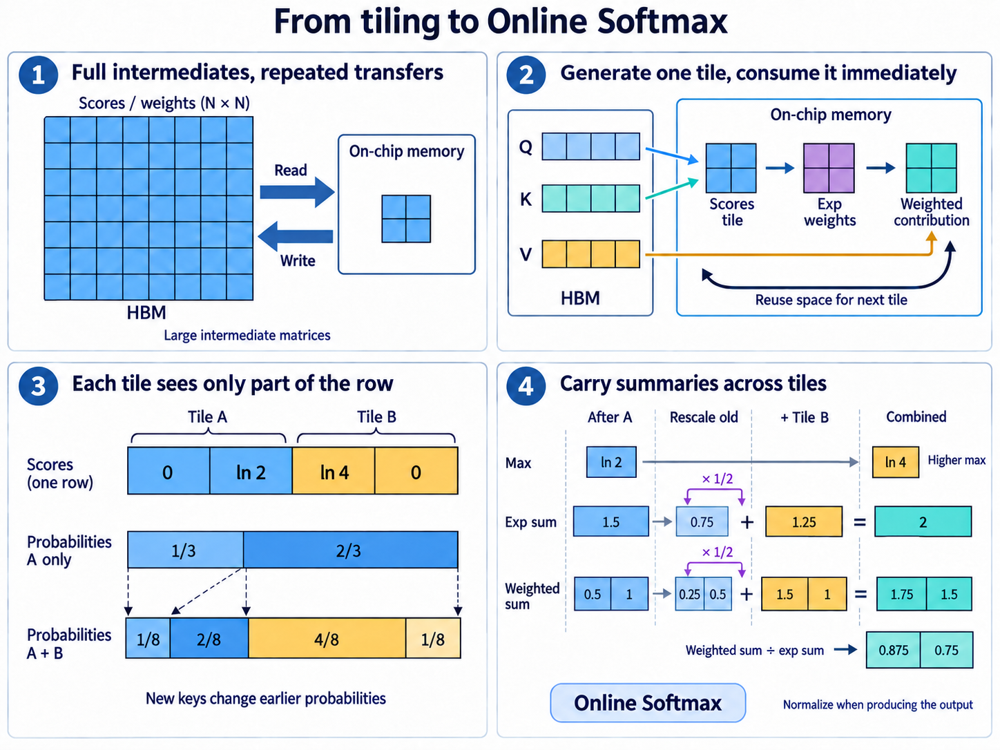
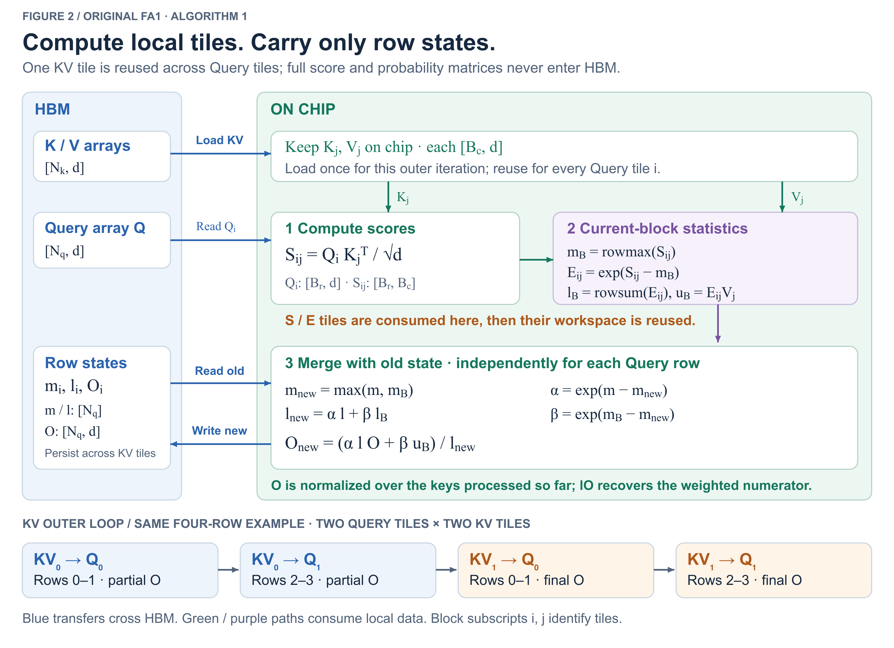
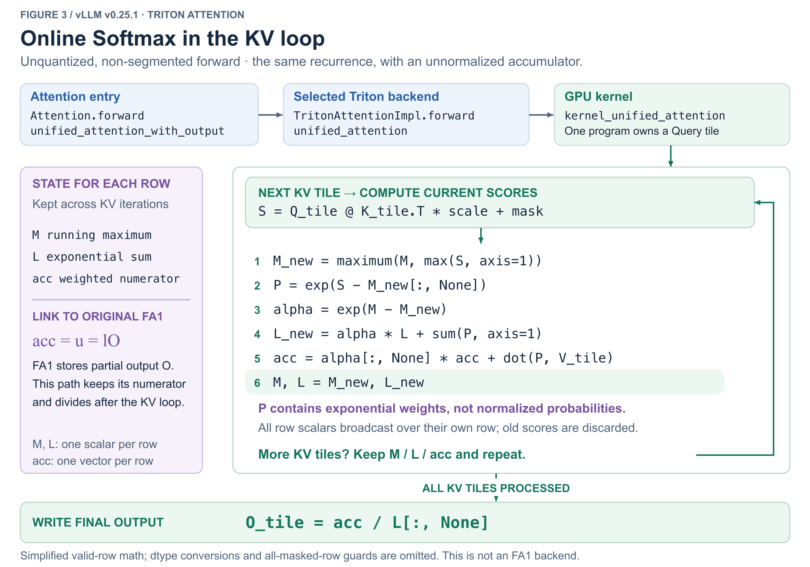

本章介绍 FlashAttention v1 如何通过分块计算、内核融合与 Online Softmax，在保持 Attention 数学结果一致的同时，减少中间矩阵的显存读写。内容涵盖标准 Attention 的计算与访存瓶颈、Online Softmax 的推导、FA1 的分块执行与数值算例，以及 vLLM 中的在线更新实现。

## 一、标准 Attention：计算过程与显存瓶颈

对每个 Query，Attention 会计算它与各个 Key 的匹配分数，再用归一化后的权重对对应的 Value 求加权和。

主例固定一个请求、一个 head，采用 **dense、无 mask、无 dropout 的 forward** 。

Q、K、V 按行存放向量，每个向量的维度均为 $d$：

| 符号    | 常用术语             | 在矩阵中对应什么                                    |
| ------- | -------------------- | --------------------------------------------------- |
| $N_q$ | Query 序列长度       | Q 的行数，即 Query 向量的数量                       |
| $N_k$ | Key/Value 序列长度   | K 和 V 的行数；同一位置的 Key、Value 一一配对       |
| $d$   | 每个 head 的向量维度 | Q、K、V 的列数，也是这个 head 的 Attention 输出维度 |

因此，$Q\in\mathbb{R}^{N_q\times d}$、$K\in\mathbb{R}^{N_k\times d}$、$V\in\mathbb{R}^{N_k\times d}$。这里说的维度都属于**单个 head** ，不是整个模型的 hidden size；输出 O 也还没有经过多头拼接和输出投影。

当有 4 个 Query、4 组 Key/Value，每个向量都是 2 维时，Q/K/V 的形状均为 $[4,2]$，分数矩阵为 $[4,4]$，输出为 $[4,2]$。计算过程为：

$$
\begin{aligned}
S &= \frac{QK^\top}{\sqrt{d}}
&&\in\mathbb{R}^{N_q\times N_k} &&\text{匹配分数}\\
P &= \mathrm{softmax}_{\mathrm{row}}(S)
&&\in\mathbb{R}^{N_q\times N_k} &&\text{沿 Key 方向归一化}\\
O &= PV
&&\in\mathbb{R}^{N_q\times d} &&\text{Value 加权和}
\end{aligned}
$$

这三个步骤分别是：

1. **匹配。** Query i 与每个 Key j 点积，得到 `S[i,j]`。一个 Query 向量产生 $N_k$ 个分数，$N_q$ 个 Query 合起来得到 $N_q\times N_k$ 分数矩阵。
2. **归一化。** 对每一行减最大值、取指数、求和、除分母。得到的 `P[i,:]` 和为 1。每行有自己的分母，不能把整张矩阵共用一个分母。
3. **混合 Value。** 用 `P[i,j]` 乘向量 `V[j,:]`，沿 j 求和。结果是一个 $d$ 维向量，放到 `O[i,:]`。

下面采用逐阶段实现：**先保存完整 S，再依次生成完整 E、P，最后计算 O** 。GEMM 内部仍然可以分块并行；跟踪单行只是为了方便手算，不代表实现会逐行完成整个 Attention：

```python
S = Q @ K.T / sqrt(d)              # 完整 [N_q,N_k]
m = rowmax(S)
E = exp(S - m[:, None])
l = rowsum(E)
P = E / l[:, None]               # 完整 [N_q,N_k]
O = P @ V
```

上面这份实现会保存三个形状均为 $[N_q,N_k]$ 的中间矩阵：$S$ 是分数，$E$ 是减去每行最大值后得到的指数权重，$P$ 是归一化后的概率。后面沿用这份逐阶段实现作为优化基线。三个矩阵是这份实现的选择；融合 Softmax 可以不单独保存 E，但只要完整 S/P 仍需写入显存，跨阶段的读写就仍然存在。

### Q/K/V 数值示例

本章用四行、宽度为 $d=2$ 的数据贯穿推导和代码：

$$
Q=\begin{bmatrix}
\sqrt{2}&0\\
0&\sqrt{2}\\
\sqrt{2}&\sqrt{2}\\
\sqrt{2}&-\sqrt{2}
\end{bmatrix},\qquad
K=\begin{bmatrix}
0&0\\
\ln 2&0\\
\ln 4&\ln 2\\
0&\ln 4
\end{bmatrix},\qquad
V=\begin{bmatrix}
1&0\\
0&1\\
1&1\\
2&0
\end{bmatrix}
$$

这里的缩放系数是 $1/\sqrt{d}=1/\sqrt{2}$。Q 中选用 $\sqrt{2}$，是为了让点积后的缩放容易计算；K 中选用 $\ln 2$ 和 $\ln 4$，是为了让第一行分数取指数后得到 $1,2,4,1$，便于手算和核对。

下面跟踪第一条 Query $q=Q[0]=[\sqrt{2},0]$。其他 Query 行按同样的方法计算。为了把数据流讲清楚，沿用前面显式保存 S/E/P 的实现：**各阶段的输入从 HBM 读到片上参与运算，阶段结果写回 HBM，供下一阶段读取。** HBM 是 GPU 的全局显存；这里的读写发生在 GPU 内部，不是 CPU 与 GPU 之间的传输。

#### 第一步：读取 Q、K，计算分数并写回 S

从 HBM 读取 Q 和 K，对每对 Query、Key 做点积，再乘 $1/\sqrt{2}$。第一条 Query 对应的四个分数为：

$$
\begin{aligned}
S[0,0]&=(\sqrt{2}\times 0+0\times 0)/\sqrt{2}=0,\\
S[0,1]&=(\sqrt{2}\times\ln 2+0\times 0)/\sqrt{2}=\ln 2,\\
S[0,2]&=(\sqrt{2}\times\ln 4+0\times\ln 2)/\sqrt{2}=\ln 4,\\
S[0,3]&=(\sqrt{2}\times 0+0\times\ln 4)/\sqrt{2}=0
\end{aligned}
$$

于是 $S[0,:]=[0,\ln 2,\ln 4,0]$。其余三行分别由 $Q[1,:]$、$Q[2,:]$、$Q[3,:]$ 与全部 Key 匹配得到。完整分数矩阵为：

$$
S=\begin{bmatrix}
0&\ln 2&\ln 4&0\\
0&0&\ln 2&\ln 4\\
0&\ln 2&\ln 8&\ln 4\\
0&\ln 2&\ln 2&-\ln 4
\end{bmatrix}
$$

矩阵的行对应 Query，列对应 Key。例如第三行第三列是 $\ln 4+\ln 2=\ln 8$，第四行第四列是 $0-\ln 4=-\ln 4$。将这个完整的 $4\times4$ 矩阵 S 写入 HBM，留给后续 Softmax；此时还没有输出 O。

#### 第二步：读回 S，计算稳定的指数权重并写回 E

先从 HBM 读取 S，求出每行最大值，将四个标量保存为向量 m：

$$
m=\begin{bmatrix}
\ln 4\\
\ln 4\\
\ln 8\\
\ln 2
\end{bmatrix}
$$

随后读取 S 和 m，对每个分数减去该行最大值，再取指数。第一行的计算为：

$$
E[0,:]=[e^{0-\ln 4},e^{\ln 2-\ln 4},e^{\ln 4-\ln 4},e^{0-\ln 4}]
=\left[\frac14,\frac12,1,\frac14\right]
$$

对其余行分别减去各自的最大值、取指数，得到完整的指数权重矩阵：

$$
E=\begin{bmatrix}
\frac14&\frac12&1&\frac14\\[4pt]
\frac14&\frac14&\frac12&1\\[4pt]
\frac18&\frac14&1&\frac12\\[4pt]
\frac12&1&1&\frac18
\end{bmatrix}
$$

例如第三行使用 $\ln 8$ 为基准，所以第一个元素为 $e^{0-\ln 8}=1/8$。每行最大的指数权重都是 1，其余不超过 1。减去最大值能避免指数过大；同一行的指数权重都乘了相同因子，因此不会改变后续归一化的结果。将这个完整的 $4\times4$ 矩阵 E 写入 HBM。

#### 第三步：读回 E，求分母、归一化并写回 P

从 HBM 读取 E，对每行求和，保存分母向量 l。第一行的分母为：

$$
l[0]=\frac14+\frac12+1+\frac14=2
$$

四行分别求和，得到完整的分母向量：

$$
l=\begin{bmatrix}
2\\
2\\[4pt]
\frac{15}{8}\\[4pt]
\frac{21}{8}
\end{bmatrix}
$$

随后读取 E 和 l，把每个指数权重除以对应行的分母。第一行得到：

$$
P[0,:]=\frac{E[0,:]}{2}
=\left[\frac18,\frac28,\frac48,\frac18\right]
$$

对所有行分别归一化，得到完整概率矩阵：

$$
P=\begin{bmatrix}
\frac18&\frac28&\frac48&\frac18\\[4pt]
\frac18&\frac18&\frac28&\frac48\\[4pt]
\frac1{15}&\frac2{15}&\frac8{15}&\frac4{15}\\[4pt]
\frac4{21}&\frac8{21}&\frac8{21}&\frac1{21}
\end{bmatrix}
$$

每行的四个概率相加都为 1，分别决定四个 Value 对该条 Query 输出的贡献。将这个完整的 $4\times4$ 矩阵 P 写入 HBM。到这里，我们已经先后生成并保存了 S、E、P 三个中间矩阵。

#### 第四步：读回 P 和 V，计算加权和并写回 O

从 HBM 读取 P 和 V，将每个概率乘以对应的 Value 向量，再沿 Key 方向求和。第一条 Query 的输出是：

$$
\begin{aligned}
O[0,:]
&=\frac18[1,0]+\frac28[0,1]+\frac48[1,1]+\frac18[2,0]\\
&=\left[\frac{1+0+4+2}{8},\frac{0+2+4+0}{8}\right]\\
&=\left[\frac78,\frac68\right]=[0.875,0.75]
\end{aligned}
$$

其余三条 Query 使用 P 中各自那一行的概率，与同一个 V 相乘。完整输出为：

$$
O=PV=\begin{bmatrix}
\frac78&\frac68\\[4pt]
\frac{11}{8}&\frac38\\[4pt]
\frac{17}{15}&\frac{10}{15}\\[4pt]
\frac{14}{21}&\frac{16}{21}
\end{bmatrix}
$$

例如第二条 Query 的第一维是 $(1+0+2+8)/8=11/8$，第二维是 $(0+1+2+0)/8=3/8$。最终将这个 $4\times2$ 的输出 O 写回 HBM，交给后续计算。这是本章后面用分块方法需要复现的完整结果。

### 为什么中间过程会成为瓶颈

Q/K/V 是输入、O 是输出，而 S/E/P 只是衔接计算阶段的中间数据，却同样需要写入 HBM，再被后续阶段读取。

当 $N_q=N_k=N$ 时，S/E/P 都是 $N\times N$，而 m、l 每行只保存一个标量。GPU 全局显存容量大，片上存储容量小但适合高频访问。本章将 SRAM 作为论文对片上快速存储的抽象；具体内核还要把数据分配到 shared memory、寄存器等资源。

**我们最终需要的是 O，但这份实现先把三个庞大的中间矩阵写入 HBM，再读回来继续计算。优化目标就是消除这三类完整中间矩阵的 HBM 存储与读写，让当前中间结果在片上生成后直接被下一步消费。**

把这个四行算例放大到 $N_q=N_k=N=4096$、$d=128$，全部按 FP32 计算。展开这笔容量与访存账：

| 对象 / 成本                            | 计算                           | 结果              |
| -------------------------------------- | ------------------------------ | ----------------- |
| 单个 Q、K、V 或 O                      | 4096×128×4 字节              | 2 MiB             |
| 单个 S、E 或 P                         | 4096²×4 字节                 | 64 MiB            |
| S/E/P 同时存在                         | 3×64 MiB                      | 192 MiB           |
| S：一次写入、两次读取                  | 3×64 MiB                      | 192 MiB           |
| E：一次写入、两次读取                  | 3×64 MiB                      | 192 MiB           |
| P：一次写入、一次读取                  | 2×64 MiB                      | 128 MiB           |
| **S/E/P 中间矩阵的逻辑访问合计** | **8×64 MiB**            | **512 MiB** |
| $QK^\top$ 与 $PV$ 两次矩阵乘法     | 4×4096²×128，乘加计 2 FLOPs | 约 8.59 GFLOPs    |

这 512 MiB 与上面的逐阶段流程一一对应：S 分别被求最大值和生成 E 读取，E 分别被求和和生成 P 读取，P 被最后的矩阵乘法读取。统计按每个阶段完整扫描一次所需对象计数，仅包含 S/E/P 的读写，不包含 Q/K/V/O 和行统计量的访问。

两次矩阵乘法的计算量分别为：$QK^\top$ 产生 $N^2$ 个元素，每个元素是长度为 d 的点积，约需 $2N^2d$ FLOPs；$PV$ 产生 $Nd$ 个元素，每个元素是长度为 N 的点积，也约需 $2N^2d$ FLOPs。合计约 $4N^2d$，这里不计 Softmax 和缩放等操作。1 GFLOP 表示十亿次浮点运算；计算量不直接代表运行时间。

容量、访问量和计算量分别回答“放多少、搬多少、算多少”。上述数值只对应一个请求、一个 head；逻辑访问按算法的数据流计数，实际 HBM 流量还会受缓存和内核实现影响。

## 二、从分块计算到在线 Softmax

{ width="90%" }

图中的 Q/K/V 小格示意按行取块，每个向量仍保留完整维度。“New keys”指后续块中尚未处理的 Key。右下角采用分子累积形式说明在线合并；原始 FA1 则在每块更新后保存部分归一化输出。

### 分块计算与内核融合

如果分数刚算出来，就能在片上继续取指数、参与 Value 加权，便不必先写入 HBM，再读回来。但这里有一个容量限制：长序列下，完整的 $N\times N$ 中间矩阵放不进片上快速存储。

**因此，把“生成完整矩阵再处理”改成“生成一个小块，处理完就释放”。** Q 按行分块，K/V 沿 Key 方向配对分块。每次取 $B_r$ 个 Query 和 $B_c$ 组 Key/Value，只产生一个 $B_r\times B_c$ 的分数块。当前工作集足够小时，才能放在片上计算。

同时，这个小块的后续计算要在同一个内核内接着完成，这就是 **Kernel fusion（内核融合）** 。如果只是把大矩阵拆成小块，却仍逐块写回 HBM、交给另一个内核读取，中间数据的往返依然存在。分块提供可容纳的工作集，融合让块内结果直接交给下一步。[FA1 §1](https://arxiv.org/pdf/2205.14135#page=2)

块内的数据流应当是：**读入当前 Q/K/V 块 → 算出局部分数 → 立刻把它转成对输出的贡献 → 释放局部分数，继续下一块。**

### Softmax 的跨块依赖

QK 的点积可以按块计算，每个分数只依赖对应的 Query 和 Key。但从分数变成概率时，每个位置都要除以**这一行全部 Key 的指数和** 。当前块只有一部分 Key，无法独立知道最终分母。

仍用第一节的第一行，将四个分数分成两块：$A=[0,\ln 2]$、$B=[\ln 4,0]$。如果只对 A 做 Softmax，两个概率是 $[1/3,2/3]$；加上 B 后，它们在完整一行中的正确概率却是 $[1/8,2/8]$。**所以“每块分别做 Softmax，再把各块输出相加”会改变结果。**

若把分数存回 HBM，等全部 Key 到齐后再归一化，又会恢复原来的中间矩阵读写。因此必须解决：**在最终分母还不知道时，如何先消费当前块的分数，留下能够继续合并的贡献？**

### 分子与分母的累积

观察我们真正需要的输出：每个概率都会立刻乘以对应的 Value，然后求和。因此，可以先把共同分母提到求和外面：

$$
\begin{aligned}
o
&=\sum_j \frac{e^{s_j}}{\sum_k e^{s_k}}\,v_j\\
&=\frac{\sum_j e^{s_j}v_j}{\sum_j e^{s_j}}.
\end{aligned}
$$

这个变形解除了当前块对最终分母的等待：**当前块先累加指数和，再累加指数与 Value 的乘积；两项都不需要提前知道后续 Key。** 分数取完指数就可以释放，指数权重参与求和和 Value 加权后也可以释放。

对每条 Query，历史贡献由一个标量分母和一个 $d$ 维加权分子保存。后面的块只需继续贡献这两项，遍历全部 Key 后再求它们的比值，就能得到最终输出。这样，跨块保留的对象从一整行分数变成了少量累计量，也不必生成完整概率矩阵 P。

不过，上式还只是代数上的解法。直接累计 $e^{s_j}$ 可能溢出；第一节减去行最大值的数值稳定处理，还需要保留。

### 数值稳定性与最大值更新

分块计算时，尚未看到全部 Key，无法提前知道整行最大值。因此需要先用已处理分数的最大值作为当前基准；下一块到来后，再更新这个基准。

但最大值一变，历史累计量使用的指数基准也要随之改变。我们需要一种方法，既能保留“减最大值”的数值稳定性，又能在不保存历史分数的情况下继续合并新块。

**Online Softmax（在线 Softmax）通过修正旧基准下的累计量，完成最大值与分母的更新；结合 Attention，同样的修正也作用于 Value 的加权分子。**

## 三、Online Softmax 的推导

### 历史状态与当前块

固定一条 Query，用 A 表示已经处理过的 Key 集合，B 表示当前新块。A 可以包含多个历史块；我们只保存它的统计量，原始分数已经释放。对于非空的已处理集合 A，定义：

$$
\begin{aligned}
m_A&=\max_{j\in A}s_j,\\
l_A&=\sum_{j\in A}e^{s_j-m_A},\\
u_A&=\sum_{j\in A}e^{s_j-m_A}v_j
\end{aligned}
$$

$m_A$ 是当前最大值，$l_A$ 是该基准下的指数和，$u_A$ 是同一基准下的 Value 加权分子。前两项是 Softmax 的在线归一化统计量；加上 $u_A$，才能把概率与 V 的乘法一起完成。对一条 Query，保存的是两个标量和一个 $d$ 维向量。

当前块 B 的分数可以直接在片上计算，因此同样可以得到：

$$
m_B=\max_{j\in B}s_j,\qquad
l_B=\sum_{j\in B}e^{s_j-m_B},\qquad
u_B=\sum_{j\in B}e^{s_j-m_B}v_j
$$

现在要用这两组统计量，构造整个 $A\cup B$ 的结果。

### 共同最大值与历史权重的修正

合并后的最大值可以直接由两个局部最大值得到：

$$
m_{new}=\max(m_A,m_B).
$$

接下来，A 中每个历史指数权重都应该从基准 $m_A$ 换到 $m_{new}$。把新基准下的指数拆开：

$$
\begin{aligned}
e^{s_j-m_{new}}
&=e^{(s_j-m_A)+(m_A-m_{new})}\\
&=e^{s_j-m_A}\,e^{m_A-m_{new}}
\end{aligned}
$$

**第二个因子只与新旧最大值有关，对 A 中所有位置都相同。** 因此，不必逐个找回历史分数，只需把已经累计的量整体乘以这个因子。记两块各自的修正因子为：

$$
\alpha=e^{m_A-m_{new}},\qquad
\beta=e^{m_B-m_{new}}.
$$

如果最大值没有超过 $m_A$，那么 $\alpha=1$，历史贡献保持原样；如果出现更大的最大值，$\alpha<1$，历史贡献整体缩小。B 的贡献也按同样规则换到共同基准。

### 分母的递推

按定义，合并后的分母应当对 $A\cup B$ 中的所有指数权重求和。先把求和拆成两部分，再代入刚才的指数恒等式：

$$
\begin{aligned}
l_{new}
&=\sum_{j\in A\cup B}e^{s_j-m_{new}}\\
&=\sum_{j\in A}e^{s_j-m_{new}}+\sum_{j\in B}e^{s_j-m_{new}}\\
&=\alpha\sum_{j\in A}e^{s_j-m_A}
 +\beta\sum_{j\in B}e^{s_j-m_B}\\
&=\alpha l_A+\beta l_B
\end{aligned}
$$

这就得到了在线更新分母的方法：**旧分母先换基准，再加上同一基准下的新块分母。** 计算只需要旧状态和当前块，不需要重新扫描 A。

### 加权分子的递推

Attention 还需要把每个指数权重乘以对应的 Value。修正因子对同一块内所有位置仍然相同，因此也能从向量求和中提出：

$$
\begin{aligned}
u_{new}
&=\sum_{j\in A\cup B}e^{s_j-m_{new}}v_j\\
&=\alpha\sum_{j\in A}e^{s_j-m_A}v_j
 +\beta\sum_{j\in B}e^{s_j-m_B}v_j\\
&=\alpha u_A+\beta u_B
\end{aligned}
$$

于是一次完整的块更新为：

$$
\boxed{
\begin{aligned}
m_{new}&=\max(m_A,m_B),\\
\alpha&=e^{m_A-m_{new}},\quad\beta=e^{m_B-m_{new}},\\
l_{new}&=\alpha l_A+\beta l_B,\\
u_{new}&=\alpha u_A+\beta u_B
\end{aligned}}
$$

第一个非空块直接建立初始状态；之后每处理一个新块，就用 $(m_{new},l_{new},u_{new})$ 替换旧状态。全部 Key 处理完后，输出为 $o=u/l$。

### 代入同一组数据

仍用第一节的分数 $[0,\ln 2,\ln 4,0]$，分成 A、B 两块，Value 与原 Key 一一配对。先分别计算局部统计量：

| 局部统计     | A：Key 0、1               | B：Key 2、3               |
| ------------ | ------------------------- | ------------------------- |
| 分数         | $[0,\ln 2]$             | $[\ln 4,0]$             |
| 对应的 Value | $v_0=[1,0],\ v_1=[0,1]$ | $v_2=[1,1],\ v_3=[2,0]$ |
| 最大值       | $m_A=\ln 2$             | $m_B=\ln 4$             |
| 指数权重     | $[1/2,1]$               | $[1,1/4]$               |
| 分母         | $l_A=3/2$               | $l_B=5/4$               |
| 加权分子     | $u_A=[1/2,1]$           | $u_B=[3/2,1]$           |

表中的加权分子需要用指数权重乘以对应的 Value，再求和：

$$
\begin{aligned}
u_A&=\frac12[1,0]+1[0,1]=\left[\frac12,1\right],\\
u_B&=1[1,1]+\frac14[2,0]=\left[\frac32,1\right]
\end{aligned}
$$

$u_A$ 的两个分量恰好与 A 的两个指数权重相同，是因为这里的两个 Value 分别为 $[1,0]$ 和 $[0,1]$。**加权分子的分量对应输出维度，指数权重的位置对应 Key，两者含义不同。**

合并后的最大值为 $\ln 4$。A 需要从 $\ln 2$ 换到 $\ln 4$，所以历史分子和分母都乘 $1/2$；B 已经使用共同基准，修正因子为 1：

$$
\begin{aligned}
\alpha&=e^{\ln 2-\ln 4}=\frac12,\qquad
\beta=e^{\ln 4-\ln 4}=1,\\
l_{new}&=\frac12\times\frac32+1\times\frac54=2,\\
u_{new}&=\frac12\left[\frac12,1\right]+1\left[\frac32,1\right]
=\left[\frac74,\frac32\right],\\
o&=\frac{u_{new}}{l_{new}}
=\left[\frac78,\frac34\right]=[0.875,0.75]
\end{aligned}
$$

结果与第一节完整矩阵计算的第一行输出一致。

### 与标准 Attention 的等价性

上面的推导对任意两个不相交的 Key 集合都成立。因此每次合并后，m 仍然是已处理集合的最大值，l/u 仍然是这个集合在同一基准下的指数和、加权指数和。第一个块满足定义，每次更新又保持定义，遍历结束后就覆盖了全部 Key。

此时分子、分母中的共同因子 $e^{-m}$ 相消：

$$
\begin{aligned}
o=\frac{u}{l}
&=\frac{\sum_j e^{s_j-m}v_j}{\sum_j e^{s_j-m}}\\
&=\frac{e^{-m}\sum_j e^{s_j}v_j}{e^{-m}\sum_j e^{s_j}}\\
&=\frac{\sum_j e^{s_j}v_j}{\sum_j e^{s_j}}
=\mathrm{softmax}(s)V
\end{aligned}
$$

这证明了分块与完整计算在数学上等价；浮点运算的归约顺序不同，实际实现允许有舍入误差。Online Softmax 解决了第二节留下的依赖：**每块的分数可以被立即消费，只保留少量可更新的状态，仍能得到完整 Attention 的结果。**

## 四、FA1 的块内计算与状态更新

### 从单行递推到矩阵块

把 Q 按行切成块，每块包含 $B_r$ 条 Query；K/V 按相同位置配对切块，每块包含 $B_c$ 组 Key/Value。**分块沿序列方向进行，每个 Query、Key、Value 向量仍保留完整的 $d$ 维。**

当前 $Q_i$ 与 $K_j,V_j$ 的块内计算包含两次小矩阵乘法：

$$
\begin{aligned}
S_{ij}&=Q_iK_j^\top/\sqrt d
&&[B_r,d]\times[d,B_c]\rightarrow[B_r,B_c],\\
U_{ij}&=E_{ij}V_j
&&[B_r,B_c]\times[B_c,d]\rightarrow[B_r,d]
\end{aligned}
$$

两次乘法之间，对 $S_{ij}$ 的每一行求局部最大值、减最大值、取指数，得到指数权重块 $E_{ij}$；再沿 Key 方向求和，得到每行的局部分母。$U_{ij}$ 的每一行就是第三节中的当前块加权分子 $u_B$。

这样，一次矩阵块计算就同时为 $B_r$ 条 Query 生成了局部贡献，再逐行应用同一套在线更新公式。**每条 Query 有独立的最大值、分母和输出，不同行之间不合并统计量。**

### 原始 FA1 保存的行状态

第三节为了便于推导，保存加权分子 u。原始 FA1 Algorithm 1 保存的是 **m、l、O，其中 O 是已处理 Key 集合上的部分归一化输出** 。两者满足 $u=lO$，因此读回旧状态后，先用旧 l 恢复分子，再套用同一合并式：

$$
\begin{aligned}
m_{new}&=\max(m,m_B),\\
\alpha&=e^{m-m_{new}},\qquad\beta=e^{m_B-m_{new}},\\
l_{new}&=\alpha l+\beta l_B,\\
O_{new}&=\frac{\alpha lO+\beta u_B}{l_{new}}
\end{aligned}
$$

这里 B 是当前 KV 块对这一条 Query 产生的贡献。上述公式对 Query 块中的每一行独立执行；$lO$ 表示该行的标量 l 乘以该行输出向量。使用的是**更新前的 l 和 O** ，不能先覆盖 l 再恢复旧分子。原始 FA1 每次更新后就保存新的部分输出，无需保留历史概率。

### 两条 Query 的状态对照

沿用第一节的 Q/K/V，取 $B_r=B_c=2$，跟踪包含前两条 Query 的块。每次产生的分数块和指数权重块都是 $2\times2$；持久保存的 m、l 各有两个标量，O 有两行、每行两维。

下表汇总这个 Query 块两次更新后保存的状态。第一条 Query 沿用第三节的计算，仅将加权分子换成部分输出 $O=u/l$：

| 已处理的 Key   | Query  | 最大值 m | 指数和 l | 部分输出 O     |
| -------------- | ------ | -------- | -------- | -------------- |
| Key 0、1       | 第一条 | $\ln2$ | $3/2$  | $[1/3,2/3]$  |
| Key 0、1       | 第二条 | $0$    | $2$    | $[1/2,1/2]$  |
| Key 0、1、2、3 | 第一条 | $\ln4$ | $2$    | $[7/8,3/4]$  |
| Key 0、1、2、3 | 第二条 | $\ln4$ | $2$    | $[11/8,3/8]$ |

加入 Key 2、3 时，两行的共同最大值都变成 $\ln4$，但旧最大值分别为 $\ln2$ 和 0，因此历史修正因子分别为 $1/2$ 和 $1/4$。**同一个矩阵块里的各行，也必须分别修正历史贡献。** 最后两行输出与第一节完整 O 矩阵的前两行一致。

这里展示的是同一个 Query 块的两次状态变化；原始 FA1 在这两次访问之间还会处理其他 Query 块。

### 一次块更新中的数据读写

在线递推让块内数据可以按下面的顺序流动：

1. **读入。** 当前 K/V 块已载入片上后，从 HBM 读入当前 Q 块及其旧状态 m/l/O。
2. **就地计算。** 在同一个融合内核内，生成分数块、转换为指数权重，再计算局部分母和 Value 加权贡献。分数完成转换后即可释放，指数权重完成求和与 Value 加权后即可释放；两者都不写回 HBM。
3. **更新并写回。** 用局部贡献更新每行 m/l/O，将新状态写回 HBM。下一次访问这个 Query 块时，从这些状态继续累计。

{ width="90%" }

**每条 Query 只保留一份持续更新的历史状态，无需为所有 KV 块各存一份统计量、等最后再统一规约。**

## 五、FA1 的循环顺序与访存成本

一次块更新只覆盖一组 Query 块与 KV 块。完整 Attention 需要让每个 Query 块遍历全部 KV 块；循环顺序决定哪些输入能够复用、哪些状态需要重新读写。

按原论文 Algorithm 1 展开循环。设四行 Q 分成两个块 `Q₀、Q₁`，四行 KV 分成两个块 `KV₀、KV₁`，Br=Bc=2。这里的下标表示 **块编号** ，不是单个 token 编号。

HBM 中初始化 $O\in\mathbb{R}^{N_q\times d}$ 为零矩阵，$l\in\mathbb{R}^{N_q}$ 为零向量，$m\in\mathbb{R}^{N_q}$ 的每个元素为 $-\infty$。

```text
for 每个 KV 块 j:                         外层：固定当前 Kⱼ/Vⱼ
    把 Kⱼ/Vⱼ 从 HBM 载入片上
    for 每个 Q 块 i:                      内层：改变 Qᵢ
        读入 Qᵢ 和属于它的 Oᵢ/lᵢ/mᵢ
        在片上计算 Sᵢⱼ、局部指数权重与统计
        统一基准，更新每行 Oᵢ/lᵢ/mᵢ
        把更新后的 Oᵢ/lᵢ/mᵢ 写回 HBM
返回最后的 O
```

这段是状态与访存顺序，不是“每行伪代码启动一个 kernel”。两层循环展开为四次访问：`(KV₀,Q₀) → (KV₀,Q₁) → (KV₁,Q₀) → (KV₁,Q₁)`。第一轮 KV₀ 结束时，所有输出行只汇总了前两个 Key；第二轮 KV₁ 再读回各自状态、补上后两个 Key。**中途写回的 O 是部分集合上的输出，全部 KV 完成后才是最终完整输出。**

这种组织把一个 KV 块用于多个 Q 块，代价是 Q 与输出状态会被再次访问。它不等于“固定 Q 块、把全部 KV 扫完、只写一次最终 O”。这里沿用原论文的循环顺序。[原始循环和写回位置见 Algorithm 1 第 5–13 行](https://arxiv.org/pdf/2205.14135#page=5)。

### 分块前后的访存对比

完整 S/E/P 的读写被消除了，但原始 FA1 每处理一个 KV 块，都要重新访问 Q 和行状态。仍用第一节的 $N=4096$、$d=128$、FP32、无 mask 条件，取 $B_r=16$、$B_c=128$，一共处理 $4096/128=32$ 个 KV 块。

沿原始算法的数据流计数：K/V 各读一遍；每个 KV 块对应 Q 的一次读取，以及 O/m/l 的一次读取和一次写入。基线则沿第一节的逐阶段流程计数，包括 S/E 的两次读取，以及 m/l 的写入和后续读取。两边均不计初始化写入、缓存效果和矩阵乘法内部的重复加载。

| 对象的逻辑访问 |           显式 S/E/P 基线 |    FA1：32 个 KV 块 |
| -------------- | ------------------------: | ------------------: |
| K/V            |                     4 MiB |               4 MiB |
| Q              |                     2 MiB |      32×2 = 64 MiB |
| O              |                写出 2 MiB | 32×(2+2) = 128 MiB |
| m/l            | 各写读一次，共 0.0625 MiB |  32×0.0625 = 2 MiB |
| S/E/P          |                   512 MiB |                   0 |
| **合计** |    **520.0625 MiB** |   **198 MiB** |

这组计算展示了 FA1 的取舍：**用 Q 和小型行状态的重复访问，替代三个完整中间矩阵的读写。** 本例逻辑访问由约 520 MiB 降到 198 MiB；192 MiB 的完整 S/E/P 存储也被局部工作区和行状态替代。这些是给定数据流下的成本，不能直接换算成同等比例的执行时间或吞吐提升。

持久存储方面，O 仍占 $N_qd$ 个元素；额外的 m、l 各占 $N_q$ 个元素，随 Query 数量线性增长。当前块的临时工作区由块大小决定。

### 块大小与片上容量

上表以 $B_r=16$、$B_c=128$ 为例，当前分数和指数权重小块各为 $16\times128$，FP32 下各占 8 KiB。$B_c$ 越大，KV 块越少，对 Q/O/m/l 的重复扫描也越少；但当前 K/V 和分数块会占用更多片上空间。因此，块大小需要在“减少重复访问”和“容纳当前工作集”之间取得平衡。

Q 块的行数 $B_r$ 同样影响当前工作集。实际配置受 shared memory 和寄存器容量约束；$B_r$、$B_c$ 必须共同选择，不能仅为了减少 KV 轮数而无限扩大块。

在原论文的容量模型中，若 M 表示片上可容纳的标量元素数，FA1 的 HBM 访问复杂度为 $\Theta(N^2d^2/M)$，而标准 Attention 为 $\Theta(Nd+N^2)$，适用范围是 $d\le M\le Nd$。它概括了同一个关系：片上容量越充裕，就越有空间复用数据、减少 HBM 往返。[FA1 §3.2](https://arxiv.org/pdf/2205.14135#page=6)

## 六、vLLM 中的 Online Softmax

本章固定的 vLLM v0.25.1，其 CUDA FlashAttention 接口支持的是 FA2/3/4，没有 FA1 分支。[版本判断入口](https://github.com/vllm-project/vllm/blob/752a3a504485790a2e8491cacbb35c137339ad34/vllm/vllm_flash_attn/flash_attn_interface.py#L89-L108)中的实现可以直接确认这一点。下面沿 **Triton Attention 后端** 看相同的在线更新机制；它采用分子累积形式，和原始 FA1 保存部分输出的方式不同。

### 从 Attention 入口到计算内核

[`Attention.forward`](https://github.com/vllm-project/vllm/blob/752a3a504485790a2e8491cacbb35c137339ad34/vllm/model_executor/layers/attention/attention.py#L523-L555)整理 Q/K/V 的形状，经由 [`unified_attention_with_output`](https://github.com/vllm-project/vllm/blob/752a3a504485790a2e8491cacbb35c137339ad34/vllm/model_executor/layers/attention/attention.py#L813-L840)调用已选择的后端。图 3 展示选择 Triton 后端时的调用路径和内核更新过程。

[`TritonAttentionImpl.forward`](https://github.com/vllm-project/vllm/blob/752a3a504485790a2e8491cacbb35c137339ad34/vllm/v1/attention/backends/triton_attn.py#L654-L705)准备内核参数；[`unified_attention`](https://github.com/vllm-project/vllm/blob/752a3a504485790a2e8491cacbb35c137339ad34/vllm/v1/attention/ops/triton_unified_attention.py#L1041-L1099)负责启动内核。这里选取标准 Attention 的未量化、非分段路径；常规多 token Prefill 使用此路径。

该路径固定一个 Query 块，在内核的 [KV 循环](https://github.com/vllm-project/vllm/blob/752a3a504485790a2e8491cacbb35c137339ad34/vllm/v1/attention/ops/triton_unified_attention.py#L398-L420)中持续更新行状态，循环结束后才归一化并写出结果。它复用了在线递推原理，**没有沿用原始 FA1 的 KV 外层循环及逐块写回部分输出的组织方式。**

{ width="90%" }

### 公式与源码变量

图中 `M`、`L`、`acc` 分别对应最大值 m、指数和 l、加权分子 u。**源码的 `P` 是尚未除以分母的指数权重，对应第一节 E 的局部作用。** 先看 [`softmax_step`](https://github.com/vllm-project/vllm/blob/752a3a504485790a2e8491cacbb35c137339ad34/vllm/v1/attention/ops/triton_attention_helpers.py#L417-L440) 的核心更新，只保留包含有效分数时的数学逻辑：

```python
M_new = maximum(M, max(S, axis=1))
P = exp(S - M_new[:, None])
alpha = exp(M - M_new)
L_new = alpha * L + sum(P, axis=1)
```

这正是第三节的分母递推。区别在于：源码直接用共同最大值 `M_new` 生成当前权重，因此当前块的修正因子 beta 已包含在 P 中，不必再单独相乘：

$$
e^{s-m_{new}}=e^{s-m_B}\,e^{m_B-m_{new}}.
$$

回到计算内核，[先修正旧分子](https://github.com/vllm-project/vllm/blob/752a3a504485790a2e8491cacbb35c137339ad34/vllm/v1/attention/ops/triton_unified_attention.py#L561-L562)，再[加入当前 Value 的贡献](https://github.com/vllm-project/vllm/blob/752a3a504485790a2e8491cacbb35c137339ad34/vllm/v1/attention/ops/triton_unified_attention.py#L579-L584)。忽略数据类型转换后的核心逻辑为：

```python
M, L, P, alpha = softmax_step(S, M, L)
acc = alpha[:, None] * acc
acc = acc + dot(P, V_tile)
```

全部 KV 处理完后，[非分段路径的最终归一化](https://github.com/vllm-project/vllm/blob/752a3a504485790a2e8491cacbb35c137339ad34/vllm/v1/attention/ops/triton_unified_attention.py#L643-L649)就是：

```python
O_tile = acc / L[:, None]
```

## 七、优化效果与边界

FA1 的性能收益来自**减少中间结果的显存往返和计算阶段之间的交接** 。它没有减少 dense Attention 需要考虑的 Query–Key 配对数量：两次矩阵乘法的主要计算量仍为 $O(N^2d)$，另有块间统计与缩放开销。对长序列 Prefill，中间矩阵随序列长度平方增长，减少这部分读写尤为重要。

逐 token Decode 则不同：单个请求、单个 Query head 本轮只有一条 Query，分数矩阵为 $1\times N_k$，没有本章 Prefill 示例中的 $N\times N$ 中间矩阵。此时读取历史 K/V 的成本更突出，不能直接套用前面的平方规模访存收益。在线 Softmax 仍可用于 Decode Attention，但实际加速还取决于 KV 读取方式、并行划分和请求批量。

收益大小还取决于矩阵运算、片上容量与重复访存之间的关系。整个服务的吞吐同时受其他模型算子、调度和 Decode 阶段影响，不能把 Attention 的访存下降比例直接当作服务吞吐提升比例。
