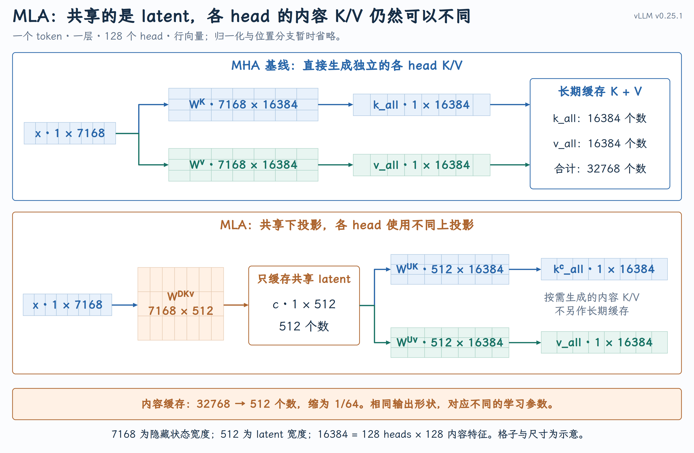
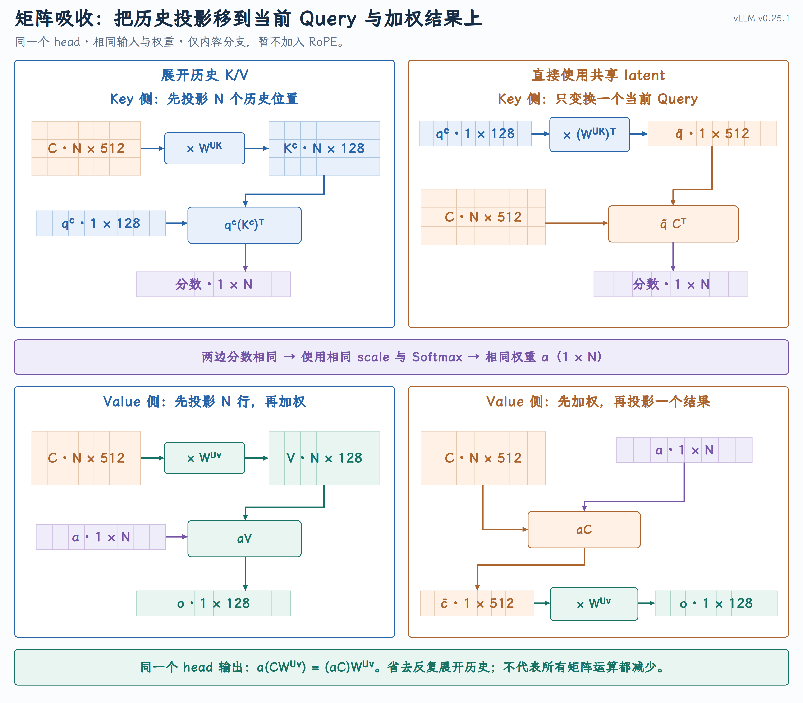
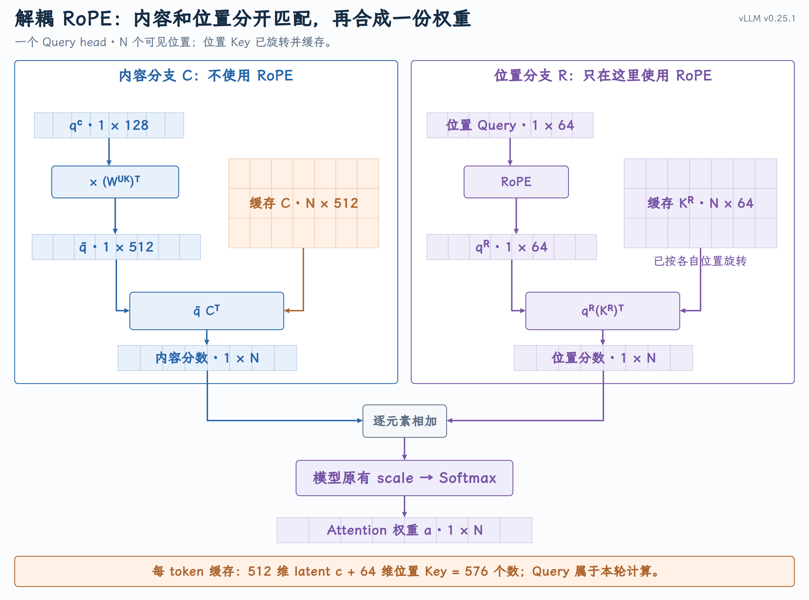
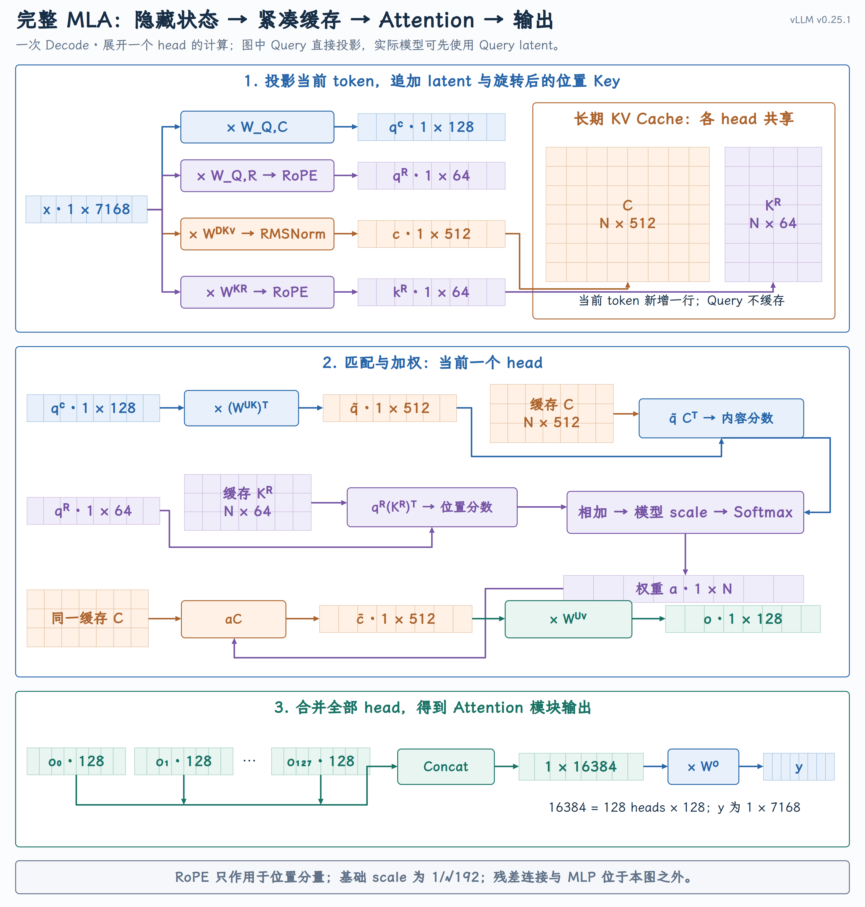

# MLA：低秩压缩、矩阵吸收与解耦 RoPE

MLA（Multi-head Latent Attention，多头潜在注意力）通过三项设计降低 Decode 的历史状态成本：低秩联合压缩减少 KV Cache，矩阵吸收避免反复展开历史 K/V，解耦 RoPE 在保留位置信息的同时维持吸收路径。

## 一、Decode 阶段的 KV Cache 容量与带宽瓶颈

FlashAttention 优化了 Attention 的执行，但模型仍然需要保存历史 K/V。固定一个请求、一个 Attention 层：当前 token 的 Query 要与所有可见位置的 Key 匹配，再对这些位置的 Value 加权。历史 token 的 K/V 已经生成，不必每轮重算，却必须在后续生成时继续可用。

对于 128 个 head、每个 Key/Value 各 128 维的 MHA 基线来说，每个 token、每层要保存：

$128\times(128+128)=32768$ 个数。

按 BF16、每个数 2 字节计算，共需要 64 KiB。一个请求有 16384 个历史 token 时，仅一层就需要 1 GiB。

这带来两项成本：**容量限制能够容纳的上下文和并发请求数，读取历史 K/V 则消耗显存带宽。**  GQA、MQA 已经提供了一种办法：减少独立的 KV head。GQA 让同组 Query head 读取相同的 K/V，MQA 让所有 Query head 共享一组 K/V。缓存因此变小，但同组 Query head 必须共用一组 K/V，无法像 MHA 那样使用各自独立的 K/V。这减少了各 head 独立表示信息的能力，可能带来精度损失。

**能否让各 head 保留不同的内容 K/V，同时只保存一份较小的共享信息？** 这就是 MLA 的出发点。

## 二、低秩联合压缩：从投影矩阵到共享 latent

{ width="100%" }

MLA 先将当前 token 的隐藏状态压缩为一个 512 维的 latent c，再由各 head 使用各自的上投影矩阵生成内容 K/V。**各 head 共享的是 c，生成的 K/V 仍然可以不同。**

由于内容 K/V 都能从 c 生成，每个 token、每层只需缓存 c 的 512 个数，无需保存展开后的 32768 个数，内容缓存因此缩小到原来的 **1/64** 。这里尚未计入位置 Key。

暂不考虑归一化，降维矩阵与全部 head 的上投影矩阵相乘，所得大矩阵的秩不超过 512：高维输出由 512 个中间分量线性组合而成。这些参数由训练学习，并非将已有 MHA 权重无损压缩。

缓存变小了，但如果每轮 Decode 都把历史 c 重新展开成 K/V，仍要反复执行历史投影。**能否直接利用缓存的 c 完成 Attention？**

## 三、矩阵吸收：重排投影与 Attention 计算

固定一个 head，暂不加入位置编码。将 N 个可见位置的 latent 按行排成 C，其形状为 $N\times L$；L = 512 是 latent 宽度，d = 128 是当前 head 的内容 Key、Value 宽度。当前内容 Query $q^C$ 为 $1\times d$。

直接计算时，先展开历史内容 K/V，再做 Attention：

$$
\begin{aligned}
K^C&=CW^{UK},\qquad V=CW^{UV},\\
a&=\operatorname{softmax}\!\left(\frac{q^C(K^C)^\top}{\sqrt d}\right),\\
o&=aV.
\end{aligned}
$$

$W^{UK}$、$W^{UV}$ 是当前 head 的 Key、Value 上投影矩阵，均为 $L\times d$。

$K^C$ 和 V 均为 $N\times d$；a 是 $1\times N$ 的注意力权重，Softmax 沿历史位置计算；o 为 $1\times d$。上标 C 表示内容分量，符号 ⊤ 表示转置。

{ width="100%" }

**矩阵吸收只改变同一个模型的计算顺序，数学结果不变。** 浮点实现可能存在舍入差异。

加入 RoPE 后，Key 侧还能这样吸收吗？

## 四、解耦 RoPE：让内容投影仍然可以吸收

我们希望直接用压缩后的 latent 计算，避免展开历史 K/V。但如果直接对内容 Key 做 RoPE，按原来的计算路径，就得先把 Key 展开，再按各自位置旋转。MLA 因此把位置分量单独拆出来：只旋转位置分支，内容分支继续用矩阵吸收，避免展开历史 K/V。

{ width="100%" }

### 解耦内容分支与位置分支

内容与位置分量沿特征维拼接，点积等于两路分数之和：

$$
\begin{aligned}
q&=[q^C,q^R],\qquad K=[K^C,K^R],\\
qK^\top&=q^C(K^C)^\top+q^R(K^R)^\top.
\end{aligned}
$$

$q^R$ 为 $1\times R$，$K^R$ 为 $N\times R$，R 表示位置分量的宽度。C/R 上标分别标记内容、位置分量。

位置分支也来自隐藏状态的投影，再施加 RoPE。两路分数相加、共同缩放后，只做**一次 Softmax** 。

### 完整 KV Cache 的容量对比

按每 token、每层的元素数比较：$n_h$ 为 Query head 数，$n_g$ 为 GQA 的 KV head 数；各机制的内容 Key、Value 宽度取 d，MLA 另保存 R 维位置 Key。

| 机制 | 缓存元素数 |
| --- | --- |
| MHA | $2n_hd$ |
| GQA | $2n_gd$ |
| MQA | $2d$ |
| MLA | $L+R$ |

取 $n_h=128$、d = 128、L = 512、R = 64，MLA 缓存占 MHA 基线的比例为：

$$
\frac{\text{MLA cache}}{\text{MHA baseline cache}}=\frac{512+64}{2\times128\times128}=\frac{576}{32768}\approx1.76\%.
$$

计入位置 Key 后，缓存占上述 MHA 基线的 1.76%；只计内容 latent 时为 1.56%。

按 BF16 计算，16384 个历史 token 的单层缓存为 18 MiB，MHA 基线为 1 GiB。

表中仅比较 KV 容量，不代表模型质量或总显存的比例。

## 五、完整 MLA：从隐藏状态到输出

{ width="100%" }

图中采用直接投影 Query 的简化路径。DeepSeek-V3 实际先将当前隐藏状态降到 1536 维并做 RMSNorm，再生成各 head 的内容、位置 Query；这份 Query latent 不写入 KV Cache。

图中的 Model scale 使用模型配置的缩放系数：基础分母仍为 $\sqrt{128+64}=\sqrt{192}$，不会因吸收后内容宽度变成 512 而改变。

## 六、用三个 token 核对完整计算

考虑一次 Decode：token 0、1 已有缓存，当前处理 token 2，可关注三个位置。使用便于手算的单 head 模型： H = 3、L = d = R = 2。内容与位置各占两维，所以完整 Q/K 为四维，分数除以 $\sqrt4=2$。

示例权重人为指定，省略 RMSNorm 和偏置，直接投影 Query；三个位置的 RoPE 角度取 $0,\pi/2,\pi$，用于验证计算，不代表实际模型配置。

### 生成当前 Query 与新缓存

所有位置的隐藏状态及本轮输入为：

$$
X=\begin{bmatrix}1&0&0\\0&1&0\\0&0&1\end{bmatrix},\qquad x_2=[0,0,1].
$$

X 为 $3\times3$，当前 $x_2$ 为 $1\times3$；前两行仅说明历史缓存的来源。取以下四个 $3\times2$ 投影矩阵：

$$
\begin{aligned}
W^{DKV}&=\begin{bmatrix}1&0\\0&1\\1&1\end{bmatrix},&
W^{Q,C}&=\begin{bmatrix}1&0\\0&1\\1&1\end{bmatrix},\\[4pt]
W^{Q,R}&=\begin{bmatrix}0&0\\0&0\\-1&0\end{bmatrix},&
W^{KR}&=\begin{bmatrix}0&1\\0&-1\\-1&-1\end{bmatrix}.
\end{aligned}
$$

行向量的旋转采用：

$$
[u,v]\mathcal R(\theta)=[u\cos\theta-v\sin\theta,\ u\sin\theta+v\cos\theta].
$$

u、v 是坐标分量，$\theta$ 是对应位置的旋转角。

当前 token 2 由此得到：

$$
\begin{aligned}
c_2&=x_2W^{DKV}=[1,1],\\
q^C&=x_2W^{Q,C}=[1,1],\\
q^R&=[-1,0]\mathcal R(\pi)=[1,0],\\
k_2^R&=[-1,-1]\mathcal R(\pi)=[1,1].
\end{aligned}
$$

各位置的缓存来源与状态如下；历史两行已在此前处理时完成计算：

| token | latent | 位置 Key 投影后、旋转前 | 旋转后的位置 Key | 本轮状态 |
| --- | --- | --- | --- | --- |
| 0 | $[1,0]$ | $[0,1]$ | $[0,1]$ | 已缓存 |
| 1 | $[0,1]$ | $[0,-1]$ | $[1,0]$ | 已缓存 |
| 2 | $[1,1]$ | $[-1,-1]$ | $[1,1]$ | 本轮追加 |

只把 $c_2$ 和 $k_2^R$ 追加到缓存，Query 留在本轮计算中。追加后：

$$
C=\begin{bmatrix}1&0\\0&1\\1&1\end{bmatrix},\qquad K^R=\begin{bmatrix}0&1\\1&0\\1&1\end{bmatrix}.
$$

### 展开路径：先恢复内容 K/V

当前 head 的两个 $2\times2$ 上投影矩阵为：

$$
W^{UK}=\begin{bmatrix}0&1\\2&0\end{bmatrix},\qquad W^{UV}=\begin{bmatrix}1&2\\3&0\end{bmatrix}.
$$

展开得到：

$$
K^C=CW^{UK}=\begin{bmatrix}0&1\\2&0\\2&1\end{bmatrix},\qquad V=CW^{UV}=\begin{bmatrix}1&2\\3&0\\4&2\end{bmatrix}.
$$

三个位置的内容分数、位置分数相加并缩放，得到 $1\times3$ 的分数向量 s：

$$
\begin{aligned}
q^C(K^C)^\top&=[1,2,3],\\
q^R(K^R)^\top&=[0,1,1],\\
s&=\frac{[1,2,3]+[0,1,1]}2=[0.5,1.5,2],\\
a=\operatorname{softmax}(s)&=\frac{[e^{-1.5},e^{-0.5},1]}{e^{-1.5}+e^{-0.5}+1}\\
&\approx[0.121952,0.331499,0.546549].
\end{aligned}
$$

a 的三个分量对应三个 token，之和为 1。对 V 加权，head 输出为：

$$
o=aV\approx[3.302646,1.337002].
$$

### 吸收路径：直接匹配和汇总 latent

保持同一组输入、权重和缓存，先变换当前 Query：

$$
\widetilde q=q^C(W^{UK})^\top=[1,2],\qquad\widetilde qC^\top=[1,2,3].
$$

内容分数与展开路径相同，位置分数也没有变化，所以直接使用刚才的 a。对 C 加权后再投影：

$$
\begin{aligned}
\overline c&=aC\approx[0.668501,0.878048],\\
o&=\overline cW^{UV}\approx[3.302646,1.337002].
\end{aligned}
$$

两条路径得到同一个二维 head 输出。**展开路径生成了两份历史矩阵，吸收路径只变换当前 Query 和一个加权结果。** 这里 C 和内容 K/V 恰好都宽 2；实际 L 与 d 可以不同，等价关系仍成立。

本例只有一个 head，取 $2\times3$ 的输出投影：

$$
\begin{aligned}
W^O&=\begin{bmatrix}1&0&1\\0&1&1\end{bmatrix},\\
y_2&=oW^O\approx[3.302646,1.337002,4.639648].
\end{aligned}
$$

$y_2$ 是本轮 $1\times3$ 的 Attention 模块输出，不包含外部残差连接和 MLP。至此，输入是当前隐藏状态 $x_2$ 与历史缓存，输出是 $y_2$，持久状态的变化是新增 token 2 的 latent 和位置 Key。

## 七、为什么 Decode 与 Prefill 采用不同执行路径

### 缓存小，不代表所有矩阵运算都更少

矩阵吸收省去了历史 K/V 的展开，但内容匹配与加权的宽度从 128 变成了 512。两种路径的取舍，在于省下的投影能否抵消更宽的 Attention 计算：

- **Decode：** 每个请求通常只有一个新 Query，避免为它展开全部历史 K/V 更划算。

- **Prefill：** 一批 Query 可以复用展开后的 K/V，并在较窄的维度上完成匹配与加权，因此临时展开可能更合适。

两种路径计算的是同一个模型，持久缓存也相同；具体性能取决于输入规模、内核和硬件。

### vLLM 中的缓存与执行路径

以下对应 **vLLM v0.25.1** 的单 GPU、未量化、全可见位置 MLA 路径。用公共 Prefill 实现和 Triton MLA Decode 说明，实际 backend 还由设备与配置决定。

**1. 当前 token 生成 Query 和新缓存。** [MLA wrapper](https://github.com/vllm-project/vllm/blob/v0.25.1/vllm/model_executor/layers/mla.py#L131-L182)先做输入投影；`kv_c_normed`对应当前 token 的 c，`k_pe` 对应旋转后的位置 Key。Query 直接投影或经过 Query latent，再拆成内容与位置部分。只有位置部分进入 RoPE。

缓存宽度设为 [`kv_lora_rank + qk_rope_head_dim`](https://github.com/vllm-project/vllm/blob/v0.25.1/vllm/model_executor/layers/attention/mla_attention.py#L373-L386) ，即 L + R。[缓存更新](https://github.com/vllm-project/vllm/blob/v0.25.1/vllm/v1/attention/backend.py#L1089-L1112)将 c 与位置 Key 拼接，按 `slot_mapping`写入分页缓存；历史通过 `block_table`寻址。Prefill、Decode 保存的是同一种表示。

**2. Prefill 临时展开 K/V。** [`forward_mha()`](https://github.com/vllm-project/vllm/blob/v0.25.1/vllm/model_executor/layers/attention/mla_attention.py#L2371-L2392) 使用 `kv_b_proj`从 latent 生成内容 K/V，拼入位置 Key 后交给 Prefill backend。已有历史可以[按 chunk 收集并展开](https://github.com/vllm-project/vllm/blob/v0.25.1/vllm/model_executor/layers/attention/mla_attention.py#L2116-L2199)，在临时 workspace 中计算，再归并各块结果；展开结果不因此变成长期缓存。

**3. Decode 直接使用 latent。** [Key 侧变换](https://github.com/vllm-project/vllm/blob/v0.25.1/vllm/model_executor/layers/attention/mla_attention.py#L777-L792)用 `torch.bmm` 计算 $\widetilde q=q^C(W^{UK})^\top$。[Triton MLA 后端](https://github.com/vllm-project/vllm/blob/v0.25.1/vllm/v1/attention/backends/mla/triton_mla.py#L234-L256)将缓存中的 latent 与位置 Key 用于匹配，把 latent 用于加权；返回 $\overline c$ 后，[Value 上投影](https://github.com/vllm-project/vllm/blob/v0.25.1/vllm/model_executor/layers/attention/mla_attention.py#L1012-L1034)计算 $o=\overline cW^{UV}$，wrapper 最后调用 `o_proj` 。

这条路径中的“吸收”通过运行时乘法改变执行顺序，并不要求预先合并所有权重；缓存始终保存 latent 与位置 Key。
