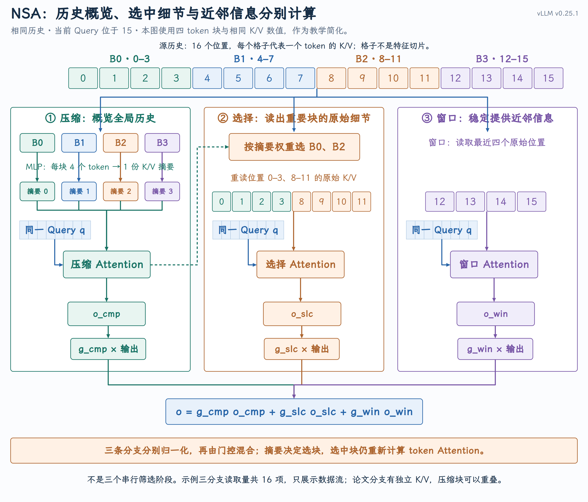
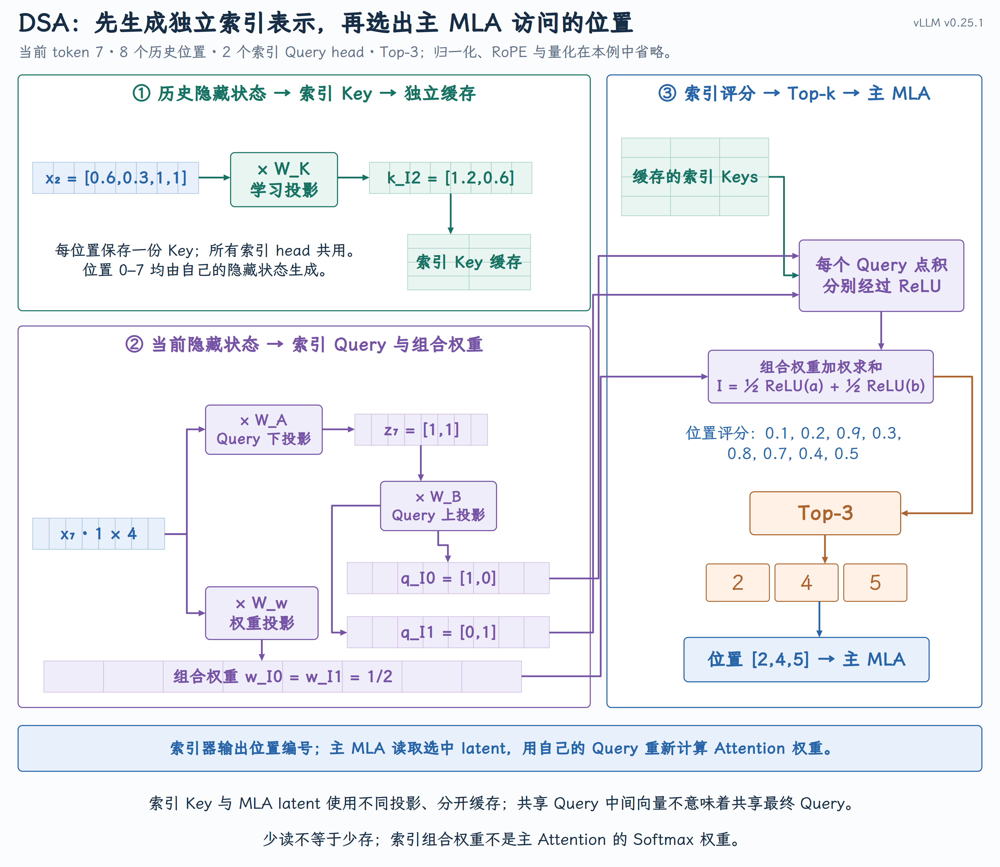

# 稀疏 Attention：选择性访问与高效计算

长文档问答、代码仓库分析和多轮对话，都会让模型面对越来越长的历史。FlashAttention 改进计算与搬运方式， MLA 减小每条历史记录；稀疏 Attention 则进一步追问：**每次真的需要读取和计算全部历史吗？**

稀疏 Attention 减少每个 Query 参与匹配的历史位置。问题有两层：**选哪些位置，才能保留有用信息；怎样执行，才能把少算变成更低的延迟。**

## 一、实验依据：注意力权重的集中与变化

稀疏计算的一个重要依据，是实验中观察到的权重集中现象。

[Sparse Transformer（2019）](https://arxiv.org/abs/1904.10509) 可视化图像建模中完整 Transformer 学到的 Attention，发现部分 head 关注少量位置，并呈现规则的连接形状；随后设计稀疏结构并验证建模效果。

[H₂O（2023）§3、图 2](https://arxiv.org/html/2306.14048v2#S3) 观察到累计 Attention 权重呈长尾分布：少量 token 获得大量关注，移除这些 Heavy Hitters 会明显损害任务表现。它据此保留重要与最近 token、淘汰其他 KV。这里支持的是重要性不均匀；淘汰缓存与只跳过本轮读取，是不同的工程选择。

[MInference（2024）§2.1、图 2](https://arxiv.org/html/2407.02490v1#S2.SS1) 分析了 LLaMA-3-8B 在 128K 上下文中的 Attention 权重：从矩阵中选取权重最集中的 4096 列，可以覆盖 **96.8% 的权重总量** 。这些列对应被关注的 Key 位置；将同一组位置用于另一个输入，覆盖率降到 **83.7%** 。

这给出两个实测观察：**权重可以集中在少量位置，但重要位置随输入变化。** 它支持稀疏计算的可能性，不代表所有层、head 和输入都有相同集中程度，也不意味着未选位置的权重为零。

用两个简化分布说明这种区别：

| 八个历史位置上的权重 | 只保留最大的两项 | 保留的概率质量 |
| --- | --- | --- |
| `[0.45,0.45,0.02,0.02,0.02,0.02,0.01,0.01]` | 前两项 | 90% |
| 八项都为 `1/8` | 任意两项 | 25% |

对于表中的两种分布，要保留至少 90% 的概率质量，集中分布只需选取 2 个历史位置，均匀分布则需选取全部 8 个位置。但权重覆盖率不等于模型能力：输出误差还取决于 Value，最终效果需要任务验证。

减少连接有两条路线：对已有完整 Attention 模型做推理期近似，或让模型从训练时就适应稀疏访问。前者需要评估改造后的效果，后者把访问规则纳入模型学习。

## 二、固定访问：滑动窗口与远距离信息

**Sliding Window Attention（SWA，滑动窗口注意力）** 让每个 Query 只访问附近的一段位置。

假设当前 token 位于 7，窗口大小为 4（包含当前位置），只访问位置 4–7；移到位置 8，就访问 5–8。窗口范围由位置直接确定，无需先对历史 token 评分来决定访问哪些位置；选定后仍正常计算窗口内的 Attention 分数与输出。每次只访问一段连续的历史位置。随着窗口向前移动，后续不再使用的旧 KV 可以回收。不过，位置 2 在窗口之外，当前层的 Query 无法直接访问它的 KV。

为了保留远距离通路，Allen AI 的 [Longformer（2020）](https://arxiv.org/abs/2004.05150) 在局部窗口外增加少量全局 token，Google 的 [BigBird（2020）](https://arxiv.org/abs/2007.14062) 再引入随机连接。它们通过预设连接规则传递远处信息。

固定规则容易执行，却不能按内容判断重要性。**距离近不总意味着更重要；要直接找回窗口外的相关内容，就需要动态选择。**

## 三、动态选择：给已有模型增加稀疏推理

动态选择先以较低成本估计重要位置，再执行主 Attention。筛选本身必须比省下的工作便宜，下面两篇论文分别面向 Prefill 与 Decode。

### MInference：减少长输入的 Prefill 计算

微软团队的 [MInference（2024）](https://arxiv.org/abs/2407.02490) 先离线为各 head 选择稀疏模式：开头与近邻、重要列与斜线，或局部块。在线时，固定模式直接使用；动态模式通过少量 Query 或分块汇聚的 Q/K 估计要计算的位置，再交给对应的稀疏 GPU 内核。**它主要减少长 Prefill 中的 Query–Key 配对计算。**

### Quest：减少 Decode 的 KV 读取

MIT 团队的 [Quest（2024）](https://arxiv.org/abs/2406.10774) 为每页 Key 保存各特征维度的最小值、最大值。每次 Decode 用当前 Query 扫描这些摘要，选出重要页，再读取其完整 K/V 执行 Attention。**它主要减少完整 KV 的读取量；未选页仍保留，下一轮可以重新选中。**

两者都在已有模型上引入推理期近似，不要求重新训练；少读、少算后的任务效果仍需验证。

## 四、训练适配：NSA 的算法与硬件协同

推理期近似改变了模型原本可见的信息。要让模型主动适应这个限制，可以在训练时就采用稀疏访问，并围绕 GPU 的执行方式设计它。

DeepSeek 团队于 2025 年提出 [Native Sparse Attention（NSA）](https://arxiv.org/abs/2502.11089)，用三条分支分担信息获取：**压缩分支概览历史，选择分支读取重要块的原始细节，窗口分支稳定提供近邻信息。** 独立的窗口分支让另两条分支可以更专注于远距离内容；三者共同参与训练。

{ width="100%" }

### 用 16 个位置走完一次 NSA

沿上图计算位置 15 的一次 Attention：历史位置 0–15 分为 B0–B3，每块四个 token；选择分支本次选取两个块，窗口分支本次访问最近四个位置 12–15。

为便于手算，只展示一个 Query head，将 Query、Key 简化为一维，Value 简化为二维，取 $q=1$，缩放因子为 1。下面给出压缩 MLP 的具体参数，从输入算出摘要，再接上后续 Attention。

本例使用四 token、无重叠的压缩块，并与选择块对齐。论文三条分支有独立 K/V；本例仅令对应数值相同以便核对，门控值也直接给定。这些数值用于演示，不是论文模型的实际参数。

| 块 | 位置 | 四个 token 的 Key | 四个 token 的 Value |
| --- | --- | --- | --- |
| B0 | 0–3 | $[\ln2,\ln2,\ln8,\ln8]$ | $[2,0],[0,2],[2,0],[0,2]$ |
| B1 | 4–7 | $[0,0,0,0]$ | 四项均为 $[0,0]$ |
| B2 | 8–11 | $[\ln2,\ln2,\ln2,\ln2]$ | 四项均为 $[2,0]$ |
| B3 | 12–15 | $[0,0,0,0]$ | 四项均为 $[0,2]$ |

**① 压缩：用 MLP 将每块 K/V 映射成摘要。** 按论文的方法，压缩器是带块内位置编码的可学习 MLP：多个 Key 汇聚成一个 Key，Value 同样处理；减少的是位置数量，摘要 Key 仍能与 Query 点积。论文实验使用块长 32、步长 16，相邻压缩块重叠；本例缩成四 token 一块且不重叠，方便逐块核对。[论文 §3.3.1、§4.1](https://arxiv.org/html/2502.11089v2#S3.SS3.SSS1)

将块内向量按位置顺序展开成列向量 $z$，用下面的两层教学 MLP 计算摘要：

$$
\varphi(z)=W_2\operatorname{ReLU}(W_1z+b_1)+b_2.
$$

ReLU 将负数变成 0，非负数保持不变。手算暂时省略块内位置编码；以下层数、激活函数和权重是教学设定，不是论文的具体网络配置，实际权重通过训练学习。

Key 输入为 $z_K=[k_0,k_1,k_2,k_3]^\top$。下面两个矩阵分别是第一层、第二层的权重；下标 K 表示压缩 Key。取：

$$
W_{1K}=[1/4\quad1/4\quad1/4\quad1/4],\quad W_{2K}=[1],\quad b_{1K}=b_{2K}=0.
$$

B0 输入的四个 Key 有两种不同数值。第一层将它们组合，再经 ReLU 和第二层得到摘要：

$$
\begin{aligned}
u_K&=\tfrac14(\ln2+\ln2+\ln8+\ln8)=\ln4,\\
\widetilde k_0&=1\times\operatorname{ReLU}(\ln4)=\ln4.
\end{aligned}
$$

摘要 Key 为 $\ln4$，既不是原始的 $\ln2$，也不是 $\ln8$：它是整块信息经过网络映射得到的新表示。这组教学参数在非负输入上恰好计算均值；一般训练得到的 MLP 不限于平均。

Value 输入为 $z_V=[v_{0,1},v_{0,2},\ldots,v_{3,1},v_{3,2}]^\top$，取：

$$
\begin{aligned}
W_{1V}&=\begin{bmatrix}1&0&1&0&1&0&1&0\\0&1&0&1&0&1&0&1\end{bmatrix},\\
b_{1V}&=\begin{bmatrix}-2\\-2\end{bmatrix},\qquad W_{2V}=\tfrac12I_2,\qquad b_{2V}=0.
\end{aligned}
$$

以 B0 为例，四个 Value 按位置顺序展开为八维输入：

$$
z_V=[2,0,0,2,2,0,0,2]^\top.
$$

第一层权重的第一行只取各 token 的第一个特征，第二行只取第二个特征，分别相加：

$$
W_{1V}z_V=\begin{bmatrix}2+0+2+0\\0+2+0+2\end{bmatrix}=\begin{bmatrix}4\\4\end{bmatrix}.
$$

加上偏置，相当于两个分量各减去 2；经 ReLU 后仍为正数，再由第二层各乘以 1/2：

$$
\begin{aligned}
W_{1V}z_V+b_{1V}&=\begin{bmatrix}4\\4\end{bmatrix}+\begin{bmatrix}-2\\-2\end{bmatrix}=\begin{bmatrix}2\\2\end{bmatrix},\\
u_V&=\operatorname{ReLU}\!\left(\begin{bmatrix}2\\2\end{bmatrix}\right)=\begin{bmatrix}2\\2\end{bmatrix},\\
\widetilde v_0&=W_{2V}u_V+b_{2V}=\tfrac12I_2\begin{bmatrix}2\\2\end{bmatrix}=\begin{bmatrix}1\\1\end{bmatrix}.
\end{aligned}
$$

同一组压缩器参数作用于其余三块，得到四份摘要 K/V：

| 块 | 压缩 Key | 压缩 Value |
| --- | --- | --- |
| B0 | $\ln4$ | $[1,1]$ |
| B1 | $0$ | $[0,0]$ |
| B2 | $\ln2$ | $[3,0]$ |
| B3 | $0$ | $[0,3]$ |

摘要生成后，由位置 15 的当前隐藏状态投影得到这个 head 的 **Query（查询向量）** ，用于判断当前 token 应关注哪些摘要。本例将 Query 简化为一维并取 $q=1$，四份摘要共用这一个 Query。

上标 **cmp 是 compression（压缩）的缩写** ，表示压缩分支，不是乘方。下面的 s 表示匹配分数，p 表示四个块上的 Attention 权重，o 表示该分支的输出；带波浪号的 k、v 是 MLP 生成的摘要。对第 i 块，先写一般公式：

$$
\begin{aligned}
s_i^{\mathrm{cmp}}&=\frac{q\cdot\widetilde k_i}{\sqrt{d_k}},\\
p_i^{\mathrm{cmp}}&=\frac{\exp(s_i^{\mathrm{cmp}})}{\sum_{j=0}^3\exp(s_j^{\mathrm{cmp}})},\\
o^{\mathrm{cmp}}&=\sum_{i=0}^3p_i^{\mathrm{cmp}}\widetilde v_i.
\end{aligned}
$$

本例 Query、Key 的维度为 1，缩放因子也为 1。代入四个摘要 Key，得到分数，再求指数、归一化，最后对摘要 Value 加权：

$$
\begin{aligned}
s^{\mathrm{cmp}}&=[1\times\ln4,1\times0,1\times\ln2,1\times0]=[\ln4,0,\ln2,0],\\
\exp(s^{\mathrm{cmp}})&=[4,1,2,1],\\
p^{\mathrm{cmp}}&=\frac{[4,1,2,1]}{4+1+2+1}=[1/2,1/8,1/4,1/8],\\
o^{\mathrm{cmp}}&=\tfrac12[1,1]+\tfrac18[0,0]+\tfrac14[3,0]+\tfrac18[0,3]=[5/4,7/8].
\end{aligned}
$$

**② 选择：按摘要权重选 B0、B2，重新计算八个原始位置。** 复用上一步压缩分支的 Softmax 权重：B0、B1、B2、 B3 分别为 1/2、1/8、1/4、1/8。本次只选两块，B0 的 1/2 和 B2 的 1/4 最大，因此选中 B0、B2。

读出位置 0–3、8–11 的原始 K/V，重新做 Attention：B0 四项的指数权重为 $[2,2,8,8]$，B2 四项各为 2。归一化分母为：

$$
Z=2+2+8+8+4\times2=28.
$$

$$
\begin{aligned}
o^{\mathrm{slc}}&=\frac{2[2,0]+2[0,2]+8[2,0]+8[0,2]+4(4[2,0])}{28}\\
&=[9/7,5/7].
\end{aligned}
$$

摘要只决定读哪些块；选中块内部仍重新计算 token 权重，不沿用摘要权重，也不从摘要还原 Value。

**③ 窗口：独立读取 B3，得到最近信息。** 位置 12–15 的分数都是 0，Softmax 权重各为 $1/4$，因此 $o^{\mathrm{win}}=[0,2]$ 。三条分支各自归一化，不能把全部位置拼在一起做一次 Softmax。

**④ 门控：将三个输出加权相加。** 当前隐藏状态还会通过 MLP 与 sigmoid 产生门控值。假设本次三个门控值分别为 1/2、3/4、1/4，代入计算：

$$
\begin{aligned}
g^{\mathrm{cmp}}&=1/2,\qquad g^{\mathrm{slc}}=3/4,\qquad g^{\mathrm{win}}=1/4,\\
o&=g^{\mathrm{cmp}}o^{\mathrm{cmp}}+g^{\mathrm{slc}}o^{\mathrm{slc}}+g^{\mathrm{win}}o^{\mathrm{win}}\\
&=\tfrac12[5/4,7/8]+\tfrac34[9/7,5/7]+\tfrac14[0,2]\\
&=[89/56,165/112].
\end{aligned}
$$

门控值分别由 sigmoid 产生，**不要求相加等于 1** 。这就是当前 head 的 NSA 输出；随后按多头 Attention 的常规方式拼接各 head 输出并做输出投影。

本轮 B1 只通过压缩摘要参与，B0、B2 提供原始细节，B3 提供近邻信息。小例子用于展示数据流；四份摘要、八个选中位置、四个窗口位置合计仍为 16 项，不能据此声称计算更少。长序列下，选块与窗口预算相对历史长度足够小，才有稀疏收益。

推理时，**摘要由历史块的 K/V 生成，不依赖当前 Query** 。一个历史块完成后，其摘要可以生成并缓存，后续 Query 直接复用；新增 token 形成新的完整压缩块时，再增量生成摘要，不必每轮重新压缩全部历史。当前 Query 在本轮三个分支间复用，但下一轮 token 会产生新的 Query；匹配分数、权重和选块结果也要重新计算。这样每轮主要读取摘要、选中块与窗口内的 K/V，而非扫描全部原始历史。[论文 §3.3.1、§5.2](https://arxiv.org/html/2502.11089v2#S5.SS2)

## 五、DSA：从隐藏状态生成索引，再选择访问位置

[DeepSeek-V3.2](https://arxiv.org/html/2512.02556v1#S2.SS1) 在 MLA 前增加 **Lightning Indexer（轻量索引器）** ，构成 DeepSeek Sparse Attention（DSA）。它用独立的索引表示筛选位置，再将位置列表交给主 MLA。

下面用八个位置走完索引器：**历史隐藏状态生成索引 Key → 当前隐藏状态生成索引 Query 和组合权重 → 匹配评分 → Top-k 选择。** 当前 token 位于 7，可访问位置 0–7，只选三个位置。

为便于手算，隐藏状态取四维。**当前 token 生成两份二维索引 Query，分别对应 head 0 和 head 1。每个历史位置只保存一份二维索引 Key，两份 Query 都与这份 Key 匹配。** 对每个历史位置，两个匹配结果分别经过 ReLU，再加权汇总成一个位置分数。这是教学配置，不是 DSA 固定要求；例子只展开线性投影、评分与选择，省略归一化、RoPE 和量化。

{ width="100%" }

### ① 历史隐藏状态 → 索引 Key → 缓存

每个 token 经过当前层前面的计算，得到隐藏状态 x。索引器用同一份投影矩阵 $W_K$，将各位置的隐藏状态变成索引 Key。本例取：

$$
W_K=\begin{bmatrix}2&0\\0&2\\0&0\\0&0\end{bmatrix},\qquad k_{Ir}=x_rW_K.
$$

下标 I 表示索引器，r 是位置编号。例如位置 2：

$$
x_2=[0.6,0.3,1,1]\quad\Longrightarrow\quad k_{I2}=[1.2,0.6].
$$

这份投影把隐藏状态的前两个分量分别乘以 2，后两个分量不参与。其余位置也用同一矩阵生成：

| 位置 | 隐藏状态 x | 生成的索引 Key |
| --- | --- | --- |
| 0 | `[-0.5,0.1,1,1]` | `[-1,0.2]` |
| 1 | `[0.1,0.1,1,1]` | `[0.2,0.2]` |
| 2 | `[0.6,0.3,1,1]` | `[1.2,0.6]` |
| 3 | `[0.3,0,1,1]` | `[0.6,0]` |
| 4 | `[0.5,0.3,1,1]` | `[1,0.6]` |
| 5 | `[0.2,0.5,1,1]` | `[0.4,1]` |
| 6 | `[0.4,0,1,1]` | `[0.8,0]` |
| 7 | `[0.25,0.25,1,1]` | `[0.5,0.5]` |

生成后写入图中的 `Index Key cache` ：**每个位置缓存一个索引 Key，供所有索引 head 共用。** 后续 Query 直接读缓存，不必重新投影历史隐藏状态。索引 Key 与主 MLA 的 latent 使用不同投影、分开缓存。

### ② 当前隐藏状态 → 索引 Query 与组合权重

当前隐藏状态为 $x_7=[0.25,0.25,1,1]$，分成两条路径。

**Query 路径：先得到 Query latent，再生成两个 head 的 Query。** 本例用 $W_A$ 取出最后两个分量，再用 $W_B$ 输出四个分量：前两个组成 head 0 的 Query，后两个组成 head 1 的 Query：

$$
\begin{aligned}
W_A&=\begin{bmatrix}0&0\\0&0\\1&0\\0&1\end{bmatrix},&
W_B&=\begin{bmatrix}1&0&0&0\\0&0&0&1\end{bmatrix},\\
z_7&=x_7W_A=[1,1],\\
[q_{I0},q_{I1}]&=z_7W_B=[1,0,0,1],\\
q_{I0}&=[1,0],\qquad q_{I1}=[0,1].
\end{aligned}
$$

图中的 I0、I1 表示索引 Query 的 head 0、1。实际模型先将当前隐藏状态降维并归一化，得到一个中间向量；再用两套不同的投影，分别生成主 MLA Query 和索引 Query。**两者共用的是中间向量，不是最终的 Query。** 本例上式也先得到中间向量，再通过索引器的投影生成两份 Query；归一化已省略。

**权重路径：从当前隐藏状态直接生成两个 head 的组合权重。** 它与 Query 路径并行：

$$
\begin{aligned}
W_w&=\begin{bmatrix}0&0\\0&0\\1/2&0\\0&1/2\end{bmatrix},\\
[w_{I0},w_{I1}]&=x_7W_w=[1/2,1/2].
\end{aligned}
$$

这些权重用于组合两个索引 head 的评分，不是主 Attention 的 Softmax 权重。例子中的矩阵是便于手算的参数；实际投影参数通过训练学习，Query 和组合权重随当前 token 改变。

### ③ 索引匹配 → 位置评分 → Top-k

用当前两个索引 Query 与缓存中的每个索引 Key 点积，经 ReLU 后加权。索引 Key 的两个分量记为 a、b：

$$
\begin{aligned}
k_{Ir}&=[a_r,b_r],\\
I_{7,r}&=\sum_{j=0}^1w_{Ij}\operatorname{ReLU}(q_{Ij}\cdot k_{Ir})\\
&=\tfrac12\operatorname{ReLU}(a_r)+\tfrac12\operatorname{ReLU}(b_r).
\end{aligned}
$$

例如位置 2：两个 head 的点积分别为 1.2、0.6，组合后为 `(1.2+0.6)/2=0.9` 。位置 0 的负分量经 ReLU 变成 0，分数为 `(0+0.2)/2=0.1` 。

| 位置 | 0 | 1 | 2 | 3 | 4 | 5 | 6 | 7 |
| --- | --- | --- | --- | --- | --- | --- | --- | --- |
| 索引分数 | 0.1 | 0.2 | **0.9**  | 0.3 | **0.8**  | **0.7**  | 0.4 | 0.5 |

最高三项为 0.9、0.8、0.7，Top-3 输出位置列表 `[2,4,5]` 。**索引器输出位置编号，不输出主 Attention 的权重，也不产生用于融合的 Attention 输出。**

接下来沿用[第5课的 MLA](MLA：低秩压缩、矩阵吸收与解耦RoPE.md)：读取位置 2、4、5 的 latent，用主 Query 重新计算 Attention 权重并生成输出。本轮 Softmax 只在选中位置上归一化，因此输出不再与完整 Attention 严格相同。

实际索引 Key 的生成还包括 **线性投影 → LayerNorm → 部分维度应用 RoPE → Hadamard 变换 → FP8 量化并缓存** 。这些处理没有在手算例子中展开。[官方 Indexer 实现](https://huggingface.co/deepseek-ai/DeepSeek-V3.2-Exp/blob/main/inference/model.py#L650-L702)

实际配置最多选择 2048 个位置；索引器仍要扫描候选历史，以较少的 head 和 FP8 降低开销。其筛选能力来自训练：先学习完整 Attention 的重要性分布，再与主模型一起适应稀疏访问。

**少读不等于少存，也不意味着延迟同比下降。** 未选位置仍保存在缓存中，后续 Query 可能重新选中它们；索引评分、Top-k、分散读取和模型其他层仍有开销，因此不能按访问位置的减少倍数推算端到端加速。

## 六、vLLM 的 DSA 执行路径

以 **vLLM v0.25.1 的 DSA / FlashMLA 稀疏路径** 为例，接着看位置列表 `[2,4,5]`如何传给后端并用于缓存读取。

| 步骤 | 实际传递的内容 | 核心实现 |
| --- | --- | --- |
| 生成索引表示 | 当前索引 Query、历史索引 Key 缓存 | 模型侧 [`Indexer`](https://github.com/vllm-project/vllm/blob/v0.25.1/vllm/model_executor/models/deepseek_v2.py#L644-L715) |
| 评分与选择 | 每个 Query 对应的 `topk_indices_buffer` | [`sparse_attn_indexer()`](https://github.com/vllm-project/vllm/blob/v0.25.1/vllm/model_executor/layers/sparse_attn_indexer.py#L295) |
| 找到缓存并计算 | 请求信息、页表、选中位置与主 MLA 缓存 | [FlashMLA 稀疏后端](https://github.com/vllm-project/vllm/blob/v0.25.1/vllm/v1/attention/backends/mla/flashmla_sparse.py#L609-L634) |
