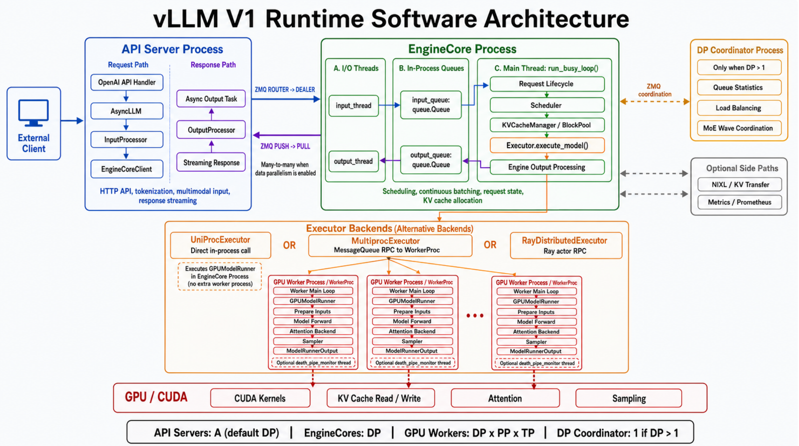

## vLLM V1整体架构



一个请求会跨越四层边界:**模块是代码职责边界,线程是并发边界,进 程是内存隔离边界,GPU 是设备边界**

| 边界 | 通信双方 | 通信方式 |
| --- | --- | --- |
| 网络 | Client ↔ API Server | HTTP/gRPC |
| 进程 | API Server ↔ EngineCore | ZMQ |
| 线程 | EngineCore I/O Thread ↔ Main Thread | queue.Queue |
| 进程，可选 | EngineCore ↔ WorkerProc | MessageQueue RPC |
| 设备 | GPUModelRunner ↔ GPU | CUDA kernel launch |

> 这里要特别区分:
>
> - `InputProcessor` 、`Scheduler` 、`KVCacheManager` 是**模块**。
>
> - `input_thread`、EngineCore main thread、`output_thread` 是线程。
>
> - API Server、EngineCore、WorkerProc 是**进程**。
>
> - GPU 是独立的**硬件执行设备**。
>
> 模块之间不一定跨线程,线程之间不一定跨进程

### 1. Client 请求进入 API Server

客户端通过 OpenAI Compatible API 发起请求：`POST /v1/chat/completions`

API Server 负责:

- 解析 HTTP 和 OpenAI 请求格式

- 应用 chat template

- tokenize

- 处理图片等多模态输入

- 创建采样参数

- 把结果流式返回客户端

API Handler 最终调用 [AsyncLLM.generate()](https://github.com/vllm-project/vllm/blob/v0.25.1/vllm/v1/engine/async_llm.py#L524)

> 这里主要运行在**API Server的asyncio主线程**中：
>
> ```python
> HTTP handler coroutine
>   -> AsyncLLM.generate() coroutine
>   -> AsyncLLM.add_request() coroutine
> ```
>
> 它们是多个 asyncio Task,并不是每个请求创建一个操作系统线程

### 2. InputProcessor 创建 EngineCoreRequest

在 AsyncLLM.add_request() 中，请求会经过[InputProcessor.process_inputs()](https://github.com/vllm-project/vllm/blob/v0.25.1/vllm/v1/engine/async_llm.py#L349)

输入大致发生如下转换:

```python
Prompt / messages + SamplingParams + LoRA / multimodal metadata
  -> EngineCoreRequest
```

`EngineCoreRequest` 是 API Server 与 EngineCore 之间的协议对象,包含:

- `request_id`

- `prompt_token_ids`

- sampling parameters

- multimodal inputs

- priority

- arrival time

- LoRA/KV transfer 等元数据

这里仍然没有发生进程通信,只是 API Server 进程内部的普通函数调用。

### 3. API Server 同时建立输出状态

创建EngineCoreRequest后，执行[AsyncLLM.\_add_request()](https://github.com/vllm-project/vllm/blob/v0.25.1/vllm/v1/engine/async_llm.py#L400-L412)：

```python
self.output_processor.add_request(...)
await self.engine_core.add_request_async(request)
```

顺序非常重要：

1. 先在 `OutputProcessor` 中登记请求。
2. 再把请求发送给 EngineCore。

因此同一个逻辑请求,在 API Server 中会有一个输出侧状态:

```python
OutputProcessor.request_states[request_id]
```

它负责后续的:

- detokenization

- stop string 检查

- logprobs 处理

- 流式输出状态

- 请求完成后的清理

### 4. EngineCoreClient 跨进程发送请求

`EngineCoreClient` 是 API Server 内部组件,不是单独进程。

入口是 [AsyncMPClient.add_request_async()](https://github.com/vllm-project/vllm/blob/v0.25.1/vllm/v1/engine/core_client.py#L1121-L1124),内部调用 [\_send_input()](https://github.com/vllm-project/vllm/blob/v0.25.1/vllm/v1/engine/core_client.py#L1064-L1099)

它把请求编码成:

```python
RequestType.ADD
  + msgpack(EngineCoreRequest)
  + optional tensor buffers
```

然后通过 ZMQ 发送:

```python
API Server Process                    EngineCore Process
EngineCore Client                     input_thread
ZMQ ROUTER ──────────────——————————─→ ZMQ DEALER
```

这是第一个真正的**进程边界**。

这里传递的是序列化数据。EngineCore 收到的对象不是 API Server 中原来的 Python 对象。

### 5. EngineCore input_thread 接收请求

EngineCore 的输入线程运行 [process_input_sockets()](https://github.com/vllm-project/vllm/blob/v0.25.1/vllm/v1/engine/core.py#L1484)

它负责:

```python
ZMQ recv_multipart()
  -> 判断 EngineCoreRequestType
  -> MsgpackDecoder.decode()
  -> preprocess_add_request()
  -> input_queue.put()
```

这里需要明确线程边界:

```python
input_thread
 │
 │ queue.Queue
 ▼
EngineCore main thread
```

`input_thread` 只负责 I/O、反序列化和轻量预处理，不负责执行调度算法。

### 6. EngineCore 主线程接管请求